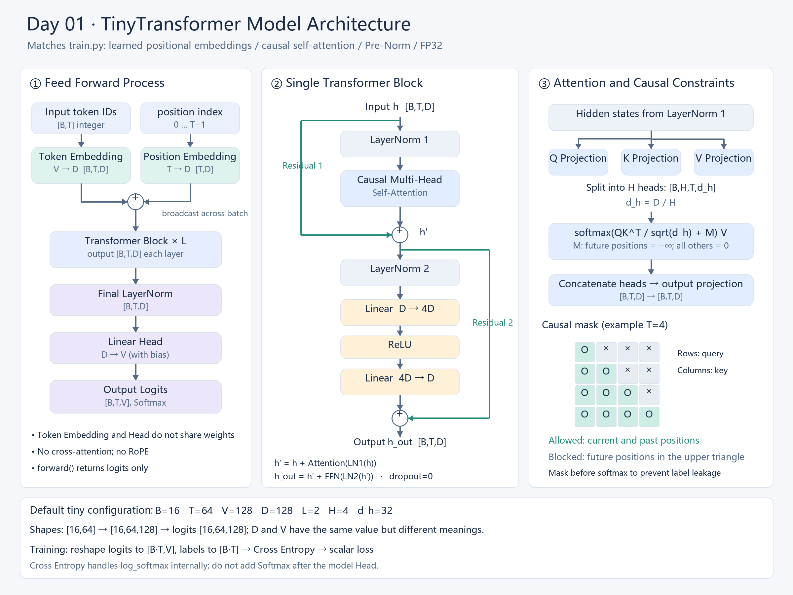

# Day 01 — Reproducible single-GPU baseline

> Setup: three machines, all FP32 with TF32 disabled, CUDA 13.0.
> - **Laptop:** RTX 5060 Laptop GPU (8 GB, sm_120), Windows 11, Python 3.13.15, torch 2.13.0+cu130, cuDNN 9.20.
> - **Desktop:** RTX 4090 (48 GB variant, sm_89) + AMD Ryzen 9 9950X, Linux 7.0, Python 3.14.4, torch 2.14.1+cu130, cuDNN 9.24.
> - **Server:** RTX 5090 (32 GB, sm_120) + 2× Intel Xeon Platinum 8380, Linux 5.15, Python 3.10.12, torch 2.14.1+cu130, cuDNN 9.24. One GPU used.
> Code: [`experiments/day01_single_gpu/`](../experiments/day01_single_gpu/README.md)

## 1. What systems problem did I solve today?

I built a reproducible single-GPU training baseline whose training state, memory usage and performance measurements I can explain.

The baseline supports checkpointing and resuming, records steady-state step time and throughput, and measures peak GPU memory. It provides a reference for later experiments involving distributed training, state sharing, and activation checkpointing.

The main lesson is that a trustworthy baseline requires more than a decreasing loss: it also requires correct state restoration, explicit measurement boundaries, and evidence that the checks can detect errors.

## 2. The mechanism in my own words

A training step consists of clearing gradients, running forward, computing the loss, running backward, and updating parameters.

Parameters remain allocated throughout training. Forward saves tensors required by backward. Backward consumes these tensors, produces temporary activation gradients, and accumulates parameter gradients. Adam lazily creates its first and second moment tensors at the first optimizer step.

For FP32 parameters occupying P bytes:

- Parameters and Adam moments require approximately 3P
- Retained parameter gradients add approximately P
- Activations, temporary tensors, workspaces, and allocation overhead increase actual memory usage.

Measured on the medium preset, the memory that stays between steps is 3P + 64 MiB (two cuBLAS workspaces) + about 2 MiB of allocator rounding = 380.19 MiB, not 3P = 314 MiB. See Question 1 in the deep dives.

The peak depends on which tensors coexist, rather than simply adding every category's maximum size.

A checkpoint restores model parameters, optimizer state, scheduler state, RNG (random generator) state, and the completed-step counter. Here, each batch is generated from the seed and step, so no separate data-loader position is required.

There are two kinds of warmup. Learning-rate warmup changes the training algorithm. Measurement warmup only excludes initial steps from steady-state statistics.

## 3. Call chain traced (pytorch v2.13.0 as installed, `torch/optim/{optimizer,adam,adamw}.py`)

The GUIDE's line numbers refer to v2.14.1. In the installed version, I found each symbol by name.

| Item | Your answer |
| --- | --- |
| Entry point | `optimizer.step()` |
| Critical path | `profile_hook_step.wrapper` → pre-hooks → `Adam.step` → `_init_group` (lazy state) → `adam()` → `_single_tensor_adam` → post-hooks |
| Tensor changes | `exp_avg`, `exp_avg_sq`: created `[same shape as p]` fp32 on the param's device at the parameter’s first update; `step`: CPU fp32 scalar |
| State changes | `state[p]["step"]` += 1 for each parameter actually updated per call; parameters with grad=None are skipped. |
| Evidence | memory-probe row `[it0] optimizer.step` grows by 2P; `[it1]` grows by 0 |

## 4. My minimal version vs the framework
My implementation deliberately simplifies data handling and checkpointing. It uses synthetic batches, one GPU, FP32 training, and synchronous checkpoint saves at completed-step boundaries.

A production trainer may additionally manage:

- Data-loader and sampler progress
- Mixed-precision scaler state
- Gradient accumulation and skipped optimizer updates
- Distributed or shared checkpoint state
- Asynchronous savings, metadata, and compatibility checks

My implementation helps expose the underlying mechanisms, but it does not provide all the operational features of a production training framework.

## 5. Evidence it is correct

`check_resume.py` runs three processes on the tiny preset (N = 200 steps, K = 100). One trains without interruption, one saves at step K and exits, and one resumes from that checkpoint. The checker compares the losses and the final model, optimizer, and scheduler states. With `--with-bad-resume` it adds a fourth run that resumes incorrectly, to show the check can fail.

| Check | Deterministic, atol = 0 (2026-10-21) | Non-deterministic, atol = 1e-5 (2026-10-20) |
|---|---|---|
| A. full vs part, losses [0, K) | PASS, 0 | PASS, 0 |
| B. full vs resumed, losses [K, N) | PASS, 0 | PASS, 0 |
| C1–C3. final model / optimizer / scheduler | PASS, 0 | PASS, 0 |
| X. negative control: full vs bad, losses [K, N) | 0.646 (should be large) | not run |

Deterministic output (`python experiments/day01_single_gpu/check_resume.py --with-bad-resume`):

```
N=200 K=100 atol=0.0 forwarded=[]
PASS  A  reproducibility: losses [0,K)  full vs part             max|diff| = 0.000e+00
PASS  B  resume: losses [K,N)  full vs resumed                   max|diff| = 0.000e+00
PASS  C1 final model params                                      max|diff| = 0.000e+00
PASS  C2 final optimizer state (exp_avg, exp_avg_sq, step, lr)   max|diff| = 0.000e+00
PASS  C3 final scheduler state                                   max|diff| = 0.000e+00
      X  NEGATIVE CONTROL: losses [K,N) full vs bad              max|diff| = 6.459e-01  should be LARGE
ALL CHECKS PASSED
```

Every compared value matches to the last bit: losses, parameters, Adam's `exp_avg`, `exp_avg_sq` and `step`, the learning rate, and the scheduler counters. The full and part runs also printed the same losses as the deterministic runs on 2026-10-19, so the result repeats across days.

**The same checks on the desktop (RTX 4090) and the server (RTX 5090), 2026-10-21:** both pass A, B and C1–C3 with max|diff| = 0 in deterministic mode (atol = 0) and in non-deterministic mode (atol = 1e-5). The negative control reports 6.459e-01 on all three machines.

**Negative control.** `--bad-resume` loads only the model weights. Adam's moments restart at zero, its step counter at 0, and the LR schedule restarts. The two runs begin from identical weights at step 100, yet their losses diverge by up to **0.646**: the final loss is 2.347 instead of 2.953. A missing optimizer or scheduler state is therefore easy to detect.

The bad resume uses fresh Adam moments and a restarted learning-rate schedule. Its final loss is lower, but this does not make the resume correct: it follows a different training trajectory. Separate ablations would be needed to identify the cause of the lower loss.

**Determinism and its tolerance:**

- **Deterministic mode is bitwise reproducible.** `base_medium` printed identical losses in two separate runs, and adding `del logits` between them did not change them.
- **Non-deterministic mode on tiny resumed bit-exactly too.** That is a result for this configuration on this GPU, not a guarantee.
- **Non-deterministic medium vs deterministic medium:** the losses first differ at step index 5 (9.160842896 vs 9.160843849). That is exactly **1 ULP**: fp32 values in [8, 16) are spaced 2⁻²⁰ ≈ 9.54e-7 apart. The difference grows about 2500× to 2.4e-3 by step 100, then levels off at 1e-3 to 5e-3. The final losses are 5.8431 vs 5.8446. Once the two runs are effectively independent, the gap is limited by ordinary step-to-step loss noise. Equal losses at steps 0–4 do not prove the parameters were equal; the loss is a mean over 4096 tokens rounded to fp32.
- **Non-deterministic medium is not repeatable run to run.** The step-100 loss printed 7.9763 in one run and 7.9767 in another, from the identical command.
- **Deterministic means repeatable on one machine, not across machines.** The deterministic medium loss at step 100 printed 7.9765 on the laptop, 7.9767 on the desktop and 7.9768 on the server. Even tiny, which agrees to 4 decimals for most of the run, differs at step 280 (2.1267 vs 2.1266 on the server). The desktop and server run the same torch build, yet the profiler shows different GEMM kernel choices: the 4090 mixes `ampere_sgemm_*` with `cutlass_80_simt_sgemm_*`, while the 5090 uses `cutlass_80_simt_sgemm_*` and `magma_sgemmEx`. Different kernels sum in a different order, so the bits differ. Cross-machine comparisons need a tolerance, never atol = 0.
- **Tolerance I use from now on:** deterministic on the same machine and software → atol = 0. Different machines, or non-deterministic → only statistically equivalent; expect ~1 ULP at first, growing to ~1e-3 within ~100 steps.

The memory probe also supports the expected state lifecycle: the first Adam update added approximately 210MiB, the next gradient clear released approximately 106 MiB, and the second Adam update added no comparable persistent state.

## 6. What the performance data proves (and what it doesn't)

Each benchmark ran for 300 steps, excluding the first 10 from timing statistics. Timing uses CUDA events. All runs include `del logits` in `train_step`.

```bash
python experiments/day01_single_gpu/train.py --tag base_tiny   --steps 300
python experiments/day01_single_gpu/train.py --tag base_medium --steps 300 --preset medium
python experiments/day01_single_gpu/train.py --tag fast_medium --steps 300 --preset medium --no-deterministic
python experiments/day01_single_gpu/profile_attention.py --mode det    # and --mode fast
```

**Median step time (p90 in brackets):**

| Configuration | Laptop: RTX 5060 Laptop + Windows | Desktop: RTX 4090 + Ryzen 9 9950X | Server: RTX 5090 + Xeon 8380 |
| --- | ---: | ---: | ---: |
| Tiny, deterministic | 9.49 ms (12.39) | 2.78 ms (3.01) | 21.14 ms (22.83) |
| Medium, deterministic (math attention) | 133.67 ms (143.29) | 24.70 ms (24.76) | 43.95 ms (45.51) |
| Medium, automatic attention (fused) | 124.57 ms (130.73) | 23.33 ms (23.41) | 41.68 ms (44.00) |
| Medium tokens/s, deterministic | 30,444 | 165,702 | 95,962 |
| Fused-attention speedup | 6.8% (3.9% in an earlier run) | 5.6% | 5.2% |

**Peak memory is the same on every machine:**

| Configuration | Peak allocated | Peak reserved |
| --- | ---: | ---: |
| Medium, deterministic | 1644.74 MiB | 1706 MiB |
| Medium, fused attention | 1406.0 MiB | 1484 MiB |

The memory probe printed the same table to 0.01 MiB on all three machines. Memory is set by tensor shapes, the cuBLAS workspace setting and the allocator's rounding rules, not by GPU architecture.

**Effect of `del logits` (laptop, same configs, earlier run without it):**

| Configuration | Peak before | Peak after | Change |
| --- | ---: | ---: | ---: |
| Medium, deterministic | 1772.74 MiB | 1644.74 MiB | −128.00 MiB |
| Medium, automatic attention selection | 1533.99 MiB | 1405.99 MiB | −128.00 MiB |

The drop is exactly B·T·V·4 bytes = 128 MiB, the logits tensor. After the change, the deterministic training peak (1644.74 MiB) equals the memory probe's peak (1644.66 MiB). Allowing automatic attention selection reduced the peak by a further 238.75 MiB (14.5%), which matches the per-layer estimate in Question 4.

### Who is the bottleneck: CPU or GPU?

The profiler sums GPU kernel time per step (5 profiled medium steps, `Self CUDA time total / 5`). Comparing it with the measured step time shows how busy the GPU actually was:

| Medium, deterministic | Desktop (4090) | Server (5090) |
| --- | ---: | ---: |
| GPU kernel time per step | 24.14 ms | 17.36 ms |
| Measured step time | 24.70 ms | 43.95 ms |
| GPU busy | ≈98% | ≈40% |
| of which GEMMs (`mm` + `addmm` + `bmm`) | 14.80 ms | 12.41 ms |
| CPU time per step under the profiler | 28.9 ms | 70.7 ms |

- **The desktop is GPU-bound.** Kernels fill 98% of the step, so its step time measures the GPU.
- **The server is CPU-bound, even on medium.** The 5090 finishes its kernels in 17.4 ms, faster than the 4090, but then waits about 60% of each step for the CPU to launch more work. The Xeon 8380 has much lower single-thread speed than the 9950X, and every kernel launch passes through one Python thread. The faster GPU produces the slower training run.
- **Tiny is launch-bound everywhere.** Its step time tracks the CPU, not the GPU: 2.8 ms on the 9950X, 9.5 ms on the laptop, 21 ms on the Xeon, even though the 5090 is the fastest GPU of the three. Medium is 8.9× slower than tiny on the desktop, but only 2.1× slower on the server, where both are host-bound.
- **The optimizer is the main launch-heavy phase.** `foreach=False` AdamW launches several small kernels for each of medium's 78 parameter tensors. The profiler's `Optimizer.step` range spans about 2.2 ms per step on the desktop and about 12.3 ms on the server for the same work.

This is the strongest result of the day: **throughput is set by whichever of CPU launch or GPU work is slower.** A faster GPU does not help a host-bound loop. Fixes that cut launches (foreach/fused optimizers, `torch.compile`, CUDA Graphs on Day 5) matter most on the server.

### Attention: FLOP share is not time share

- **The fused kernel is memory-efficient attention:** `fmha_cutlassF_f32_aligned_64x64_rf_sm80` (forward) and `fmha_cutlassB_f32_aligned_64x64_k64_sm80` (backward), on both the desktop and the server. Flash attention is ruled out because it needs FP16/BF16 inputs and cannot take an arbitrary float mask.
- **On the desktop**, fused attention takes 2.90 ms per step (0.80 forward + 2.10 backward). Total kernel time falls by 1.28 ms per step when switching from math to fused, so math attention costs about 2.90 + 1.28 ≈ 4.2 ms per step. That is about 17% of GPU time, against about 6% of the FLOPs. The extra time is memory-bound work on the [B,H,T,T] tensor: scaling, mask add, softmax, softmax backward, and copies.
- **On the server**, kernel time barely changes (−0.08 ms per step), yet the step is 5.2% faster. The likely reason is that the math path launches more separate kernels, and the server pays for launches, not GPU time.
- **The speedup is now pinned down.** On the desktop, p90 is within 0.3% of the median, so 5.6% is a clean result. The laptop's 3.9% and 6.8% were the same effect seen through laptop noise.

### Arithmetic throughput

6·N·tokens + 12·L·T·D·tokens ≈ 607 GFLOP per medium step, with N = 23.1M non-embedding parameters.

| | Laptop | Desktop (4090) | Server (5090) |
| --- | ---: | ---: | ---: |
| Achieved, deterministic | 4.5 TFLOP/s | 24.6 TFLOP/s | 13.8 TFLOP/s |
| Achieved by kernel time alone | — | 25.1 TFLOP/s | 35.0 TFLOP/s |
| NVIDIA FP32 peak (non-tensor) | — | ≈82.6 | ≈104.8 |
| Fraction of peak (kernel time) | — | ≈30% | ≈33% |

Every GEMM in the profiles is a SIMT `sgemm` kernel, because TF32 is disabled: no tensor cores are used. The observed GEMMs use SIMT FP32 kernels rather than Tensor Cores. The estimated workload throughput reaches about 30% of the non-tensor FP32 peak; this is an observed result, not a SIMT efficiency ceiling. TF32 or BF16 (Day 9) is the lever for the GEMMs.

### Timing noise

| Machine | Behaviour |
| --- | --- |
| Laptop | Medium varied 2.6% between identical runs; tiny medians ranged 8.17–13.29 ms over 9 runs, plus one run at 23.88 ms |
| Desktop | Very stable: medium p90 within 0.3% of the median |
| Server | Tiny is unstable: median 21.1–21.6 ms in four runs, 16.6 ms in the smoke run and 9.90 ms in the bad-resume run, which does the same work per step. The mean is below the median in most runs, so some steps are much faster than others |

The server's spread most likely comes from the host: other jobs on the shared CPUs, CPU frequency changes, or the process running on the socket far from the GPU. The logs cannot tell which. For server benchmarks, pin the process to the GPU's NUMA node (`nvidia-smi topo -m`, then `numactl --cpunodebind`) and check for other GPU and CPU users first.

### What it does not prove

- **The server diagnosis is an inference.** Kernel time vs step time shows the GPU idles 60% of the time; the Perfetto trace (`trace_det.json`) will show whether the gaps line up with the CPU launch thread.
- **The reported throughput covers the measured step intervals,** not complete training wall time including checkpoint saves.
- **Single-GPU results do not establish distributed scaling or communication efficiency.**

## Open questions

- [x] Which fused SDPA kernel was selected? Memory-efficient attention (`fmha_cutlassF/B_f32_aligned_64x64_*_sm80`) on both the 4090 and the 5090. See §6.
- [x] How much GPU time does attention take in math vs fused mode? On the 4090, about 4.2 ms vs 2.9 ms per medium step. See §6.
- [ ] Does the server's kernel gap line up with CPU launch time? Open `trace_det.json` from the server in ui.perfetto.dev.
- [ ] Does pinning the server process to the GPU's NUMA node remove the tiny-timing instability and narrow the 43.9 vs 17.4 ms gap?
- [ ] How much do `foreach=True` / `fused=True` AdamW cut step time on the server, where the optimizer range spans about 12 ms per step?
- [ ] What is the ~0.5 MiB in the tiny probe's forward that the saved-tensor hook does not see (18.54 measured vs 18.06 expected)? Take a memory snapshot.
- [ ] Does the medium preset pass `check_resume` with `--no-deterministic --atol 1e-5`? Prediction: check B fails.

## Deep dives (answered questions)

- [x] ( From section 1.2 in GUIDE.md) Why we must save `Adam per-param step`, `LR scheduler counter` and `Global step counter` together in a checkpoint? It seems that these three parameters are equal to others.

  Answers: First regarding the relationship between the `Adam per-param step` and the `Global step counter`, during fine tuning, we sometimes freeze certain layers. As a result , the step counter for frozen parameters remains at 0, while active parameters might reach 1000. Beyond this misalignment, the most severe consequence of resetting or losing this step counter is that it corrupts the Adam bias correction calculation. ($\hat{m}_t = \frac{m_t}{1-\beta_1^t}$, where typically $\beta_1=0.9$, and more critically for variance, $\beta_2=0.999$). Second regarding the `LR scheduler counter` and `Global step counter`: in this code they are equal, and `LambdaLR`'s learning rate is a pure function of the step. They come apart in real training:
  - **Gradient accumulation** (Day 4): the global micro-batch counter advances k times per optimizer and scheduler step.
  - **Mixed-precision training:** `GradScaler` skips optimizer steps whose gradients overflow. Adam's `step` then falls behind the global step, and whether the scheduler also advances depends on the training loop.
  - **History-dependent schedulers:** `ReduceLROnPlateau` cuts the LR based on the history of a metric (best value, number of bad epochs). That state cannot be recomputed from any step count.

  Saving the scheduler's own `state_dict` lets it continue exactly where it stopped, instead of reconstructing its state from a step counter.

- [x] ( From BLOCK 2, point 5 'tiny_transformer' in GUIDE.md ) What is the architecture of the tiny transformer?
Answers: 


(Generated by [`assets/draw_architecture.py`](assets/draw_architecture.py).)

- [x] ( From BLOCK 2, source code: `lr_lambda` in [train.py](../experiments/day01_single_gpu/train.py) ) What is the learning rate schedule of the tiny transformer?
Answers: The learning rate schedule is a linear **warmup** followed by a **cosine decay**, and lr_lambda returns a coefficient, which is multiplied by the initial lr (`cfg.lr`, typically 3e-4), torch.optim.lr_scheduler.LambdaLR allows users to define the `lr_lambda` function, and the `s` is current scheduler step.

- [x] What is the formula of the gradient if we know the gradient of next layer $\frac{\partial L}{\partial Y}$ through backpropagation?
Answers: If Y=XW, then $\frac{\partial L}{\partial W} = X^T \frac{\partial L}{\partial Y}$, $\frac{\partial L}{\partial X} = \frac{\partial L}{\partial Y} W^T$

- [x] ( From BLOCK 4, Step 3) When running `python experiments/day01_single_gpu/train.py --memory-probe --preset medium`, we can get output memory usage message: 

| phase | alloc | delta | peak | expected |
|---|---|---|---|---|
| build: model.to(cuda) | 105.75 | +105.75 | 105.75 | params = 104.69 |
| get_batch | 105.81 | +0.06 | 105.81 | x, y (int64, small) |
| [it0] zero_grad(set_to_none=True) | 105.81 | +0.00 | 105.81 | no grads yet |
| [it0] forward + loss | 1275.22 | +1169.41 | 1275.22 | saved activations 1008.47 + logits 128.00 |
| [it0] del logits | 1147.22 | -128.00 | 1275.22 | -128.00 |
| [it0] backward | 275.50 | -871.72 | 1403.22 | +grads 104.69, -activations 1008.47 |
| [it0] optimizer.step | 485.88 | +210.38 | 517.88 | +exp_avg +exp_avg_sq = 209.38 |
| [it1] zero_grad(set_to_none=True) | 380.19 | -105.69 | 485.88 | grads freed: -104.69 |
| [it1] forward + loss | 1516.60 | +1136.41 | 1516.60 | saved activations 1008.47 + logits 128.00 |
| [it1] del logits | 1388.60 | -128.00 | 1516.60 | -128.00 |
| [it1] backward | 488.88 | -899.72 | 1644.60 | +grads 104.69, -activations 1008.47 |
| [it1] optimizer.step | 488.88 | +0.00 | 520.88 | no new state |

- steady state between steps = params + optimizer state = 314.06 MiB expected
- reserved by caching allocator: 1706.00 MiB（nvidia-smi also adds the CUDA context, typically several hundred MiB）

- [x] **Question 1: Why does each of the two stages in it0 — forward pass plus loss computation, and backward pass — consume an extra 32 MiB of memory?**

Answers: The extra 32*2 MB memory usage is due to the CUBLAS workspace (the library that runs matrix multiplies), we set `os.environ.setdefault("CUBLAS_WORKSPACE_CONFIG", ":4096:8")` at the top of [train.py](../experiments/day01_single_gpu/train.py), meaning that 8 buffers × 4096 KiB = 32 MiB of scratch space:
- Forward: the first matmul creates a cuBLAS handle, and its workspace, on the main Python thread.
- Backward: the autograd engine runs CUDA backward on its own worker thread. PyTorch keeps cuBLAS handles per thread and a workspace per (handle, stream), so the backward thread’s first matmul allocates a second 32 MiB.

The table below shows refined memory usage: 

| Moment | Params | Grads | Adam m+v | Workspaces | x, y | Activations + logits | Total | Measured |
| --- | --- | --- | --- | --- | --- | --- | --- | --- |
| after build + get_batch | 105.75 | – | – | – | 0.06 (16×256×8×2 B) | – | 105.81 | 105.81 |
| it0 after forward | 105.75 | – | – | 32 | 0.06 | 1008.47 + 128 | ≈1274.3 | 1275.22 |
| it0 after backward | 105.75 | 105.69 | – | 64 | 0.06 | – | 275.50 | 275.50 |
| it0 after step | 105.75 | 105.69 | 210.38 | 64 | 0.06 | – | 485.88 | 485.88 |
| **between steps** (after zero_grad) | 105.75 | – | 210.38 | 64 | 0.06 | – | **380.19** | 380.19 |

Params, grads, and Adam state use the measured sizes. Each is about 1 MiB above the formula (P = 104.69, 2P = 209.38). The caching allocator does not split a free block when the leftover would be 1 MiB or less; it hands out the whole block, and `memory_allocated()` counts all of it. The rounding depends on which blocks the tensors land in, which is why it1's backward leaves 488.88 MiB (3 MiB more) instead of 485.88. The remaining ~0.9 MiB in the it0 forward row is the same effect on first-time allocations.

The table below breaks down memory usage by Activations:
Let a = one [B,T,D] fp32 tensor = 16·256·512·4 B = **8 MiB**. The attention probabilities are [B,H,T,T] = 16·8·256·256·4 B = 32 MiB = **4a**.

| Saved for backward (per layer) | Units of a | MiB |
| --- | --- | --- |
| LayerNorm1 input, in_proj input | 2 | 16 |
| packed q/k/v buffer (v is a view into it, so all of it stays alive) | 3 | 24 |
| scaled q, scaled k (math attention) | 2 | 16 |
| softmax probabilities(B·H·T·T) | **4** | **32** |
| out_proj input, LayerNorm2 input, linear1 input | 3 | 24 |
| ReLU output [B,T,4D] | 4 | 32 |
| **Per layer** | **18** | **144** |

| Totals | MiB |
| --- | --- |
| 6 layers × 144 | 864 |
| final LN input + head input | 16 |
| **log_softmax output [B·T, V]** | **128** |
| LN mean/rstd, token ids, targets | 0.47 (13 LayerNorms × 2 × B·T × 4 B = 0.41; int64 token ids + targets = 0.06) |
| **Total** | **1008.47** |

- [x] **Question 2: Why does memory usage peak at 1403.22 MiB during the backward pass of iteration 0?**

**Answer:** After deleting the logits, allocated memory is 1147.22 MiB. The backward pass temporarily requires an additional 256 MiB, bringing the peak to 1403.22 MiB.
To understand this increase, consider the forward computation:
logits → log_softmax → NLL loss
During backward, NLL loss first produces the gradient with respect to the log-softmax outputs. The log-softmax backward operation then uses this incoming gradient and its saved forward output to compute the gradient with respect to the logits.
In this implementation, the incoming and outgoing gradient tensors coexist temporarily. Each has shape [B·T, V] and occupies 128 MiB in FP32, so together they require an additional 256 MiB. The saved log-softmax output is already included in the initial 1147.22 MiB.
Therefore, the peak is:
1147.22 + 128 + 128 = 1403.22 MiB.
Once the log-softmax backward operation finishes, the incoming gradient and saved output can be released if they are no longer needed. The logits gradient is passed to the output head’s backward operation. This temporary overlap explains the memory peak, so does 1644.60 MiB in iteration 1.

- [x] **Question 3: Why we can delete the logits before backward? don't we need it to compute the gradient?**

**Answer:** We can delete the logits because, in this implementation, the backward operations do not need their original values. Autograd retains the computation graph and the tensors required for backward, even after we delete the Python variable.

Consider the forward computation for a single token:

$$
z = hW+b,\qquad
p_i=\log\operatorname{softmax}(z)_i
=z_i-\log\sum_j e^{z_j},
\qquad
L=-p_y
$$

Here, $z$ denotes the logits, $p$ denotes the log-probabilities, and $y$ is the target class.

The log-softmax derivative is:

$$
\frac{\partial p_i}{\partial z_j}
=\delta_{ij}-\operatorname{softmax}(z)_j
=\delta_{ij}-e^{p_j}
$$

where $\delta_{ij}$ is 1 if $i=j$, and 0 otherwise.

Let the incoming gradient from NLL loss backward be:

$$
g_i=\frac{\partial L}{\partial p_i}
$$

By the chain rule:

$$
\frac{\partial L}{\partial z_j}
=\sum_i g_i\frac{\partial p_i}{\partial z_j}
=g_j-e^{p_j}\sum_i g_i
$$

**This formula requires only the incoming gradient $g$ and the saved log-softmax output $p$, not the original logits $z$.** For a single-token NLL loss, it simplifies to:

$$
\frac{\partial L}{\partial z_j}
=e^{p_j}-\mathbf{1}_{j=y}
$$

For a mean loss over $N=B\cdot T$ tokens, each token’s gradient is additionally divided by $N$.

The output head’s backward operation also does not require the original logits. For:

$$
Z=HW+b
$$

let $G_Z=\partial L/\partial Z$. Then:

$$
\frac{\partial L}{\partial H}=G_ZW^\top,\qquad
\frac{\partial L}{\partial W}=H^\top G_Z,\qquad
\frac{\partial L}{\partial b}=\sum_{n=1}^{N}G_{Z,n}
$$

These calculations require $H$, $W$, and the newly computed $G_Z$, but not $Z$.

Therefore:

```python
loss = F.cross_entropy(logits.reshape(-1, V), targets.reshape(-1))
del logits
loss.backward()
```

can release the original logits storage before backward, provided no other references remain.

More generally, `del logits` only removes our Python reference. If autograd needed the original tensor for backward, its saved reference would keep the storage alive.

- [x] **Question 4: Why does the non-deterministic attention path reduce peak memory usage by approximately 240 MiB?**

**Answer:** The reduction comes from differences in the tensors saved for backward. In the execution paths described here, the math path saves the full attention probability matrix and separate scaled Q and K tensors. The fused path avoids retaining these tensors, but additionally saves the original attention output and small softmax normalization statistics.

The attention computation is:
$$S = \frac{QK^\top}{\sqrt{d_h}} + M$$

$$P = \operatorname{softmax}(S)$$

$$O = PV$$

For our configuration:
$$B = 16 \qquad H = 8 \qquad T = 256 \qquad D = 512 \qquad d_h = \frac{D}{H} = 64$$

The probability matrix $P$ has shape $[B,H,T,T]$, so its FP32 memory usage is:

$$
\frac{BHT^2\times4}{1024^2}=32\ \text{MiB}
$$
Each scaled Q or K tensor has shape $[B,H,T,d_h]$. Since $Hd_h=D$, each occupies:

$$
\frac{BTD\times4}{1024^2}=8\ \text{MiB}
$$

Avoiding these three saved tensors saves:

$$
32+8+8=48\ \text{MiB per layer}
$$

However, the fused backward additionally retains the original attention output $O$, which occupies 8 MiB. This is separate from the output projection’s input $O_2$: in the path described here, rearranging the heads requires a copy.

```python
O = attention(q, k, v)  # [B,H,T,dh]
O2 = O.permute(2, 0, 1, 3).contiguous()  # Separate storage in this path
out = out_proj(O2.view(T * B, D))
```

Both paths save $O_2$ for the output projection’s weight gradient:

$$
G_{W_O}=O_2^\top G_{\mathrm{out}}
$$
The math attention backward does not need the original output $O$, because the backward formulas for $O=PV$ are:

$$
G_P=G_OV^\top,\qquad G_V=P^\top G_O
$$

The fused backward retains $O$ to compute the row-wise quantity required by softmax backward:

$$
r_i=\sum_jP_{ij}G_{P,ij}
$$

Using $G_P=G_OV^\top$ and $O=PV$, this becomes:

$$
\begin{aligned}
r_i
&=\sum_jP_{ij}\sum_dG_{O,id}V_{jd}\\
&=\sum_dG_{O,id}\left(\sum_jP_{ij}V_{jd}\right)\\
&=\sum_dG_{O,id}O_{id}
\end{aligned}
$$

Thus, $r_i$ can be computed from the saved output $O$ and incoming gradient $G_O$, without first reconstructing an entire row of $P$.

**However, this identity does not eliminate the need for $P$ throughout backward.** The softmax gradient still contains each individual probability:
$$
G_{S,ij}=P_{ij}(G_{P,ij}-r_i)
$$
The value gradient also requires $P$:

$$
G_V=P^\top G_O
$$

Therefore, the fused implementation still needs probability values, but reconstructs them **block by block** rather than retaining the full matrix. It saves the row-wise log-sum-exp statistics:

$$
\ell_i=\log\sum_j e^{S_{ij}}
$$

During backward, it recomputes a block of scores from Q and K, then reconstructs the corresponding probabilities:

$$
P_{ij}=e^{S_{ij}-\ell_i}
$$

Each probability block is used to accumulate gradients and then discarded. The roles of the saved tensors are therefore different:

- $O$, together with $G_O$, provides the row-wise scalar $r_i$.
- $\ell_i$, together with recomputed scores, provides individual probabilities $P_{ij}$.

The log-sum-exp tensor has shape $[B,H,T]$ and occupies:

$$
\frac{BHT\times4}{1024^2}=0.125\ \text{MiB}
$$

The estimated memory change per layer is:

| Change | Memory |
|---|---:|
| Remove saved attention probabilities | −32 MiB |
| Remove scaled Q and K copies | −16 MiB |
| Retain original attention output $O$ | +8 MiB |
| Save log-sum-exp statistics | +0.125 MiB |
| **Net change** | **−39.875 MiB** |

For six layers:

$$
6\times39.875=239.25\ \text{MiB saved}
$$

This closely matches the measured reduction of **238.75 MiB**. The agreement supports this explanation, but confirming the exact saved tensors and their independent storage requires inspecting the selected backend’s saved-tensor records or a memory snapshot.

The key optimization is that **probabilities are still computed and used, but the complete quadratic-sized probability matrix is no longer stored between forward and backward.**
