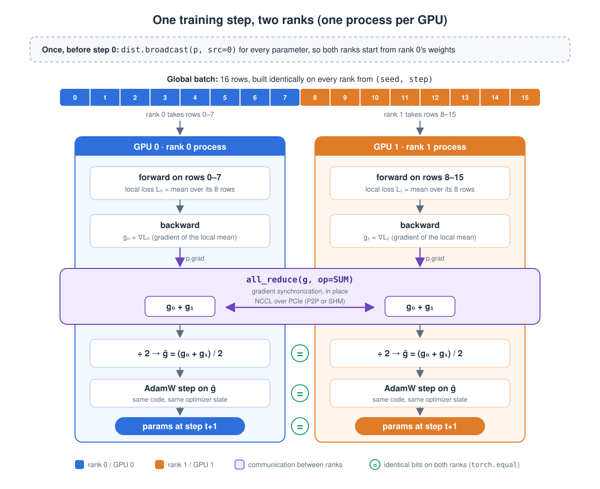

# Day 02 — Data parallel without DDP (guide, dual-A100 edition, revised 2026-10-27)

**Goal:** by tonight you can explain, and have shown with a parity test on real GPUs, how N processes that each see only part of a batch end up with *the same model across ranks and numerically close updates to* one process that saw the whole batch. You build it from `broadcast`, `all_reduce`, `send` and `recv` (no `DistributedDataParallel`), then measure what the communication costs on your own hardware. Day 3 replaces your hand-written gradient sync with DDP's hooks and buckets, so today's vocabulary, parity test and measurements get reused.

**Done means:**

- [x] `gpu_probe.py` output for the dual-A100 instance saved in your notes (topology, *current and max* PCIe link, peer-access capability)
- [x] `hello_dist.py` (the smoke test) passes on 2 GPUs of the machine you are about to use; you looked at one `NCCL_DEBUG=INFO` log. **A failed or hung smoke test stops the session; do not go on to parity or benchmarks.**
- [x] `ring_allreduce.py --device cuda` prints `RING SELF-TEST PASSED` with the 2 A100 GPUs
- [x] `check_parity.py --device cuda --with-bugs` prints `ALL CHECKS PASSED`, which includes all three negative controls reported as `DETECTED` (a failing check A *on a negative control* is the expected, good outcome)
- [x] **Estimates compared with measurements** (Block 1.6); existing A100 results are a retrospective, and future configurations get predictions before measuring
- [x] You can answer, without notes: *why do synced gradients keep the parameters identical, and what must hold?*
- [x] `day02/notes.md` written; the `c10d` → NCCL call chain traced (Block 3)

---

## Read this first: the dual-A100 experiment host

All GPU experiments in this guide use **one Vast.ai instance with 2 × NVIDIA A100-SXM4-40GB**, one process per GPU. GPU 0 and GPU 1 form the complete GPU scaling range: **1 → 2 GPUs**. Larger rank counts are paper/simulator exercises, or optional CPU/gloo logic tests only.

| Item | Validated on 2026-10-27 |
| --- | --- |
| SSH endpoint | `ssh -p 26936 root@23.127.144.217` (this rental only; re-check after recreating it) |
| Project | `/workspace/AI-Infra-Learning` |
| Python environment | `/venv/main`; project `.venv` is a symlink to it |
| GPU interconnect | `NV12`; 12 active links per GPU, each reported as 25 GB/s; peer access supported both ways |
| Actual NCCL transport | `P2P/CUMEM/read`; default-path SUM and AVG completed |
| Software | PyTorch 2.14.1+cu130, CUDA build 13.0, NCCL 2.30.7, driver 595.71.05 |
| Host CPU / resources | EPYC 7532; about 30.72 CPU-equivalents of cgroup quota, 129 GB offered RAM; GPU allocation is exclusive but the whole host is not |
| Measurement label | `--condition shared`: do not relabel the existing measurements as an exclusive-host benchmark |

The bottleneck from an unusable/slow GPU communication path has been removed for this host. Communication, CPU launch overhead and parameter updates still cost time; faster links do not guarantee perfect strong scaling. See Appendix A and the [acceptance report](../outputs/vast_acceptance_20261027/report.zh-CN.md).

### Connect and activate the existing environment

```bash
# Run on your own computer. Add -L 8080:localhost:8080 only if you want Jupyter.
ssh -p 26936 root@23.127.144.217

# Run inside the instance; use tmux if available for longer interactive sessions.
cd /workspace/AI-Infra-Learning
source .venv/bin/activate
export CUDA_VISIBLE_DEVICES=0,1 OMP_NUM_THREADS=1
unset NCCL_P2P_DISABLE NCCL_SHM_DISABLE NCCL_ALGO
python -c "import sys, torch; print(sys.executable, torch.__version__, torch.version.cuda, torch.cuda.device_count(), torch.cuda.nccl.version())"
```

The non-interactive SSH PATH may not contain this Python. Use `/venv/main/bin/python` or explicitly source the environment. Do not copy a venv from another machine or reinstall CUDA/drivers. `requirements.txt` requires `torch>=2.13`; the installed 2.14.1 meets that requirement.

The acceptance upload contains the experiment scripts, Day 1's `train.py`, and requirements; it is **not a git checkout of the entire repository**. Copy later edits from your local workspace, or create a real checkout before using `git pull`.

### Session and measurement routine

1. Save `gpu_probe.py --want 2` output before the run and check GPU 0,1. Run the smoke test with a hard timeout before longer work.
2. Use the default NCCL path. `NCCL_P2P_DISABLE=1` is only a command-local comparison experiment here, never the normal session configuration.
3. Run scaling with `--repeats 3 --condition shared`. Each repeat gets its own matching single-GPU baseline; report medians and min–max, not a confidence interval.
4. Keep the same visible GPU order. The single-process baseline uses GPU 0, which also hosts rank 0 in the two-process run.
5. Download important results before recycle/destroy. `/workspace` on this rental is container storage, not a persistent volume. An idle GPU does not stop instance billing.

### Status of this revision

The **current experiment scripts** were run on this host on 2026-10-27: GPU probe, default smoke, ring self-test, tiny parity with all three negative controls, two default bandwidth sweeps, one P2P-disabled sweep, and medium weak/strong scaling (100 steps, three repeats). All nine top-level stages exited successfully.

Not measured in that session: medium training performance for `per_param` vs `flat`, medium ring-training scaling, forced NCCL Ring vs Tree, Day 1 resume, or real DDP overlap. Do not infer those results from the tiny parity timing lines.

### Reuse Day 1's model, not another host's timings

`Config`, `TinyTransformer`, `build` and `get_batch` come from Day 1. Re-measure the single-GPU baseline with **Day 2's own harness**. For medium/global batch 16, the strong-scaling session's single-GPU core median was 57.62 ms; the weak-scaling session measured its own baseline (57.72 ms). Default 20-step correctness runs stay inside LR warmup and do not demonstrate convergence.

---

## Files

| File | What it is |
| --- | --- |
| `experiments/day02_data_parallel/launch_utils.py` | Shared helpers: one env recipe (explicit `OMP_NUM_THREADS`), launching with timeout that only signals the process group it started, and the smoke test |
| `experiments/day02_data_parallel/gpu_probe.py` | GPU load, PCIe link (current **and** max), topology, reported peer-access capability; suggests idle GPUs |
| `experiments/day02_data_parallel/hello_dist.py` | **Smoke test** of torchrun + NCCL/gloo (+ `ReduceOp.AVG` probe), with a timeout. Run first, everywhere |
| `experiments/day02_data_parallel/ddp_manual.py` | Data-parallel training loop. Core functions marked **YOU WRITE THESE FIRST** |
| `experiments/day02_data_parallel/ring_allreduce.py` | Stretch: ring all-reduce from point-to-point ops, with a self-test |
| `experiments/day02_data_parallel/simulate_ring.py` | Pure-Python ring simulator (no torch). Use it in the Design block |
| `experiments/day02_data_parallel/check_parity.py` | 1 GPU vs N GPUs; `--with-bugs` runs negative controls; unique `--run-id` per run; `--skip-run` verifies recorded settings |
| `experiments/day02_data_parallel/bench_allreduce.py` | All-reduce time / bandwidth vs message size (NCCL, optionally your ring) |
| `experiments/day02_data_parallel/run_scaling.py` | Weak / strong scaling table over 1 and 2 GPUs on this host, `--repeats`, per-repeat baseline |
| `experiments/day02_data_parallel/find_symbols.py` | `file:line` of every Block 3 symbol, for *your* installed torch. A text-search aid, not proof of a call chain |
| `day02/GUIDE.md`, `day02/notes.md` | This guide; your summary (a draft is provided) |

Everything imports Day 1's `Config`, `TinyTransformer`, `build`, `get_batch`: same model, same data, same optimizer. Only the process structure changes. `result.pt` from `ddp_manual.py` is a *comparison artifact* (gradients, first-update parameters, losses, metadata), **not** a resumable optimizer checkpoint.

---

## Block 1 — Design (30 min): draw this and write your predictions before running anything

### 1.1 One step, two ranks (one process per GPU)



Before the loop, rank 0's parameters are `broadcast` to everyone; the ranks deliberately start from different random weights, so a missing broadcast cannot hide. The gradient sync is the *per-step* communication, but not the program's only communication: the initial broadcast, the consistency checks, the loss and timing reductions and any barriers communicate too.

### 1.2 The collectives you need (write the "after" columns yourself first)

Imagine 3 ranks, rank r holding data that identifies it. Fill in what each holds afterwards:

| Collective | What it does | Who holds what afterwards |
| --- | --- | --- |
| `broadcast(t, src=0)` | rank 0's tensor overwrites everyone's | every rank has rank 0's value |
| `all_reduce(t, SUM)` | element-wise sum over ranks | every rank has the *same* full sum |
| `reduce_scatter` | sum, but each rank keeps only $1/W$ of the result | rank $r$ has chunk $r$ of the sum |
| `all_gather` | concatenate each rank's piece | every rank has all pieces |
| `send(t, dst)` / `recv(t, src)` | point to point | only the two named ranks are involved |

Identity worth burning in: **`all_reduce` = `reduce_scatter` + `all_gather`**. The two ring phases below are exactly those two. It returns on Day 6 (ZeRO), Day 7 (FSDP) and Day 13 (sequence parallel).

### 1.3 Why *average*? One line of math

The single-process loss is a mean over all $B$ rows: $L = \frac{1}{B}\sum_i \ell_i$. Split the batch into $W$ equal shards; rank $r$'s loss is $L_r = \frac{W}{B}\sum_{i \in \text{shard } r} \ell_i$. Then the full gradient is the mean of the local gradients:

$$
\nabla L = \frac{1}{B}\sum_i \nabla \ell_i = \frac{1}{W}\sum_r \nabla L_r
$$

Exact **only when every shard has the same number of samples** (or tokens, for a token-mean loss). With unequal shards (padding, masks) the plain average is wrong; weight each rank by its share, or sum losses and divide by the *global* token count. That is Day 18's `response_mask` problem in disguise. The precise condition is that every rank's loss averages over the same number of *effective loss elements*; with masks or ignored tokens, weight each rank's gradient by its valid count (or sum the losses and divide by the *global* valid count).

### 1.4 Core question: write your own answer *now*, compare at the end

> **Why do synced gradients keep the parameters identical, and what must hold?**

### 1.5 Ring all-reduce on paper (15 min)

Run `python experiments/day02_data_parallel/simulate_ring.py 3`, then predict the table for `4` before running it. Each rank cuts its tensor into $W$ chunks and passes chunks around a ring (rank $r$ sends to $r+1$, receives from $r-1$):

- **Phase 1, reduce-scatter** ($W-1$ steps): at step $s$ rank $r$ sends chunk $(r - s) \bmod W$, receives chunk $(r - s - 1) \bmod W$ and **adds** it. Afterwards rank $r$ holds the finished chunk $(r + 1) \bmod W$.
- **Phase 2, all-gather** ($W-1$ steps): at step $s$ rank $r$ sends chunk $(r + 1 - s) \bmod W$, receives chunk $(r - s) \bmod W$ and **overwrites**.

Cost model, $S$ = tensor bytes, $\alpha$ = per-message latency, $\beta$ = per-link bandwidth.

**Ring:**

$$
T_\text{ring} \approx 2(W-1)\,\alpha + \frac{2(W-1)}{W}\cdot\frac{S}{\beta}
$$

Bytes **sent** per rank are $\frac{2(W-1)}{W}\,S$ for equal chunks: less than $2S$ and nearly independent of $W$. The same amount is also received, so sent plus received is twice that.

**Naive** (everyone sends to rank 0, rank 0 sums and sends back): rank 0 receives $(W-1)\,S$ and sends $(W-1)\,S$, so the root link is the bottleneck.

With uneven chunks ($S$ not divisible by $W$) one rank's sent bytes can differ slightly from that formula, though the average over ranks still matches. `simulate_ring.py` counts how often each rank's data was added to each chunk and requires exactly once; it tracks *coverage*, not values, so the numeric self-test of the real ring stays necessary.

Two lessons to write in your own words: (1) the ring is **bandwidth-optimal**, every link carries data in every step; (2) it needs $2(W-1)$ sequential steps, so for *small* tensors latency $\alpha$ dominates. That is why 30 tiny per-parameter gradients are expensive and why DDP packs gradients into ~25 MB buckets (Day 3). NCCL also has a **tree** algorithm whose latency grows with $\log W$ instead of $W$; larger-world Ring/Tree comparisons are outside this two-GPU plan. The pure-Python simulator can still illustrate more ranks.

### 1.6 Predictions first: estimate, measure, explain

The purpose is to connect **gradient size → communication cost → total step time**, not to guess an exact answer. Before a new configuration, write assumptions and a range. Existing A100 results are already known, so use Appendix A for a retrospective calculation; do not present its measured numbers as a blind prediction. The previous host's predictions were archived with the old notes.

| Quantity | How to estimate it | Your assumption for the next experiment |
| --- | --- | --- |
| Gradient payload $S$ | Sum parameter elements × 4 bytes for FP32; medium = 27,443,200 elements = **104.6875 MiB** | |
| Bytes sent per rank, $W=2$ | $2(W-1)S/W=S$ for a ring; received bytes are additional | |
| Effective bandwidth $\beta$ | Inspect `NV12` and the completed P2P smoke, then measure `bench_allreduce.py`; a PCIe link rate is not the A100 NVLink rate | |
| One-GPU compute baseline | Run the same Day 2 harness, model, batch, device and precision; use `core_step_ms` | |
| Sync time and sync/core | Start from latency + $S/\beta$; account separately for flat-buffer copies, averaging, launches and rank skew | |
| Strong efficiency | Fixed global batch 16: $E=T_1/(2T_2)$; only the batch-dependent work may approach half the time | |
| Weak efficiency | Fixed local batch 16: global batch 16 → 32, $E=T_1/T_2$ | |

Also predict: (a) whether one flat collective can beat 78 per-parameter collectives after including copies; (b) Python ring vs builtin at 1 KiB, 1 MiB and 256 MiB; (c) how the bandwidth curve grows with message size; (d) what changes when P2P is disabled for one benchmark. These are separate experiments; a bandwidth sweep does not measure training speed.

**Units:** MiB = $2^{20}$ bytes, GB/s = $10^9$ bytes/s. Use seconds consistently before converting to milliseconds. No four- or eight-GPU measurement is required for this guide.

### 1.7 Four rules that prevent most distributed bugs

1. **Same collectives, same order, same shapes, on every rank *of the process group they run on*.** Today's calls use the default group, so that means every rank; a subgroup legitimately involves only its members. Break it and you get a hang, or silently wrong data. (`sync_grads` asserts that no grad is `None` for this reason. That assert is *local*: it can fire on one rank only, which is why the first step also does a consensus check on which gradients exist.)
2. **Never put a collective under `if rank == 0:`.** Only printing and file writing belong there.
3. **Agree before you raise.** If rank 1 raises alone, rank 0 sits in the next collective until the timeout. `check_in_sync` all-reduces a flag first, so every rank raises together. Only the paths that use such a flag are protected; an ordinary local exception elsewhere can still leave the others waiting.
4. **Tensors live where the backend lives.** NCCL needs CUDA tensors; a CPU tensor passed to an NCCL collective is an error. That is why `check_in_sync` and the loss/timing reductions keep their tensors on the GPU.

---

## Block 2 — Code (2 h)

### Stage 0 (20 min): machines and plumbing

```bash
python experiments/day02_data_parallel/gpu_probe.py --want 2          # save this output
python -m torch.distributed.run --standalone --nproc_per_node 2 experiments/day02_data_parallel/hello_dist.py --device cuda
NCCL_DEBUG=INFO python -m torch.distributed.run --standalone --nproc_per_node 2 experiments/day02_data_parallel/hello_dist.py --device cuda 2>&1 | grep -E "NCCL INFO (Channel|Using|Connected|comm)|via"
```

`hello_dist.py` is the **smoke test**: if it fails or hangs, stop. (`check_parity.py` and `run_scaling.py` run it for you before any long run.) Use the A100 session environment above, with P2P enabled by default. You should see your GPUs, `after all_reduce: 3.0 ... ok` on both ranks, and a `ReduceOp.AVG` line. On torch 2.14.1 AVG worked on **both** gloo and NCCL (1.5 on 2 ranks); that is a version-dependent observation, so what *your* install prints is the answer. In the `NCCL_DEBUG` output find the lines like `Channel 00/0 : 0[0] -> 1[1] via ...`: these describe channel connections and the chosen transport (`P2P/...`, `SHM/direct`, ...), not proof of the algorithm chosen for every message. A P2P capability query or channel setup line alone is not enough: require the SUM/AVG operation to complete. Both completed on the A100 default path. Copy those lines into your notes. (`python -m torch.distributed.run` is the same program as `torchrun`.)

### Stage 1 (35 min): write the data-parallel core yourself

Copy `ddp_manual.py` to a scratch file, delete the bodies of `broadcast_params` and `sync_grads`, and rewrite them from the Block 1 picture:

- `broadcast_params`: afterwards every rank's parameters equal rank 0's. One collective per parameter is fine.
- `sync_grads`: afterwards every `p.grad` is the average over ranks. Per parameter first, then with **one** collective over a flat buffer (`torch.cat` → `all_reduce` → copy back). What does the copy back cost?

Then diff against my version. Read the rest in this order:

1. **`init_dist`.** `torchrun` provides `RANK`, `WORLD_SIZE`, `LOCAL_RANK`; plain `python` gives none, so the same script is also the 1-GPU reference. `LOCAL_RANK` picks the GPU (one process per GPU; use `CUDA_VISIBLE_DEVICES` to choose which physical cards, and note the baseline then runs on the *first visible* one). NCCL is the default for `--device cuda`, and the code passes `device_id` so the communicator is bound to the GPU early. The `timeout` turns a deadlock into an exception. Do not assume the communicator is created at training step 0: this code communicates (the initial broadcast) before the loop, and *where* creation really happens is something to read off your `NCCL_DEBUG` log.
2. **Seeds.** `torch.manual_seed(cfg.seed + rank)` *before* `build()`: rank 0 keeps 42 (equal to the reference), the others start elsewhere. If `broadcast_params` is wrong, the first `check_in_sync` says so (negative control `--bug no_broadcast`).
3. **Sharding and batch modes.** `get_batch` returns the global batch; rank r slices its rows. `--global-batch N` = strong scaling (fixed total), `--per-gpu-batch N` = weak scaling (total grows with GPUs). Parity with the 1-GPU reference only makes sense at the same global batch.
4. **`sync_grads`.** SUM then `div_(world)`: explicit normalisation that does not depend on which backend or version supports `ReduceOp.AVG`. The `assert p.grad is not None` is local (see rule 1); the two modes; non-contiguous tensors are copied first because collectives need contiguous memory. `flat` allocates and fills one more gradient-sized buffer and does not overlap with backward, so it is **not** guaranteed to be faster than `per_param`.
5. **`check_in_sync`.** Compares every rank against rank 0 with `torch.equal` on the GPU: *exact element equality* (not raw byte identity: `+0.0 == -0.0`, and a NaN never equals itself). The failure flag and the worst deviation are reduced together (MAX over ranks), so the printed number is the global worst. Runs after step 0 for gradients and parameters, then every `--check-every` steps.
6. **Loss.** Local losses stay on the GPU (no `.item()` per step); one `all_reduce` at the end gives the global loss curve.
7. **Timing.** `perf_counter` bracketed by `torch.cuda.synchronize()`. This matters more now: CUDA work is asynchronous with respect to the CPU; stream choice depends on version and async_op. Without completion synchronization the CPU timer can mostly measure submission. Each step records its phases (fwd+bwd, sync, optimizer) and the whole **core** step (their sum as it actually happened, without data generation, zeroing, checks or logging). Per step, the **slowest rank** counts (MAX over ranks, because the slowest rank sets the step time); then the **median over the timed steps** is taken. Phase medians therefore need not add up to the core-step median, and a sum of per-phase medians would be a step that never occurred. A second, wider **loop** scope (includes data, zeroing, checks and logging) is reported separately as a mean; the two scopes use different statistics, so do not subtract one from the other to estimate overhead.
8. **Evidence saved.** `grads0` is captured **after** `sync_grads`; `params1` after the first update. `metrics.json` and `result.pt` also record the metadata that makes a number interpretable: torch/CUDA/NCCL/driver versions, the physical GPU, `NCCL_*`/`OMP_*` overrides, warmup and timed step counts, and `--condition` (exclusive / shared / unknown).

### Stage 2 (35 min): ring all-reduce (the stretch goal)

Keep `simulate_ring.py`'s output next to you, write `ring_all_reduce(t)` yourself (~25 lines), compare with mine, then:

```bash
python -m torch.distributed.run --standalone --nproc_per_node 2 experiments/day02_data_parallel/ring_allreduce.py --device cuda
python -m torch.distributed.run --standalone --nproc_per_node 3 experiments/day02_data_parallel/ring_allreduce.py --device cpu    # optional odd-world logic check, not a GPU benchmark
```

Things your version has to get right (all in mine, with comments):

- **Use `P2POp` + `batch_isend_irecv`, not separate `send` and `recv`.** With NCCL a send completes only when the peer posts the matching receive; if every rank issues `send` then `recv`, the ring deadlocks. The batch makes both progress together. (Try the naive send-then-recv version once to *see* the hang; the 120 s collective timeout should end it. It is a good memory.)
- **Receive into a scratch buffer in phase 1**: you must add to your own chunk, not overwrite it. In phase 2 receive straight into place.
- **Don't touch a buffer while its send is in flight.** Sent and received chunks are always different.
- **Chunks of unequal size.** `torch.tensor_split` gives views (no copy), sizes differ by at most one; empty chunks are skipped identically on both sides.

The self-test compares against `dist.all_reduce`: **int64 must match exactly** (integer addition is associative), **float32 only approximately** (different summation order), and all ranks must hold *identical values* after the ring. It prints the average bytes **sent** per rank next to $\frac{2(W-1)}{W}\cdot S$ (an individual rank can differ when chunks are uneven).

### Stage 3 (15 min): wire the ring into training, run the parity check

`--allreduce ring` makes `sync_grads` call your ring instead of `dist.all_reduce`. Then Block 4.

### Pitfalls (symptom → cause)

| Symptom | Likely cause |
| --- | --- |
| Hang, then a timeout error after 120 s | Ranks issued different collectives (one under `if rank == 0`, a `None` grad, different shapes), or the naive send-then-recv ring |
| The first all-reduce hangs although initialization completed | Save the default-path smoke log and stop; inspect matching calls and the current host. The A100 acceptance default path completed, so no permanent P2P-disable workaround is prescribed. |
| `Duplicate GPU detected` / two ranks on one GPU | `--nproc_per_node` larger than the number of visible GPUs, or `CUDA_VISIBLE_DEVICES` wrong |
| `LOCAL_RANK n but only m visible GPUs` | Same: fewer idle GPUs than processes |
| Error about CPU tensors / "Tensors must be CUDA" | A tensor in a NCCL collective lives on the CPU |
| CUDA out of memory | Inspect your own GPU processes, batch size and temporary gradient buffers with `gpu_probe.py` / `nvidia-smi`. |
| `NOT IN SYNC: initial params` | `broadcast_params` missing or it broadcast copies, not the real parameters |
| `NOT IN SYNC` only from step ≥ 1 | Something rank-dependent *after* the sync (a per-rank random op or a per-rank scale applied to the already-synced gradient) |
| Ranks stay in sync but parity check A fails by a modest amount | Different math rather than different ranks: clipping local gradients before the all_reduce, independent dropout masks, unequal valid-token counts per rank. None of these desynchronises ranks; they change what is being compared with the 1-GPU run |
| Parity fails by ~`world`× in the gradient | Forgot to divide |
| Parity fails by ~`1/world`× | Divided twice or by the wrong count |
| Ring result off in a few elements | Wrote into a chunk before its send completed, or a wrong chunk index |
| Output from several ranks interleaves | Normal. Print from rank 0 or prefix with the rank |

---

## Block 3 — Read the source (1 h): follow `dist.all_reduce(t)` down to NCCL

**First** run `python experiments/day02_data_parallel/find_symbols.py`. It prints `file:line` for each Python symbol below in *your* installed torch (open the files under `site-packages/torch/`, the code you actually run). Use **symbol names** and your installed version rather than stale line numbers; the acceptance stack is torch 2.14.1. `find_symbols.py` is a text search, a navigation aid, not proof of the call chain: a match can be a different function of the same name, and nobody has audited the C++ side line by line. The chain below is the *expected shape* that you confirm or correct.

### Chain A: from `dist.all_reduce(t)` to the GPU

**Stop 1: `distributed_c10d.py`: `all_reduce`.** You should find roughly: argument checks (`_check_single_tensor`, `_rank_not_in_group`), an `AllreduceOptions` with `reduceOp` set, the group defaulting to `_get_default_group()`, a call of the form `group.allreduce([tensor], opts)`, and async-dependent return handling: synchronous calls return None, optionally waiting on a non-null Work for backend compatibility; asynchronous calls return Work.
*Q1: what does it return with `async_op=False`? with `True`? Q2: why is the tensor wrapped in a list? Q3: what if this rank is not in `group`?*

**Stop 2: `ReduceOp`.** Imported from the C++ binding. Find where, and read the entry for `AVG`.
*Q: which backends support `AVG`? Does that match what `hello_dist.py` printed for NCCL and for gloo? (On torch 2.14.1 both accepted it; I did not test 2.13.0, so check your version rather than trusting me or a blog post.)*

**Stop 3: the default group and backend selection** (`_get_default_group`, `_new_process_group_helper`). The object you call `.allreduce` on is a C++ `ProcessGroup` that dispatches to a *backend* by device type.
*Q: with `backend="nccl"`, which C++ class does the work?*

**Stop 4: `ProcessGroupNCCL` (C++; read on GitHub at the tag for your version, search by symbol).**
- `ProcessGroupNCCL::allreduce` and the shared `collective<>` helper it calls. Find: the lookup of an NCCL communicator for this device (`getNCCLComm`), the stream selection conditional on `asyncOp` (current vs separate NCCL stream), any event that orders separate streams, and the actual `ncclAllReduce` call.
- `WorkNCCL` and its `wait()`.
*Q1: on which stream does the all-reduce run, and how does it know your backward kernels (on the current stream) have finished writing the gradients? Q2: what does `work.wait()` do on NCCL: block the CPU, or make your current stream wait? Q3: given your answer, why does `ddp_manual.py` call `torch.cuda.synchronize()` around the collective when timing? Q4: how does PyTorch's caching allocator avoid reusing a gradient's memory while the NCCL stream is still reading it (look for `recordStream`, tensor stashing, and when references are released; these mechanisms vary by version)?*

**Stop 5: NCCL itself, plus evidence from your own run.** In `github.com/NVIDIA/nccl`, find `ncclAllReduce` (`src/collectives.cc`), how an algorithm (ring, tree) and protocol are chosen (`src/enqueue.cc`, tuning in `src/graph/`), and the ring kernel (`src/device/all_reduce.h`). Then re-read your `NCCL_DEBUG=INFO` log: the `Channel ... via ...` lines show channel connections and transport, not per-message algorithm proof. Compare builtin with your Python ring on 2 GPUs. Forced Ring/Tree is optional; do not make claims about 4+ GPU scaling from this host.
*Q: is NCCL's ring the same algorithm as yours? What does it do that yours cannot (several channels in parallel, pipelining sub-chunks, fusing the reduction into the transfer kernel)?*

### Chain B: how the ranks find each other

`python -m torch.distributed.run` → `torch/distributed/run.py` (`get_args_parser`, `config_from_args`, `run_script_path`) → `launcher/api.py` (`elastic_launch`) → `elastic/agent/server/local_elastic_agent.py` (`_start_workers`), which is where each worker's `RANK`, `LOCAL_RANK`, `WORLD_SIZE`, `MASTER_ADDR`, `MASTER_PORT` come from. In the worker: `init_process_group` → `rendezvous.py` (`_env_rendezvous_handler`, `_create_c10d_store`: the TCP key-value Store endpoint; with torchrun the launcher may host the rendezvous service) → `_new_process_group_helper`.
*Q: NCCL needs every rank to hold the same `ncclUniqueId`. How does it get from rank 0 to the others? (Hint: search the NCCL group code for where the id is written to and read from the store.)*

### Chain C: the bridge to Day 3

`torch/nn/parallel/distributed.py` (`DistributedDataParallel.__init__`) and `_sync_module_states`, `_verify_param_shape_across_processes` in `torch/distributed/utils.py`: the real-framework version of your `broadcast_params`.
*Q: what does DDP broadcast that you did not? Why check parameter shapes across processes first?*

### Fill this in `notes.md` §3

| Item | Your answer (draft) |
| --- | --- |
| Entry point | `dist.all_reduce(p.grad, op=SUM)` in `sync_grads` |
| Critical path | `distributed_c10d.all_reduce` → `group.allreduce([t], opts)` → C++ `ProcessGroup` → `c10d::allreduce_` device dispatch → CUDA backend → `ProcessGroupNCCL::allreduce` → `allreduce_impl` / `collective` → `ncclAllReduce`. Treat Work/wait as an async-dependent result-ordering branch, not as proof that CPU return means GPU completion. |
| Tensor changes | in place; same shape/dtype/device; values become the sum over ranks, then ÷ world |
| State changes | `p.grad` overwritten; optimizer step counter +1 on every rank; NCCL stream/event ordering; an NCCL communicator exists after the first collective on that device (verify where yours is created: this code passes `device_id` and broadcasts before the loop) |
| Evidence | `check_in_sync` (exact element equality), `check_parity` A, `NCCL_DEBUG=INFO` log |

---

## Block 4 — Run + summarize on the dual A100

From the project root with the existing venv active. Set a fresh session ID so benchmarks and artifacts do not overwrite earlier evidence. `check_parity.py` and `run_scaling.py` are **orchestrators: launch them with plain Python**, not an outer torchrun. Each starts its own worker runs and smoke test.

```bash
export CUDA_VISIBLE_DEVICES=0,1 OMP_NUM_THREADS=1
unset NCCL_P2P_DISABLE NCCL_SHM_DISABLE NCCL_ALGO
RID=$(date -u +%Y%m%dT%H%M%SZ)
mkdir -p outputs/day02_data_parallel

python experiments/day02_data_parallel/gpu_probe.py --want 2 > "outputs/day02_data_parallel/probe_before_${RID}.txt"
NCCL_DEBUG=INFO timeout --kill-after=10s 90s python -m torch.distributed.run --standalone --nproc_per_node 2 experiments/day02_data_parallel/hello_dist.py --device cuda --timeout 60 > "outputs/day02_data_parallel/smoke_${RID}.log" 2>&1
# If the smoke command failed, inspect its log and STOP before continuing.
python -m torch.distributed.run --standalone --nproc_per_node 2 experiments/day02_data_parallel/ring_allreduce.py --device cuda
python experiments/day02_data_parallel/check_parity.py --device cuda --nproc 2 --with-bugs --condition shared --run-id "a100_parity_${RID}"

# Independent collectives: default path twice; Python ring in the first sweep.
python -m torch.distributed.run --standalone --nproc_per_node 2 experiments/day02_data_parallel/bench_allreduce.py --device cuda --max-mib 256 --warmup 10 --iters 30 --ring --condition shared --tag "a100_default_r1_${RID}"
python -m torch.distributed.run --standalone --nproc_per_node 2 experiments/day02_data_parallel/bench_allreduce.py --device cuda --max-mib 256 --warmup 10 --iters 30 --condition shared --tag "a100_default_r2_${RID}"

# A comparison only: this assignment does not change the following commands.
NCCL_P2P_DISABLE=1 python -m torch.distributed.run --standalone --nproc_per_node 2 experiments/day02_data_parallel/bench_allreduce.py --device cuda --max-mib 256 --warmup 10 --iters 30 --condition shared --tag "a100_no_p2p_${RID}"

# Strong: global batch fixed at 16. Weak: local batch fixed at 16.
python experiments/day02_data_parallel/run_scaling.py --device cuda --mode strong --preset medium --global-batch 16 --nprocs 1 2 --steps 100 --repeats 3 --sync flat --condition shared --run-id "a100_strong_${RID}"
python experiments/day02_data_parallel/run_scaling.py --device cuda --mode weak --preset medium --per-gpu-batch 16 --nprocs 1 2 --steps 100 --repeats 3 --sync flat --condition shared --run-id "a100_weak_${RID}"
python experiments/day02_data_parallel/gpu_probe.py --want 2 > "outputs/day02_data_parallel/probe_after_${RID}.txt"
```

The acceptance session used the fixed run IDs listed in `notes.md`; use fresh IDs when repeating. A `--with-bugs` run tests the reference experiment implementation unless you deliberately wire in your practice implementation.

### How to read the parity output

The reference processes the whole global batch on one GPU. Each two-GPU variant processes half on each rank, then averages gradients. The comparison is against what rank 0 saved; separate checks inside training verify cross-rank equality.

| Check | What it compares | How to interpret the A100 observation |
| --- | --- | --- |
| **A** | First synced gradient, every tensor; `rtol=1e-4, atol=1e-6` | All three normal variants had max absolute error **2.794e-9**. The pass condition is elementwise absolute + relative tolerance, not just a threshold on the printed maximum. |
| **B** | Parameters after one update; max absolute error ≤ `1e-5` | Normal variants: **1.192e-7**. This is weaker than A: Adam's first update approximately normalizes gradient magnitude, so forgetting the average can escape B. |
| **C** | Initial global loss; absolute error ≤ `1e-5` | Normal variants: **0**. Compare the global mean, not rank-0 local loss. Later loss and final-parameter drift are informational. |

Negative controls must fail **A** and print `DETECTED by check A (good)`. On this host all three did. `no_average` had gradient error 1.635e-2 while B passed with 2.649e-6; `no_broadcast` and `no_allreduce` also failed B. A real `dp_*` FAIL is bad; a control's lower-case `fail A` is expected. `ALL CHECKS PASSED` means both the normal runs and the detection checks worked.

### How to read performance

- **Core vs loop:** core covers forward, backward, sync and update; loop also covers data, zeroing, checks and logging. Core is a median, loop a mean. Do not subtract them as an overhead estimate.
- **Timing aggregation:** training takes the slowest rank per step, then the median. The standalone benchmark takes the maximum of per-rank medians. Phase medians need not sum to the core median.
- **Flat sync is not pure network time:** it includes concatenation, all-reduce, averaging, copy-back, launches and waits. Do not divide gradient bytes by this phase and call it raw NVLink bandwidth.
- **Measured communication:** default 256 MiB builtin took 1.746–1.758 ms (152.71–153.77 GB/s busbw); disabling P2P took 97.212 ms (2.76 GB/s) in one sweep. This is an application-level default-path advantage, not a hardware-counter measurement or a guarantee for every size.
- **Measured scaling:** strong 1 → 2 GPUs reached about 1.40× speedup / 70% efficiency; weak throughput reached about 1.94× / 97%. Link costs are much lower, but communication and CPU/optimizer work remain.
- **Bandwidth curve:** small calls are latency/launch dominated. Bandwidth still grows from 64 to 256 MiB; the largest observed rate is not proof that the asymptotic plateau has been reached.
- **Unmeasured comparisons:** medium per_param vs flat training, ring-training scaling and forced Ring vs Tree remain open. Tiny parity timings are not those performance experiments. On two GPUs, forcing Ring/Tree is optional and does not establish larger-world scaling behavior.
- **Precision:** this teaching model uses FP32, TF32 disabled, deterministic MATH attention. A100 does not promise faster single-GPU execution than another GPU for this exact workload. Keep each run's own baseline.

### Troubleshooting (this instance)

| Symptom | Check |
| --- | --- |
| `python` missing or torch cannot import | Activate `/venv/main`, or use `/venv/main/bin/python`; the project `.venv` points there. |
| `check_parity.py` cannot be found | Run `python experiments/day02_data_parallel/check_parity.py` from the project root. Do not put an outer torchrun around this orchestrator. |
| P2P smoke hangs or fails | Stop before benchmarks; save logs and confirm the two visible devices. Use a command-local P2P-disabled run only to isolate the issue, not as an automatic permanent setting. |
| Collectives unexpectedly slow | Check `NV12`, `nvidia-smi nvlink -s`, environment overrides and completed smoke transport; compare with Appendix A. |
| Collective timeout | Check that group members issue matching calls, shapes and dtypes; also inspect connectivity. A timeout alone does not identify a unique cause. |
| Out of memory | Inspect your own processes, batch size and saved tensors. |
| Import error after recreating the rental | Confirm image/Python/torch versions; re-upload or restore the project. `/workspace` here is not a persistent volume. |

### Write `day02/notes.md`

Keep your own mechanism and source-reading explanations. Sections 5–6 now contain the **2026-10-27 A100 acceptance evidence**, with provenance and unmeasured items marked explicitly. Appendix A summarizes the same session; it is not an independent replication. For future experiments, record a new prediction before measuring and use a fresh run ID.

1. Problem: two-GPU training numerically close to the one-GPU global-batch reference.
2. Mechanism: broadcast → shard → backward → SUM → divide → identical updates.
3. Call chain: verify the installed version, including async-dependent stream choice and wait semantics.
4. Framework comparison: use the remaining overhead to motivate real DDP and overlap in Day 3.
5. Correctness: parity A/B/C, negative controls and the integer/float ring tests.
6. Performance: separate strong and weak baselines, repeat spread, standalone bandwidth and training sync scope.

---

## Today's core question, answered

**Why do synced gradients keep the parameters identical, and what must hold?**

Each rank applies the same deterministic function (the optimizer) to the same inputs (parameters, averaged gradient, optimizer state, step count, LR). Same function + same inputs → same outputs, by induction from step 0. For that to be true, **all** of these must hold:

1. **Identical start.** Same parameters on every rank (the `broadcast`) and identical optimizer state and hyper-parameters (fresh Adam moments are all zeros; a resumed run must load the same checkpoint everywhere).
2. **Bit-identical gradients after the all-reduce, across ranks of one run.** "Close" is not enough: a 1-ULP difference becomes a parameter difference, which changes the next gradient, and the gap grows. A correct all-reduce delivers the same bits to every rank (`check_in_sync` verifies it; the ring self-test checks it for your implementation).
3. **Everything after the sync is rank-independent.** Weight decay, LR schedule, Adam math, clipping computed *from the synced gradient* are fine. Anything that consumes per-rank state *after* the sync (a local RNG, a per-rank scale applied to the synced gradient) breaks it. Per-rank randomness *before* the all-reduce (independent dropout) or clipping the *local* gradient before it does not desynchronise ranks, because everyone still receives the same reduced gradient; it changes the update, though, so it affects whether you match the single-process computation.
4. **Same number of optimizer steps and the same code path on every rank** (no rank skips a step; a mixed-precision overflow skip must be decided globally).
5. **Deterministic kernels given the same inputs** (same GPU model and library versions on all ranks; that is why Day 1's determinism flags matter, and why both ranks here use the same A100 model and software stack).

**Two different claims, tested differently.** (1) *Cross-rank equality within a run*: all ranks hold identical values (`check_in_sync`, `torch.equal`). (2) *Closeness to a single-process reference*: this needs equal effective loss-element counts per shard (1.3), the same stochastic computation (no dropout, or matching masks), no local clipping before the sync, the same global batch and the same initial weights. Even then it is closeness, not bitwise equality: the sums are grouped differently, and NCCL's reduction order can change with the GPU count or the algorithm it picks.

---

## Self-check (answer aloud, < 2 min each)

<details><summary>1. Why SUM-then-divide instead of ReduceOp.AVG, and what goes wrong if you divide twice or not at all?</summary>

SUM + divide is an explicit normalisation that does not depend on which backend or torch version implements <code>ReduceOp.AVG</code> (on torch 2.14.1 both gloo and NCCL accepted AVG; 2.13.0 was not tested, which is exactly why not to rely on it). Not dividing makes the gradient <code>world</code>× too big: Adam hides that (it normalises the scale), SGD or gradient clipping would not. Dividing twice shrinks it by <code>world</code>×: invisible to Adam except through $\varepsilon$. Both are caught only by comparing the gradient itself against a reference.
</details>

<details><summary>2. Why is it dangerous to raise an exception on only one rank?</summary>
The other ranks continue into the next collective and wait for a partner that never arrives, so the job hangs until the timeout. Agree on the failure with a collective first (all-reduce a flag), then every rank raises together. <code>check_in_sync</code> does this.
</details>

<details><summary>3. busbw plateaus at X GB/s for large messages but small messages are slow. What limits each regime?</summary>

Large: link (or host-memory) bandwidth, so busbw saturates near what the interconnect carries. Small: the ring needs $2(W-1)$ sequential steps, each paying latency $\alpha$ (plus kernel-launch cost), so time is roughly constant and busbw is tiny. That is why 78 separate gradient all-reduces are slower than one over a flat buffer, and why DDP uses ~25 MB buckets: big enough to be bandwidth-bound, small enough to start overlapping with backward.
</details>

<details><summary>4. Why does the timing code need torch.cuda.synchronize() around the all-reduce?</summary>
CUDA submission is asynchronous to the CPU even when operations use the current stream. In the async path, an NCCL stream is ordered with events and Work.wait() normally orders the current stream after communication; blocking-wait settings can also block the CPU. Check the installed version and asyncOp branch. Synchronizing before and after isolates completion time for this teaching harness; it does not measure just the launch, and it removes overlap.
</details>

<details><summary>5. Why can't the 1-GPU vs N-GPU comparison be bitwise, and what do you do about it?</summary>
Sum of the whole batch in one order vs sums of shards followed by a cross-GPU sum: floating-point addition is not associative (and kernels may differ by batch size). Compare with a tolerance justified by analysis and by observation (rounding level on the gradient, an Adam-aware bound on the parameters; never loosen it to make a failing run pass), keep a negative control proving the tolerance is tight enough to catch real bugs, and use exact equality only between ranks of the same run.
</details>

**Tomorrow (Day 3):** replace `sync_grads` with real `DistributedDataParallel` plus `DistributedSampler`, then explore bucketed async reductions and overlap. Use the **same dual A100**, one process per GPU, and keep a matching one-GPU baseline. Verify numerical parity before comparing performance; this hand-written synchronous loop is not a DDP benchmark.

---

## Appendix A — Dual-A100 observations (2026-10-27)

This appendix and `notes.md` summarize the **same acceptance session**, not independent repetitions of the entire study. Raw logs/metrics were saved before editing these docs. See the [acceptance report](../outputs/vast_acceptance_20261027/report.zh-CN.md). Earlier machine notes and raw pasted logs are preserved locally under `outputs/vast_acceptance_20261027/docs_before_a100/`, outside this active guide.

### A.1 Setup and correctness

Two A100-SXM4-40GB GPUs, NV12, default `P2P/CUMEM/read`, torch 2.14.1+cu130, NCCL 2.30.7, driver 595.71.05, OMP_NUM_THREADS=1. GPU allocation exclusive, whole host not exclusive; condition=shared. Ring self-test passed for all lengths. Tiny/20-step parity: all three normal variants passed A/B/C, all three negative controls detected. Correct gradient max error 2.794e-9; first-update parameter error 1.192e-7; initial global-loss error 0. `no_average` A failed, B passed with error 2.649e-6.

### A.2 Standalone communication

At 256 MiB, default builtin took **1.746–1.758 ms**, busbw **152.71–153.77 GB/s** over two sweeps. Python ring took **2.051 ms**, 130.87 GB/s in one sweep. P2P-disabled builtin took **97.212 ms**, 2.76 GB/s in one sweep. At 1 KiB builtin took 67.7–68.8 us, Python ring 260.6 us. Warmup 10, 30 calls per size; max of per-rank medians. This supports the default fast interconnect path, not a 300/600 GB/s application throughput promise or a proven bandwidth plateau.

### A.3 Medium training, flat/builtin

100 steps, 3 warmup excluded, 97 timed steps, three repeats. Weak and strong each use fresh per-repeat one-GPU baselines. FP32, TF32 disabled, deterministic MATH attention. Training sync includes copies/averaging/waits; its scope differs from the standalone benchmark.

**Strong: fixed global batch 16.**

| GPUs | Global B | Local B | fwd+bwd ms | sync ms | optim ms | sync/core | core ms [min–max] | core tokens/s | Speedup [min–max] | Efficiency [min–max] |
| ---: | ---: | ---: | ---: | ---: | ---: | ---: | --- | ---: | --- | --- |
| 1 | 16 | 16 | 50.54 | — | 7.11 | — | 57.62 [57.49–58.46] | 71,084 | 1.00 [1.00–1.00] | 100.0% [100.0–100.0%] |
| 2 | 16 | 8 | 28.18 | 4.60 | 10.76 | 11.2% | 41.35 [39.49–41.62] | 99,052 | 1.40 [1.39–1.46] | 70.2% [69.5–72.9%] |

**Weak: fixed local batch 16.**

| GPUs | Global B | Local B | fwd+bwd ms | sync ms | optim ms | sync/core | core ms [min–max] | core tokens/s | Speedup [min–max] | Efficiency [min–max] |
| ---: | ---: | ---: | ---: | ---: | ---: | ---: | --- | ---: | --- | --- |
| 1 | 16 | 16 | 50.58 | — | 7.03 | — | 57.72 [57.62–58.03] | 70,964 | 1.00 [1.00–1.00] | 100.0% [100.0–100.0%] |
| 2 | 32 | 16 | 50.48 | 4.69 | 7.00 | 7.9% | 59.61 [59.56–59.69] | 137,435 | 1.94 [1.93–1.95] | 96.9% [96.5–97.4%] |

Time columns are medians over the three per-run medians; ranges are repeat spreads, not confidence intervals. Speedup and efficiency are computed for each repeat against its own baseline, then summarized. Do not sum phase medians. Current measurements demonstrate better communication and useful two-GPU scaling; they do not establish medium per_param-vs-flat speed, ring-training scaling, larger-world scaling, convergence, or real DDP overlap.
