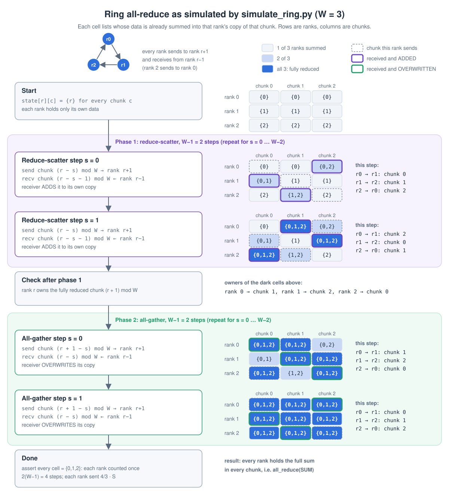

# Day 02 — Data parallel without DDP

> Setup: **Vast.ai, 2 × A100-SXM4-40GB**, GPU ids 0,1, topology NV12, default NCCL P2P/CUMEM/read; accepted 2026-10-27. PyTorch 2.14.1+cu130, CUDA build 13.0, NCCL 2.30.7, driver 595.71.05. `OMP_NUM_THREADS=1`; no P2P-disable override in normal runs. GPUs are allocated exclusively, but CPU/host resources are shared, so measurements remain `condition=shared`.
> Code: [`experiments/day02_data_parallel/`](../experiments/day02_data_parallel/README.md) · Guide: [`GUIDE.md`](GUIDE.md)

<!-- Mechanism and source-reading explanations are consolidated in sections 2–4. Sections 5–6 retain the 2026-10-27 A100 acceptance evidence. Unknowns are explicitly tracked under Open questions; measured results are not claims of an independently completed implementation or a full source audit. -->

## 1. What systems problem did I solve today?

I studied the core data-parallel operations and validated the reference implementation: N GPU processes train on shards of one batch, stay identical across ranks, and remain numerically close to a single-process global-batch reference. Each rank computes gradients on its shard of the global batch; an `all_reduce` turns the N local gradients into one averaged gradient on every rank, and each rank applies the same optimizer step. The hard part is not the code (about 30 lines) but the invariants: identical starting weights, identical averaged gradients on every rank, nothing rank-dependent after the sync. I outlined the ring algorithm and its exchange helper, then tested the executable reference ring and measured collective costs on the A100 NV12 interconnect using NCCL P2P/CUMEM/read. My practice file is an algorithm skeleton inside docstrings, not a separately validated executable implementation.

## 2. The mechanism in my own words

1. `broadcast` rank 0's parameters (ranks deliberately start from different random weights).
2. Each rank takes its equal-sized slice of the global batch; forward/backward gives a gradient of the *local* mean loss.
3. `all_reduce(SUM)` over every gradient, then divide by the world size (explicit normalisation rather than `ReduceOp.AVG`: NCCL AVG returned 1.5 in the A100 smoke test; Gloo AVG was not re-tested in this acceptance session). The mean of local means equals the global mean only when each rank's loss averages over the same number of effective loss elements.
4. Every rank runs the same AdamW step on the same averaged gradient, so parameters and optimizer state stay identical without being communicated again.

Two claims I keep apart: (a) **cross-rank equality in one run** (`torch.equal`, exact element equality), and (b) **numerical closeness to a single-process run** (a tolerance, never bitwise: the summation grouping differs). `check_in_sync` and the ring cross-rank comparison check (a); parity A/B/C compare against the single-process reference and check (b). Two ranks can agree with each other while both use a wrongly scaled gradient.

Ring all-reduce: W chunks; W−1 steps of reduce-scatter (each rank sends one chunk to rank r+1 and adds the chunk it receives from rank r−1), then W−1 steps of all-gather (same direction, but the receiver overwrites). Each rank **sends** 2(W−1)/W·S bytes (equal chunks) but needs 2(W−1) sequential steps, so latency dominates for small tensors. The measured builtin latency floor is about 65–70 us for small messages; achieved bandwidth grows strongly over 1–16 MiB and is still rising at 256 MiB. This shows a transition from launch/latency overhead toward bandwidth costs, but does not identify a unique crossover or a final plateau.



### 2.1 Why do the parameters stay equal?

All ranks start with the same broadcast parameters and identical optimizer state/hyperparameters. After each sync they use the same averaged gradient. The same deterministic optimizer update, LR schedule and step count therefore produce the same next parameters, inductively. Any rank-dependent update after synchronization breaks this reasoning. Matching the single-GPU reference additionally requires the same global batch and equivalent loss normalization/stochastic computation.

### 2.2 What is the ring's communication cost?

For equal chunks, one round sends $S/W$ bytes. Reduce-scatter has $W-1$ rounds and all-gather another $W-1$, giving $2(W-1)S/W$ sent per rank. Uneven chunks change individual ranks' counts, but the average still follows the formula. Receiving adds the same average amount; do not mix send-only and send-plus-receive conventions.

Under the simple equal-link model, each rank needs contributions from the other ranks and every rank must receive the finished result; the ring meets the usual bandwidth-volume bound while keeping links active. It is not latency optimal: $2(W-1)$ sequential rounds each pay message/startup overhead. With two ranks, sending per rank is $S$; small tensors still pay the round and launch costs.

### 2.3 One process sees local code; why does the whole ring run?

`torchrun` starts independent Python workers and supplies `RANK`, `WORLD_SIZE` and `LOCAL_RANK`. Each worker executes the same algorithm, but its rank selects different peers and chunk indices. This is one process per GPU, not one Python process controlling every card.

```python
rank = int(os.environ["RANK"])
world = int(os.environ["WORLD_SIZE"])
local_rank = int(os.environ["LOCAL_RANK"])
torch.cuda.set_device(local_rank)
dist.init_process_group(backend="nccl")
```

```bash
python -m torch.distributed.run --standalone --nproc_per_node=2 your_script.py
```

The per-step order is zero_grad → forward/loss → backward → sync and average → optional clipping of the synced gradient → optimizer.step → scheduler.step. The ring primitive returns SUM; averaging belongs to its caller.

## 3. Call chain: from my gradient to NCCL

### 3.1 Reading scope and evidence

Runtime evidence is from **PyTorch 2.14.1+cu130 / NCCL 2.30.7** on the dual A100. The explanatory upstream source walkthrough used **PyTorch v2.14.0** and **NCCL v2.30.7-1**. It is a symbol-level reading, not an audit of every line of the installed 2.14.1 C++ binary. In particular, re-check the installed tag before relying on stream-selection implementation details. `find_symbols.py` is a navigation aid, not proof of a caller/callee relationship.

| Item | Recorded answer |
| --- | --- |
| Entry | `sync_grads` calls `dist.all_reduce(grad, op=SUM)`; flat mode first concatenates gradients. |
| Ordinary path | Python `all_reduce` → C++ `ProcessGroup::allreduce` → `c10d::allreduce_` CUDA dispatch → registered CUDA backend → `ProcessGroupNCCL::allreduce` → `allreduce_impl` / `collective` → `ncclAllReduce` → NCCL enqueue/planning and GPU work. Special optimized paths may differ. |
| Tensor changes | The original collective tensor is overwritten with SUM, preserving shape/dtype/device; the caller divides by world. Flat mode copies its averaged buffer back to the original gradients. |
| State changes | Communication uses a communicator and CUDA ordering. The subsequent optimizer, not all-reduce itself, updates parameters, Adam state and the optimizer step count. |
| Actual evidence | P2P/CUMEM/read channels, successful SUM/AVG smoke, ring test and parity A/B/C. These demonstrate this runtime path works, not that every source branch was executed. |

The normal training code passes `device_id` and broadcasts before the first training step, so communicator initialization must not be assumed to start at step 0. The saved smoke log confirms init and communication completion; it does not establish the exact communicator-creation call site of every training run.

```text
NCCL INFO Channel 00/0 : 0[0] -> 1[1] via P2P/CUMEM/read
after all_reduce: 3.0 (expected 3.0) ok
ReduceOp.AVG worked on nccl: 1.5 (expected 1.5)
```

Saved evidence: `outputs/vast_acceptance_20261027/smoke.log` on the instance, or the downloaded `raw/outputs/vast_acceptance_20261027/smoke.log` locally.

### 3.2 I want to synchronize gradients: what does the Python API do?

It validates the input and group membership, chooses the default group if needed, sets the reduction/options, and delegates to `group.allreduce([tensor], opts)`.

- **Stop 1 Q1:** a normal synchronous call (`async_op=False`) returns None; an asynchronous call returns a Work handle. Results overwrite the input tensor rather than being returned as a new tensor.
- **Stop 1 Q2:** `[tensor]` adapts a single-tensor user API to the backend's tensor-list interface. The list is local to this rank; it does not contain every rank's tensor and does not concatenate/copy data.
- **Stop 1 Q3:** a non-member receives a warning and returns None without participating, including when async_op=True. Actual group members still have to issue matching operations.

Source: [distributed_c10d.py: all_reduce](https://github.com/pytorch/pytorch/blob/v2.14.0/torch/distributed/distributed_c10d.py#L3528).

### 3.3 The request is ready: who handles it?

Initialization with `dist.init_process_group(backend="nccl")` creates a ProcessGroupNCCL backend and registers an association between the device type and backend. At runtime a CUDA tensor selects CUDA dispatch, which looks up the current process group's registered CUDA backend. ProcessGroup forwards the operation; ProcessGroupNCCL handles the NCCL-specific work. A CUDA tensor alone does not automatically create or switch the group to NCCL.

```text
dist.all_reduce
  → group.allreduce([tensor], opts)
  → C++ ProcessGroup::allreduce
  → c10d::allreduce_ CUDA dispatch
  → group.getBackend(CUDA)
  → ProcessGroupNCCL::allreduce
  → allreduce_impl / collective
  → ncclAllReduce
```

`c10d` names PyTorch's distributed communication infrastructure, not a synonym for NCCL. NCCL is one backend. **Stop 3 answer:** ProcessGroupNCCL is the C++ backend doing the work for this ordinary NCCL path.

Source: [ProcessGroup.hpp](https://github.com/pytorch/pytorch/blob/v2.14.0/torch/csrc/distributed/c10d/ProcessGroup.hpp#L233), [device dispatch](https://github.com/pytorch/pytorch/blob/v2.14.0/torch/csrc/distributed/c10d/Ops.cpp#L210).

### 3.4 Why SUM and divide, instead of AVG?

ReduceOp comes from the C++ binding. The reviewed NCCL implementation maps AVG to ncclAvg; the reviewed PyTorch Gloo implementation supplies AVG through SUM plus division. Backend support depends on version and dtype; these are statements about the reviewed source, not a fresh Gloo runtime test. **Stop 2 runtime answer:** this A100 NCCL smoke produced AVG=1.5; Gloo was not re-tested in this acceptance session. Explicit SUM then `grad.div_(world)` keeps normalization visible.

### 3.5 Separate programs: how do ranks join one communication session? (Chain B)

The launcher supplies rendezvous information and rank variables. For the ordinary NCCL unique-ID initialization path:

```text
group rank 0 generates ncclUniqueId
  → writes its bytes under a Store key
  → other group members read the same key
  → all initialize communicators with the same ID, their own ranks and group size
```

Store is a cross-process key-value service; the launcher may host the rendezvous endpoint. Publishing an ID is setup/control traffic. The gradient payload does not travel through Store on every step. Split/scalable communicator paths may use other initialization routines.

Source: [broadcastUniqueNCCLID](https://github.com/pytorch/pytorch/blob/v2.14.0/torch/csrc/distributed/c10d/ProcessGroupNCCL.cpp#L2687).

### 3.6 The GPU is asynchronous: when can communication and the optimizer run? (Stop 4 Q1/Q2)

Two ordering problems are different:

1. Communication must wait until backward has finished writing the gradient.
2. The optimizer must wait until communication has produced the averaged gradient.

In the reviewed v2.14.0 ordinary collective implementation, async_op=False selects the current CUDA stream and relies on its ordering. async_op=True selects an internal NCCL stream: an event recorded on the current compute stream makes the communication stream wait before reading inputs. This is version-specific; "NCCL always uses a separate stream" is too broad.

```python
handle = dist.all_reduce(grad, async_op=True)
# Work independent of grad may be scheduled here.
handle.wait()
grad.div_(world)
optimizer.step()
scheduler.step()
```

Ordinary `WorkNCCL.wait()` orders the current CUDA stream after the communication completion event; it normally does not wait on the CPU until the GPU finishes. CPU return, stream dependency and physical GPU completion are distinct. Blocking-wait settings or an explicit wait timeout can add CPU blocking. The synchronous API can handle ordering in C++ and return None, so Work.wait is not an unconditional last link of every all-reduce call.

Source: [stream choice](https://github.com/pytorch/pytorch/blob/v2.14.0/torch/csrc/distributed/c10d/ProcessGroupNCCL.cpp#L3559), [WorkNCCL.wait](https://github.com/pytorch/pytorch/blob/v2.14.0/torch/csrc/distributed/c10d/ProcessGroupNCCL.cpp#L781).

### 3.7 Why synchronize for timing, and why keep memory alive? (Stop 4 Q3/Q4)

Correct GPU execution order does not mean the CPU clock has waited for completion. The leading `torch.cuda.synchronize()` drains prior GPU work; the trailing synchronize waits for the measured work. Without these, a CPU wall timer may mainly measure submission. This phase-isolated teaching measurement sacrifices overlap, which Day 3 will examine.

Ordering alone does not protect allocation lifetime: an internal communication stream may still read a tensor after Python drops its reference. Implementations can record cross-stream use with `recordStream`, or stash tensor references until safe ordering is established. The reviewed version stashes async collective inputs/outputs and releases the stash after the current-stream dependency is installed. Its AVOID_RECORD_STREAMS environment switch is deprecated because that behavior became default. This answer is version-scoped, not a reason to toggle allocator settings on the accepted instance.

Source: [input/output lifetime handling](https://github.com/pytorch/pytorch/blob/v2.14.0/torch/csrc/distributed/c10d/ProcessGroupNCCL.cpp#L3592).

### 3.8 Same ring idea: why is NCCL more efficient? (Stop 5)

The mathematical procedure is reduce-scatter + all-gather when NCCL chooses ring. Builtin all-reduce does not guarantee ring for every message. ncclAllReduce describes/enqueues an operation, and NCCL plans and launches GPU work.

| Dimension | Hand-written version | NCCL |
| --- | --- | --- |
| Host overhead | Python submits batches round by round | GPU kernels organize much of the transfer/reduction work, reducing repeated host involvement |
| Fusion | Receive, then a separate add_ | Fused receive/reduce/forward primitives |
| Parallelism | Coarse chunks in a simple loop | Channel/chunk/slice organization and pipelining |

The measured standalone sweep supports a performance gap: at 1 KiB ring 260.6 us vs builtin 68.8 us; at 256 MiB ring 2.051 ms vs builtin 1.746 ms in sweep 1. It does not isolate how much each optimization contributes. Channel transport log lines do not prove per-message algorithm choice, and no forced Ring/Tree comparison was measured.

Source: [NCCL all-reduce API entry](https://github.com/NVIDIA/nccl/blob/v2.30.7-1/src/collectives.cc#L154), [ring kernel](https://github.com/NVIDIA/nccl/blob/v2.30.7-1/src/device/all_reduce.h#L11).

### 3.9 Why does real DDP check shapes and broadcast buffers? (Chain C)

My broadcast covers parameters only. DDP initialization can also synchronize buffers, such as BatchNorm running statistics, depending on configuration. Before corresponding tensors communicate, shape/layout checks verify that ranks have compatible models and parameter ordering; otherwise transfers may not match or may fail. Our causal mask is identical by construction, so this reference model does not expose every buffer-synchronization case.

Source: [_verify_param_shape_across_processes / _sync_module_states](https://github.com/pytorch/pytorch/blob/v2.14.0/torch/distributed/utils.py#L271).

## 4. My minimal version vs the framework

The reference manual loop finishes backward, synchronizes the gradients, then updates parameters. Its communication does not overlap the model's backward computation. Flat mode adds a gradient-sized buffer and copies; per_param issues 78 collectives for medium.

Real DistributedDataParallel motivates the next day's experiment:

- Autograd hooks launch asynchronous communication as gradient buckets become ready, potentially overlapping remaining backward work.
- Initialization checks model consistency and synchronizes parameters and optionally buffers.
- find_unused_parameters supports models with unused parameters; no_sync can defer synchronization for gradient accumulation.
- Bucket size trades earlier launches against more small-message overhead. The common roughly 25 MiB setting is a starting point, not a measured optimum here.

These are framework mechanisms to investigate, not features independently implemented and benchmarked in my practice skeleton. Day 02's measured baseline is the reference manual loop. At fixed global batch 16 it reached 1.40× strong speedup; weak throughput reached 1.94×. The standalone Python ring lost to builtin, especially on small messages. Whether real DDP improves this model and by how much remains an Open question until measured on the same A100s.

## 5. Evidence it is correct — dual A100, 2026-10-27

Smoke passed on the default NCCL path: both ranks got SUM 3.0 and AVG 1.5. The log showed `P2P/CUMEM/read`. This evidence concerns the reference experiment scripts, not my docstring-only practice skeleton.

```bash
python experiments/day02_data_parallel/check_parity.py --device cuda --nproc 2 --with-bugs --condition shared --run-id vast_20261027_accept
```

Tiny preset, 20 steps, global batch 16 = 2 × 8, OMP_NUM_THREADS=1, NCCL_P2P_DISABLE unset. Run id is the existing evidence; use a fresh id when repeating.

| Check | per_param | flat | flat + Python ring |
| --- | ---: | ---: | ---: |
| A. synced gradient, step 0: max abs diff | 2.794e-9 | 2.794e-9 | 2.794e-9 |
| B. parameters after 1 update: max abs diff | 1.192e-7 | 1.192e-7 | 1.192e-7 |
| C. initial global loss: abs diff | 0 | 0 | 0 |
| Loss diff at step 20 (informational) | 0 | 0 | 0 |
| Final parameter max diff (informational) | 5.569e-5 | 5.569e-5 | 5.569e-5 |

All A/B/C checks passed. Final parameter drift is not the first-update pass criterion.

| Injected bug | A max abs diff | Detected by A? | B max abs diff | B result |
| --- | ---: | --- | ---: | --- |
| no_broadcast | 1.727e-2 | yes | 3.004e-5 | fail |
| no_allreduce | 1.341e-2 | yes | 3.004e-5 | fail |
| no_average | 1.635e-2 | yes | 2.649e-6 | pass; Adam's first update hid much of the scale error |

Result: **real variants 3/3 passed; negative controls 3/3 detected; ALL CHECKS PASSED**. An injected bug failing A is expected, not a failed acceptance.

### Ring self-test

```bash
python -m torch.distributed.run --standalone --nproc_per_node 2 experiments/day02_data_parallel/ring_allreduce.py --device cuda
```

Lengths 1, 2, 7, 1000, 100003 and 4000000 all passed. int64 results matched builtin exactly; rank-0's printed float32 max error was 0 in every row. The verdict checked every rank for closeness to builtin and exact cross-rank element equality. Empty and uneven chunks were exercised.

The printed sent-byte counters use **int64**, so $S=8\times\mathrm{numel}$ bytes, not the FP32 training payload. With two ranks the average sent amount is $2(W-1)S/W=S$: at 4,000,000 elements, both measured and theoretical averages were **32,000,000 B per rank**. These are logical send counters, not physical NVLink traffic counters.

**Tolerance policy:** A uses rtol 1e-4 / atol 1e-6; B max abs error 1e-5; C initial loss abs error 1e-5. Do not loosen a tolerance to hide a bug. Exact equality is checked across ranks of one run; single-vs-multi parity is approximate.

## 6. What the performance data proves (and what it doesn't)

### Provenance and environment

All tables below come from **2026-10-27 on this dual-A100 Vast.ai instance**. The report is linked here: [A100 acceptance report](../outputs/vast_acceptance_20261027/report.zh-CN.md). Remote logs are in `/workspace/AI-Infra-Learning/outputs/vast_acceptance_20261027/`; the local downloaded originals are in `outputs/vast_acceptance_20261027/raw/outputs/`. Appendix A in GUIDE is a summary of this same session, not separate evidence.

- GPU 0 and 1: NVIDIA A100-SXM4-40GB, idle before and after; PCIe Gen4 x16 current/max in the probe; GPU-to-GPU topology **NV12**, with all 12 NVLinks active per GPU.
- Default transport: `Channel ... via P2P/CUMEM/read`; peer capability True in both directions and the actual SUM/AVG smoke completed.
- Python `/venv/main/bin/python`, PyTorch 2.14.1+cu130, CUDA build 13.0, NCCL 2.30.7, driver 595.71.05. The image's NCCL_VERSION environment label is not used as the loaded library version; torch and NCCL logs are the evidence.
- OMP_NUM_THREADS=1, CUDA_VISIBLE_DEVICES=0,1. NCCL_P2P_DISABLE, NCCL_SHM_DISABLE and NCCL_ALGO unset for default runs; only the dedicated comparison subprocess had NCCL_P2P_DISABLE=1.
- GPUs allocated to this instance, host not exclusively reserved. CPU quota was about 30.72 CPU-equivalents despite 128 visible affinity CPUs; /dev/shm about 62 GB. Timings are labelled **shared/provisional**.
- No PyTorch, CUDA or driver reinstall; experiment code unchanged. Source hashes and environment snapshot are in the saved evidence.

### Predictions versus measurements

No independent A100 prediction was recorded before the acceptance measurements. Earlier hardware-specific estimates and pasted measurements were archived unchanged, not reused as A100 predictions. The first two rows below are model-derived quantities; the rest explicitly distinguish missing predictions from observed results.

| Quantity | Pre-measurement estimate for this host | Measured / derived from the A100 evidence | Interpretation |
| --- | --- | --- | --- |
| Medium gradient payload S | Model-derived 104.6875 MiB | 27,443,200 FP32 parameters × 4 = 109,772,800 B | Model size is independent of batch and host. |
| Ring bytes sent per rank, W=2 | S | 104.6875 MiB for a medium FP32 reduction; integer self-test counters matched their own dtype's formula | Sending is counted separately from receiving. |
| Flat sync per step | Not recorded | Strong median 4.60 ms; weak median 4.69 ms | Includes cat, collective, averaging, copy-back and waits, not pure link time. |
| sync/core | Not recorded | Strong about 11.2%; weak about 7.9% | Ratio of per-run phase/core medians, then summarized over repeats. |
| Medium per_param vs flat training | Not recorded | Not measured | Tiny parity run timings are not a medium performance comparison. |
| Python ring vs builtin | Not recorded | Ring slower at all measured sizes; 256 MiB 2.051 vs 1.746 ms in the same sweep | One ring sweep, not a repeated training speed comparison. |
| Large-message busbw | Not recorded | Default 256 MiB 152.71–153.77 GB/s over two sweeps | Largest tested rate; no demonstrated plateau beyond 256 MiB. |
| Weak two-GPU efficiency | Not recorded | About 97%, throughput speedup 1.94× | Each GPU retains batch 16. |
| Strong two-GPU efficiency | Not recorded | About 70%, speedup 1.40× | Total batch fixed at 16, local batch 8. |

**Retrospective estimate, not a blind prediction:** using about 153 GB/s gives 109,772,800 / (153×10^9) ≈ **0.72 ms** for the payload transfer term. This is not the whole 4.6 ms training sync phase. Using the advertised 300 GB/s instead would give 0.37 ms but treats a link specification as achieved application bandwidth. Neither calculation accounts for all overheads or proves their individual contributions.

### All-reduce bandwidth

Both default sweeps and the P2P-disabled sweep used **10 warmup + 30 timed calls per message size**, max message 256 MiB. Time = maximum over ranks of per-rank medians. W=2 makes algbw and normalized busbw equal numerically. Byte units are binary KiB/MiB; GB/s is decimal.

| Message | NCCL default r1 | Default r1 busbw GB/s | NCCL default r2 | Python ring r1 | Ring busbw GB/s | P2P disabled | Disabled busbw GB/s |
| --- | ---: | ---: | ---: | ---: | ---: | ---: | ---: |
| 1 KiB | 68.8 us | 0.015 | 67.7 us | 260.6 us | 0.004 | 67.4 us | 0.015 |
| 4 KiB | 64.9 us | 0.063 | 68.3 us | 256.5 us | 0.016 | 68.2 us | 0.060 |
| 16 KiB | 67.6 us | 0.242 | 67.2 us | 255.3 us | 0.064 | 65.8 us | 0.249 |
| 64 KiB | 65.8 us | 0.995 | 69.3 us | 258.4 us | 0.254 | 90.3 us | 0.726 |
| 256 KiB | 69.4 us | 3.77 | 69.5 us | 261.5 us | 1.00 | 187.7 us | 1.40 |
| 1 MiB | 98.7 us | 10.63 | 105.6 us | 264.2 us | 3.97 | 394.4 us | 2.66 |
| 4 MiB | 117.5 us | 35.68 | 120.3 us | 269.4 us | 15.57 | 1.635 ms | 2.56 |
| 16 MiB | 193.0 us | 86.93 | 190.8 us | 304.9 us | 55.03 | 5.975 ms | 2.81 |
| 64 MiB | 498.3 us | 134.68 | 495.0 us | 658.9 us | 101.86 | 24.284 ms | 2.76 |
| 256 MiB | 1.746 ms | 153.77 | 1.758 ms | 2.051 ms | 130.87 | 97.212 ms | 2.76 |

Default sweep 1 included both builtin and Python ring; sweep 2 repeated builtin only. P2P-disabled builtin had one sweep. The largest-message default comparison was about **55× faster** than P2P disabled. Default bandwidth grew from about 10 GB/s at 1 MiB to 87 GB/s at 16 MiB and 153 GB/s at 256 MiB. The small-message latency floor is around 65–70 us; the curve shows a transition, not a uniquely established crossover or a proven final plateau. Ring latency at 1 KiB was 260.6 us versus builtin 68.8 us in the first sweep.

Commands below reproduce the settings; fresh suffixes avoid overwriting the measured JSON files:

```bash
RID=$(date -u +%Y%m%dT%H%M%SZ)
python -m torch.distributed.run --standalone --nproc_per_node 2 experiments/day02_data_parallel/bench_allreduce.py --device cuda --max-mib 256 --warmup 10 --iters 30 --ring --condition shared --tag "a100_default_r1_${RID}"
python -m torch.distributed.run --standalone --nproc_per_node 2 experiments/day02_data_parallel/bench_allreduce.py --device cuda --max-mib 256 --warmup 10 --iters 30 --condition shared --tag "a100_default_r2_${RID}"
NCCL_P2P_DISABLE=1 python -m torch.distributed.run --standalone --nproc_per_node 2 experiments/day02_data_parallel/bench_allreduce.py --device cuda --max-mib 256 --warmup 10 --iters 30 --condition shared --tag "a100_no_p2p_${RID}"
```

Saved measured files: `vast_default_r1_20261027.json`, `vast_default_r2_20261027.json`, `vast_no_p2p_20261027.json` under `outputs/day02_data_parallel/` (local copies under the downloaded `raw/outputs/` tree).

### How the scaling columns are measured and calculated

The tables below use three levels of aggregation: **rank → training step → experiment repeat**. Each configuration runs 100 steps, discards the first 3, and keeps 97 timed steps. Each entire configuration is measured in three repeats. All calculations use unrounded values; rounding happens only for display.

**1. Measure four boundaries on each rank in each step.** `time.perf_counter()` returns seconds. The GPU is synchronized before each boundary, so the intervals include CPU submission and waiting as well as GPU execution, rather than only kernel launch time.

```text
t0 → forward + loss + backward → t1
t1 → flat-buffer creation + all-reduce + averaging + copy-back → t2
t2 → optimizer.step + scheduler.step → t3

fwd_bwd_ms = (t1 - t0) × 1000
sync_ms    = (t2 - t1) × 1000
optim_ms   = (t3 - t2) × 1000
core_ms    = (t3 - t0) × 1000
```

Core is measured directly across the whole interval. It excludes batch generation/transfer, zero_grad, checks and logging. The wider loop includes these activities but is reported as a mean, so it must not be subtracted from the core median to estimate overhead. A single-rank run still has a tiny sync-function/timer overhead; the table displays a dash because there is no cross-rank gradient communication.

**2. Within one run, take the slowest rank per step, then the median over steps.** Let `d[k,i,r,p]` be the measured milliseconds in repeat k, timed step i, rank r, for phase p (including p=core):

```text
slowest_step[k,i,p] = max over ranks r of d[k,i,r,p]
run_time[k,p]      = median over the 97 timed steps i of slowest_step[k,i,p]
```

This models the slow-rank cost of synchronous training. The maximum is taken independently for each phase and for the whole core interval; their slowest ranks need not be the same. These are local interval durations, not globally aligned cross-rank timestamps.

**3. Summarize three repeats.** Each time column is `median_k(run_time[k,p])`. For `core ms [min–max]`, the bracket contains the minimum and maximum of the **three run-level core medians**, not the fastest/slowest individual training steps and not a confidence interval.

The actual two-GPU strong-scaling runs explain the displayed numbers:

| Repeat | Run sync median (ms) | Run core median (ms) | sync/core | Core tokens/s |
| ---: | ---: | ---: | ---: | ---: |
| 1 | 4.596858 | 41.621006 | 11.0446% | 98,412 |
| 2 | 4.436879 | 39.494605 | 11.2341% | 103,710 |
| 3 | 6.611369 | 41.352207 | 15.9879% | 99,052 |

Sorting the core medians gives 39.494605, 41.352207, 41.621006, hence **41.35 [39.49–41.62] ms**.

**4. Compute sync/core inside each repeat, before summarizing.**

```text
sync_share[k]    = run_time[k,sync] / run_time[k,core]
displayed share = 100 × median_k(sync_share[k]) percent
```

Here `median(11.0446%, 11.2341%, 15.9879%) = 11.2341%`, displayed as **11.2%**. Dividing the displayed 4.60 by 41.35 instead gives about 11.1%; those two independently summarized, rounded columns are not the values used to compute the final share. This share is a ratio of run-level medians, not the mean of per-step percentages.

**5. Compute core tokens/s from global work, not local work.** Medium sequence length is 256. In this synthetic workload every token is valid:

```text
tokens_per_step[k] = global_batch[k] × sequence_length
throughput[k]      = tokens_per_step[k] / (run_time[k,core] / 1000)
displayed tokens/s = median_k(throughput[k])
```

For strong scaling both one and two GPUs process **16 × 256 = 4096 global tokens per step**. The two-GPU median-core run gives `4096 / (41.352207 / 1000) ≈ 99,052 tokens/s`; the single-GPU median-core run gives `4096 / (57.621981 / 1000) ≈ 71,084 tokens/s`. Do not multiply by two again: the global batch already includes both ranks. For weak scaling, the two-GPU global batch grows to 32, so its numerator is **8192**, not 4096.

The column is training **tokens per second**, not milliseconds per token and not autoregressive generation throughput. If a time-per-token statistic is wanted, `ms/token = run_core_ms / tokens_per_step = 1000 / throughput`.

**6. Compute speedup and efficiency against the baseline of the same repeat.** Let N be the number of GPUs, `Q[N,k]` the global core throughput and `T[N,k]` the run core time:

```text
speedup[N,k]    = Q[N,k] / Q[1,k]
efficiency[N,k] = speedup[N,k] / N

Strong, fixed global batch: speedup[N,k] = T[1,k] / T[N,k]
Weak, fixed local batch:    speedup[N,k] = N × T[1,k] / T[N,k]
```

These efficiency formulas assume the first configuration is one GPU, as it is here. The table displays each ratio's median and min–max over repeats; efficiency is converted to percent. The strong two-GPU result is **1.40× speedup, 70.2% efficiency**. Do not divide the displayed core medians and expect to reproduce the exact median of the paired ratios.

**Why phase columns do not add up:** on the same rank in the same step, fwd_bwd + sync + optim equals core before rounding. But independent rank maxima, step medians and repeat medians do not preserve addition. For example, rank 0 phase times `[8,2,2]` and rank 1 `[2,8,2]` both have core=12, while the phase maxima sum to `8+8+2=18`. Therefore **28.18 + 4.60 + 10.76 = 43.54 ms** is not how the measured **41.35 ms core** was calculated.

Implementation references: `ddp_manual.py` training boundaries and `summarize_timing`; `run_scaling.py` per-repeat baselines and summary printing. The measured table values below are unchanged.

### Strong scaling: fixed global batch 16

| GPUs | Global B | Local B | fwd+bwd ms | sync ms | optim ms | sync/core | core ms [min–max] | core tokens/s | Speedup [min–max] | Efficiency [min–max] |
| ---: | ---: | ---: | ---: | ---: | ---: | ---: | --- | ---: | --- | --- |
| 1 | 16 | 16 | 50.54 | — | 7.11 | — | 57.62 [57.49–58.46] | 71,084 | 1.00 [1.00–1.00] | 100.0% [100.0–100.0%] |
| 2 | 16 | 8 | 28.18 | 4.60 | 10.76 | 11.2% | 41.35 [39.49–41.62] | 99,052 | 1.40 [1.39–1.46] | 70.2% [69.5–72.9%] |

### Weak scaling: fixed local batch 16

| GPUs | Global B | Local B | fwd+bwd ms | sync ms | optim ms | sync/core | core ms [min–max] | core tokens/s | Speedup [min–max] | Efficiency [min–max] |
| ---: | ---: | ---: | ---: | ---: | ---: | ---: | --- | ---: | --- | --- |
| 1 | 16 | 16 | 50.58 | — | 7.03 | — | 57.72 [57.62–58.03] | 70,964 | 1.00 [1.00–1.00] | 100.0% [100.0–100.0%] |
| 2 | 32 | 16 | 50.48 | 4.69 | 7.00 | 7.9% | 59.61 [59.56–59.69] | 137,435 | 1.94 [1.93–1.95] | 96.9% [96.5–97.4%] |

Both modes: **medium, flat, builtin, FP32 with TF32 disabled, deterministic MATH attention**, 100 steps, first 3 excluded = 97 timed steps, repeats=3. The scaling runner sets check-every=1000. Timing is slowest rank per step, then median over steps. Columns summarize the per-run statistics over repeats; ranges are min–max, not confidence intervals. The wider loop mean is a separate statistic.

Strong efficiency is T1/(2×T2); weak efficiency is T1/T2 because the two-GPU run processes twice as many tokens per step. Each repeat uses its own one-GPU baseline before ratios are summarized, so speedup is not necessarily the ratio of the displayed time medians. Phase medians need not sum to core.

```bash
python experiments/day02_data_parallel/run_scaling.py --device cuda --mode strong --preset medium --global-batch 16 --nprocs 1 2 --steps 100 --repeats 3 --sync flat --condition shared --run-id "a100_strong_${RID}"
python experiments/day02_data_parallel/run_scaling.py --device cuda --mode weak --preset medium --per-gpu-batch 16 --nprocs 1 2 --steps 100 --repeats 3 --sync flat --condition shared --run-id "a100_weak_${RID}"
```

Existing measured IDs: **vast_strong_20261027**, **vast_weak_20261027**. All default runs leave P2P enabled.

### What I can conclude

- **Measured:** default P2P works, all 12 NVLinks are active, and large-message communication is much faster than the P2P-disabled comparison. This removes the previously encountered unusable/slow communication path from the current experiment setup.
- **Measured:** in strong scaling, fwd+bwd fell from 50.54 to 28.18 ms, while core fell from 57.62 to 41.35 ms. The CPU/optimizer and sync costs remain; two cards do not halve the whole iteration. Strong dual optim median was 10.76 ms versus the single-GPU 7.11 ms; this phase's cause has not been isolated.
- **Measured:** in weak scaling, per-GPU compute remained about 50.5 ms and two-GPU throughput was nearly twice the baseline. This supports useful scaling for this configuration, not a universal efficiency claim.
- **Measured:** Python ring loses to builtin in the standalone sweep, especially for small messages. **Hypothesis:** Python launches and missing fusion/pipelining contribute; the experiment does not isolate each contribution.

### What these numbers do not prove

They do not establish long-term instance reliability, exclusive-host performance, a true NVLink hardware limit, medium per_param-vs-flat training speed, ring-training efficiency, forced Ring-vs-Tree superiority, more-than-two-GPU scaling, multi-node networking, convergence, or DDP overlap. The plain FP32 teaching workload does not imply A100 is faster at single-GPU training than every other GPU. Better communication does not make communication free.

## 7. Answered self-checks and Day 02 outcome

**Why do synced gradients keep models equal?** Identical initial parameters, optimizer state, averaged gradients, LR, step count and deterministic update rules produce identical next parameters. See section 2.1. A comparison to the one-GPU reference is approximate because summation order and batch-shaped kernels differ.

**Why is ring bandwidth-efficient but slow for small messages?** Each rank sends $2(W-1)$ chunks of $S/W$ bytes in the equal-chunk model, but every sequential round incurs overhead. For uneven chunks the average count still matches. See section 2.2 and the integer send counters in section 5.

**Why can Adam hide a missing division in the first update?** With zero initial moments, bias correction gives a gradient-dependent term approximately $-\mathrm{lr}\,g/(|g|+\varepsilon)$. Scaling a nonzero gradient by positive world size barely changes this ratio when its magnitude is much larger than epsilon. The common AdamW decay term is unchanged too. This is not mathematical equivalence: epsilon, later moments, clipping and other optimizers can expose the error. In the control, A failed at 1.635e-2 while B passed at 2.649e-6. Gradient parity is the sharper check.

**Why are wait and timing synchronization different?** A stream dependency allows subsequent GPU work to use the result safely, while an explicit device synchronize lets the CPU timer wait for actual completion. Neither implies a compute/communication overlap benefit in the synchronous teaching loop. See sections 3.6–3.7.

**Which prediction failed?** No independent A100 performance prediction was recorded. The correct entry is "not recorded," not a post-hoc claim of accurate prediction. Retrospectively, the payload-only estimate using measured large-message bandwidth is about 0.72 ms, whereas the flat training sync phase is about 4.6 ms; their scopes differ. Future hypotheses are tracked below.

**Outcome:** the mechanism and communication skeleton have been explained; the executable reference passed numerical parity, ring tests and negative controls; the dual-A100 default path and 1→2 scaling were measured. This is sufficient evidence for the recorded Day 02 reference experiments. It is not evidence that the practice skeleton executes, that every source branch was audited, or that the optional comparisons below were completed.

## Open questions

- [ ] On the same A100s, how much does real DDP overlap reduce core time relative to this synchronous loop? Keep model, batch and precision fixed.
- [ ] Does medium per_param lose to flat once all buffer-copy costs are included? Measure both repeatedly; tiny parity timings are insufficient.
- [ ] How much of strong scaling's larger optimizer phase is CPU launch/scheduling or phase-timing variability? Profile before assigning a cause.
- [ ] Does standalone bandwidth continue to improve above 256 MiB? No final plateau was established.
- [ ] What explains the Python ring gap: launch overhead, fusion, pipelining or channel organization? No component was isolated yet.
- [ ] Does cross-rank equality remain exact under other NCCL algorithm choices? Two ranks cannot establish larger-world behavior.
- [ ] Optional: how should unequal valid-token counts change gradient averaging?
