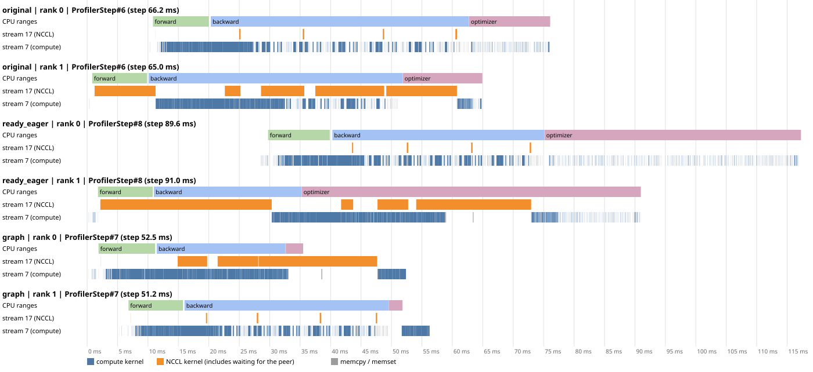

# Optimizer-only CUDA Graph follow-up

This experiment tests the submission-gap hypothesis in `notes.md` §6.4: does
replacing repeated Python optimizer dispatch with graph replay pack the optimizer
kernels more tightly, and does it align the next step across ranks?

Only `optimizer.step()` is captured. Forward, loss, backward, bucket rebuild,
all-reduces, gradient copy-back and the learning-rate scheduler remain eager.
MiniDDP uses rebuilt 25 MiB buckets with a 1 MiB first-bucket target; PyTorch DDP
uses its defaults. Both keep independent gradient tensors, rather than bucket views.

## Controls and implementation

| Mode | AdamW | Gradient lifetime | Submission |
| --- | --- | --- | --- |
| `original` | Day01 defaults: `foreach=False, fused=False, capturable=False`, Python float LR | `set_to_none=True` | Python dispatch every step |
| `ready_eager` | `foreach=False, fused=False, capturable=True`, CUDA scalar LR | Stable `.grad` addresses; zero in place | Python dispatch every step |
| `graph` | Same as `ready_eager` | Same as `ready_eager` | Replay captured optimizer kernels |

`ready_eager → graph` isolates replay under matching optimizer settings. Comparing
`original → graph` measures the net effect of this entire adaptation. Capturable
AdamW uses a different floating-point expression and additional device operations,
so these two comparisons answer different questions. Stable independent gradients
also remain allocated early in backward, affecting memory compared with the original.

`optimizer_graph.py` warms the optimizer on a side stream, captures if requested,
then restores parameters and zeros both moments and every Adam step counter.
No dummy update survives into training. Each real step verifies the captured
gradient and LR addresses. A bucket-view rebuild would change addresses, so this
experiment rejects `--grad-as-view`.

LambdaLR remains outside the graph. Its CUDA LR tensor is updated **in place**;
the next replay reads the new value. We record the LR actually used at each step
and check both the warmup and cosine portions. The scheduler is not frozen at the
capture-time LR.

## Reproduce

Use the preinstalled main environment, from the uploaded project root:

```bash
source /venv/main/bin/activate
python experiments/day03_ddp_hooks/run_optimizer_graph.py --run-id YOUR_NEW_ID
python experiments/day03_ddp_hooks/analyze_optimizer_graph.py \
  outputs/day03_cuda_graph/YOUR_NEW_ID
```

The runner stops if correctness fails. `--stage parity`, `timing` and `profile`
can be run separately. Use a fresh run ID; result files are protected against
accidental reuse. Outputs are separate from the October 28 Day03 measurements.

Correctness uses the tiny model for 24 steps, global batch 16, with a two-rank
flat-sync reference, the existing A/B/C tolerances, cross-rank checks, Adam counter
and LR-schedule checks, and bitwise comparison of matching eager/replay outputs.

Performance uses the medium model, global batch 16 = 2 × local batch 8, FP32,
deterministic kernels, TF32 disabled, `OMP_NUM_THREADS=MKL_NUM_THREADS=1`. There
are three repeats of 60 steps with the first 10 excluded; run order rotates.
Each run reports the median of the slower rank's core time per step. Core time
includes forward through optimizer/scheduler, with CUDA synchronization only at
the two ends. Batch creation and gradient zeroing are excluded. The LR evidence
copy adds one small eager device operation to both graph-ready modes.

Profiler jobs are separate: 14 steps, five warmup steps, three sampled steps per
rank. They explain structure and are not used for benchmark speedups. The analyzer
matches eager optimizer kernels through CPU operator external IDs, and replay
kernels through their nonzero graph ID. It reports GPU busy time, first-to-last
span and internal gaps independently.

Rank-start offsets use per-rank `perf_counter` timestamps on this same Linux host.
Profile figures additionally verify matching host and trace clock-base metadata,
select the median-length rank-0 sampled step, and show the same step ID on rank 1
with a shared origin. Each mode is a separate run; horizontal positions cannot
be compared as absolute times between modes.

## Results: `a100_nvlink_20261101`

Measured November 1 on 2 × A100-SXM4-40GB, **NV12**, PyTorch 2.14.1+cu130,
CUDA 13.0, NCCL 2.30.7, driver 595.71.05. Host exclusivity was not established
(`condition=unknown`). These are fresh within-host comparisons, not a subtraction
against the October 28 run. The mistakenly supplied NODE-topology host is not used
in any result below.

All tiny-model A/B/C checks pass against flat-sync. Graph-ready eager and replay
are bitwise identical for first-step gradients, first-update parameters, final
parameters and all 24 losses, for both DDP implementations. Adam counters are
exactly 24 and the actual LR follows warmup and cosine decay. Capturable AdamW
versus original AdamW differs by up to 5.96e-8 after the first update and 7.24e-5
after 24 updates; final drift is informational, not a claim of bitwise equivalence
to the original arithmetic. Every medium timing repeat also has an identical
60-step loss curve between matching eager/replay modes, with correct counters/LRs.

### Unprofiled core step time

Each cell shows the median of three run medians, with their min–max in brackets.
Percentage reductions use these summary medians.

| Implementation | Original ms | Ready eager ms | Graph ms | Graph time reduction vs original | vs ready eager |
| --- | --- | --- | --- | --- | --- |
| MiniDDP rebuild | 42.94 [42.90–43.33] | 49.65 [49.58–49.76] | 41.03 [40.73–41.07] | 4.44% | 17.35% |
| PyTorch DDP | 41.51 [41.05–42.53] | 48.85 [48.49–48.98] | 39.06 [38.77–39.63] | 5.88% | 20.03% |

**Replay helps, but the net gain over the original is modest.** The graph-ready
adaptation first makes eager slower. Most forward/backward and communication
submission still runs eagerly, and the graph-safe optimizer does more device
operations than the original. Peak allocated memory is approximately 1117 MiB
for original versus 1224 MiB for both ready eager and graph. The increase of
about **107 MiB is approximately one gradient buffer P = 104.7 MiB**. The likely
main cause is gradient lifetime: in-place zeroing keeps independent `.grad`
tensors alive through the early-backward peak, whereas `set_to_none=True` in
the original releases them. This follows the lifetime argument in notes §7.
The equal ready-eager and graph peaks support a shared adaptation cost rather
than a Graph-only cost. Without an allocation timeline or a one-variable memory
ablation, this does not exactly attribute the remaining few MiB or exclude other
optimizer/allocator contributions.

### What changed in the profiler

The following columns independently take the median of three sampled steps.
Busy time is a union of matched optimizer-kernel intervals. Span includes gaps;
the gap number is not a pure CPU-work duration.

| Implementation / rank | Original busy / span / gaps ms | Ready eager busy / span / gaps ms | Graph busy / span / gaps ms |
| --- | --- | --- | --- |
| MiniDDP / 0 | 2.22 / 12.25 / 10.04 | 4.85 / 37.25 / 32.39 | 4.49 / 4.59 / 0.095 |
| MiniDDP / 1 | 2.18 / 20.69 / 18.52 | 4.77 / 17.87 / 13.09 | 4.47 / 4.57 / 0.100 |
| PyTorch DDP / 0 | 2.22 / 20.64 / 18.42 | 4.85 / 41.29 / 36.44 | 4.50 / 4.60 / 0.097 |
| PyTorch DDP / 1 | 2.18 / 3.62 / 1.44 | 4.77 / 17.75 / 12.98 | 4.48 / 4.58 / 0.100 |

Original AdamW has **624 optimizer kernels** per rank per step. Both graph-ready
modes have **1950**: replay does not fuse these kernels or restore the original
624-kernel expression. The ready eager CPU optimizer scope issues 1953
`cudaLaunchKernel` calls (optimizer plus LR recording/scheduler). The graph scope
instead issues **one `cudaGraphLaunch` and three eager kernel launches**, while
the 1950 optimizer kernels run tightly packed. This directly supports the
submission-gap hypothesis. Profiled graph CPU scopes still take roughly 2–4 ms;
they are instrumented and include scheduler work, not a bare launch microbenchmark.

Both ranks, same step ID, shared time origin within each mode:




### Does the next step start simultaneously?

No. For each unprofiled run, take the median absolute difference between the
two ranks' core-start timestamps over its 50 measured steps. Then take the median
of those three run statistics:

| Implementation | Original start offset ms | Ready eager ms | Graph ms |
| --- | --- | --- | --- |
| MiniDDP rebuild | 9.67 | 11.57 | 1.74 |
| PyTorch DDP | 9.54 | 11.81 | 1.40 |

Graph substantially reduces the usual offset, but does not remove it. The maximum
observed graph offset is 8.75 ms for MiniDDP and 5.28 ms for DDP. This matches the
more precise version of the learner's prediction: removing optimizer submission
gaps reduces one source of renewed skew; it does not make the entire eager step
execute in lockstep. These offsets are core-start offsets, not a direct breakdown
of how much time each CPU or GPU waited.

### Saved evidence

All local evidence is under `outputs/day03_cuda_graph/a100_nvlink_20261101/`:
`parity_summary.json`, `validation_summary.json`, `timing_summary.json`,
`trace_analysis.json`, all 12 raw rank traces, 31 run results/metrics, both-rank
boundaries, logs, hardware inventory and a source snapshot. `SHA256SUMS` covers
the extracted originals and locally derived analysis. The immutable downloaded
archive is `outputs/day03_cuda_graph_a100_nvlink_20261101.tar.gz`, SHA-256
`60160539dff0cc1fcc5b2da9d4e8f81ff2f3903c6b3c70e4f2ed9b9bc3be4fb7`.

## Interpretation limits

Graph replay reduces repeated host launches; it is not a cross-rank barrier.
CPU forward/backward dispatch, scheduler work, gradient copies and communication
can still introduce skew. Tightly packed optimizer kernels alone do not establish
simultaneous next-step starts. Whole-step capture, fused/foreach AdamW, CUDA Graph
setup amortization and time-to-convergence are outside this experiment.
