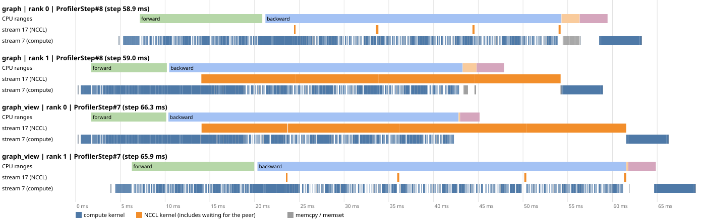
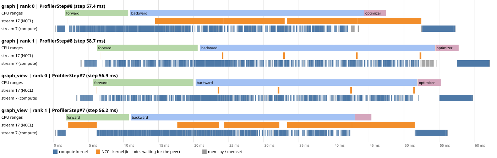
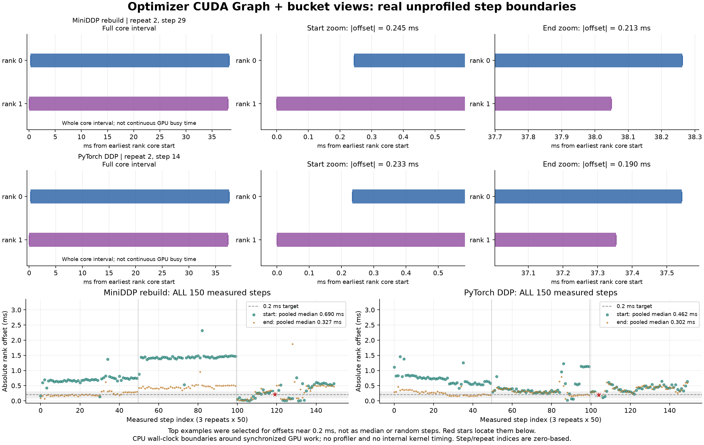

# Optimizer-only CUDA Graph follow-up

This experiment tests the submission-gap hypothesis in `notes.md` §6.4: does
replacing repeated Python optimizer dispatch with graph replay pack the optimizer
kernels more tightly, and does it align the next step across ranks?

Only `optimizer.step()` is captured. Forward, loss, backward, bucket rebuild,
all-reduces, gradient copy-back and the learning-rate scheduler remain eager.
MiniDDP uses rebuilt 25 MiB buckets with a 1 MiB first-bucket target; PyTorch DDP
uses its defaults. The November 1 experiment below keeps independent gradient
tensors. A subsequent bucket-view study removes the remaining gradient copy-back,
capturing only after rebuild and view addresses have stabilized. Testing it with
the profiler switched on and off shows that, on this workload, profiling itself
moves the ranks apart.

**Summary.** Optimizer replay removes the optimizer's launch gaps; bucket views
remove the 78 gradient copy-backs and one gradient buffer of peak memory. Together
they bring the two ranks' unprofiled step boundaries to typically **0.3 ms apart at
step end and 0.5–0.7 ms at step start**, with occasional steps above 1 ms: closer,
not lockstep. The 2–4 ms offsets seen in profiled traces are **created by the
profiler** on this launch-bound workload, including a CUDA-only profiler that
records no CPU operators. Alignment is therefore measured from unprofiled
boundaries; profiler traces document structure, not alignment.

## Controls and implementation

| Mode | AdamW | Gradient lifetime | Submission |
| --- | --- | --- | --- |
| `original` | Day01 defaults: `foreach=False, fused=False, capturable=False`, Python float LR | `set_to_none=True` | Python dispatch every step |
| `ready_eager` | `foreach=False, fused=False, capturable=True`, CUDA scalar LR | Stable `.grad` addresses; zero in place | Python dispatch every step |
| `graph` | Same as `ready_eager` | Same as `ready_eager` | Replay captured optimizer kernels |

`ready_eager → graph` isolates replay under matching optimizer settings. Comparing
`original → graph` measures the net effect of this entire adaptation. Capturable
AdamW uses a different floating-point expression and additional device operations,
so these two comparisons answer different questions. Stable independent gradients
also remain allocated early in backward, affecting memory compared with the original.

`optimizer_graph.py` warms the optimizer on a side stream, captures if requested,
then restores parameters and zeros both moments and every Adam step counter.
No dummy update survives into training. Each real step verifies the captured
gradient and LR addresses. The original November 1 implementation rejected
`--grad-as-view` because rebuild changes addresses. The subsequent implementation
supports it by running three setup backwards without optimizer updates first,
checking stable addresses on the last two, and preserving those views during
optimizer preparation. No `.grad = zeros_like(...)` rebinding is performed on
the bucket-view path. Setup gradients, dummy optimizer updates and RNG changes
are cleared/restored before real training.

LambdaLR remains outside the graph. Its CUDA LR tensor is updated **in place**;
the next replay reads the new value. We record the LR actually used at each step
and check both the warmup and cosine portions. The scheduler is not frozen at the
capture-time LR.

## Reproduce

Use the preinstalled main environment, from the uploaded project root:

```bash
source /venv/main/bin/activate
python experiments/day03_ddp_hooks/run_optimizer_graph.py --run-id YOUR_NEW_ID
python experiments/day03_ddp_hooks/analyze_optimizer_graph.py \
  outputs/day03_cuda_graph/YOUR_NEW_ID
```

The runner stops if correctness fails. `--stage parity`, `timing` and `profile`
can be run separately. Use a fresh run ID; result files are protected against
accidental reuse. Outputs are separate from the October 28 Day03 measurements.

Correctness uses the tiny model for 24 steps, global batch 16, with a two-rank
flat-sync reference, the existing A/B/C tolerances, cross-rank checks, Adam counter
and LR-schedule checks, and bitwise comparison of matching eager/replay outputs.

Performance uses the medium model, global batch 16 = 2 × local batch 8, FP32,
deterministic kernels, TF32 disabled, `OMP_NUM_THREADS=MKL_NUM_THREADS=1`. There
are three repeats of 60 steps with the first 10 excluded; run order rotates.
Each run reports the median of the slower rank's core time per step. Core time
includes forward through optimizer/scheduler, with CUDA synchronization only at
the two ends. Batch creation and gradient zeroing are excluded. The LR evidence
copy adds one small eager device operation to both graph-ready modes.

Profiler jobs are separate: 14 steps, five warmup steps, three sampled steps per
rank, recording CPU and CUDA activity. They explain structure and are not used for
benchmark speedups or rank alignment (see
[Profiler on versus off](#profiler-on-versus-off-the-trace-is-a-different-execution);
`train_ddp.py --profile-activities cuda` records GPU activity only). The analyzer
matches eager optimizer kernels through CPU operator external IDs, and replay
kernels through their nonzero graph ID. It reports GPU busy time, first-to-last
span and internal gaps independently.

Rank-start offsets use per-rank `perf_counter` timestamps on this same Linux host.
Profile figures additionally verify matching host and trace clock-base metadata,
select the median-length rank-0 sampled step, and show the same step ID on rank 1
with a shared origin. Each mode is a separate run; horizontal positions cannot
be compared as absolute times between modes.

## Results: `a100_nvlink_20261101`

Measured November 1 on 2 × A100-SXM4-40GB, **NV12**, PyTorch 2.14.1+cu130,
CUDA 13.0, NCCL 2.30.7, driver 595.71.05. Host exclusivity was not established
(`condition=unknown`). These are fresh within-host comparisons, not a subtraction
against the October 28 run. The mistakenly supplied NODE-topology host is not used
in any result below.

All tiny-model A/B/C checks pass against flat-sync. Graph-ready eager and replay
are bitwise identical for first-step gradients, first-update parameters, final
parameters and all 24 losses, for both DDP implementations. Adam counters are
exactly 24 and the actual LR follows warmup and cosine decay. Capturable AdamW
versus original AdamW differs by up to 5.96e-8 after the first update and 7.24e-5
after 24 updates; final drift is informational, not a claim of bitwise equivalence
to the original arithmetic. Every medium timing repeat also has an identical
60-step loss curve between matching eager/replay modes, with correct counters/LRs.

### Unprofiled core step time

Each cell shows the median of three run medians, with their min–max in brackets.
Percentage reductions use these summary medians.

| Implementation | Original ms | Ready eager ms | Graph ms | Graph time reduction vs original | vs ready eager |
| --- | --- | --- | --- | --- | --- |
| MiniDDP rebuild | 42.94 [42.90–43.33] | 49.65 [49.58–49.76] | 41.03 [40.73–41.07] | 4.44% | 17.35% |
| PyTorch DDP | 41.51 [41.05–42.53] | 48.85 [48.49–48.98] | 39.06 [38.77–39.63] | 5.88% | 20.03% |

**Replay helps, but the net gain over the original is modest.** The graph-ready
adaptation first makes eager slower. Most forward/backward and communication
submission still runs eagerly, and the graph-safe optimizer does more device
operations than the original. Peak allocated memory is approximately 1117 MiB
for original versus 1224 MiB for both ready eager and graph. The increase of
about **107 MiB is approximately one gradient buffer P = 104.7 MiB**. The likely
main cause is gradient lifetime: in-place zeroing keeps independent `.grad`
tensors alive through the early-backward peak, whereas `set_to_none=True` in
the original releases them. This follows the lifetime argument in notes §7.
The equal ready-eager and graph peaks support a shared adaptation cost rather
than a Graph-only cost. Without an allocation timeline or a one-variable memory
ablation, this does not exactly attribute the remaining few MiB or exclude other
optimizer/allocator contributions.

### What changed in the profiler

The following columns independently take the median of three sampled steps.
Busy time is a union of matched optimizer-kernel intervals. Span includes gaps;
the gap number is not a pure CPU-work duration.

| Implementation / rank | Original busy / span / gaps ms | Ready eager busy / span / gaps ms | Graph busy / span / gaps ms |
| --- | --- | --- | --- |
| MiniDDP / 0 | 2.22 / 12.25 / 10.04 | 4.85 / 37.25 / 32.39 | 4.49 / 4.59 / 0.095 |
| MiniDDP / 1 | 2.18 / 20.69 / 18.52 | 4.77 / 17.87 / 13.09 | 4.47 / 4.57 / 0.100 |
| PyTorch DDP / 0 | 2.22 / 20.64 / 18.42 | 4.85 / 41.29 / 36.44 | 4.50 / 4.60 / 0.097 |
| PyTorch DDP / 1 | 2.18 / 3.62 / 1.44 | 4.77 / 17.75 / 12.98 | 4.48 / 4.58 / 0.100 |

Original AdamW has **624 optimizer kernels** per rank per step. Both graph-ready
modes have **1950**: replay does not fuse these kernels or restore the original
624-kernel expression. The ready eager CPU optimizer scope issues 1953
`cudaLaunchKernel` calls (optimizer plus LR recording/scheduler). The graph scope
instead issues **one `cudaGraphLaunch` and three eager kernel launches**, while
the 1950 optimizer kernels run tightly packed. This directly supports the
submission-gap hypothesis. Profiled graph CPU scopes still take roughly 2–4 ms;
they are instrumented and include scheduler work, not a bare launch microbenchmark.

Both ranks, same step ID, shared time origin within each mode:


### Does the next step start simultaneously?

No. For each unprofiled run, take the median absolute difference between the
two ranks' core-start timestamps over its 50 measured steps. Then take the median
of those three run statistics:

| Implementation | Original start offset ms | Ready eager ms | Graph ms |
| --- | --- | --- | --- |
| MiniDDP rebuild | 9.67 | 11.57 | 1.74 |
| PyTorch DDP | 9.54 | 11.81 | 1.40 |

Graph substantially reduces the usual offset, but does not remove it. The maximum
observed graph offset is 8.75 ms for MiniDDP and 5.28 ms for DDP. This matches the
more precise version of the learner's prediction: removing optimizer submission
gaps reduces one source of renewed skew; it does not make the entire eager step
execute in lockstep. These offsets are core-start offsets, not a direct breakdown
of how much time each CPU or GPU waited.

### Saved evidence

All local evidence is under `outputs/day03_cuda_graph/a100_nvlink_20261101/`:
`parity_summary.json`, `validation_summary.json`, `timing_summary.json`,
`trace_analysis.json`, all 12 raw rank traces, 31 run results/metrics, both-rank
boundaries, logs, hardware inventory and a source snapshot. `SHA256SUMS` covers
the extracted originals and locally derived analysis. The immutable downloaded
archive is `outputs/day03_cuda_graph_a100_nvlink_20261101.tar.gz`, SHA-256
`60160539dff0cc1fcc5b2da9d4e8f81ff2f3903c6b3c70e4f2ed9b9bc3be4fb7`.

## Bucket-view follow-up: removing the gradient copy-back

**Hypothesis.** After optimizer replay, the largest remaining eager tail is the
copy of 78 averaged bucket slots back into independent `.grad` tensors. With bucket
views (`--grad-as-view`), `.grad` *is* the bucket slot, so that copy disappears.
If the copy-back is what keeps the ranks apart, removing it should bring their step
boundaries close together.

Measured November 2 on the accessible dual-A100 **NV12** instance, with the same
PyTorch/CUDA/NCCL versions and `condition=unknown`. The CPU-affinity topology
differs from the November 1 inventory, so every baseline is rerun here; numbers
are not subtracted across dates. There is no added per-step rank barrier. Two runs
on the same instance make up the study:

| Run ID | Purpose |
| --- | --- |
| `a100_nvlink_view_20261102` | parity; unprofiled timing, memory and rank offsets, independent gradients vs views (3 × 60 steps); profiled structure |
| `a100_profiler_overhead_20261102` | the views configuration with the profiler as the only variable: none, CUDA-only, CPU+CUDA (3 repeats each) |

### Capture after rebuild, rather than capture stale pointers

`train_ddp.py --optimizer-mode graph --grad-as-view` performs three setup
forward/backward/sync passes **without taking optimizer updates**. This establishes
the actual bucket layout and gradient views. It requires identical gradient
addresses in the last two passes and checks that every gradient has a view base.
It restores RNG state, preserves the views while preparing AdamW, then clears
dummy optimizer updates, moments, counters and gradients before training. Every
real update continues to check gradient/LR addresses. Thus the captured optimizer
reads the same bucket slots that subsequent backward and NCCL write.

The parity stage compares four cases per implementation: ready eager and graph,
each with independent gradients or views. All A/B/C checks pass against flat sync.
The tiny 24-step saved gradients, first-update parameters, final parameters and
loss curves are **bitwise identical** between matched eager/replay cases and
between independent/view graph cases. All three medium timing repeats also
have identical 60-step loss curves between graph cases, correct Adam counters
and changing LRs. Bootstrap metadata records zero real updates during setup.

### Does the memcpy disappear?

Yes: all three sampled steps on **both ranks of both implementations** show
78 gradient copy-back operations totaling **104.6875 MiB** with independent
gradients, and **zero** with bucket views. MiniDDP's copies are matched through
`## finish_grad_sync`; DDP's through `copy_bucket_to_grad` and CPU/GPU external
IDs. These are same-device DtoD copies, not additional inter-GPU collectives.

Other gray activity remains. Total memcpy events fall from 95 to 17 per sampled
rank-step, and bytes from 152.7500 to 48.0625 MiB. The surviving copies belong to
other eager work (including backward internals, batch transfer and LR handling).
Bucket views remove the gradient return path, not all copies in the model. The
view graphs still run 1950 optimizer kernels per rank with about 0.1 ms of internal
gaps, just like the independent-gradient graph.

The figures show one profiled step per rank, independent gradients against views,
for this structure. Their horizontal offsets between ranks are **not**
representative of training: profiling itself shifts the ranks apart (see
[Profiler on versus off](#profiler-on-versus-off-the-trace-is-a-different-execution)).





### Unprofiled performance and memory

Same medium/global-batch-16 configuration, 60 steps, 10 excluded, three repeats;
order alternates. Time cells are median [min–max] of run medians. The control
is already optimizer Graph with persistent **independent** gradients.

| Implementation | Graph independent ms | Graph + views ms | Peak independent / views MiB |
| --- | --- | --- | --- |
| MiniDDP rebuild | 39.25 [37.08–40.46] | 38.30 [38.22–39.18] | 1223.90 / 1119.21 |
| PyTorch DDP | 39.48 [31.76–39.48] | 37.35 [37.25–37.82] | 1223.90 / 1119.21 |

The peak decreases by **exactly 104.6875 MiB = P** in this matched comparison,
supporting the persistent-gradient explanation for the earlier memory increase.
The time summary favors views, but ranges overlap and one DDP independent run
is unusually fast (31.76 ms). Per-repeat independent-minus-view differences are
**+2.16, -2.10, +1.03 ms** for MiniDDP and **-6.06, +2.13, +2.23 ms** for DDP.
These repeats do not establish an improvement on every run or isolate a fixed
copy-back cost; the removed memcpy busy time itself is only about 0.32–0.35 ms
per rank in the profiles, with additional submission and waiting gaps.

### Are the ranks now synchronized?

They are closer, but not locked together. Each cell below is the median of three
run medians of absolute same-step timestamp differences, measured **without the
profiler**; start means core start after batch creation/zeroing, and end follows
the existing end-of-core device synchronization. Maximum start differences cover
all 150 measured steps per case.

| Implementation | Start offset independent → views ms | End offset independent → views ms | Max start offset with views ms |
| --- | --- | --- | --- |
| MiniDDP rebuild | 1.524 → 0.684 | 1.199 → 0.296 | 3.088 |
| PyTorch DDP | 2.106 → 0.412 | 1.081 → 0.296 | 1.455 |

Pooling all 150 view steps per implementation gives the same picture with its
spread:

| Implementation + views | Start offset median / p90 / max ms | End offset median / p90 / max ms | Steps with start ≤ 0.3 ms / end ≤ 0.3 ms |
| --- | --- | --- | --- |
| MiniDDP rebuild | 0.690 / 1.456 / 3.088 | 0.327 / 0.507 / 1.877 | 20% / 47% |
| PyTorch DDP | 0.462 / 0.836 / 1.455 | 0.302 / 0.477 / 0.797 | 17% / 49% |

The hypothesis is supported in its weaker form: eliminating copy-back removes
another source of renewed skew. Step **ends** are typically about 0.3 ms apart;
step **starts** remain 0.5–0.7 ms apart and exceed 1 ms in roughly one step in ten
for MiniDDP. That is reduced skew, not simultaneous step boundaries, and it does
not establish that one GPU is always later. Remaining sources include eager
forward/backward dispatch, scheduler work, graph-launch submission and host
scheduling; they were not separately isolated.

#### Unprofiled boundary offsets: all steps, plus two illustrative examples

The lower panels of the figure below plot all 150 unprofiled offsets per
implementation; their medians are in the pooled table above. The upper panels zoom
into one step per implementation, chosen to minimize
`|abs(start_offset)-0.2| + |abs(end_offset)-0.2|`. These two examples are
**target-selected to illustrate the 0.2 ms scale; they are not typical steps**:
only about one step in five has a start offset that small, so read the typical
offsets from the pooled table, not from the examples.

| Implementation | Repeat / step (zero-based) | Absolute start offset ms | Absolute end offset ms |
| --- | --- | --- | --- |
| MiniDDP rebuild + view | 2 / 29 | 0.244519 | 0.212768 |
| PyTorch DDP + view | 2 / 14 | 0.233099 | 0.189529 |

Both examples have rank 1 arriving and ending earlier than rank 0. Bars represent
CPU `perf_counter` core boundaries enclosing synchronized GPU work, **not GPU
kernel execution or continuous device busy time**. The lower panels show all
150 offsets, with the examples marked by stars. Their pooled medians are not
the median-of-three-run-medians statistic used in the preceding table.



Regenerate with `python day03/assets/draw_unprofiled_boundaries.py`. The adjacent
`unprofiled_view_boundaries.json` records the selection rule, original timestamp
rows, all 150 offsets per implementation and input-file SHA-256 hashes.

### Profiler on versus off: the trace is a different execution

The natural next step was to show the sub-millisecond alignment inside a GPU
trace. Profiled view runs do not show it: their ranks end several milliseconds
apart. To find out whether the trace reveals an offset the boundaries miss, or
whether profiling creates it, `a100_profiler_overhead_20261102` reruns the views
configuration and changes **only the profiler**. The configuration is medium,
global batch 16, optimizer Graph with bucket views, MiniDDP with rebuilt 25 MiB
buckets and a 1 MiB first bucket, and PyTorch DDP defaults. Each run has 18 steps
with 5 warmup steps. Three settings, three repeats each, in rotating order:

| Setting | What is recorded |
| --- | --- |
| `none` | no profiler |
| `cuda` | `ProfilerActivity.CUDA` only: CUPTI kernel, memcpy/memset and CUDA runtime records; no CPU operators, no `ProfilerStep` ranges |
| `cpu_cuda` | CPU and CUDA activity, as in every other trace in this file |

All three use the **same metric**, the ranks' `perf_counter` core-start and
core-end boundaries, on the **same step indices**, 6–11: exactly the steps the
profiler records in the profiled runs. Each cell pools 3 repeats × 6 steps = 18
rank-step pairs.

| Implementation | Setting | Start offset median / max ms | End offset median / max ms | Core step, slower rank, median ms |
| --- | --- | --- | --- | --- |
| MiniDDP rebuild + views | none | **0.171** / 0.637 | **0.145** / 0.332 | 35.56 |
| | cuda | 1.953 / 3.819 | 1.939 / 2.947 | 47.95 |
| | cpu_cuda | 2.224 / 4.124 | 2.303 / 3.092 | 54.85 |
| PyTorch DDP + views | none | **0.354** / 0.802 | **0.308** / 0.685 | 34.81 |
| | cuda | 2.684 / 4.243 | 3.260 / 3.460 | 44.67 |
| | cpu_cuda | 4.318 / 5.945 | 3.480 / 3.759 | 55.54 |

**The offset appears whenever a profiler runs.** Without one, the step window
matches the unprofiled view runs above: end offsets 0.15 / 0.31 ms. With either
profiler setting, both offsets grow to about 2–4 ms and the step lengthens by
10–20 ms. The CUDA-only profiler records no CPU operators, yet it accounts for most
of the effect. Per step it still records about 2,760 kernels and 1,020–1,050 CUDA
runtime calls; CPU+CUDA adds about 3,700–3,860 CPU operator records. This step is
launch-bound, so per-launch instrumentation lengthens eager forward/backward
submission. The two ranks are not slowed equally, which recreates the kind of
CPU-submission skew that optimizer replay and bucket views had removed.

**The traces report their own run accurately.** In the profiled runs, the end of
each optimizer replay (kernels with a nonzero `graph id`, grouped into replays,
one per step) differs between ranks by 1.942 / 2.302 ms (MiniDDP, `cuda` /
`cpu_cuda`) and 3.255 / 3.478 ms (DDP), medians of 18. The boundary end-offset
medians in the same runs are 1.939 / 2.303 and 3.260 / 3.480 ms. The trace is not
misreporting; the profiled run really is offset. It is a different execution from
unprofiled training.

**Conclusion.** On this host and workload, a torch.profiler trace cannot
demonstrate the unprofiled alignment, even at CUDA-only granularity. Rank
alignment is therefore reported from unprofiled boundaries; traces remain the
evidence for structure: removed copy-backs, 1950 packed replay kernels, launch
counts.

Limits: 18 steps per cell from the early part of 18-step runs, so the 150-step
distribution above is the better estimate of typical unprofiled offsets (its start
offsets are larger, 0.46–0.69 ms). The experiment does not isolate why the
profiled ranks slow unequally (CUPTI buffering, host scheduling, CPU placement).
It does not test lower-overhead tracing such as Nsight Systems or an NVTX-only
capture, which might perturb less and would need its own measurement.

### Reproduce and evidence

```bash
python experiments/day03_ddp_hooks/run_optimizer_graph.py \
  --run-id YOUR_NEW_VIEW_ID --bucket-view-study
python experiments/day03_ddp_hooks/verify_optimizer_graph_artifacts.py \
  outputs/day03_cuda_graph_view/YOUR_NEW_VIEW_ID
python experiments/day03_ddp_hooks/analyze_graph_views.py \
  outputs/day03_cuda_graph_view/YOUR_NEW_VIEW_ID
python experiments/day03_ddp_hooks/run_profiler_overhead.py --run-id YOUR_NEW_ID
python experiments/day03_ddp_hooks/analyze_profiler_overhead.py \
  outputs/day03_profiler_overhead/YOUR_NEW_ID
```

`outputs/day03_cuda_graph_view/a100_nvlink_view_20261102/` contains parity and
validation summaries, all 25 runs, eight raw rank traces, boundary timestamps,
`timing_summary.json`, `view_analysis.json`, logs, hardware inventory and source.
The complete downloaded archive is
`outputs/day03_cuda_graph_view_a100_nvlink_view_20261102.tar.xz`, SHA-256
`49084413b0c41bcd7c7d953bc91bd620d5373b9c914e6e6a8d0d8fcea6f7f4f2`.

`outputs/day03_profiler_overhead/a100_profiler_overhead_20261102/` has
`summary.json` (boundary offsets), `trace_offsets.json` (trace-level replay-end
offsets), per-run boundaries, metrics and logs, the driver log, and `SHA256SUMS`
over those files. Its 24 raw rank traces are in
`outputs/day03_profiler_overhead/traces_a100_profiler_overhead_20261102.tar.gz`,
SHA-256 `5e4765c9d98de631411ee4f6b370241d8d67ee7f2adcd9d11c7167bde756584d`.

## Interpretation limits

Graph replay reduces repeated host launches; it is not a cross-rank barrier.
CPU forward/backward dispatch, scheduler work, gradient copies and communication
can still introduce skew. Tightly packed optimizer kernels alone do not establish
simultaneous next-step starts. With bucket views as well, unprofiled step ends are
typically ~0.3 ms apart and starts 0.5–0.7 ms; this is measured on one host with
two GPUs and is not a general lockstep guarantee.

Profiled step times and cross-rank offsets are not representative of unprofiled
training on this launch-bound workload: profiling adds 10–20 ms per step and
2–4 ms of offset. Whole-step capture, fused/foreach AdamW, CUDA Graph setup
amortization, lower-overhead tracers and time-to-convergence are outside these
experiments.
