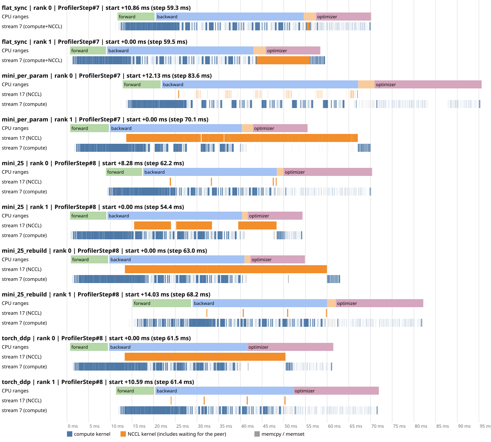
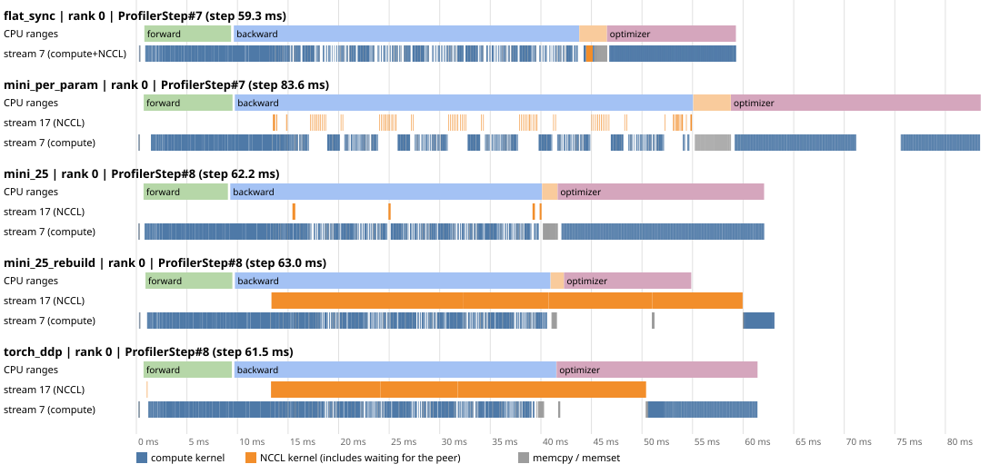
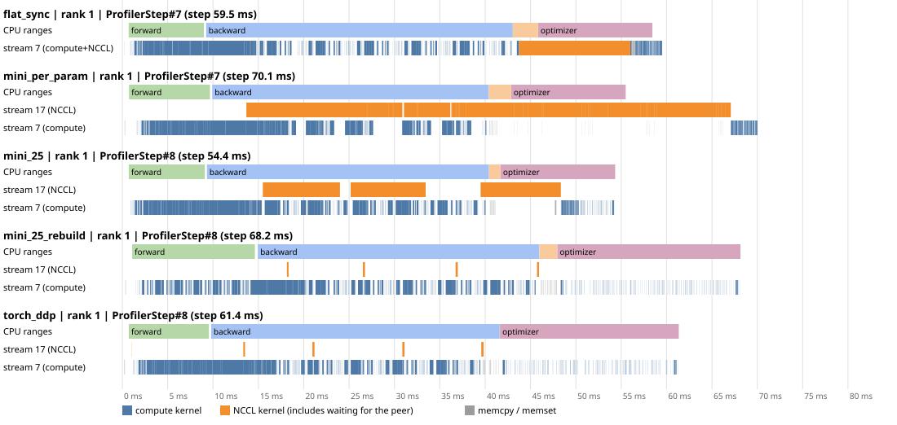

# Day 03 — DDP and autograd gradient hooks (guide, dual-A100 edition)

**Goal:** by tonight you can explain, and have shown in a profiler trace on your own GPUs, how DistributedDataParallel hides gradient communication behind the backward pass: which autograd event says "this gradient is final", why gradients travel in **buckets**, why buckets must be **launched in the same order on every rank**, and what the remaining (exposed) communication is made of. You build it yourself as `MiniDDP` (hooks + buckets + async `all_reduce`, ~150 lines), check it against Day 02 and against real DDP, then read DDP's C++ `Reducer` and find each of your pieces in it.

Day 02 left a number on the table: on the medium model with global batch 16, the synchronous flat sync took **4.60 ms of a 41.35 ms step (11%)**, and nothing else ran while it did. Today asks how much of that can be hidden, and why not all of it.

**Done means:**

- [x] `hook_order.py` run for `tiny` and `medium`; you can say why the gradient-ready order is *not* the reverse of the registration order for this model, and what that does to the first bucket layout
- [x] `MiniDDP` written by you (the **YOU WRITE** parts of `mini_ddp.py`), diffed against the reference
- [x] `compare_ddp.py --stage parity` prints `PARITY: ALL CHECKS PASSED`: every variant passes Day 02's checks A/B/C, prints `bitwise == flat_sync: True`, and `bug_early_launch` is `DETECTED`
- [x] Timing table measured (`--stage timing`, 3 repeats): you can name the **overhead over `none`** of `flat_sync`, per-parameter hooks, your buckets and real DDP, and the peak memory of each
- [x] Profiler traces (`--stage profile`) analyzed for per-param, `mini_25_rebuild` and `torch_ddp`, including both ranks and aligned SVG timelines; the overlap table and peer-waiting interpretation explained in the notes
- [x] Ablation and regimes (`--stage ablation`, `--stage regimes`) run: non-gradient-communication overhead and the slower-link regime where overlap beats flat_sync recorded, with individual CPU costs left unisolated
- [x] DDP call chain traced from `DistributedDataParallel.__init__` to `Reducer::finalize_backward` (Block 3); `day03/notes.md` written
- [x] You can answer, without notes: *why can DDP hide gradient communication behind backward, and what limits how much it can hide?*

---

## Read this first: same host, new folder

Same machine and rules as Day 02: **one Vast.ai instance, 2 × A100-SXM4-40GB, NV12, default NCCL settings (Day 02 observed `P2P/CUMEM/read`)**, torch 2.14.1+cu130, NCCL 2.30.7, `--condition shared`. For this measured run, you cloned the project on the server (commit `00f887f6e64b5c4ecdeb96e3fa12c29d97ae1fcf`). If setting up a future instance from an uploaded project instead, copy today's folder from your Windows project root:

```bash
scp -P 26936 -r experiments/day03_ddp_hooks root@23.127.144.217:/workspace/AI-Infra-Learning/experiments/
```

Then, on the instance:

```bash
cd /workspace/AI-Infra-Learning
source .venv/bin/activate
export CUDA_VISIBLE_DEVICES=0,1 OMP_NUM_THREADS=1
unset NCCL_P2P_DISABLE NCCL_SHM_DISABLE NCCL_ALGO
python -m torch.distributed.run --standalone --nproc_per_node 2 experiments/day02_data_parallel/hello_dist.py --device cuda   # smoke: stop if it fails
```

Today's code imports Day 01 (`train.py`) and Day 02 (`ddp_manual.py`, `check_parity.py`, `launch_utils.py`, `find_symbols.py`). The captured server sources and Git metadata for this run are saved under `outputs/day03_source_a100_20261028T040220Z/` and `outputs/day03_closeout_a100_20261028T040220Z/`; use them when checking provenance rather than assuming the live checkout stayed unchanged.

**Measurement status.** Appendix A and `notes.md` now use **your server run on 2026-10-28**, `a100_20261028T040220Z`, rather than the assistant's pre-test. The experiments have already been collected; analyze the downloaded artifacts offline. For any future run, use a fresh run id and record predictions before viewing its results. Historical Day 02 baselines remain explicitly labeled as Day 02 measurements.

---

## Files

| File | What it is |
| --- | --- |
| `experiments/day03_ddp_hooks/hook_order.py` | One process, no NCCL. (1) `register_hook` vs `register_post_accumulate_grad_hook`; (2) registration order vs gradient-ready order; (3) bucket layouts and in-order launch waits for a given cap |
| `experiments/day03_ddp_hooks/mini_ddp.py` | **The core.** `assign_buckets` + `MiniDDP`: broadcast, buckets, post-accumulate hooks, in-order async launch, `finish_grad_sync`, optional rebuild and `grad_as_view`, two negative controls. Parts marked **YOU WRITE** |
| `experiments/day03_ddp_hooks/train_ddp.py` | One harness, `--impl none / flat_sync / mini_ddp / torch_ddp`; times the core step; `--profile` writes Chrome traces |
| `experiments/day03_ddp_hooks/compare_ddp.py` | Orchestrator: smoke → `parity` → `timing` → `profile`. Launch with plain `python` |
| `experiments/day03_ddp_hooks/analyze_trace.py` | Reads the traces: NCCL time, overlap with compute, exposed NCCL, number of NCCL kernels; draws an SVG timeline. Pure Python |
| `experiments/day03_ddp_hooks/sampler_demo.py` | Side exercise: what `DistributedSampler` gives each rank (interleaving, padding, `set_epoch`) |
| `experiments/day03_ddp_hooks/find_symbols.py` | `file:line` of today's Python reading list in *your* install, plus the C++ files to open on GitHub |
| `day03/GUIDE.md`, `day03/notes.md` | This guide; write-up using your measured run |
| `day03/assets/overlap_schematic.svg` | §1.1 schematic: synchronous sync vs bucketed overlap on one rank; drawn by `draw_overlap_schematic.py` |
| `day03/assets/overlap_timeline.svg` | One medium step per variant, from your `a100_20261028T040220Z` rank-0 traces |
| `day03/assets/overlap_timeline_rank1.svg` | Matching rank-1 step IDs, with the same time scale; generated together by `draw_rank_timelines.py` |
| `day03/assets/overlap_timeline_both_ranks.svg` | Both ranks on a shared time origin within each variant; use this to compare actual arrival/completion times |

---

## Block 1 — Design (30 min): draw these and write predictions before you run anything

### 1.1 What Day 02 left on the table

![One rank, one medium step. Top, Day 02 flat_sync: forward, the whole backward, then cat, one all_reduce on the compute stream and a copy back before the optimizer, so all communication is exposed. Bottom, MiniDDP/DDP: backward is split into four bucket groups (head; norm and blocks 5–4; blocks 3–2; blocks 1–0 and the embedding); as each group's gradients become final, its bucket (16, 28, 28, 32.5 MiB) is all-reduced on a separate NCCL stream while backward continues. Orange ticks mark the per-parameter hook work inside backward; only the last bucket, the copy back and rank skew remain exposed after backward](assets/overlap_schematic.svg)

The figure is schematic (not to scale; redraw it with `python day03/assets/draw_overlap_schematic.py`). Two details agree with your run: the bucket sizes are the medium model's rebuilt layout (§1.4), and `flat_sync`'s synchronous all-reduce runs on the **compute stream** itself (profiler, Appendix A.5), not on a separate NCCL stream.

Backward computes gradients **from the output towards the input**. `head`'s gradient is final after a few kernels; `token_emb`'s only at the very end. Day 02 waits for the last one before sending any. If gradients travel *while* backward is still producing the others, communication time is hidden behind compute, except for whatever is sent **after the last gradient is ready**. That tail can never be hidden by overlapping with backward.

### 1.2 When is a gradient "final"? The post-accumulate hook

For a parameter (a leaf tensor) autograd runs an `AccumulateGrad` node that writes the incoming gradient into `p.grad` (it *steals* the tensor when `p.grad` is None, or adds into it). Two hooks exist, and they differ in one way that matters:

| Hook | Called with | When | `p.grad` at that moment |
| --- | --- | --- | --- |
| `p.register_hook(fn)` | the incoming gradient | before `AccumulateGrad` | not yet updated |
| `p.register_post_accumulate_grad_hook(fn)` | the parameter | after `AccumulateGrad` | final for this backward |

`hook_order.py` Part 1 shows it with a parameter used twice and two backwards without `zero_grad` (accumulation, Day 4):

```text
backward #1   register_hook: incoming grad 5.0, w.grad = None      post_accumulate: w.grad = 5.0
backward #2   register_hook: incoming grad 5.0, w.grad = 5.0       post_accumulate: w.grad = 10.0
```

Autograd sums the two uses (2 + 3) *before* the parameter's single `AccumulateGrad`, so each hook fires once per backward. Only the post-accumulate hook sees the value that is ready to send. DDP's C++ `Reducer` attaches the same kind of hook: `grad_accumulator->add_post_hook(...)` in its constructor (Block 3, Stop 3).

### 1.3 Why buckets? One collective per parameter is latency, one for everything is no overlap

Use Day 02's measured all-reduce curve (Appendix A of Day 02): a small all-reduce costs **~65–70 µs** whatever its size; 16 MiB takes ~0.19 ms; 64 MiB ~0.50 ms; 256 MiB ~1.75 ms (~153 GB/s). A simple model for one bucket of $S_b$ bytes:

$$T_b \approx \alpha + \frac{S_b}{\beta}, \qquad \alpha \approx 65\ \mu\text{s},\ \beta \approx 130\text{–}150\ \text{GB/s at tens of MiB}$$

| Strategy | Collectives per step (medium) | Latency part | Overlap |
| --- | --- | --- | --- |
| Day 02 `flat_sync` | 1 × 105 MiB | 1 × α | none: starts after backward |
| Per-parameter hooks (`--bucket-mb 0`) | 78 | 78 × α ≈ 5 ms of latency if run back to back | yes, but 78 tiny messages queue on one NCCL stream |
| Buckets of ~25 MiB | 4 | 4 × α | yes; the last bucket is exposed |

The latency is paid on the NCCL stream, not on the compute stream, so 78 × α does not necessarily show up in the step time: it only does if the NCCL queue is still busy after backward ends. Write down your prediction for **per-param vs buckets** before running.

Three things make up the exposed tail, and only the first depends on the bucket size:

1. **The last bucket.** It contains the gradients that are ready last (the input embedding). Its all-reduce starts when backward ends: $\alpha + S_\text{last}/\beta$. Here `token_emb.weight` alone is 16 MiB, so the last bucket is ≥ 16 MiB (≈ 0.2 ms) whatever the cap.
2. **Copy-back** (unless `grad_as_view`): one copy kernel per parameter from bucket to `p.grad`.
3. **Rank skew.** A collective finishes only when the slower rank arrives. If rank 1's backward is 1 ms behind, rank 0 waits 1 ms inside its last all-reduce. No overlap trick removes this; a faster link does not either.

### 1.4 Which gradient is ready first? Order, and the in-order launch rule

Before the first backward nobody knows the order, so DDP guesses **reverse registration order** (`model.parameters()` reversed): the last-defined layer should produce its gradients first. `hook_order.py` Part 2 measures the real order with post-accumulate hooks. For the tiny model:

```text
reg#  ready#  name
  10      26  blocks.0.norm1.weight     <- registered after linear1/linear2 ...
   8      17  blocks.0.linear2.weight   <- ... but ready long before norm1
ready order == reverse registration order? False  (26/30 positions differ)
```

Why: inside a pre-norm `TransformerEncoderLayer` the parameters are *registered* as `self_attn, linear1, linear2, norm1, norm2`, but *used* as `norm1 → self_attn → norm2 → linear1 → linear2`. Backward visits them in reverse use order, so `norm1` (registered late, used first) is ready **last** in its block.

Now the rule that makes this matter: **buckets are launched strictly in bucket index order**. Rule 1 from Day 02: every rank must issue the same collectives in the same order. For this model the hooks happen to fire in the same order on both ranks, but nothing guarantees that in general. Launching by bucket index makes the order part of the bucket layout, which all ranks share. The cost: a bucket that fills early waits for every earlier bucket. Part 3 on tiny with a 0.25 MiB cap:

```text
reverse-registration layout          bucket 0 is complete only at hook 15, so buckets 1 and 2 (ready at 7 and 13) wait for it
                                     -> 20 hook-steps of extra in-order waiting
recorded ready-order layout          0 hook-steps of waiting
```

That is why DDP **rebuilds its buckets after the first iteration** from the order its hooks recorded (`rebuild_buckets`), and broadcasts rank 0's layout so every rank agrees (`sync_bucket_indices`). In torch 2.14, DDP without `find_unused_parameters` actually puts **all parameters in one bucket for the first iteration** (`compute_bucket_size_limits` returns `[sys.maxsize]`): the first iteration does not overlap at all, it only records the order. Your `MiniDDP` starts from the reverse-registration guess instead, so you can see what a wrong order costs.

For **medium** with DDP's caps (1 MiB first bucket, then 25 MiB), Part 3 shows only 4 buckets, and the 1 MiB cap is overshot at once because `head.weight` alone is 16 MiB. The last bucket is ~32.5 MiB and ends with `token_emb.weight`, the last gradient of backward.

### 1.5 Prediction worth making: bitwise equality at W = 2

Day 02 compared 1 GPU vs 2 GPUs with a tolerance, and ranks of one run with exact equality. Today there is a third comparison: **flat_sync vs MiniDDP vs DDP, all on 2 ranks.** Predict before running: equal within a tolerance, or bitwise equal?

Argument for bitwise at W = 2: each local gradient is computed by the same deterministic kernels on the same rows. The all-reduce then computes, element by element, $\mathrm{fl}(a + b)$, one rounding, and $\mathrm{fl}(a+b) = \mathrm{fl}(b+a)$. Bucket boundaries only change *which* elements travel together, not the operation on any element. DDP and `MiniDDP` pre-scale by $1/W$ while Day 02 divides after the sum; with $W = 2$ the factor 0.5 is exact in binary floating point, so $\mathrm{fl}(a/2 + b/2) = \mathrm{fl}(a+b)/2$ (outside the subnormal range). Same averaged gradient → same AdamW update → same parameters, by the induction from Day 02.

Why it would **not** hold in general: with $W \ge 3$, $(a+b)+c \ne a+(b+c)$ in floating point. Which rank's value is added first depends on the element's position in the ring's chunks, which depends on the bucket layout, and $1/3$ is not exact. Then implementations are only *close*. This host cannot test $W = 3$ on GPUs; say so in the notes instead of claiming it.

### 1.6 Memory: who holds a gradient-sized buffer?

$P$ = 104.7 MiB of fp32 gradients (medium).

| Variant | Persistent gradient memory | Transient |
| --- | --- | --- |
| `none` / 1 GPU | `p.grad`: P | — |
| `flat_sync` | P | a flat P during the sync (`torch.cat`) |
| `mini_ddp`, `torch_ddp` | `p.grad` P + buckets P = **2P** | — |
| `--grad-as-view` | **P**: `p.grad` *is* a view of the bucket | — |

Peak memory adds activations (they dominate at the start of backward, Day 01) and Adam state (2P). Predict which variants have the same peak and which is ~P lower. One trap: with `grad_as_view` you must zero gradients **in place** (`zero_grad(set_to_none=False)`). `set_to_none=True` drops the views; the next backward then allocates new gradients and copies them into the bucket, which is still correct but loses the saving. `train_ddp.py` does this for you.

### 1.7 Your predictions (fill in before Block 4)

| Quantity | How to estimate | Your prediction |
| --- | --- | --- |
| Number of buckets, medium, caps 1/25 MiB | Part 3 of `hook_order.py` | 4 (16, 28, 28, 32.5) MiB |
| Exposed tail of the last bucket | $\alpha + S_\text{last}/\beta$ with Day 02's curve | |
| Overhead of `flat_sync` over `none` | Day 02's sync phase, plus rank skew | |
| Overhead of per-param hooks over `none` | 78 × α on the NCCL stream: is any of it after backward? | |
| Overhead of `mini_25_rebuild` / `torch_ddp` over `none` | last bucket + copy-back + skew | |
| Peak memory difference with `grad_as_view` | §1.6 | Maybe size of P, but actually no difference |
| `bitwise == flat_sync` at W = 2 | §1.5 | True |

### 1.8 New rules (on top of Day 02's four)

1. **Hooks run in the middle of backward, on autograd's thread.** Keep them cheap; never block in them (no `.item()`, no `wait()`).
2. **Launch in a fixed, shared order.** Bucket index order, the same layout on every rank (broadcast it if it is computed at runtime).
3. **Wait before you read.** `work.wait()` before anything on the compute stream touches the bucket. On NCCL it makes the current stream wait; it does not block the CPU.
4. **Reset per-iteration state in forward** (pending counters, next bucket), and check at the end that every bucket was launched. A missing hook on one rank means the other rank waits in a collective until the timeout.

---

## Block 2 — Code (2 h)

### Stage 0 (15 min): look before you build

```bash
python experiments/day03_ddp_hooks/hook_order.py --device cuda                                          # tiny, cap 0.25 MiB
python experiments/day03_ddp_hooks/hook_order.py --preset medium --bucket-mb 25 --first-bucket-mb 1 --device cuda
python experiments/day03_ddp_hooks/sampler_demo.py
```

Save the Part 2/3 output in your notes. For the sampler: rank $r$ gets indices $r, r+W, \dots$ (interleaved, not contiguous); with $N=10, W=3$ two indices are repeated so every rank gets 4 (equal shard sizes keep "mean of local means = global mean" exact, Day 02 §1.3); `drop_last=True` drops one sample instead; `set_epoch` must be called with the same epoch on every rank or the ranks shuffle differently. Today's harness keeps Day 02's contiguous row slices, because the parity test needs the same rows per rank as the reference. A real training job would use the sampler.

### Stage 1 (25 min): per-parameter async hooks, from memory

Write this yourself in a scratch file before you open `mini_ddp.py`. It is the smallest overlapped DDP:

```python
class PerParamDDP(torch.nn.Module):
    def __init__(self, module):
        super().__init__()
        self.module, self.world, self.works = module, dist.get_world_size(), []
        for t in list(module.parameters()) + list(module.buffers()):
            dist.broadcast(t.data, src=0)    # same start (Day 02), buffers (like casual mask) included
        for p in module.parameters():
            p.register_post_accumulate_grad_hook(self._hook)

    def _hook(self, p):                      # p.grad is final for this backward
        p.grad.div_(self.world)              # pre-scale (exact for W = 2)
        self.works.append(dist.all_reduce(p.grad, async_op=True))   # returns at once; NCCL stream runs it

    def forward(self, *a, **k):
        self.works.clear()
        return self.module(*a, **k)

    def finish_grad_sync(self):               # after backward, before optimizer.step()
        for w in self.works:
            w.wait()                          # current stream waits for NCCL; no CPU block
```

Questions to answer before moving on:

- Why does this not deadlock even though the all-reduces are issued from inside backward? (Both ranks fire the hooks in the same order for this model. What if they did not?)
- Which stream does `p.grad.div_` run on, and why does the all-reduce not read `p.grad` before `div_` is done? (Day 02, Stop 4: the async path makes the NCCL stream wait on an event recorded on the current stream.)
- What happens if you forget `finish_grad_sync()`? (Try it later: it is the `no_wait` control.)

### Stage 2 (45 min): buckets — write the **YOU WRITE** parts of `mini_ddp.py`

Copy `mini_ddp.py` to a scratch name, delete the bodies under the `YOU WRITE` markers, and rewrite them. Specification, part by part:

1. **`assign_buckets(sizes_bytes, order, caps_bytes)`**: walk `order`, add each parameter to the current bucket, **close the bucket as soon as its size ≥ its cap** (DDP's rule in `compute_bucket_assignment_by_size`). `caps_bytes[k]` is bucket k's cap; the last one repeats. Cap 0 must give one parameter per bucket.
2. **`_build(order)`**: one `_Bucket` per group: a flat `torch.zeros` buffer plus one view per parameter (`flat[off:off+n].view_as(p)`), and `locate[i] = (bucket, slot)`.
3. **`forward`**: reset `pending`, `ready`, `work` of every bucket and `_next_bucket = 0`, then call the module.
4. **`_on_grad_ready(i, p)`**: copy `p.grad × 1/world` into the slot **in one kernel** (`torch.mul(..., out=view)`), decrement `pending`, mark the bucket ready at 0, then `_launch_in_order()`.
5. **`_launch_in_order()`**: while bucket `_next_bucket` is ready, launch `dist.all_reduce(flat, async_op=True)`, keep the Work, advance.
6. **`finish_grad_sync()`**: check every bucket was launched; `wait()` each Work; copy each view back into `p.grad`.

Then diff with the reference and run the parity stage (Block 4). Read the two negative controls in the reference:

- `--bug early_launch`: a bucket is declared ready when its **last slot** is filled, not when **all** slots are filled. With the reverse-registration layout, bucket 0's last slot is `blocks.1.linear2.weight`, ready at hook 5, while `blocks.1.norm1.*` arrive at hooks 14–15. Their late gradients are dropped and their slots stay 0. Deterministic, and check A must catch it.
- `--bug no_wait`: skip `work.wait()`. The copy-back on the compute stream can read a bucket before NCCL has written it. It is a **race**: the result depends on timing, so it is reported but not counted. In your run, check A missed it at step 0, but parameters differed across ranks by 9.613e-4 at step 10 and 2.642e-3 at step 20. A passing initial check does not establish correctness.

### Stage 3 (20 min): rebuild and `grad_as_view`

- **`--rebuild`**: the first backward records `ready_order`; the next `forward()` rebuilds the buckets from it, **before** the module runs. DDP does the same in `_pre_forward` for a memory reason: while activations are still small, old and new buckets can briefly coexist. Rank 0's order is broadcast so all ranks build the same layout. Read `_rebuild` and answer: what goes wrong if rank 1 used its own order and it differed from rank 0's?
- **`--grad-as-view`**: after the first copy, `p.grad = view`, so `AccumulateGrad` adds straight into the bucket from then on and the copy-back disappears. Check in `_on_grad_ready` how an alias is detected (`data_ptr`) and that the scaling then happens in place.

### Stage 4 (20 min): the real thing

Read `wrap()` in `train_ddp.py`. Real DDP replaces everything in `MiniDDP` with one line, and its finalizer is queued by the reducer at the end of backward, so the loop has no `finish_grad_sync()`:

```python
net = DDP(model, device_ids=[local_rank], bucket_cap_mb=None,          # None = defaults: 25 MiB, 1 MiB first bucket
          gradient_as_bucket_view=False, forward_sync_buffers=True)    # torch 2.14 name for broadcast_buffers
```

`forward_sync_buffers=True` (the default) broadcasts buffers from rank 0 **before every forward**: one extra collective per step for the causal mask here. `broadcast_buffers` still works in 2.14 but warns that it is deprecated.

### Pitfalls (symptom → cause)

| Symptom | Likely cause |
| --- | --- |
| Hang in backward, then a timeout | Ranks launched different buckets or in a different order; a bucket layout not shared (rebuild without broadcast); a hook that did not fire on one rank |
| `only k/n buckets were launched` | A parameter did not get a gradient (unused parameter); DDP's equivalent asks for `find_unused_parameters=True` |
| Gradients right on step 0, wrong from step 1 | Per-iteration state not reset in `forward` (pending counts go negative, nothing launches) |
| A few parameters' gradients are 0 or stale | A bucket launched before all its gradients arrived (`early_launch`) |
| Results change from run to run, ranks disagree | Missing `wait()`: compute-stream reads race with NCCL (`no_wait`) |
| `grad_as_view` peak memory not lower | `zero_grad(set_to_none=True)` dropped the views |
| Overlap visible but step not faster | NCCL kernels share SMs/memory bandwidth with compute; the tail (last bucket, copy-back, skew) dominates; or the step is CPU-bound |
| Per-param slower than buckets, though everything "overlaps" | 78 launches + 78 × latency on one NCCL stream; the queue is still draining after backward |

---

## Block 3 — Read the source (1 h): DDP, from the constructor to the last bucket

Run `python experiments/day03_ddp_hooks/find_symbols.py` first: it prints `file:line` for the Python symbols in *your* install. The C++ lives in `torch/csrc/distributed/c10d/reducer.cpp` on GitHub; the original reading used **v2.14.0**, and our follow-up checked the Reducer and Python wrapper at **v2.14.1**, matching the installed wheel. Search by symbol name rather than trusting line numbers. Read in this order; each stop maps onto a piece of `MiniDDP`.

### Stop 1 — construction: `DistributedDataParallel.__init__` → `_ddp_init_helper` (Python, `torch/nn/parallel/distributed.py`)

Find: `_BucketCapacityConfig.create` (25 MiB default, `_DEFAULT_FIRST_BUCKET_BYTES` = 1 MiB first bucket **only when you did not pass `bucket_cap_mb`**), `_sync_module_states` (rank 0's params and buffers, coalesced), `compute_bucket_size_limits`, `dist._compute_bucket_assignment_by_size`, and `dist.Reducer(parameters, list(reversed(bucket_indices)), ...)`.

*Q1: with `find_unused_parameters=False` and `static_graph=False`, what are the bucket size limits for the first iteration, and why (read the long comment above it)? Q2: why is `bucket_indices` reversed before it reaches the Reducer? Q3: `MiniDDP` equivalent?* (`_sync_module_states`, `_build(reversed(...))`.)

### Stop 2 — every iteration: `forward` → `_pre_forward` / `_post_forward`

Find: `_lazy_init`, `reducer.prepare_for_forward()`, `reducer._rebuild_buckets()` (and the comment on why it runs *before* forward), `_sync_buffers` when `forward_sync_buffers`, then `reducer.prepare_for_backward(...)` in `_post_forward`.

*Q: where does the rebuild actually happen, and in which iteration? What in `MiniDDP` corresponds to `prepare_for_backward` (C++ `reset_bucket_counting`: `next_bucket_ = 0`, `pending = variables.size()`)?*

### Stop 3 — the hook: `Reducer::Reducer` (C++)

Find the loop over parameters: `torch::autograd::impl::grad_accumulator(variable)` and `grad_accumulator->add_post_hook(... this->autograd_hook(variable_index) ...)`.

*Q: why does the Reducer keep the gradient accumulators alive in `grad_accumulators_`? (Hint: read the comment; the variable holds only a weak pointer.) Q: which Python API registers the same kind of hook?* (`register_post_accumulate_grad_hook`.)

### Stop 4 — gradient ready → bucket ready → launch

Follow `autograd_hook` → `mark_variable_ready` → `mark_variable_ready_dense` → (`--bucket.pending == 0`) → `mark_bucket_ready` → `all_reduce_bucket` → `run_comm_hook` → `_AllReduceBySumCommHook::runHook` (`default_comm_hooks.cpp`) → `ProcessGroup::allreduce` (Day 02's chain from here on).

- In `autograd_hook`: `grad_ready_order_indices_.push_back(index)` and `push_rebuilt_params(index)`: the recorded order. Your `ready_order`.
- In `mark_variable_ready_dense`: `at::mul_out(bucket_view, grad, 1/div_factor_)` ("divides while copying ... to save one scan"), the `is_alias_of(bucket_view)` branch, and `grad = bucket_view` for `gradient_as_bucket_view`. Your `torch.mul(..., out=view)`, `data_ptr` check and `p.grad = view`.
- In `mark_bucket_ready`: "Buckets are reduced in sequence. Ignore this bucket if it's not its turn". Your `_launch_in_order`.

*Q1: where is `div_factor_` set, and why can it differ from the world size (search `set_divide_factor`: join mode)? Q2: when a comm hook is registered, who divides? (Read Note [DDP Communication Hook].) Q3: the comment in `all_reduce_bucket` explains why no extra CUDA event is needed between the copy into the bucket and the all-reduce. What assumption does it rely on?*

### Stop 5 — the end of backward: `queue_callback` → `finalize_backward`

In `mark_variable_ready`, once `next_bucket_ == buckets_.size()`: `torch::autograd::Engine::get_default_engine().queue_callback(... finalize_backward ...)`. In `finalize_backward`: `bucket.future_work->wait()`, `populate_bucket_views_out`, `finalize_bucket_dense` → `copy_bucket_to_grad` (or nothing for `gradient_as_bucket_view`).

*Q1: when does a queued callback run relative to `loss.backward()` returning? (It runs at the end of the backward graph task, before `backward()` returns to Python.) Q2: so what does `future_work->wait()` block, the CPU or the stream? (Same answer as `WorkNCCL::wait` in Day 02 Stop 4.) Q3: this is your `finish_grad_sync`. Why does DDP not need the user to call it, and what would go wrong if it ran before the last bucket was launched?*

### Stop 6 — the rebuild: `rebuild_buckets` → `sync_bucket_indices` → `initialize_buckets`

Find the caps used for the rebuild (`first_bucket_bytes_cap_`, `bucket_bytes_cap_`), `compute_bucket_assignment_by_size(rebuilt_params_, ...)` in *ready order* (no reversal), `sync_bucket_indices` (rank 0's layout broadcast to all), and in `initialize_bucket_views` the `gradient_as_bucket_view` case that copies an existing grad into the new view.

*Q: `MiniDDP._rebuild` broadcasts rank 0's order and rebuilds; DDP broadcasts rank 0's bucket indices. Which failure does either prevent?*

### Stop 7 (optional, 10 min) — comm hooks and a preview of Day 4

`register_comm_hook` + `default_hooks.allreduce_hook` / `fp16_compress_hook`: replace what happens to a `GradBucket` (compression, PowerSGD). `no_sync()` sets `require_backward_grad_sync = False`, so `_pre_forward` skips `prepare_for_forward` and the hooks return early (`if (!expect_autograd_hooks_) return;` in `autograd_hook`). That is tomorrow.

### Fill this in `notes.md` §3

| Item | Your answer (draft) |
| --- | --- |
| Entry point | `DDP(model, ...)` builds a C++ `Reducer`; `loss.backward()` triggers it through post-accumulate hooks |
| Critical path | `AccumulateGrad` post hook → `Reducer::autograd_hook` → `mark_variable_ready` → `mark_variable_ready_dense` (copy × 1/W into bucket) → `mark_bucket_ready` (in order) → `all_reduce_bucket` → `_AllReduceBySumCommHook` → `ProcessGroupNCCL::allreduce` (async) … `queue_callback` → `finalize_backward` → `wait` → `copy_bucket_to_grad` |
| Tensor changes | each grad copied (scaled) into a persistent flat bucket; bucket summed in place by NCCL; copied back into `p.grad` (or `p.grad` is the bucket view) |
| State changes | `pending` per bucket, `next_bucket_`, `future_work`; ready order recorded once; bucket layout rebuilt once and broadcast |
| Evidence | parity + bitwise check, `early_launch` control, profiler traces (NCCL kernels interleaved with backward kernels) |

---

## Block 4 — Run + summarize on the dual A100

Plain `python` for the orchestrator (it launches `torchrun` itself and runs the smoke test first):

```bash
export CUDA_VISIBLE_DEVICES=0,1 OMP_NUM_THREADS=1
unset NCCL_P2P_DISABLE NCCL_SHM_DISABLE NCCL_ALGO
RID=$(date -u +%Y%m%dT%H%M%SZ)
mkdir -p outputs
python experiments/day02_data_parallel/gpu_probe.py --want 2 > "outputs/day03_probe_before_${RID}.txt"
python experiments/day03_ddp_hooks/compare_ddp.py --stage parity  --condition shared --run-id "a100_${RID}"
python experiments/day03_ddp_hooks/compare_ddp.py --stage timing  --condition shared --run-id "a100_${RID}" --repeats 3 --no-smoke
python experiments/day03_ddp_hooks/compare_ddp.py --stage profile --condition shared --run-id "a100_${RID}" --no-smoke
```

Parity takes ~2 min, timing ~8 min (9 variants × 3 repeats × 100 medium steps), profile ~2 min. Then the two diagnosis stages (~7 min and ~6 min):

```bash
python experiments/day03_ddp_hooks/compare_ddp.py --stage ablation --condition shared --run-id "a100_${RID}" --repeats 2 --no-smoke
python experiments/day03_ddp_hooks/compare_ddp.py --stage regimes  --condition shared --run-id "a100_${RID}" --repeats 2 --steps 60 --no-smoke
```

Disk: timing/profile/ablation/regime runs pass `--no-tensors` (metrics only). A medium `result.pt` with tensors is ~330 MB, and `/workspace` is a 60 GB container disk. Download `outputs/day03_ddp_hooks/` before recycling the instance. Timing/profile/ablation/regime result files are small with `--no-tensors`; preserve parity `result.pt` files for tensor checks. The downloaded package excludes only the extra manual medium run's large `try_*/result.pt`.

A single run by hand:

```bash
python -m torch.distributed.run --standalone --nproc_per_node 2 experiments/day03_ddp_hooks/train_ddp.py \
    --device cuda --preset medium --impl mini_ddp --bucket-mb 25 --first-bucket-mb 1 --rebuild --steps 60 --tag "try_${RID}"
```

### How to read the parity output

Same A/B/C as Day 02 (same tolerances, same code: `check_parity.compare`), against one process with global batch 16. New line: `bitwise == flat_sync (grads0, params1, final params after 20 steps)`, the §1.5 prediction, checked over 20 full steps. It is reported, not a pass condition: a `False` at W = 2 would be a finding to explain, not a failure to hide. Controls print lower-case `pass`/`fail`; `early_launch` must fail A.

### How to read the timing table

- **`none`** is the floor: same compute, no communication, no waiting for the other rank. Not a training run (ranks diverge).
- **`overhead vs none`** = core(variant) − core(none) *of the same repeat*: everything data parallelism adds on top of local compute (exposed communication, copies, skew, hook CPU time, buffer broadcast).
- **`speedup vs 1gpu`**: strong scaling at global batch 16, comparable to Day 02's 1.40×.
- **Peak MiB**: max over ranks, after warmup; check it against §1.6.
- Shared host: repeat spreads of a few tenths of a ms are normal. Do not rank two variants whose ranges overlap.

### How to read the profiler

`analyze_trace.py` (run by `--stage profile`) prints, per variant, medians over 3 profiled steps of rank 0: `gpu compute`, `nccl`, `overlapped`, `exposed`, `#nccl`. Open the traces in **Perfetto** (<https://ui.perfetto.dev>, "Open trace file"): download `outputs/day03_ddp_hooks/prof_<variant>_<rid>/trace_rank0.json`. Look for the compute stream (backward kernels) and the NCCL stream (`ncclDevKernel_AllReduce_Sum_f32_...`) side by side, and the CPU ranges `## forward`, `## backward`, `## finish_grad_sync`, `## optimizer`. `day03/assets/overlap_timeline.svg` is the same thing drawn by `analyze_trace.py --svg`.

Two caveats, visible in your traces:

1. **An NCCL kernel's duration includes waiting for the peer.** Per-param `nccl` time is large partly because 78 kernels each wait for the other rank. Kernel time is not transfer time.
2. **"Overlapped" is not "free".** NCCL kernels occupy SMs and HBM bandwidth while backward runs, so compute can get slower. The step-time difference against `none` is the ground truth; the profiler explains it.

Your rank-0 median profiled steps are 59.34–83.60 ms; ordinary timing gives 38.30 ms for flat_sync and 40.83 ms for DDP. These are different windows under different instrumentation. Both-rank traces show strong NCCL-duration asymmetry (DDP 37.09 ms on rank 0 versus 0.94 ms on rank 1), supporting peer waiting / skew rather than a literal transfer-time interpretation. Use traces for **structure** and unprofiled timing/ablation for **cost**; do not subtract the two measurement modes to infer CPU idle time. Each profile column is independently median-aggregated, so displayed NCCL minus overlap need not equal displayed exposed time. Exposed means no concurrent non-NCCL GPU activity anywhere in the step, not just a tail after backward.

### How to read the ablation and the regimes

Before you look, write down a hypothesis for *why* a bucketed variant could be slower than `flat_sync` on NVLink. Then test it:

- **`*_nocomm`**: the same hooks, copies and bookkeeping, but no all-reduce (`MiniDDP(comm=False)`; for DDP a comm hook that returns the bucket untouched). Overhead that survives this has nothing to do with communication.
- **`*_2ch`**: `NCCL_MAX_NCHANNELS=2`. Day 02 reported 24 default channels; this run records the channel-limit intervention but does not include a fresh NCCL-debug channel-count capture. Fewer channels can change both communication throughput and resource contention. The tested hypothesis was that the cap would reduce bucketed overhead; your measured results did not show that improvement.
- **`torch_ddp_nobufsync`**: DDP without the per-forward buffer broadcast.
- **Regimes**: the same four variants where communication is expensive (`NCCL_P2P_DISABLE=1`, Day 02: ~2.8 GB/s) and where backward is GPU-bound (global batch 64). A mechanism that is right but slow on one host can win on another. The regime table tells you which costs dominate where.

### Write `day03/notes.md`

The notes now contain the completed mechanism summary and self-check answers in §2 and §7, alongside measured results and provenance. These are retrospective explanations, not pre-run predictions. The optional follow-up list is separate from today's completed requirements; the optimizer-only CUDA Graph extension is documented in [CUDA_GRAPH.md](CUDA_GRAPH.md).

---

## Today's core question, answered

**Why can DDP hide gradient communication behind backward, and what limits how much it can hide?**

Backward produces gradients layer by layer, from the output to the input, and a parameter's gradient is final the moment its `AccumulateGrad` node has run. A post-accumulate hook observes exactly that moment. DDP packs gradients into buckets in (recorded) ready order and launches each bucket's all-reduce asynchronously on NCCL's stream as soon as the bucket is full and every earlier bucket has been launched. The all-reduce of bucket $k$ then runs while the compute stream is still computing the gradients of buckets $k+1, k+2, \dots$. Bucketing exists because a collective has a fixed latency (~65 µs here): one per parameter pays it 78 times, one for everything cannot start before backward ends.

What cannot be hidden:

1. **The tail**: the last bucket starts only when the last gradient is ready, and its full $\alpha + S_\text{last}/\beta$ is exposed. Here the last bucket holds the 16 MiB input embedding.
2. **Copy-back** into `p.grad` (removed by `gradient_as_bucket_view`).
3. **Rank skew**: a collective ends when the slower rank arrives.
4. **Interference**: overlapped NCCL kernels still take SMs and memory bandwidth from compute (the 2-channel intervention did not improve the bucketed variants; this does not rule out every form of contention).
5. **The order**: until the layout matches the real ready order (after the rebuild), in-order launching can hold full buckets back.

Overlap has a **price**: hooks, per-parameter copies/scaling and bookkeeping inside backward. In your ablation, no-gradient-communication variants still add **+3.63 ms** (DDP no-op hook, forward buffer sync retained) and **+4.80 ms** (MiniDDP), versus **+2.07 ms** for flat_sync. This supports substantial non-gradient-communication overhead without isolating each CPU component. Under default local batch 8, flat_sync wins. With P2P disabled, MiniDDP and DDP beat flat by about **3.75 ms** and **3.52 ms**. At local batch 32, overhead falls to **1.25–1.46 ms**, with DDP and flat essentially tied. Overlap pays when the communication hidden outweighs added orchestration and any interference.

Everything outside backward is untouched by overlap: forward, the optimizer step (`foreach=False` AdamW is a launch-bound loop here), data and logging.

---

## Self-check (answer aloud, < 2 min each)

<details><summary>1. Why register_post_accumulate_grad_hook and not register_hook?</summary>

<code>register_hook</code> sees the incoming gradient before it is added to <code>.grad</code>; with gradient accumulation or a non-None <code>.grad</code>, that is not the value to communicate. The post-accumulate hook runs after <code>AccumulateGrad</code>, when <code>p.grad</code> is final for this backward. DDP's C++ Reducer uses the same point: a post hook on the parameter's grad accumulator.
</details>

<details><summary>2. Why are buckets launched in index order instead of as soon as each is ready?</summary>
Every rank must issue the same collectives in the same order. Hook firing order is not guaranteed to be identical across ranks in general; the bucket layout is (it is shared, and broadcast after a rebuild). Launch order = bucket index makes the collective sequence a property of the layout. The cost is that a full bucket can wait for an earlier, slower-to-fill one, which the rebuild in ready order removes.
</details>

<details><summary>3. Why does DDP rebuild buckets, and why broadcast the result?</summary>
The initial layout is a guess (reverse registration; in torch 2.14 actually one big bucket for iteration 1). The real ready order is only known after one backward; for this model 74 of 78 positions differ from the guess. Rebuilding in the recorded order lets buckets fill and launch in sequence. All ranks must agree on bucket k's size and contents, otherwise the all-reduce mismatches or hangs, so rank 0's layout is broadcast.
</details>

<details><summary>4. What does gradient_as_bucket_view save, and what does it require?</summary>
It removes one gradient-sized buffer (p.grad and the bucket become the same memory) and the copy-back at the end of backward. It requires zeroing gradients in place (<code>set_to_none=False</code>); otherwise the views are dropped and the copy into the bucket reappears every step. Code that keeps a reference to <code>p.grad</code> must know it aliases communication memory.
</details>

<details><summary>5. Why were all variants bitwise identical on 2 GPUs, and would that survive 3 GPUs?</summary>
With two operands, every element of the all-reduce is fl(a+b), independent of chunking, bucketing or order; pre-scaling by 0.5 is exact. Same local gradients (deterministic kernels, same rows) → same reduced gradient → same updates. With three or more ranks the summation order of each element depends on its position in the ring and on the bucket boundaries, and 1/3 is inexact, so implementations agree only to within rounding.
</details>

<details><summary>6. The profiler says NCCL overlapped with compute, but the step got slower than Day 02's synchronous loop. How?</summary>
Overlap only removes communication time that was on the critical path, here ~1–2 ms on NVLink. The bucketed path adds per-parameter work inside backward (hook, scale-and-copy, bookkeeping, copy-back). On a partly CPU-bound step that work is on the critical path, and the no-gradient-comm ablations retained ~3.6–4.8 ms of overhead (not isolated hook CPU cost). NCCL kernel durations also include waiting for the peer, so "overlapped" NCCL time is not saved time. The overhead against <code>none</code>, split by ablations, is the number that counts; the profiler explains the structure.
</details>

<details><summary>7. Then why does everybody use DDP?</summary>
Because in the regimes it was built for (slower interconnects, multi-node, larger models and batches where backward is GPU-bound) the communication it hides is much larger than its bookkeeping. Your run showed both sides: with P2P disabled DDP beat flat_sync by ~3.52 ms; at local batch 32 their measured times were essentially tied. This is consistent with more compute amortizing orchestration, not proof that bookkeeping vanished. DDP also does things a hand-written loop forgets: buffer sync, unused-parameter detection, <code>no_sync</code>, comm hooks, join.
</details>

**Tomorrow (Day 4):** gradient accumulation. `no_sync()` makes the hooks return early so microbatches accumulate locally, and only the last microbatch communicates. Re-use today's harness: the hook skips are visible in the same trace, and the parity question becomes "does N microbatches with `no_sync` match one large batch?".

---

## Appendix A — My dual-A100 measurements (2026-10-28, `a100_20261028T040220Z`)

These tables replace the assistant's pre-test with my server execution. Raw files and the full terminal log are in `outputs/day03_ddp_hooks/`; closeout metadata is in `outputs/day03_closeout_a100_20261028T040220Z/`, and the captured experiment sources are in `outputs/day03_source_a100_20261028T040220Z/`. The old results are archived under `outputs/day03_ddp_hooks_pretest_archive_20261027/`. See `notes.md` §6.1 for provenance and measurement limits. The failed before-run probe was not recreated; `probe_after.txt` records the environment after the run.

### A.1 Ready order and buckets (`hook_order.py`, terminal log)

| Model | Parameter tensors | Ready order differs from reverse registration | Buckets | Extra in-order waiting |
| --- | --- | --- | --- | --- |
| tiny (1.67 MiB) | 30 | 26/30 positions | 7 with 0.25 MiB cap | 20 -> 0 hook-event intervals after rebuild |
| medium (104.69 MiB) | 78 | 74/78 positions | 4 with 1/25 MiB caps: 16.031, 28.057, 28.059, 32.541 MiB after rebuild | 0 -> 0; boundaries still move (bucket 1 last-ready event 39 -> 29) |

Event intervals are ordering distances, not milliseconds or additive wall-clock delay. Caps are closing thresholds and can be exceeded by a whole parameter tensor.

### A.2 Parity (tiny, 20 steps)

Tiny preset, 20 steps, global batch 16 = 2 × 8, bucket cap 0.25 MiB (7–8 buckets), Day 02 tolerances. All six normal variants pass A/B/C against the single-process reference. Their saved `grads0`, `params1` and final parameters after 20 updates are exactly equal to dual-rank `flat_sync`; intermediate gradients at every step were not exhaustively compared.

| Variant | A gradient max diff | B params after 1 update max diff | C loss-0 diff | Exact vs dual-rank flat_sync |
| --- | --- | --- | --- | --- |
| flat_sync | 2.794e-9 | 1.192e-7 | 0 | True |
| mini per-param | 2.794e-9 | 1.192e-7 | 0 | True |
| mini buckets 0.25 MiB | 2.794e-9 | 1.192e-7 | 0 | True |
| mini rebuild + bucket view | 2.794e-9 | 1.192e-7 | 0 | True |
| torch DDP | 2.794e-9 | 1.192e-7 | 0 | True |
| torch DDP + bucket view | 2.794e-9 | 1.192e-7 | 0 | True |

| Negative control | Observation in this run | Interpretation |
| --- | --- | --- |
| `early_launch` | A max diff 1.114e-3 (worst `blocks.0.norm1.bias`); B max diff 1.502e-5; C passes | DETECTED by A, as required |
| `no_wait` | A/B/C pass at the initial checkpoints; A max diff 2.794e-9. Cross-rank parameter disagreement is 9.613e-4 after step 10 and 2.642e-3 after step 20 | MISSED by check A, but later consistency checks expose the race; informational, not counted in the final verdict |

The log ends this stage with `PARITY: ALL CHECKS PASSED`. This verdict covers the normal variants and the required `early_launch` detection; it does not certify `no_wait`. Evidence: `program-log_a100_20261028T040220Z.txt` and `par_*_a100_20261028T040220Z/{metrics.json,result.pt}` in `outputs/day03_ddp_hooks/`.

### A.3 Timing (medium, global batch 16, 100 steps, five warmup, three repeats)

| Variant | Core ms [min–max] | Overhead vs none ms | Tokens/s | Speedup vs 1 GPU | Peak MiB |
| --- | --- | --- | --- | --- | --- |
| 1 GPU (batch 16) | 50.51 [50.49–50.52] | — | 81,091 | 1.00 [1.00–1.00] | 1645 |
| none (no comm) | 36.33 [35.81–36.59] | +0.00 [+0.00–+0.00] | 112,734 | 1.39 [1.38–1.41] | 1014 |
| flat_sync | 38.30 [38.17–38.65] | +1.96 [+1.57–+2.84] | 106,954 | 1.32 [1.31–1.32] | 1012 |
| mini per-param | 57.46 [53.83–59.11] | +20.87 [+17.50–+23.30] | 71,279 | 0.88 [0.85–0.94] | 1121 |
| mini 25 MiB (initial layout) | 41.84 [41.41–42.58] | +5.98 [+5.08–+6.03] | 97,898 | 1.21 [1.19–1.22] | 1119 |
| mini 25 MiB + rebuild | 41.59 [41.45–42.03] | +5.69 [+4.86–+5.78] | 98,494 | 1.21 [1.20–1.22] | 1117 |
| mini rebuild + bucket view | 41.85 [41.70–42.64] | +6.04 [+5.37–+6.05] | 97,875 | 1.21 [1.18–1.21] | 1117 |
| torch DDP (defaults) | 40.83 [40.27–40.91] | +4.50 [+3.67–+5.10] | 100,321 | 1.24 [1.23–1.25] | 1117 |
| torch DDP + bucket view | 40.80 [40.61–41.46] | +4.28 [+4.21–+5.65] | 100,393 | 1.24 [1.22–1.24] | 1117 |

Overhead and speedup are calculated within each repeat before taking medians. `none` is not a valid synchronized training run. Do not derive per-operation costs from total overhead.

### A.4 Ablation (100 steps, five warmup, two repeats)

| Variant | Core ms [min–max] | Overhead vs none ms |
| --- | --- | --- |
| `none` | 36.03 [35.98–36.09] | +0.00 [+0.00–+0.00] |
| `flat_sync` | 38.10 [38.07–38.13] | +2.07 [+2.05–+2.10] |
| `mini_per_param` | 52.88 [46.37–59.39] | +16.85 [+10.40–+23.31] |
| `mini_per_param_nocomm` | 40.90 [40.77–41.03] | +4.87 [+4.79–+4.94] |
| `mini_25_rebuild` | 41.90 [41.69–42.11] | +5.87 [+5.72–+6.03] |
| `mini_25_rebuild_nocomm` | 40.83 [40.82–40.84] | +4.80 [+4.73–+4.86] |
| `torch_ddp` | 40.52 [40.39–40.65] | +4.49 [+4.41–+4.56] |
| `torch_ddp_nobufsync` | 40.61 [40.22–40.99] | +4.58 [+4.14–+5.01] |
| `torch_ddp_nocomm` | 39.66 [39.60–39.72] | +3.63 [+3.51–+3.74] |
| `flat_sync_2ch` | 38.24 [38.17–38.30] | +2.21 [+2.20–+2.22] |
| `mini_per_param_2ch` | 58.94 [58.62–59.27] | +22.91 [+22.53–+23.29] |
| `mini_25_rebuild_2ch` | 43.26 [42.88–43.64] | +7.23 [+6.90–+7.55] |
| `torch_ddp_2ch` | 41.04 [40.68–41.39] | +5.00 [+4.70–+5.30] |

**Supported:** substantial overhead survives without gradient collectives: MiniDDP rebuild is +5.87 ms versus +4.80 ms with communication disabled; DDP is +4.49 ms versus +3.63 ms with its no-op communication hook. The residual includes copies, bookkeeping and launch costs; DDP's no-op hook also changes normalization behavior and retains forward buffer synchronization, so this is not a pure measurement of autograd-hook CPU time. Mini per-param varies widely (+10.40 to +23.31 ms overhead), so a precise per-collective cost cannot be extracted from two repeats.

**No evidence for the proposed channel-limit improvement:** two-channel MiniDDP rebuild is +7.23 ms, above the default +5.87 ms, and DDP is +5.00 versus +4.49 ms. This intervention did not improve these variants and does not prove that all forms of resource contention are absent. Disabling forward buffer sync gives +4.58 versus +4.49 ms with overlapping ranges; its individual cost is not resolved here. Do not infer CPU slack by subtracting profiled kernel sums from unprofiled step times.

### A.5 Profiler (rank 0, three sampled steps)

| Variant | Step ms (profiled) | Non-NCCL GPU activity | NCCL | Overlapped | Exposed NCCL | NCCL kernels |
| --- | --- | --- | --- | --- | --- | --- |
| flat_sync | 59.34 | 27.82 | 0.67 | 0.00 | 0.67 | 1 |
| mini_per_param | 83.60 | 27.76 | 2.39 | 0.21 | 2.16 | 78 |
| mini_25 | 62.16 | 27.78 | 0.89 | 0.15 | 0.73 | 4 |
| mini_25_rebuild | 63.04 | 31.04 | 43.42 | 16.96 | 28.98 | 4 |
| torch_ddp | 61.51 | 31.14 | 37.09 | 17.69 | 19.40 | 5 |

Each column is independently the median of three profiled steps on rank 0. `Non-NCCL GPU activity` is the union of kernel, memcpy and memset intervals excluding NCCL, not just backward compute. `Overlapped` is its intersection with NCCL activity. `Exposed NCCL` is NCCL activity without concurrent non-NCCL GPU activity anywhere in the step, not necessarily the post-backward tail or an additive step-time penalty. At each individual step, exposed = NCCL - overlapped; independent column medians need not obey that subtraction (e.g. 43.42 - 16.96 differs from 28.98 for rebuilt MiniDDP).

The raw traces contain one NCCL kernel per flat step, 78 for per-parameter synchronization, four for MiniDDP buckets, and five for DDP (four reductions plus buffer broadcast). Rank-0 overlap is small for per-param (0.21 ms) and unreconstructed buckets (0.15 ms), but visible for rebuilt buckets (16.96 ms) and DDP (17.69 ms). Asynchronous submission does not guarantee a large measured overlap in every run.

Both ranks' raw traces were reanalyzed:

| Variant | Rank 0 NCCL ms | Rank 1 NCCL ms |
| --- | --- | --- |
| flat_sync | 0.67 | 12.26 |
| mini_per_param | 2.39 | 52.89 |
| mini_25 | 0.89 | 25.61 |
| mini_25_rebuild | 43.42 | 0.93 |
| torch_ddp | 37.09 | 0.94 |

The large rank asymmetry supports waiting for the peer / rank skew as an explanation for long NCCL intervals; it does not isolate transfer versus waiting exactly. A 37.09 ms rank-0 NCCL interval cannot be treated as the transfer cost when rank 1 records 0.94 ms in the same DDP run. Profiling also changes execution timing: rank-0 median profiled steps are 59.34–83.60 ms, while ordinary timing records 38.30 ms for flat and 40.83 ms for DDP. These are different measurement windows, so do not subtract their columns to infer CPU idle time or benchmark overhead. Use unprofiled timing/ablations for cost. See the raw traces, original `profile_summary`, derived `profile_both_ranks` and `profile_per_step` JSON files for this run.

Compare both rank figures:

For cross-rank timing, use the aligned version first. Each variant's pair uses the earlier step start as a shared zero; matching host and trace clock-base metadata were verified. Different variants are separate runs.



For rebuilt MiniDDP step #8, rank 1's step begins 14.0276 ms later. Its last NCCL end at local +45.9372 ms is +59.9648 ms on rank 0's axis, versus rank 0's +59.9581 ms: the ends differ by only about 6.6 microseconds. The roughly 14 ms gap in separately zeroed plots is not additional communication time.

Separate local-origin views:





`overlap_timeline.svg` selects each variant's median-length rank-0 step; `overlap_timeline_rank1.svg` shows the same step ID on rank 1, not its independently selected median. Both use a common pixels-per-millisecond scale. Their zero points are local step starts, **not an aligned absolute clock**, so horizontal positions do not prove which rank arrived first. Panels label the rank and step; summary-table columns are independently computed medians and need not describe that exact step. Regenerate with `python day03/assets/draw_rank_timelines.py`; selection details are in `outputs/day03_ddp_hooks/timeline_selection_a100_20261028T040220Z.json`. The explanatory `overlap_schematic.svg` is a separate not-to-scale diagram.

### A.6 Regimes (60 steps, five warmup, two repeats)

| Regime | none core ms | flat_sync overhead | mini rebuild overhead | torch DDP overhead |
| --- | --- | --- | --- | --- |
| NVLink, local batch 8 | 36.20 | +2.55 [+2.27–+2.83] | +5.23 [+4.96–+5.50] | +4.75 [+4.68–+4.82] |
| P2P disabled, local batch 8 | 36.24 | +18.53 [+18.36–+18.70] | +14.78 [+14.65–+14.92] | +15.01 [+14.89–+15.13] |
| NVLink, local batch 32 | 92.91 | +1.46 [+1.40–+1.52] | +1.25 [+1.21–+1.29] | +1.46 [+1.44–+1.48] |

`slowlink_b16` sets `NCCL_P2P_DISABLE=1` only for that regime; it is a host-specific slower-communication condition, not a direct model of every multi-node network. Global batch 64 gives local batch 32 with the same gradient volume. Both use 60 steps, five warmup steps excluded, two repeats.

- **Slower communication:** flat_sync is 54.78 ms, rebuilt MiniDDP 51.03 ms and DDP 51.26 ms. Within-repeat comparisons give approximately 3.75 ms and 3.52 ms savings over flat. The ranking reverses relative to the default small-batch run.
- **Larger local batch:** none is 92.91 ms and synchronization overheads are +1.46 ms (flat), +1.25 ms (MiniDDP) and +1.46 ms (DDP). DDP and flat are essentially tied; MiniDDP is about 0.21 ms faster in these two repeats. The much smaller relative overhead is consistent with more compute masking orchestration costs, but does not prove those costs vanish.

### A.7 CUDA Graph follow-up (November 1; separate run)

The optimizer submission-gap hypothesis was tested in a new **2 × A100 NV12**
run, `a100_nvlink_20261101`. Read [CUDA_GRAPH.md](CUDA_GRAPH.md) for the controls,
capture procedure, reproducible commands, correctness evidence and paired-rank
timelines. Outputs are in `outputs/day03_cuda_graph/a100_nvlink_20261101/`;
the October 28 tables above remain their original measurements.

| Three-repeat unprofiled summary | Original ms | Graph-ready eager ms | Graph ms | Time reduction vs original |
| --- | --- | --- | --- | --- |
| MiniDDP rebuild | 42.94 | 49.65 | 41.03 | 4.44% |
| PyTorch DDP | 41.51 | 48.85 | 39.06 | 5.88% |

Only optimizer.step is captured. Matched eager/replay correctness passes, including
LR changes and Adam counters. Graph packs the 1950 capturable optimizer kernels
into about 4.6 ms with approximately 0.1 ms of gaps in profiled samples. This is
not fusion: original AdamW has only 624 kernels, and the capture-compatible
adaptation itself makes eager slower and increases peak allocation.

Unprofiled median absolute rank core-start offsets decrease from about 9.67 to
1.74 ms (MiniDDP) and 9.54 to 1.40 ms (DDP), but do not vanish. The experiment
supports reduced host-submission gaps and renewed skew, not guaranteed
cross-rank synchronization or a whole-step graph result.

### A.8 What this does not establish

Only two GPUs on one node, shared host conditions, FP32 and one small model. No per-call CPU cost isolation, no exact transfer/wait decomposition, no Day 03 allocation timeline, and no W >= 3 GPU numerics. The remaining local-batch-32 overhead (about 1.25–1.46 ms) is not decomposed. Profiled and unprofiled timings must not be subtracted to infer idle time. Rankings are specific to this run and workload.
