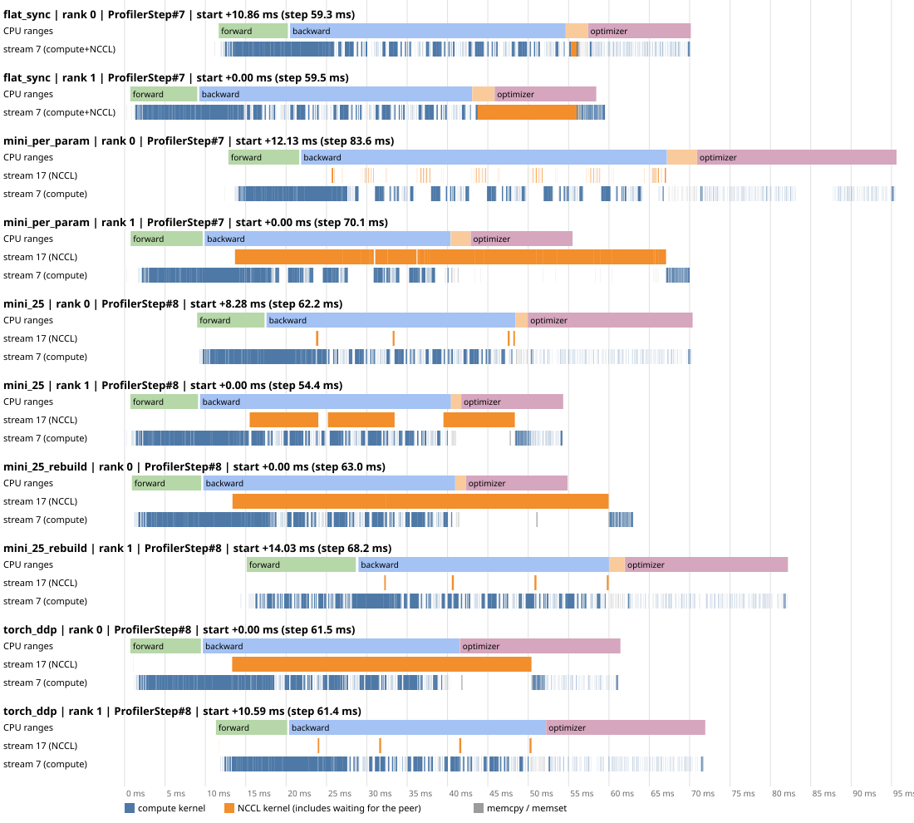
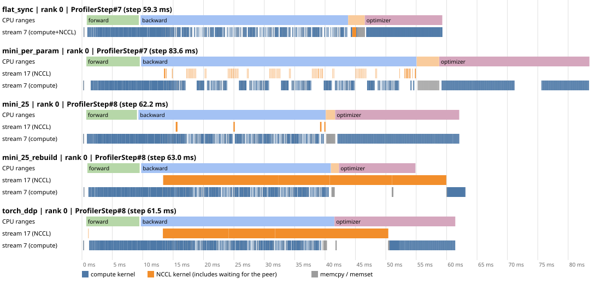
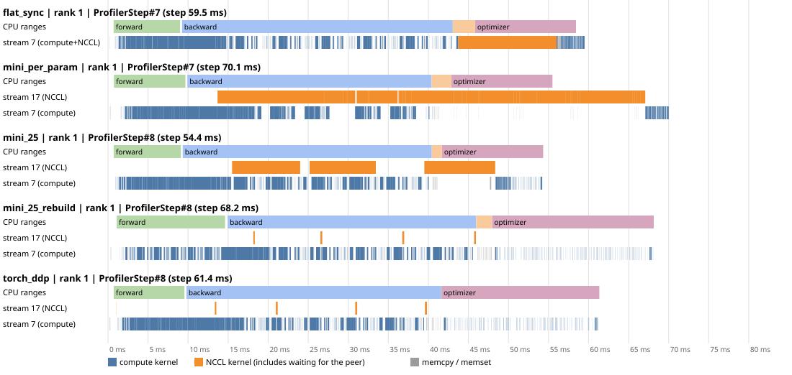

# Day 03 — DDP and autograd gradient hooks

> Setup: **Vast.ai, 2 × A100-SXM4-40GB**, GPU ids 0,1, NV12 topology; default transport/channel description inherited from Day 02, PyTorch 2.14.1+cu130, CUDA build 13.0, NCCL 2.30.7, driver 595.71.05, `OMP_NUM_THREADS=1`, `condition=shared`. Same host and software as Day 02.
> Code: [`experiments/day03_ddp_hooks/`](../experiments/day03_ddp_hooks/README.md) · Guide: [`GUIDE.md`](GUIDE.md)

> Measurements: **my server run on 2026-10-28**, run ID `a100_20261028T040220Z`. Its tables use saved JSON and terminal output; profile comparisons also use both ranks' traces. The separate **November 1 CUDA Graph follow-up**, `a100_nvlink_20261101`, is summarized in §6.4 and [CUDA_GRAPH.md](CUDA_GRAPH.md). Assistant pre-test measurements were replaced; older artifacts are archived separately. The mechanism and self-check answers below consolidate the completed walkthrough; they are retrospective explanations, not pre-run predictions.

## 1. What systems problem did I solve today?

Day 02 waits for backward to finish before synchronizing roughly 105 MiB of gradients. Day 03 overlaps bucket all-reduces with backward using gradient-ready hooks, fixed collective order and completion dependencies. MiniDDP exposes this mechanism; real DDP manages it in the Reducer. In my default local-batch-8 run, flat_sync remains fastest (38.30 ms), ahead of DDP (40.83 ms) and rebuilt MiniDDP (41.59 ms). No-comm ablations retain substantial overhead, while disabling P2P reverses the ranking. The mechanism works, but its net benefit depends on workload and communication conditions.

## 2. Mechanism recap (assistant-assisted)

**Authorship and learning status.** The original §2, §2.1, §2.2 and §3.1/§3.2 tables came from Claude's draft. This recap was subsequently rewritten by Codex from the discussion; retained source-reading tables remain assistant-authored. The self-check answers are also assisted summaries. Reading and discussing them is not evidence of independent recall. No separate learner implementation of the `YOU WRITE` bodies or pre-run Block 1.7 predictions is recorded in this repository.

Think of a bucket as a parcel with several gradient slots. Each hook tells us that one parameter's `.grad` has now been written, so its averaged contribution can be placed in the parcel. The pending counter tracks how many slots are still missing; it does not describe whether a previous parcel has been sent.

Sending needs two permissions: this parcel must be complete, and every earlier parcel must already have been launched. The second rule keeps both ranks communicating about the same parameters even when their hooks arrive at different times. A complete later bucket can therefore wait for an incomplete earlier one. Rebuilding uses the observed gradient order to make that situation less likely, while broadcasting rank 0's layout keeps the ranks consistent.

The CPU launches work rather than waiting for each GPU operation. Stream dependencies put gradient writes before NCCL reads, and NCCL results before copy-back and optimizer reads. While one bucket communicates, backward can produce gradients for later buckets. MiniDDP needs an explicit `finish_grad_sync()`; DDP arranges finalization through the autograd engine. These dependencies ensure correct data use, not simultaneous progress of the two ranks.

Ordinary buckets keep a communication buffer separate from `.grad`. Bucket views make them share storage and avoid copy-back, provided gradients are zeroed in place. This saves duplicate storage, but the step's peak depends on which tensors coexist at that moment; it need not fall by one full gradient buffer.

### 2.1 Why the ready order is not the reverse registration order

`TransformerEncoderLayer` registers `self_attn, linear1, linear2, norm1, norm2` but, in pre-norm, *uses* `norm1 → self_attn → norm2 → linear1 → linear2`. Backward runs in reverse use order, so `norm1` is ready last in its block. For the medium model 74 of 78 positions differ from reverse registration (tiny: 26/30). With the guessed layout, the tiny model with a 0.25 MiB cap accumulates 20 hook-steps of in-order waiting; the rebuilt layout has 0. For medium with 25 MiB caps the difference is small: 4 buckets either way, and only the bucket boundaries move.

### 2.2 Why bitwise equality at W = 2

Every element of a two-rank all-reduce is fl(a + b), regardless of bucketing, chunking or order, and scaling by 0.5 is exact. Same local gradients (deterministic kernels, same rows) give the same reduced gradient and the same update. With W ≥ 3, the summation order depends on the element's ring position (hence on the bucket layout) and 1/3 is inexact, so implementations would only be close. This host cannot test W = 3 on GPUs.

## 3. Call chain: from `loss.backward()` to the bucket all-reduce

### 3.1 Reading scope

Python: installed torch 2.14.1 (`find_symbols.py` output in `outputs/day03_closeout_a100_20261028T040220Z/`). The original C++ walkthrough used tag **v2.14.0**; our follow-up checked the Python wrapper, Reducer and autograd engine at **v2.14.1**, while communication-helper examples used v2.14.0. This is symbol-level reading, not an audit of every branch or of the installed binary.

| Item | Recorded answer |
| --- | --- |
| Entry | `DDP(model, ...)` → `_ddp_init_helper` → `dist.Reducer(params, reversed(bucket_indices), ...)`; `loss.backward()` triggers it through hooks |
| Construction | `_BucketCapacityConfig` (25 MiB; 1 MiB first bucket only with the default cap), `compute_bucket_size_limits`: **one bucket (`sys.maxsize`) for the first iteration** when neither `find_unused_parameters` nor `static_graph` is set |
| Hook registration | `Reducer::Reducer`: `grad_accumulator(variable)->add_post_hook(... autograd_hook(index) ...)`; accumulators kept alive in `grad_accumulators_` |
| Per gradient | `autograd_hook` (records `grad_ready_order_indices_`, `push_rebuilt_params`) → `mark_variable_ready` → `mark_variable_ready_dense`: `at::mul_out(bucket_view, grad, 1/div_factor_)`, or `div_` in place if `grad.is_alias_of(bucket_view)`; `grad = bucket_view` for `gradient_as_bucket_view` |
| Per bucket | `--bucket.pending == 0` → `mark_bucket_ready`: "Buckets are reduced in sequence" → `all_reduce_bucket` → `run_comm_hook` → `_AllReduceBySumCommHook::runHook` → `ProcessGroup::allreduce` (Day 02's chain) |
| End of backward | `next_bucket_ == buckets_.size()` → `Engine::queue_callback(finalize_backward)` → `future_work->wait()` → `finalize_bucket_dense` → `copy_bucket_to_grad` (skipped for bucket views) |
| Rebuild | `_pre_forward` → `reducer._rebuild_buckets()` → `rebuild_buckets`: ready order, caps `[first_bucket_bytes_cap_, bucket_bytes_cap_]` → `sync_bucket_indices` (rank 0's layout) → `initialize_buckets` / `initialize_bucket_views` |
| Every forward | `_pre_forward`: `prepare_for_forward`, rebuild, `_sync_buffers` if `forward_sync_buffers` (torch 2.14's new name for `broadcast_buffers`); `_post_forward`: `prepare_for_backward` → `reset_bucket_counting` |

### 3.2 `MiniDDP` ↔ `Reducer`

| MiniDDP | Reducer |
| --- | --- |
| `_sync_module_states` | `_sync_module_states` (Python, coalesced broadcast) |
| `_build(reversed(...))` + `assign_buckets` | `_compute_bucket_assignment_by_size` + `reversed(bucket_indices)` |
| `forward`: reset `pending`, `_next_bucket` | `prepare_for_backward` → `reset_bucket_counting` |
| `_on_grad_ready` | `autograd_hook` → `mark_variable_ready_dense` |
| `_launch_in_order` | `mark_bucket_ready` |
| `finish_grad_sync` (called by the loop) | `finalize_backward` (queued with `queue_callback`) |
| `_rebuild` (broadcast rank 0's order) | `rebuild_buckets` + `sync_bucket_indices` |

### 3.3 `find_unused_parameters` and `prepare_for_backward`

For the ordinary synchronized training path in PyTorch 2.14.1:

- **Prepare reduction state.** After forward, before backward, `prepare_for_backward` enables Reducer hook handling, clears per-iteration readiness records, and resets `next_bucket_ = 0` and each bucket's `pending` count. It does not clear `.grad` or run backward.
- **Handle missing hooks.** `find_unused_parameters=False` normally assumes every managed parameter will trigger its gradient hook. With `find_unused_parameters=True` and `static_graph=False`, DDP searches for unused parameters and accounts for them without waiting forever for missing hooks. This adds graph-traversal overhead; it does not make autograd produce gradients for disconnected parameters.
- **Interpret `[]` in context.** In our configuration, `_post_forward` calls `prepare_for_backward([])` because dynamic unused-parameter detection is disabled. The empty list is not itself the switch, nor does it mean there are no gradients. Autograd follows the loss graph; DDP manages reduction readiness.
- **Search from outputs.** When dynamic detection is enabled, forward output tensors provide roots. The Reducer follows their `grad_fn` / backward edges and identifies unreachable parameter accumulators. Leaf parameters have no `grad_fn` exposing downstream consumers, so starting from them cannot perform this same traversal. Output reachability should not be confused with the set of outputs later selected for the loss.
- **Compare MiniDDP.** MiniDDP resets reduction state before model forward; DDP does so afterward. Both prepare before `loss.backward()` in this harness; this is not a claim of equivalence for every execution mode.

Sources: [Python forward path](https://github.com/pytorch/pytorch/blob/v2.14.1/torch/nn/parallel/distributed.py#L1685-L1696), [Reducer preparation and search](https://github.com/pytorch/pytorch/blob/v2.14.1/torch/csrc/distributed/c10d/reducer.cpp#L1358-L1482).

## 4. My minimal version vs the framework

### 4.1 Blocks 2 and 3 recap

**Block 2 builds the mechanism.** Start with one asynchronous all-reduce per parameter, triggered after gradient accumulation. Then group parameters into flat buckets with shaped views and a parameter-to-slot lookup. Reset per-iteration state, scale and copy gradients into slots, decrement pending counts, launch consecutive ready buckets, and wait before copying results back and updating parameters. The negative controls break readiness (`early_launch`) or the read-after-communication dependency (`no_wait`). Rebuilding improves the layout using observed readiness; bucket views reduce duplicate gradient storage. Finally, the same harness substitutes real DDP for comparison.

**Block 3 locates the mechanism in PyTorch.** DDP construction creates the Reducer and installs post-hooks on parameter gradient accumulators. The forward wrapper handles rebuilding, buffer synchronization and backward preparation. During backward, `autograd_hook` -> `mark_variable_ready` -> `mark_variable_ready_dense` fills slots; a zero pending count leads to `mark_bucket_ready` and bucket communication. After all buckets are launched, an autograd callback runs `finalize_backward` before backward returns. Rebuilding broadcasts a common layout; communication hooks customize bucket processing, while `no_sync()` postpones gradient synchronization during local accumulation.

### 4.2 Main implementation differences

Scope: this repository's MiniDDP versus the ordinary C++ Reducer path in PyTorch 2.14.1, with our single-device, dense FP32 training configuration. Both ultimately use PyTorch distributed/NCCL for GPU communication; MiniDDP's Python implementation refers to its orchestration, not a Python implementation of GPU collectives.

| Aspect | MiniDDP | PyTorch DDP |
| --- | --- | --- |
| Gradient notification | Python `register_post_accumulate_grad_hook` calls `_on_grad_ready(i, p)` | C++ post-hook on `AccumulateGrad` calls `Reducer::autograd_hook(index)`; Reducer retains accumulator references |
| Initial state synchronization | Broadcasts parameters and buffers individually at construction | Default initialization verifies parameter shapes and uses coalesced model-state broadcast |
| First iteration | Reverses parameter order before grouping into multiple buckets | Our configuration starts with one large bucket; initial helper reverses the bucket list, not each bucket's contents |
| Per-iteration reset | At the start of wrapper `forward()`, before model computation | `prepare_for_backward()` in `_post_forward`, after model computation; does not replace gradient clearing |
| Bucket readiness and order | `pending == 0`, then `_launch_in_order()` advances `_next_bucket` | `mark_variable_ready` decrements `pending`; `mark_bucket_ready` advances `next_bucket_` through consecutive ready buckets |
| Gradient scaling | Copies with `1/world`, or scales an existing bucket view in place | Default dense path uses `div_factor_`; join mode can change the divisor, and custom comm hooks own normalization |
| Rebuilding | Optional; records the first backward order, broadcasts rank 0's order, then rebuilds before the next forward | Automatic under our configuration; broadcasts rank 0's bucket assignments and reinitializes buffers and views before forward |
| Bucket views | Explicit `p.grad = view`; current implementation compares data pointers and uses contiguous shaped slots | Alias/layout-aware handling, including parameter strides and rebinding existing gradients after rebuild |
| Completion and copy-back | Training loop explicitly calls `finish_grad_sync()`, using `dist.Work.wait()` and optional copy-back | Autograd queues `finalize_backward`; it consumes communication Futures and finalizes gradients before backward returns, establishing required stream dependencies |
| Forward buffer synchronization | Construction only | Enabled before each forward by default; adds the causal-mask broadcast in this experiment |
| Unused parameters and accumulation | Assumes every managed parameter produces a gradient once per iteration; no unused search or `no_sync()` | Supports configured unused-parameter handling and `no_sync()` accumulation |
| Additional execution modes | One dtype/device, dense gradients, no general comm-hook or join API | Supports broader layouts and modes, including sparse gradients, mixed precision, communication hooks, static graphs and join, subject to their configuration constraints |

Neither implementation guarantees that overlap improves step time or that bucket views lower peak memory. Those are measured outcomes. The timing gap between MiniDDP and DDP does not by itself isolate Python-hook cost: copying, bookkeeping and other implementation differences also contribute.

## 5. Evidence it is correct — my dual-A100 run, 2026-10-28

Run ID: `a100_20261028T040220Z`. Canonical local artifacts: [`outputs/day03_ddp_hooks/`](../outputs/day03_ddp_hooks/). Environment, source commit and source-diff records: [`outputs/day03_closeout_a100_20261028T040220Z/`](../outputs/day03_closeout_a100_20261028T040220Z/). The initial GPU probe failed because `outputs/` did not yet exist; the saved probe is explicitly **after** the experiments. Earlier topology and smoke-test output remain in the log.

Tiny preset, 20 steps, global batch 16 = 2 × 8, bucket cap 0.25 MiB (7–8 buckets), Day 02 tolerances. All six normal variants pass A/B/C against the single-process reference. Their saved `grads0`, `params1` and final parameters after 20 updates are exactly equal to dual-rank `flat_sync`; intermediate gradients at every step were not exhaustively compared.

| Variant | A gradient max diff | B params after 1 update max diff | C loss-0 diff | Exact vs dual-rank flat_sync |
| --- | --- | --- | --- | --- |
| flat_sync | 2.794e-9 | 1.192e-7 | 0 | True |
| mini per-param | 2.794e-9 | 1.192e-7 | 0 | True |
| mini buckets 0.25 MiB | 2.794e-9 | 1.192e-7 | 0 | True |
| mini rebuild + bucket view | 2.794e-9 | 1.192e-7 | 0 | True |
| torch DDP | 2.794e-9 | 1.192e-7 | 0 | True |
| torch DDP + bucket view | 2.794e-9 | 1.192e-7 | 0 | True |

| Negative control | Observation in this run | Interpretation |
| --- | --- | --- |
| `early_launch` | A max diff 1.114e-3 (worst `blocks.0.norm1.bias`); B max diff 1.502e-5; C passes | DETECTED by A, as required |
| `no_wait` | A/B/C pass at the initial checkpoints; A max diff 2.794e-9. Cross-rank parameter disagreement is 9.613e-4 after step 10 and 2.642e-3 after step 20 | MISSED by check A, but later consistency checks expose the race; informational, not counted in the final verdict |

The log ends this stage with `PARITY: ALL CHECKS PASSED`. This verdict covers the normal variants and the required `early_launch` detection; it does not certify `no_wait`. Evidence: `program-log_a100_20261028T040220Z.txt` and `par_*_a100_20261028T040220Z/{metrics.json,result.pt}` in `outputs/day03_ddp_hooks/`.

## 6. What the performance data proves (and what it doesn't)

### 6.1 Method and provenance

Medium preset: 27,443,200 parameters, 104.69 MiB FP32 gradients; global batch 16 = 2 × 8, TF32 off, deterministic MATH attention. Timing and ablation: 100 steps, five warmup steps excluded; timing has three repeats, ablation two. Core includes forward/loss, backward, synchronization, optimizer and scheduler, but excludes batch generation, zeroing, checks and logging. Synchronize only at its boundaries. Take the slowest rank per step, then the median over measured steps; tables show the median [min–max] over repeats. Overhead and speedup are computed within each repeat before aggregation, so differences/ratios of displayed medians may differ. Ranges are observed repeats, not confidence intervals. Day 02's 41.35 ms used a different harness and must not be directly subtracted from this run's 38.30 ms flat result.

Published code and write-up: [Day03 commit 7cc5f4f](https://github.com/Cudrix-dev/AI-Infra-Learning/commit/7cc5f4fa397e625f47c195927b47962b1496cc81). This later publication includes the CUDA Graph follow-up; it is not the exact October 28 checkout. The historical server checkout was `00f887f6e64b5c4ecdeb96e3fa12c29d97ae1fcf`, which is not reachable from the published branch history. For exact measured source, use the local [captured source snapshot](../outputs/day03_source_a100_20261028T040220Z/), the closeout Git records and `artifact_manifest_a100_20261028T040220Z.json`. Captured status lists only the untracked `.venv`, and the source patch is empty. Runtime NCCL is 2.30.7 as reported by torch, even though an inherited environment variable named `NCCL_VERSION` says 2.28.3-1; the variable is not evidence of the loaded runtime version. Default transport/channel details from Day 02 are historical context, not newly captured NCCL-debug evidence for this run.

### 6.2 Timing (`--stage timing`, `a100_20261028T040220Z`)

| Variant | Core ms [min–max] | Overhead vs none ms | Tokens/s | Speedup vs 1 GPU | Peak MiB |
| --- | --- | --- | --- | --- | --- |
| 1 GPU (batch 16) | 50.51 [50.49–50.52] | — | 81,091 | 1.00 [1.00–1.00] | 1645 |
| none (no comm) | 36.33 [35.81–36.59] | +0.00 [+0.00–+0.00] | 112,734 | 1.39 [1.38–1.41] | 1014 |
| flat_sync | 38.30 [38.17–38.65] | +1.96 [+1.57–+2.84] | 106,954 | 1.32 [1.31–1.32] | 1012 |
| mini per-param | 57.46 [53.83–59.11] | +20.87 [+17.50–+23.30] | 71,279 | 0.88 [0.85–0.94] | 1121 |
| mini 25 MiB (initial layout) | 41.84 [41.41–42.58] | +5.98 [+5.08–+6.03] | 97,898 | 1.21 [1.19–1.22] | 1119 |
| mini 25 MiB + rebuild | 41.59 [41.45–42.03] | +5.69 [+4.86–+5.78] | 98,494 | 1.21 [1.20–1.22] | 1117 |
| mini rebuild + bucket view | 41.85 [41.70–42.64] | +6.04 [+5.37–+6.05] | 97,875 | 1.21 [1.18–1.21] | 1117 |
| torch DDP (defaults) | 40.83 [40.27–40.91] | +4.50 [+3.67–+5.10] | 100,321 | 1.24 [1.23–1.25] | 1117 |
| torch DDP + bucket view | 40.80 [40.61–41.46] | +4.28 [+4.21–+5.65] | 100,393 | 1.24 [1.22–1.24] | 1117 |

`none` is a no-synchronization performance reference, not correct data-parallel training. Per-param is slower than one GPU; bucketed versions are much better than per-param, but slower than flat_sync here. Rebuild and bucket-view timing ranges overlap their counterparts, so these repeats do not establish a stable speed improvement for either option. Bucket views leave the measured peak unchanged (1117 MiB); see §7 for the lifetime-based explanation.

### 6.3 Ablation: where the overhead survives (two repeats)

| Variant | Core ms [min–max] | Overhead vs none ms |
| --- | --- | --- |
| `none` | 36.03 [35.98–36.09] | +0.00 [+0.00–+0.00] |
| `flat_sync` | 38.10 [38.07–38.13] | +2.07 [+2.05–+2.10] |
| `mini_per_param` | 52.88 [46.37–59.39] | +16.85 [+10.40–+23.31] |
| `mini_per_param_nocomm` | 40.90 [40.77–41.03] | +4.87 [+4.79–+4.94] |
| `mini_25_rebuild` | 41.90 [41.69–42.11] | +5.87 [+5.72–+6.03] |
| `mini_25_rebuild_nocomm` | 40.83 [40.82–40.84] | +4.80 [+4.73–+4.86] |
| `torch_ddp` | 40.52 [40.39–40.65] | +4.49 [+4.41–+4.56] |
| `torch_ddp_nobufsync` | 40.61 [40.22–40.99] | +4.58 [+4.14–+5.01] |
| `torch_ddp_nocomm` | 39.66 [39.60–39.72] | +3.63 [+3.51–+3.74] |
| `flat_sync_2ch` | 38.24 [38.17–38.30] | +2.21 [+2.20–+2.22] |
| `mini_per_param_2ch` | 58.94 [58.62–59.27] | +22.91 [+22.53–+23.29] |
| `mini_25_rebuild_2ch` | 43.26 [42.88–43.64] | +7.23 [+6.90–+7.55] |
| `torch_ddp_2ch` | 41.04 [40.68–41.39] | +5.00 [+4.70–+5.30] |

**Supported:** substantial overhead survives without gradient collectives: MiniDDP rebuild is +5.87 ms versus +4.80 ms with communication disabled; DDP is +4.49 ms versus +3.63 ms with its no-op communication hook. The residual includes copies, bookkeeping and launch costs; DDP's no-op hook also changes normalization behavior and retains forward buffer synchronization, so this is not a pure measurement of autograd-hook CPU time. Mini per-param varies widely (+10.40 to +23.31 ms overhead), so a precise per-collective cost cannot be extracted from two repeats.

**No evidence for the proposed channel-limit improvement:** two-channel MiniDDP rebuild is +7.23 ms, above the default +5.87 ms, and DDP is +5.00 versus +4.49 ms. This intervention did not improve these variants and does not prove that all forms of resource contention are absent. Disabling forward buffer sync gives +4.58 versus +4.49 ms with overlapping ranges; its individual cost is not resolved here. Do not infer CPU slack by subtracting profiled kernel sums from unprofiled step times.

The channel intervention mixes reduced resource occupancy with potentially reduced communication bandwidth, so it cannot refute interference. In profiled runs, concurrent large-bucket NCCL kernels coincide with roughly 2–3 ms more non-NCCL GPU activity. Interference remains a supported but unquantified contributor; §6.4 gives the descriptive evidence and its limits.

### 6.4 Profiler: structure and rank skew

For cross-rank arrival and completion timing, use this aligned figure. Each variant's rank pair shares the earlier step start as zero, using trace timestamps after checking matching host and clock-base metadata. Different variants remain separate runs. Labels include each rank's step-start offset.

For `mini_25_rebuild`, step #8, rank 1 starts its step 14.0276 ms after rank 0. The last NCCL ends at local +59.9581 ms on rank 0 and +45.9372 ms on rank 1. With rank 0's origin, rank 1's end is +59.9648 ms: only about 6.6 microseconds later, not 14 ms earlier. The apparent gap in the separately zeroed figures below is a coordinate-origin difference, not additional post-peer communication or waiting.

The tracked SVGs use a compact overview: GPU interval endpoints are rounded to 0.1 SVG pixel and touching intervals of the same color/stream are merged. Original clocks, CPU ranges and time scales are retained; raw traces hold individual kernel names and finer detail. This affects display only, not the statistics.

Rank 0:

Rank 1, matching the step ID selected for rank 0 in each variant:

Both figures use the same pixels-per-millisecond scale and label each panel with rank and step ID. Each panel starts at its own local step boundary: the zero points are **not globally aligned**, so horizontal positions cannot establish which rank arrived first in absolute time. Rank-1 steps are matched to rank 0, not independently selected medians. Table columns below remain medians across all three steps; individual panels need not equal those medians. Reproduce both figures with `python day03/assets/draw_rank_timelines.py`.

| Variant | Step ms (profiled) | Non-NCCL GPU activity | NCCL | Overlapped | Exposed NCCL | NCCL kernels |
| --- | --- | --- | --- | --- | --- | --- |
| flat_sync | 59.34 | 27.82 | 0.67 | 0.00 | 0.67 | 1 |
| mini_per_param | 83.60 | 27.76 | 2.39 | 0.21 | 2.16 | 78 |
| mini_25 | 62.16 | 27.78 | 0.89 | 0.15 | 0.73 | 4 |
| mini_25_rebuild | 63.04 | 31.04 | 43.42 | 16.96 | 28.98 | 4 |
| torch_ddp | 61.51 | 31.14 | 37.09 | 17.69 | 19.40 | 5 |

Each column is independently the median of three profiled steps on rank 0. `Non-NCCL GPU activity` is the union of kernel, memcpy and memset intervals excluding NCCL, not just backward compute. `Overlapped` is its intersection with NCCL activity. `Exposed NCCL` is NCCL activity without concurrent non-NCCL GPU activity anywhere in the step, not necessarily the post-backward tail or an additive step-time penalty. At each individual step, exposed = NCCL - overlapped; independent column medians need not obey that subtraction (e.g. 43.42 - 16.96 differs from 28.98 for rebuilt MiniDDP).

The raw traces contain one NCCL kernel per flat step, 78 for per-parameter synchronization, four for MiniDDP buckets, and five for DDP (four reductions plus buffer broadcast). Rank-0 overlap is small for per-param (0.21 ms) and unreconstructed buckets (0.15 ms), but visible for rebuilt buckets (16.96 ms) and DDP (17.69 ms). Asynchronous submission does not guarantee a large measured overlap in every run.

Both ranks' raw traces were reanalyzed:

| Variant | Rank 0 NCCL ms | Rank 1 NCCL ms |
| --- | --- | --- |
| flat_sync | 0.67 | 12.26 |
| mini_per_param | 2.39 | 52.89 |
| mini_25 | 0.89 | 25.61 |
| mini_25_rebuild | 43.42 | 0.93 |
| torch_ddp | 37.09 | 0.94 |

The large rank asymmetry supports waiting for the peer / rank skew as an explanation for long NCCL intervals; it does not isolate transfer versus waiting exactly. A 37.09 ms rank-0 NCCL interval cannot be treated as the transfer cost when rank 1 records 0.94 ms in the same DDP run. Profiling also changes execution timing: rank-0 median profiled steps are 59.34–83.60 ms, while ordinary timing records 38.30 ms for flat and 40.83 ms for DDP. These are different measurement windows, so do not subtract their columns to infer CPU idle time or benchmark overhead. Use unprofiled timing/ablations for cost. See the raw traces, original `profile_summary`, derived `profile_both_ranks` and `profile_per_step` JSON files for this run.

#### Profile evidence consistent with compute/communication interference

Recomputing all five variants × two ranks × three steps gives **30 rank-steps** and Pearson correlation **r = 0.707** between overlapped time and the union of non-NCCL GPU activity. The [per-step data](assets/profile_interference.json) is regenerated from raw traces by `python experiments/day03_ddp_hooks/analyze_interference.py`.

| Profile observation | Overlap ms | Non-NCCL GPU activity ms |
| --- | --- | --- |
| flat_sync, both ranks, all six steps | 0 | 27.72–27.82 |
| mini_25 rank 1, steps 7–8 | 10.81–10.86 | 29.75–29.79 |
| mini rebuild rank 0, all three steps | 13.69–17.60 | 30.23–31.06 |
| DDP rank 0, all three steps | 15.52–17.69 | 30.66–31.14 |
| per-parameter rank 1, all three steps | 14.04–14.92 | 28.13–28.41 |

Large-bucket overlap is associated with about 2–3 ms more non-NCCL activity than the roughly 27.8 ms baseline; small-message overlap shows a much smaller increase. This is consistent with NCCL occupying SM/memory resources, including while waiting for the peer. Actual channel counts per message were not captured, so fewer channels for small messages remain a possible explanation rather than a measured fact.

This is not a controlled comparison of matched kernel durations or an isolated interference penalty. For example, DDP rank 1 step 6 has **32.15 ms** non-NCCL activity with only **0.35 ms** overlap: other variation also matters. The 30 samples share ranks, steps and configurations and are not independent trials. Profiling inflates rank skew, and the two-channel ablation also changes bandwidth. These observations support interference as a contributor but neither assign it an unprofiled 2–3 ms cost nor explain all non-NCCL variation.

#### Observed optimizer submission gaps explain how rank skew can reappear

The aligned `mini_25_rebuild` step #8 gives more specific evidence than a hypothetical GPU compute-speed difference. CPU optimizer-scope operations were matched to GPU kernels by `External id`, and GPU kernels to CUDA runtime launches by correlation ID. All 624 optimizer kernels on each rank matched a launch. Times below share rank 0's step origin:

| Optimizer observation | Rank 0 | Rank 1 |
| --- | --- | --- |
| Final NCCL kernel ends | 59.958 ms | 59.965 ms |
| CPU optimizer range | 42.29–54.88 ms | 61.98–82.17 ms |
| GPU optimizer kernels, first start to last end | 60.07–63.00 ms | 62.34–82.11 ms |
| Matched GPU kernel count | 624 | 624 |
| GPU kernel busy-time union | 2.217 ms | 2.220 ms |
| GPU optimizer first-to-last span | 2.925 ms | 19.767 ms |
| Gaps between matched optimizer kernels | 0.709 ms | 17.547 ms |

Rank 0's CPU finishes submitting optimizer work before the last NCCL ends; the GPU executes that queued work after the communication dependencies are satisfied. Rank 1 starts the CPU optimizer range later and submits work while its GPU consumes it. Of its 615 inter-kernel gaps longer than 10 microseconds, 613 have the next CUDA launch begin on the CPU only after the preceding GPU kernel has ended. Those gaps total 17.499 ms, including launch/execution latency; this is not a pure CPU-work duration. Both ranks spend essentially the same time executing the same optimizer kernels, so the long rank-1 blue region is predominantly separated kernels, not substantially slower optimizer arithmetic.

This strongly supports a host-submission-limited optimizer in this profiled step. The CPU range overlapping GPU activity is expected for asynchronous execution; overlap alone would not prove launch starvation, but the matched launch timestamps provide additional evidence. Nearly simultaneous final NCCL completion does not imply simultaneous optimizer launch or identical optimizer wall time: post-communication submission gaps can recreate a large offset for the next iteration. The trace does not isolate Python dispatch, profiler overhead, OS scheduling and driver overhead individually, nor establish the same gap size in unprofiled training. The `## optimizer` scope also contains the scheduler.

**CUDA Graph follow-up measured on November 1.** The October 28 trace motivated capturing only the optimizer, whose replay submits captured work with one launch ([PyTorch CUDA Graphs](https://docs.pytorch.org/docs/2.14/notes/cuda.html#why-cuda-graphs)). The new NV12 run `a100_nvlink_20261101` validates this intervention; see [the full method, results and paired-rank timelines](CUDA_GRAPH.md). It keeps a separate output directory and does not replace the October 28 evidence.

| New within-host comparison | Original core ms | Graph-ready eager ms | Graph core ms | Reduction vs original |
| --- | --- | --- | --- | --- |
| MiniDDP rebuild | 42.94 | 49.65 | 41.03 | 4.44% |
| PyTorch DDP | 41.51 | 48.85 | 39.06 | 5.88% |

These are three-repeat unprofiled summary medians (60 steps, 10 excluded). Ready eager and graph use identical capturable AdamW, tensor LR and persistent independent gradients; they match bitwise on tiny saved tensors/losses and on all medium timing loss curves. Their 17.35% / 20.03% replay improvement must not be confused with the smaller net gain over original AdamW. Original and capturable arithmetic are not bitwise equivalent. Peak allocation rises from approximately 1117 to 1224 MiB. The ~107 MiB increase is close to one gradient buffer P = 104.7 MiB: in-place zeroing retains independent `.grad` tensors through the early-backward peak, whereas the original releases them with `set_to_none=True`. This is the likely main cause, consistent with section 7; no allocation timeline isolates the small remainder. Ready eager has the same peak as graph, so the increase is not evidence of a Graph-only cost.

The profiled optimizer has 1950 kernels in both graph-ready modes; replay packs them into about 4.6 ms with only 0.095–0.100 ms of internal gaps across ranks/implementations. Original AdamW has 624 kernels with about 2.2 ms busy time, but sampled gaps range from 1.44 to 18.52 ms. Thus Graph reduces submission gaps without fusing the optimizer or making its arithmetic cheaper. Do not subtract profiled gaps from unprofiled steps.

The learner's prediction is supported **with a qualification**: optimizer launch starvation can recreate rank skew, and graph replay reduces it, but does not impose synchronization. Median absolute unprofiled core-start offsets (median of three run medians) fall from 9.67 to 1.74 ms for MiniDDP and 9.54 to 1.40 ms for DDP; maxima with graph still reach 8.75 / 5.28 ms. Forward/backward, copies, scheduler and communication remain eager, so the next step is closer in time rather than guaranteed simultaneous.

Reproduce this offline analysis with `python outputs/analyze_optimizer_submission_a100_20261028T040220Z.py`; its derived evidence is `outputs/day03_ddp_hooks/optimizer_submission_a100_20261028T040220Z.json`. The following arrival-skew model remains an illustration, not proof of a fixed hardware-speed difference.

#### A working model for long NCCL intervals on one rank

The learner's model is that an earlier rank enters a bucket collective, waits inside its NCCL kernel, and continues producing later gradients on the compute stream. Completing one collective does not force the two compute streams to resume in lockstep, so the same rank can repeatedly arrive early. This explains how long NCCL intervals can coexist with similar full-step times.

The model needs the following qualifications:

- **Order is not timing.** Shared bucket order ensures matching collectives, not simultaneous arrival. CPU submission, profiling, GPU execution and scheduling can create persistent skew. Asynchronous communication permits computation to continue; it does not guarantee zero resource interference.
- **Use per-bucket waiting, not a fixed per-layer lead.** For a simplified two-rank rendezvous, let `a[r,i]` be the actual NCCL-kernel arrival time for bucket i, after local stream queuing. The early rank may wait roughly `w[0,i] = max(0, a[1,i] - a[0,i])`. Gradient-ready times can be earlier than these arrivals because previous collectives occupy the NCCL stream.
- **The N*Delta expression is conditional.** If N non-overlapping NCCL kernels on rank 0 each wait approximately Delta, its total kernel occupancy is approximately `sum(w[0,i] + t[0,i])`, or `N*Delta + sum(t[0,i])`; the other rank may have little waiting. Here t includes communication/protocol work, not an independently measured pure transfer time. A per-layer compute-speed advantage does not establish constant Delta at successive bucket arrivals. For example, bucket readiness at (10,15) ms then (12,17) ms can yield first-collective completion near 16 ms and only about 1 ms of additional waiting for rank 0's second collective. Waiting already paid cannot automatically be counted again.
- **The tail constrains progress, not exact step alignment.** Before an optimizer reads gradients, the required final communication dependencies must be established. This can make full-step times similar, but does not impose identical wall-clock boundaries or prevent one rank from submitting later work earlier. `backward()` returning is not a global GPU barrier.
- **Which rank waits can change.** Persistent arrival skew can keep waiting on one side across several buckets; local jitter or different execution conditions can change that relationship. Our mirrored rank statistics support this explanation but do not prove a hardware-speed difference, constant waiting per bucket, or exact transfer/wait decomposition. The paired SVGs use local step origins and cannot establish absolute arrival order from horizontal positions alone.

### 6.5 Regimes: when overlap pays

| Regime | none core ms | flat_sync overhead | mini rebuild overhead | torch DDP overhead |
| --- | --- | --- | --- | --- |
| NVLink, local batch 8 | 36.20 | +2.55 [+2.27–+2.83] | +5.23 [+4.96–+5.50] | +4.75 [+4.68–+4.82] |
| P2P disabled, local batch 8 | 36.24 | +18.53 [+18.36–+18.70] | +14.78 [+14.65–+14.92] | +15.01 [+14.89–+15.13] |
| NVLink, local batch 32 | 92.91 | +1.46 [+1.40–+1.52] | +1.25 [+1.21–+1.29] | +1.46 [+1.44–+1.48] |

`slowlink_b16` sets `NCCL_P2P_DISABLE=1` only for that regime; it is a host-specific slower-communication condition, not a direct model of every multi-node network. Global batch 64 gives local batch 32 with the same gradient volume. Both use 60 steps, five warmup steps excluded, two repeats.

- **Slower communication:** flat_sync is 54.78 ms, rebuilt MiniDDP 51.03 ms and DDP 51.26 ms. Within-repeat comparisons give approximately 3.75 ms and 3.52 ms savings over flat. The ranking reverses relative to the default small-batch run.
- **Larger local batch:** none is 92.91 ms and synchronization overheads are +1.46 ms (flat), +1.25 ms (MiniDDP) and +1.46 ms (DDP). DDP and flat are essentially tied; MiniDDP is about 0.21 ms faster in these two repeats. The much smaller relative overhead is consistent with more compute masking orchestration costs, but does not prove those costs vanish.

### 6.6 Conclusions supported by this run

- **Correctness:** all normal variants pass the single-GPU checks; the three saved tensor checkpoints match dual-rank flat_sync exactly. `early_launch` is detected. `no_wait` passes the initial check but diverges across ranks later.
- **Default timing:** flat_sync is 38.30 ms (1.32× versus one GPU), DDP 40.83 ms (1.24×), rebuilt MiniDDP 41.59 ms (1.21×), per-param 57.46 ms (0.88×). Overlap does not beat flat on this workload.
- **Ablation and interference:** much of the bucketed overhead remains without gradient communication. Profiled large-bucket overlap also coincides with longer non-NCCL GPU activity. The channel cap does not improve performance, but its bandwidth/occupancy confound cannot refute interference. Costs per Python hook, copy launch or process-group call are not individually isolated.
- **Different conditions:** P2P-disabled overlap beats flat by about 3.75 ms for MiniDDP and 3.52 ms for DDP. At local batch 32, DDP and flat are effectively tied.
- **Memory and traces:** bucket views do not lower the measured peak; ordinary bucketed variants peak roughly P higher than flat. NCCL duration includes waiting and is strongly rank-dependent, so profile overlap is not saved time.

### 6.7 Limits

These results cover two GPUs on one node, shared host conditions, FP32 and one small model. They do not establish a general DDP performance ranking, exact CPU idle time, a transfer/wait decomposition, or which component causes every remaining overhead. The experiments do not test W ≥ 3 numerics, multi-node networks, mixed precision or compiled DDP. Day 03 peak counters do not establish the exact allocation timeline.

## 7. Answered self-checks

**Why `register_post_accumulate_grad_hook`?** Communication needs the gradient stored in `p.grad` after this backward has accumulated into it. `register_hook` receives the incoming gradient before that write; it can therefore see a different value from the stored gradient. In `hook_order.py`, `(w*2 + w*3).backward()` produces an incoming gradient of 5, even though `w` is used twice: autograd combines those contributions before its accumulator. Without zeroing between backwards, the incoming hook sees 5 both times, while the post-accumulate hook sees stored gradients of 5 and then 10. MiniDDP reads `p.grad`, so it uses the latter notification. "Final" here means after accumulation for the current backward, not after every possible future microbatch.

**Why launch buckets in index order?** Two conditions must hold: every gradient slot in the bucket has been filled (`pending == 0`), and all earlier buckets have already been launched. The first protects data completeness; the second makes every rank issue matching collectives in the same sequence. A ready bucket 2 must wait if bucket 1 is incomplete. If ranks instead follow arbitrary hook arrival order, different-shaped collectives can error or hang; same-shaped collectives can silently combine unrelated gradients. The rule fixes communication order, not wall-clock arrival time or simultaneous GPU execution.

**Why rebuild, and why broadcast the layout?** Registration describes how modules are stored, not the order used by this pre-norm model's forward/backward. MiniDDP initially guesses reverse registration, then records actual gradient readiness and rebuilds before the next forward. Real DDP in our configuration begins with one large bucket and subsequently rebuilds from observed readiness. Grouping nearby ready gradients can let consecutive buckets fill earlier and reduce in-order waiting. Broadcast rank 0's order/assignments so bucket k has the same parameter membership, ordering and size on every rank, even if local hook order differs. Tiny's extra waiting drops from 20 to 0 hook-event intervals; medium already has 0 with either layout, although bucket boundaries move. These are ordering observations, not a guarantee of faster steps: the measured timing ranges overlap.

**Why can communication be launched inside backward without a CPU wait for each bucket?** The hook submits CUDA work asynchronously. Gradient production and scale/copy run on the current compute stream; ProcessGroupNCCL establishes a dependency so its communication stream consumes the bucket only after those writes. At completion, `finish_grad_sync()` in MiniDDP, or DDP's finalization callback, establishes the reverse dependency before copy-back and optimizer reads. This gives two edges: producer → communication and communication → consumer. Fixed collective order makes the rank-to-rank sequence match. Asynchronous submission alone prevents neither races nor collective mismatches, and `backward()` returning does not mean the GPU is globally synchronized.

**Why did all normal variants match exactly at W = 2, and what did the negative controls prove?** With the same deterministic local gradients, the two-rank reduction combines the same two values; power-of-two averaging preserves the expected equivalence in this tested setup. The saved gradient, first-update and final-parameter checkpoints match dual-rank flat_sync exactly. This does not establish bitwise equality at W ≥ 3, where summation order and the inexact averaging factor can matter. Against the single-GPU reference, use tolerances because batch shape and floating-point evaluation order differ. `early_launch` fails gradient parity; `no_wait` happens to pass the initial checks but later splits the parameters across ranks. A passing first step is insufficient evidence that an asynchronous implementation is correct.

**What did `gradient_as_bucket_view` change?** My run `a100_20261028T040220Z` recorded 1117 MiB for both `mini_25_rebuild` and `mini_25_rebuild_view`; their timing ranges overlap. Views remove duplicate parameter-gradient storage and copy-back, but this need not reduce the peak of the whole step.

**Why can bucket views save storage without lowering peak memory?** Reasoning from Day 01's memory probe:

1. After Adam's first update, parameters and its two moment tensors occupy about 3P. Both bucketed variants also keep P of bucket storage allocated throughout the step (P = 104.7 MiB here).
2. Day 01 located the peak early in backward, before most parameter gradients exist. With `set_to_none=True`, the ordinary variant has not yet allocated a full extra P of independent `.grad` tensors. The view variant stores parameter gradients in the existing buckets.
3. In the measured cross-entropy implementation, the gradients with respect to the log-softmax output and the logits coexist temporarily. Each has shape [B*T, V], so together they occupy 2*B*T*V*4 bytes in FP32, with B the local batch size. Both variants need these activation gradients: bucket views share parameter gradients only. The saved forward log-softmax output is already included in saved activations and must not be counted twice.
4. At that early point, both variants therefore have approximately 4P + saved activations + those temporary gradients, plus other small allocations. Later, the ordinary variant builds independent parameter gradients while activations and loss-backward temporaries are released; its extra storage may never exceed the earlier peak.

This explains why equal peaks are plausible despite less duplicate gradient storage. Day 03's peak counters establish the equal maxima, but a Day 03 memory timeline would be needed to confirm their exact timing and composition; Day 01's probe alone does not prove that timing for every variant.

**Core question: why can DDP hide communication behind backward, and what limits it?** Backward produces parameter gradients progressively. Once a bucket is complete and permitted by collective order, DDP can submit its all-reduce to the NCCL stream while the compute stream continues producing later gradients. Buckets balance two costs: per-parameter reductions pay collective/dispatch overhead repeatedly, whereas one flat reduction cannot start until every gradient exists.

The amount hidden depends on how much later backward work is available, bucket layout, peer arrival times and resource contention. The final bucket has little remaining backward work to overlap; scaling/copying, hooks, bookkeeping and optimizer submission also cost time. A long NCCL kernel can contain peer waiting, so its duration or overlap is not a direct measure of transfer cost or saved step time. Here the default flat_sync is faster than bucketed overlap; disabling P2P makes overlap win, and a larger local batch reduces relative overhead. CUDA Graph replay additionally shrinks optimizer submission gaps and rank-start offsets, but does not synchronize the whole step. The useful criterion is lower unprofiled end-to-end core time under a matched configuration.

**Why use DDP if flat_sync wins in this default case?** This small FP32 workload on fast NVLink exposes orchestration costs that can outweigh the communication saved. In the measured slower-link regime, DDP beats flat_sync by about 3.52 ms. DDP also manages model/buffer synchronization, bucket rebuilding, unused-parameter handling, accumulation through `no_sync()`, communication hooks and join behavior that MiniDDP does not implement generally. The experiment demonstrates a tradeoff and a working mechanism, rather than a universal ranking of implementations.

**Day 03 outcome.** The executable MiniDDP and real DDP paths have been checked against references and negative controls; timing, ablation and regimes have been measured; both ranks' traces have been analyzed with aligned timelines; and the Reducer call chain has been mapped to the minimal implementation. The optimizer-only CUDA Graph follow-up passes its matched correctness checks and improves unprofiled step time in the new NV12 run. The reference experiments and assisted walkthrough are complete. Independent implementation and unaided recall are not established: the learner should still reproduce `_on_grad_ready` and `_launch_in_order` without the reference and explain section 2 from memory. Individual CPU-cost decomposition, alternative optimizers/execution modes and larger-world tests below remain optional research.

## Optional follow-up experiments

These are intentionally unmeasured extensions. They are not outstanding Day 03 completion requirements; a checked CUDA Graph item records the extension completed during this walkthrough.

- [ ] How much CPU time does one Python post-accumulate hook, one `torch.mul(out=)` launch and one `ProcessGroupNCCL::allreduce(async_op=True)` call cost? Measure with a microbenchmark rather than infer from step differences.
- [ ] Does `torch.compile` (DDPOptimizer / compiled autograd with the Python reducer) remove the per-parameter overhead on this workload?
- [ ] With `foreach=True` or `fused=True` AdamW (fewer launches), how much of the 36 ms `none` step remains CPU-bound, and does DDP overlap start to pay at local batch 8?
- [ ] Would DDP's `batched_grad_copy=True` (torch 2.14) remove part of the per-parameter copy cost?
- [x] Does optimizer-only CUDA Graph replay reduce submission gaps and improve unprofiled step time? Yes in `a100_nvlink_20261101`; [results and rank offsets](CUDA_GRAPH.md) show smaller gaps and 4.44% / 5.88% net core-time reductions. Foreach/fused comparison remains open above; graph does not enforce cross-rank lockstep.
- [ ] W = 3 numerics (bitwise vs close): only testable on CPU/gloo or on a larger host.
