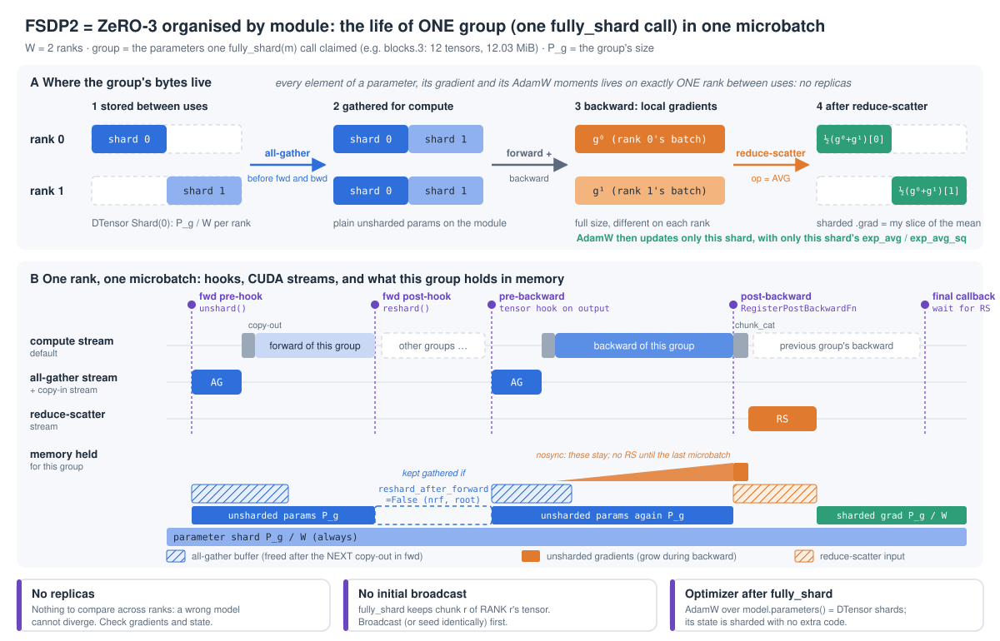

# Day 07: FSDP2, `fully_shard` on the whole model vs per block (dual-A100 guide)

> **Status (2026-11-04): personal run a100_manual_20261104_01 passed all output checks.** Appendix A links the measured results and logs.

**Goal:** by tonight you can put Day 01's transformer under FSDP2 in two ways and say, with measurements, what each one costs. The first way is `fully_shard(model)`, one group holding all 78 tensors. The second is `fully_shard(block)` ×6 then `fully_shard(model)`, seven groups. You will show:

1. With gradient sync deferred to the window boundary, FSDP2 is **bitwise identical** to DDP + AdamW. It only becomes "close but not bitwise" when it reduce-scatters every microbatch.
2. **Where every byte lives, at every block boundary,** on each rank: what is sharded all the time, what is gathered and for how long, and why the whole-model layout's peak is only a little below DDP's.
3. You can find each `all_gather` and `reduce_scatter` in the profiler trace, name the FSDP group it belongs to, and say whether compute hid it.
4. **Why FSDP2 is slower than DDP on this model on NVLink, and when it stops being slower.**

You write about 40 lines: the initial broadcast, the wrapping policy and the accumulation switch. Then you read FSDP2's hook chain from `fully_shard` down to `all_gather_single` / `reduce_scatter_single`.

Day 06 left the numbers this day builds on:
- **Model size:** Ψ = 27,443,200 parameters, P = 104.69 MiB in FP32.
- **DDP with `no_sync`:** 5P ≈ 523 MiB of model state per rank between microbatches.
- **ZeRO-1:** sharded the 2P of AdamW state.
- **What is left:** the parameters (P), the gradients (P) and DDP's buckets (P), all still replicated. FSDP shards the parameters and gradients too (ZeRO-3), and pays for it by gathering parameters again for every forward and backward.

Day 06's open question (Guide §1.4, Stop 8) is answered today by measurement. With `set_requires_gradient_sync(False)`, does FSDP2 keep the unsharded gradient between microbatches (Day 06's `zero1` row) or reduce-scatter and accumulate it (the `rs_every` row)?

**Done means:**

- [ ] §1.8 predictions written (memory ledger per layout, collectives per microbatch, bitwise groups, which check catches which control) before you look at Appendix A
- [ ] The **YOU WRITE** parts of `fsdp_setup.py` written by you and diffed against the reference
- [x] `compare_fsdp.py --stage parity` prints `PARITY: ALL CHECKS PASSED`: every variant passes A–E, R, S; the `nosync` group is bitwise equal to DDP; all three controls are `DETECTED` by their named check
- [x] `--stage count`: AllGather / ReduceScatter per optimizer step for every layout and accumulation mode recorded, with a named `block_sync` sequence and overlap evidence
- [x] `--stage memory`: five timelines captured; start-of-step, forward peak and backward peak compared with §1.4
- [x] `--stage timing` and `--stage slowlink`: DDP vs FSDP2 at m = 8 and m = 32 on NVLink, sync vs nosync, and the m = 8 slow-link comparison documented against trace evidence
- [x] `day07/notes.md` filled with measured numbers
- [ ] Block 3 per-stop source notes written in your own words
- [ ] You can answer without notes: *what does FSDP2 shard, what does each layout gather and when, and why isn't it free?*

---

## Read this first: same host type, fresh rental

The software and rules are the same as Days 02–06: **2 × A100-SXM4-40GB, NV12, default NCCL settings**, torch 2.14.1+cu130, NCCL 2.30.7, `--condition shared`. The measured run a100_manual_20261104_01 had both GPUs on NUMA node 1.

The project directory arrives empty on a fresh rental. From your Windows project root:

```bash
ssh -p <port> root@<host> 'mkdir -p /workspace/AI-Infra-Learning/experiments'
scp -P <port> requirements.txt root@<host>:/workspace/AI-Infra-Learning/
scp -P <port> -r experiments/day01_single_gpu experiments/day02_data_parallel experiments/day03_ddp_hooks experiments/day04_grad_accum experiments/day07_fsdp2 root@<host>:/workspace/AI-Infra-Learning/experiments/
```

Then, on the instance:

```bash
cd /workspace/AI-Infra-Learning
ln -sfn /venv/main .venv        # fresh rental only
source .venv/bin/activate
export CUDA_VISIBLE_DEVICES=0,1 OMP_NUM_THREADS=1
unset NCCL_P2P_DISABLE NCCL_SHM_DISABLE NCCL_ALGO
nvidia-smi topo -m              # record it: timings compare only within one host
python -m torch.distributed.run --standalone --nproc_per_node 2 experiments/day02_data_parallel/hello_dist.py --device cuda
```

Today's code imports these files unchanged:
- Day 01: `train.py`
- Day 02: `ddp_manual.py`, `check_parity.py`, `launch_utils.py`, `find_symbols.py`, `gpu_probe.py`
- Day 03: `analyze_trace.py`
- Day 04: `compare_accum.py`, `count_collectives.py`

---

## Files

| File | What it is |
| --- | --- |
| `experiments/day07_fsdp2/fsdp_setup.py` | **The part you write.** `broadcast_module_state`, `apply_fully_shard` (layouts `root`, `block`, `block_nrf`, `block_pf`), `set_microbatch_sync`; given: explicit forward prefetch, the `sum_grads` control, DTensor evidence helpers |
| `experiments/day07_fsdp2/train_fsdp.py` | Day 04/06's loop with `--impl ddp / fsdp_*`, `--accum sync / nosync`, `--foreach`, three `--bug` controls, synchronized phase timing, the per-rank memory ledger, the **block-boundary memory timeline**, `--memory-snapshot`, `--profile` |
| `experiments/day07_fsdp2/compare_fsdp.py` | Orchestrator: smoke → `parity` → `count` → `memory` → `timing` → `slowlink`. Plain `python` |
| `experiments/day07_fsdp2/analyze_fsdp_trace.py` | Names every NCCL kernel by the FSDP group that launched it; counts, overlap, exposed communication, GPU idle time, min-over-ranks durations |
| `experiments/day07_fsdp2/find_symbols.py` | `file:line` of the Block 3 reading list in your install |
| `experiments/day07_fsdp2/run_server_once.sh` | All stages once, logs, source snapshot, output checks, checksummed archive |
| `day07/assets/fsdp2_group_lifecycle.svg` | §1.1 figure: one group's bytes across ranks and one rank's hooks, streams and memory; drawn by `draw_fsdp2_group_lifecycle.py` |

---

## Block 1: Design (30 min). Reason first, then compare with the measured run

### 1.1 What FSDP2 is: ZeRO-3, organised by module

ZeRO stage 3 shards parameters, gradients and optimizer state, so each rank stores 1/W of each. A parameter must be whole when it is used, so it is **gathered just before use and freed just after**. Gradients are **reduce-scattered** as soon as they are complete. FSDP2 decides "before use" and "after use" with module hooks. **Each `fully_shard(m)` call creates one parameter group**: the parameters of `m` that no earlier call has claimed. The group is the unit of communication: one `all_gather` to unshard it, one `reduce_scatter` for its gradients.



How to read the figure (schematic, not to scale; drawn by `assets/draw_fsdp2_group_lifecycle.py`):
- **Panel A** follows one group's bytes on both ranks:
  1. each rank stores only its shard;
  2. the all-gather rebuilds the full group on both ranks;
  3. backward produces a different full gradient on each rank;
  4. the reduce-scatter (`AVG`) leaves each rank with its slice of the mean, which AdamW updates with its slice of the state.
- **Panel B** is one rank's timeline. Each purple tick is a hook FSDP2 fires on the CPU. Each lane is a CUDA stream: the all-gather and reduce-scatter run on their own streams, while the copy-out and `chunk_cat` copy-in run on the compute stream. The memory lane shows what the group holds meanwhile:
  - the parameter shard, always;
  - the unsharded parameters plus their all-gather buffer, during forward and again during backward;
  - the unsharded gradients growing during backward;
  - the sharded gradient after the reduce-scatter.
- **The dashed box** is what `reshard_after_forward=False` (and the root group by default) keeps alive instead of re-gathering.
- **The orange note** is what `nosync` keeps instead of reduce-scattering.

Three properties make this different from Day 06:

1. **There are no replicas.** Every element of a parameter, its gradient and its two AdamW moments lives on exactly one rank (the sharded parameter is a `DTensor` with placement `Shard(0)`). Check R (replica agreement) has nothing to check, and a wrong model cannot diverge across ranks.
2. **FSDP2 does not broadcast the initial parameters.** `fully_shard` keeps chunk r of rank r's own tensor. DDP's constructor broadcasts rank 0's model and Day 06's `FlatZeroAdamW` did too. With FSDP2, it is your job.
3. **The optimizer is an ordinary `torch.optim.AdamW`** over the DTensor shards. Its elementwise ops dispatch to each rank's local tensor, so the state is sharded with no ZeRO-specific code. It must be **built after `fully_shard`**. An optimizer built before holds the original full tensors: they are no longer in the model, they never receive gradients, and their memory is never freed.

### 1.2 The groups of this model

The medium preset has 78 tensors (FP32: 4 bytes per element):

| Group | Contents | Elements | MiB |
| --- | --- | --- | --- |
| each `blocks.i` (×6) | `self_attn.in_proj` (1536×512 + 1536), `out_proj` (512×512 + 512), `linear1` (2048×512 + 2048), `linear2` (512×2048 + 512), `norm1`, `norm2`: 12 tensors | 3,152,384 | 12.03 |
| root (per-block layout) | `token_emb` (8192×512), `pos_emb` (256×512), final `norm`, `head` (8192×512 + 8192): 6 tensors | 8,528,896 | 32.53 |
| root (root layout) | everything | 27,443,200 | 104.69 |

**Wrap bottom-up.** `fully_shard(model)` first would claim all 78 tensors, and later block calls would find nothing left. The root is wrapped last *and always*. Otherwise the embeddings and head would not be managed at all, and every block would become its own FSDP root.

**`reshard_after_forward`** controls when a group is freed. Its default `None` means True for non-root groups and False for the root, because the root is needed again the moment backward starts. `fsdp_root` is therefore gathered once, kept through backward, and reduce-scattered once at the end. `block_nrf` sets False on the blocks too: one all-gather per block per microbatch instead of two, at the cost of keeping every block unsharded from its forward to its backward.

### 1.3 Collectives and bytes per microbatch, per rank (W = 2)

| Layout | AllGather | ReduceScatter | Bytes sent per rank | vs DDP's all-reduce (P) |
| --- | --- | --- | --- | --- |
| `ddp` | — | — (4 bucket all-reduces) | P | 1 |
| `fsdp_root` | 1 | 1 | P/2 + P/2 | 1 |
| `fsdp_block` | 7 (fwd) + 6 (bwd re-gather; the root is not re-gathered) | 7 | P/2 + 72.15/2 MiB + P/2 | ≈ 1.34 |
| `fsdp_block_nrf` | 7 | 7 | P/2 + P/2 | 1 |

The ring all-reduce identity from Day 06 is still the key: AR = RS + AG. FSDP moves the AG from "after the optimizer" (ZeRO-1) to "before the next use". The re-gather in backward is the only extra traffic. "ZeRO-3 costs 1.5×" assumes the whole model is re-gathered; here the root's 32.5 MiB is not.

With K microbatches per window:
- **`sync`** (FSDP2's default): everything above × K.
- **`nosync`**: the all-gathers are still × K, because parameters are resharded after each backward. Only the reduce-scatters drop to 1 per window.
- `set_reshard_after_backward(False)` would also skip the next microbatch's forward all-gather. That knob is **not tested** today.

### 1.4 The memory ledger

Per rank, FP32, after the first optimizer step:

| What | `ddp` | FSDP (any layout) |
| --- | --- | --- |
| parameters, always | P | P/2 (the shards) |
| AdamW state, always | 2P | P |
| DDP buckets (`gradient_as_bucket_view=False`) | P | — |
| **start of a window** (gradients set to None) | **4P = 418.8 MiB** | **1.5P = 157.0 MiB** |
| between microbatches, K ≥ 2 | + P (`p.grad`) | `sync`: + P/2 (sharded grad). `nosync`: + P (unsharded grads kept on every group) |

The transient extra while computing is what separates the layouts:

| Layout | Unsharded at the worst moment of forward | During backward |
| --- | --- | --- |
| `fsdp_root` | **2P**: the all-gather output buffer *and* the unsharded parameters copied out of it. The buffer is only freed at the root's post-forward, because there is no next group whose copy-out could release it | P of parameters + up to P of unsharded gradients, reduce-scattered only at the very end |
| `fsdp_block` | root group (32.5 MiB) + one block (12 MiB) + one in-flight all-gather buffer | root + 1–2 blocks + one block's unsharded gradients before its reduce-scatter |
| `fsdp_block_nrf` | grows by 12 MiB per block: every block stays gathered until its backward | shrinks again block by block |

**Activations do not change at all.** At m = 8 the timeline shows +72 MiB of saved activations per block forward and +64 MiB of logits, about 630 MiB in total. ZeRO-3 shards model state; it does not touch activations. The prediction is that FSDP cuts the peak by roughly the persistent difference, 4P − 1.5P ≈ 260 MiB. It recovers less of that for `fsdp_root`, which holds 2P unsharded in forward and P + P in backward. `memory_allocated()` also counts a constant (cuBLAS workspaces, the causal mask, allocator rounding), so predict **differences between rows** and read the constant from one measured row.

### 1.5 The accumulation boundary, answered from the source

`FSDPParamGroup.post_backward` (Block 3, Stop 5) begins:

```python
if not self.reduce_grads:              # set by set_requires_gradient_sync(False)
    if self.reshard_after_backward:
        self.reshard()                 # parameters are freed again...
    for fsdp_param in self.fsdp_params:
        fsdp_param.to_accumulated_grad_if_needed()   # (only casts for mixed precision)
    return                             # ...but the UNSHARDED .grad stays on the unsharded parameter
```

So `nosync` is Day 06's `zero1` row: the full unsharded gradient (P) is held between microbatches, and the next backward's `AccumulateGrad` adds into it. One reduce-scatter runs per group at the last microbatch. `sync` is the `rs_every` row: the reduce-scatter output is added into the sharded `.grad` (`sharded_param.grad._local_tensor += new_sharded_grad` in `foreach_reduce`), and the unsharded gradient is freed. The memory difference between them, P − P/2 = 52.3 MiB, is §1.8's prediction to check.

The flag is **sticky**, unlike DDP's `no_sync()` context manager. Forget to set it back to True for the last microbatch and nothing is ever reduced (`--bug sync_never`).

### 1.6 Numerics: what is bitwise

| Comparison | Prediction | Why |
| --- | --- | --- |
| any `*_nosync` layout vs `ddp` (same AdamW) | **bitwise equal** on all five saved quantities | Both reduce the same locally accumulated window sum once. At W = 2 each element is one two-operand sum. FSDP2 uses `ReduceOp.AVG` for FP32 (`_get_gradient_divide_factors`) and DDP divides by 2 then sums: scaling by ½ is exact, so both give fl(a + b)/2. Forward and backward run on unsharded tensors with the same values, shapes and strides. AdamW on a `Shard(0)` slice is elementwise |
| `*_sync` vs `ddp` | close, **not** bitwise | One reduction per microbatch: Σⱼ fl(gⱼ⁰ + gⱼ¹)/2 vs fl(Σⱼ gⱼ⁰ + Σⱼ gⱼ¹)/2 (Day 04 / Day 06 `rs_every`) |
| `foreach` AdamW vs per-tensor AdamW | close, not bitwise | Different kernels for the same formula. Hence a separate `ddp_foreach` reference for `block_nosync_foreach` |
| everything vs 1 process | Day 02/04 tolerances | big-batch matmul vs accumulated `+=` |

### 1.7 Checks and the three controls

A–E are the checks of Days 02 and 04, against one process with one big batch. **S**: AdamW state gathered from the shards (`DTensor.full_tensor()`) vs the DDP run. **R**: replicas equal across ranks, vacuous for FSDP. Predict for each control which of A B C D E R S fail:

| `--bug` | What it does | Must be caught by |
| --- | --- | --- |
| `no_init_bcast` | skips the broadcast before `fully_shard`; ranks are seeded differently | C |
| `sync_never` | `set_requires_gradient_sync(False)` on every microbatch, including the last | A |
| `sum_grads` | `set_gradient_divide_factor(1.0)`: the reduced gradient is the SUM over ranks | A |

Questions before you run:
- Which control leaves the loss at step 0 (C) correct, and why?
- Why might `sum_grads` **pass B** (parameters after one update)? Hint: Adam's first update is lr · m̂ / (√v̂ + ε). What happens to it when g doubles?
- Why can R never catch a FSDP bug?

### 1.8 Your predictions (fill in before Block 4)

| Quantity | How to estimate | Your prediction |
| --- | --- | --- |
| After wrapping (MiB, rank 0): `ddp`, `fsdp_*` | DDP: params + buckets. FSDP: shards only (the old full tensors must be freed) | |
| `exp_avg + exp_avg_sq` per rank; allocation across the first step | 2P vs P | |
| Start of a window (memory timeline, first line): `ddp` − `fsdp_block` | §1.4 | |
| Between microbatches (K = 4): `block_nosync` − `block_sync` | §1.5 | |
| Forward peak and backward peak: `ddp`, `root`, `block`, `nrf` | §1.4: persistent + transient + activations | |
| `fsdp_root`: what happens to memory at `fwd_post model`? | the all-gather buffer | |
| AllGather / ReduceScatter per optimizer step at K = 4: root sync/nosync, block sync/nosync, nrf sync/nosync | §1.3 × K | |
| Bitwise groups; which checks each control fails | §1.6, §1.7 | |
| Time per step, K = 1, m = 8 (NVLink): rank `ddp`, `fsdp_root`, `fsdp_block`, `block_nrf`, `block_pf` | bytes are tiny on NVLink. What else does FSDP add per group? | |
| The same at m = 32 | what changes when each block's compute is 4× longer? | |
| Slow link (`NCCL_P2P_DISABLE=1`), K = 1: `fsdp_root` vs `fsdp_block` | which layout can overlap its communication at all? | |

### 1.9 New rules (on top of Days 02–06)

1. **Wrap bottom-up, always wrap the root.** The group structure is the communication schedule.
2. **Broadcast (or seed identically) before `fully_shard`.** FSDP2 shards whatever each rank holds.
3. **Build the optimizer after `fully_shard`,** over `model.parameters()` (the DTensor shards).
4. **No replicas, no replica check.** Correctness is the gradient and the state against an unsharded run.
5. **Gradient sync is a sticky flag,** set before each microbatch, including the last.
6. **FSDP's overlap depends on the CPU running ahead.** The next group's all-gather is issued when the CPU reaches that group's hook. If the GPU is already idle by then, the collective is exposed, however fast the link is.

---

## Block 2: Code (2 h)

### Stage 0 (15 min): the ledger by hand

From §1.2, write in MiB:
- each group's unsharded size and shard size;
- start-of-window memory per layout;
- between-microbatch memory for `sync` vs `nosync`;
- the §1.3 collective counts for K = 4.

Then predict the `[rank r]` lines of a `ddp` and an `fsdp_block` medium run: stored elements, state MiB, after-wrap MiB.

### Stage 1 (45 min): write the **YOU WRITE** parts of `fsdp_setup.py`

Copy `fsdp_setup.py` to a scratch name, delete the bodies under `YOU WRITE`, and rewrite them:

1. **`broadcast_module_state`**: one `dist.broadcast` per parameter **and buffer** from rank 0, under `torch.no_grad()`. Why buffers too, when this model's only buffer (the causal mask) is derived from the config?
2. **`apply_fully_shard`**: the three layouts of §1.2. For `block_nrf` pass `reshard_after_forward=False` to the blocks only. Leave the root's at the default and explain why that default is False.
3. **`set_microbatch_sync`**: `model.set_requires_gradient_sync(accum == "sync" or last)`. Then read `set_requires_gradient_sync` (`_fully_shard.py:413`). Which attribute does it set, on which objects, and what does `recurse=True` walk?

Questions before moving on:

- After `apply_fully_shard`, what type is `model.blocks[0].linear1.weight`, and what are `.shape` and `.to_local().shape` on rank 1? (A `DTensor`; global (2048, 512), local (1024, 512).)
- What is `type(model)` now? (A dynamically created subclass `FSDPTinyTransformer`: `_apply_to_module` puts `FSDPModule` first in the MRO, which is how `model.set_requires_gradient_sync` exists.)
- The harness deletes Day 01's optimizer *before* wrapping and builds a new AdamW *after*. What breaks if you keep the old one? Two things.
- Why does `optimizer.zero_grad(set_to_none=True)` do no harm here, when on Day 06 it detached the gradient views? (FSDP2 assigns a fresh sharded `.grad` from the reduce-scatter output each window; there is no persistent buffer to keep views into.)

### Stage 2 (30 min): read the harness

In `train_fsdp.py` find:

- the wrap section: the broadcast, `apply_fully_shard`, the optimizer rebuild, and `params` collected **after** wrapping;
- `set_microbatch_sync` before every microbatch's forward, and DDP's `no_sync()` around non-final microbatches (decided in forward, Day 04);
- the three timestamps t0..t3. All FSDP communication is inside [t0, t1]. Why is t1 after the last reduce-scatter? (`_root_post_backward_final_callback` → `finalize_backward` makes the compute stream wait on the post-reduce events, then `sync_dev()`.)
- `MemTimeline`: why are the hooks guaranteed to run **after** FSDP's own? (FSDP's forward pre-hook uses `prepend=True`; its post-hook and its output tensor hook are registered first.) What exactly does `bwd_post` observe? (The grad w.r.t. the block input is ready; FSDP's `RegisterPostBackwardFunction.backward`, which reduce-scatters, has not run yet.)
- the evidence path: `to_full()` calls `DTensor.full_tensor()`, an all-gather **outside** t0..t3 that every rank must call.

### Stage 3 (30 min): read the trace analyzer

In `analyze_fsdp_trace.py`, follow one NCCL kernel back to Python: kernel `args.correlation` → the `cudaLaunchKernel` event with the same id → the innermost `FSDP::` range on that CPU thread at that time. Two things to understand:

- Forward collectives are launched from the training thread, which carries the `## fwd j` annotation. Backward collectives come from autograd's device thread, so they show `bwd thread`.
- Why does `min-rank` take the shorter of the two ranks' durations for the i-th collective? (NCCL requires every rank to issue the same collectives in the same order. The rank that arrived first spends its "duration" waiting.)

### Pitfalls (symptom → cause)

| Symptom | Likely cause |
| --- | --- |
| Loss at step 0 differs from 1 GPU, nothing diverges, no error | parameters not broadcast before `fully_shard` (§1.1, `no_init_bcast`) |
| Loss falls slowly, `adam step 0`, gradient check shows zeros | gradient sync never re-enabled (`sync_never`), or the optimizer was built before `fully_shard` and steps tensors the model no longer uses |
| Parameters after one step look right, gradients are exactly W× too large | sum instead of mean (`sum_grads`); Adam's update is almost scale-invariant, so B and the loss barely notice |
| Memory after wrapping still ≈ P | something holds the original parameters (an old optimizer, a `params` list made before wrapping) |
| `fully_shard(model)` gives one group although blocks were wrapped | root wrapped first: wrap bottom-up |
| UserWarning "FSDP2-wrapped module returned a view tensor" | `head(norm(h))` returns a view of a matmul output. Harmless here (no in-place op on the logits), but an in-place op on it would skip the pre-backward hook |
| Optimizer step 25 ms instead of 3 ms | per-tensor AdamW on DTensors: every op pays DTensor's Python dispatch; use `foreach=True` (or `fused=True`) |
| FSDP per block slower than DDP on NVLink although the bytes are tiny | consistent with per-group launch overhead and limited overlap at m = 8 (notes §7–8) |
| A 1 ms all-gather of 6 MiB on NVLink | the kernel waited for the other rank; compare the `min-rank` column |

---

## Block 3: Read the source (1 h), from `fully_shard` to the NCCL call

Run `python experiments/day07_fsdp2/find_symbols.py` first. The line numbers below are torch 2.14.1's; your install prints its own. All paths are under `torch/distributed/fsdp/_fully_shard/`.

### Stop 1: `fully_shard` (`_fully_shard.py:98`; the typing overloads start at `:64`, which is what `find_symbols.py` prints)

Read the docstring (it is the design document) and the body:
- `_get_modules_and_states` → `state.init` (registers the forward pre/post hooks, `_fsdp_state.py:105`);
- `_init_param_group` (`_fsdp_init.py:433`);
- `_apply_to_module`, which swaps the class to `FSDP<Name>`.

*Q: where does the docstring say "should be called bottom-up", and why does an unclaimed-parameters rule force that?* *Q: what does `reshard_after_forward=None` resolve to, and where is the root's value overridden?* (`_lazy_init`, `_fsdp_state.py:171`: `post_forward_mesh_info = None` for the root.)

### Stop 2: `FSDPParam._init_sharded_param` (`_fsdp_param.py:249`)

The parameter is chunked on dim 0 (`_chunk_with_empty`) and this rank keeps chunk `shard_rank`, zero-padded to chunk 0's size (`padded_sharded_param`). It is wrapped as a `DTensor` (`to_sharded_dtensor`) and set on the module with `_setattr_on_modules`. *Q: where would rank 1 get its data from if rank 0's and rank 1's tensors differed? (Its own: nothing is broadcast here. That is Stop 2's lesson and the `no_init_bcast` control.)* *Q: when is padding needed for this model? (Never: every dim 0 is even. 2049 rows would give rank 0 1025 rows and rank 1 1024 + 1 pad row.)*

### Stop 3: forward, `FSDPState._pre_forward` → `FSDPParamGroup.pre_forward` → `unshard` / `wait_for_unshard` (`_fsdp_state.py:290`, `_fsdp_param_group.py:550`, `:382`, `:427`)

`_root_pre_forward` (`:137`) runs once per iteration. It does lazy init and makes the all-gather streams wait for the compute stream (the optimizer must be done before parameters are gathered). `unshard` → `foreach_all_gather` (`_fsdp_collectives.py:325`):
1. on the **copy-in stream**, `all_gather_copy_in` copies every shard of the group into one flat input;
2. on the **all-gather stream**, `all_gather_comm(...)` runs `DefaultAllGather.__call__` → `dist.all_gather_single` (`:111`): **this is the `all_gather` of today's done-when**.

`wait_for_unshard` → `foreach_all_gather_copy_out` (`:431`) waits for the event and copies the flat output into each parameter's own full storage with `split_with_sizes_copy`. Then `init_unsharded_param` (`_fsdp_param.py:845`) / `to_unsharded` puts plain unsharded `nn.Parameter`s on the module. *Q: in forward, why is the all-gather output kept alive after copy-out (`comm_ctx.all_gather_state`, "defer free")? Which memory line in `fsdp_root`'s timeline is that buffer, and when does it go away?* (`_post_forward` of the root, `_fsdp_state.py:328`.)

### Stop 4: `post_forward` → `reshard` → `to_sharded` → `free_storage` (`_fsdp_param_group.py:570`, `:509`; `_fsdp_param.py:921`, `:1306`)

`free_storage` is `tensor.untyped_storage().resize_(0)`: the tensor object survives, its memory does not. Autograd saved the unsharded weight for backward (a matmul saves its inputs). *Q: why is that safe?* (The saved tensor shares the storage, which `alloc_storage` + the next all-gather refill before backward needs it. FSDP's pre-backward hook guarantees the refill happens first.) *Q: where is the pre-backward hook registered?* (`_register_pre_backward_hook`, `_fsdp_state.py:440`: a tensor hook on the module's outputs.)

### Stop 5: backward, `_pre_backward` → `pre_backward` → `_backward_prefetch`, then `post_backward` → `foreach_reduce` (`_fsdp_state.py:386`; `_fsdp_param_group.py:592`, `:821`, `:607`; `_fsdp_collectives.py:522`)

- `pre_backward` unshards (a no-op if prefetched) and prefetches the group that runs next in backward, i.e. the previous one in forward (`post_forward_order[curr_index - 1]`).
- `post_backward` is triggered by `RegisterPostBackwardFunction` (`:1141`), an autograd Function that `pre_forward` applied to the module's **inputs**. Its backward runs when the gradient w.r.t. the inputs is done, i.e. after the module's whole backward.
- Read the `if not self.reduce_grads:` branch (§1.5). Then `foreach_reduce`: `foreach_reduce_scatter_copy_in` (`chunk_cat` into the RS input, `:778`), `unsharded_grads.clear()` (frees them), and `reduce_scatter_comm` → `DefaultReduceScatter` → `dist.reduce_scatter_single` (`:175`). **This is the `reduce_scatter` of today's done-when.** After it, the new sharded gradient is an `as_strided` view of `reduce_output`, either assigned or `+=`-accumulated.

*Q: the root's inputs are integer token ids that do not require grad. When does the root group's post-backward run?* (`_root_post_backward_final_callback`, `_fsdp_state.py:401`: "Run post-backward in case forward inputs did not require gradient". That is why the root's reduce-scatter is the very last collective and overlaps nothing.)

### Stop 6: `_get_gradient_divide_factors` (`_fsdp_collectives.py:812`)

For FP32/BF16 without a custom factor: `ReduceOp.AVG`, no pre/post divide kernels. With a factor equal to the group size: AVG; otherwise `PREMUL_SUM(1/factor)`. With FP16: pre/post division by about √W to avoid overflow. *Q: what does `set_gradient_divide_factor(1.0)` select? (`PREMUL_SUM(1.0)` = SUM: the `sum_grads` control.)* *Q: why is AVG at W = 2 bitwise equal to DDP's divide-then-sum?*

### Stop 7: `FSDPCommContext.lazy_init` (`_fsdp_param_group.py:76`)

Four streams: all-gather copy-in, all-gather, reduce-scatter and all-reduce (HSDP), the communication ones at high priority. `reduce_scatter_max_input_buffers = 1`: the next group's post-backward waits for the previous reduce-scatter before allocating another input buffer. *Q: map each stream to the `stream` column of the `--sequence` output.*

### Stop 8 (10 min): the user-facing knobs you did not use

These were read but not measured; mark them [not tested] in your notes unless you add a run.
- `set_reshard_after_backward` (`_fully_shard.py:490`): keep parameters gathered between microbatches.
- `set_modules_to_backward_prefetch` (`:533`).
- `MixedPrecisionPolicy` (`_fsdp_api.py`): BF16 parameters with FP32 reduction. This is Day 9.
- `CPUOffloadPolicy`.
- HSDP with a 2-D mesh: `(Replicate(), Shard(0))`.

### Fill this in `notes.md` §3

| Item | Your answer (draft) |
| --- | --- |
| Entry | `fully_shard(module)` → `FSDPState.init` (hooks) + `FSDPParamGroup` (one per call) + class swap |
| Shard | `FSDPParam._init_sharded_param`: dim-0 chunk of this rank's own tensor, padded, as a `DTensor(Shard(0))` |
| Forward | `_pre_forward` → `FSDPParamGroup.pre_forward` → `unshard` → `foreach_all_gather` → `all_gather_single`; `wait_for_unshard` → copy-out; `post_forward` → `reshard` → `free_storage` |
| Backward | output tensor hook → `pre_backward` (re-gather + prefetch); `RegisterPostBackwardFunction` → `post_backward` → `foreach_reduce` → `reduce_scatter_single(AVG)` |
| Accumulation | `set_requires_gradient_sync(False)` → `reduce_grads = False` → `post_backward` returns early; unsharded `.grad` kept |
| End of backward | `_root_post_backward_final_callback`: root's post-backward, `finalize_backward` waits for the reduce-scatters |
| Mine vs framework | Day 06's one flat buffer, one RS + one AG per window vs FSDP2's per-module groups, AG before each use, RS after each group's backward |

---

## Block 4: Run + summarize on the dual A100

Use plain `python` for the orchestrator: it launches `torchrun` itself and runs the smoke test first. Alternatively, `bash experiments/day07_fsdp2/run_server_once.sh "a100_${RID}"` does all of this, checks the outputs and writes an archive.

```bash
export CUDA_VISIBLE_DEVICES=0,1 OMP_NUM_THREADS=1
unset NCCL_P2P_DISABLE NCCL_SHM_DISABLE NCCL_ALGO
RID=$(date -u +%Y%m%dT%H%M%SZ)
mkdir -p outputs
nvidia-smi topo -m > "outputs/day07_topo_${RID}.txt"
python experiments/day07_fsdp2/compare_fsdp.py --stage parity   --condition shared --run-id "a100_${RID}"
python experiments/day07_fsdp2/compare_fsdp.py --stage count    --condition shared --run-id "a100_${RID}" --no-smoke
python experiments/day07_fsdp2/compare_fsdp.py --stage memory   --condition shared --run-id "a100_${RID}" --no-smoke
python experiments/day07_fsdp2/compare_fsdp.py --stage timing   --condition shared --run-id "a100_${RID}" --no-smoke --repeats 3
python experiments/day07_fsdp2/compare_fsdp.py --stage slowlink --condition shared --run-id "a100_${RID}" --no-smoke --repeats 2
```

Stage durations from the console timestamps for `a100_manual_20261104_01` (18 min 33 s from environment logging through output checks, before packing):

| Stage | Duration |
| --- | --- |
| parity | 1 min 58 s |
| count | 2 min 41 s |
| memory | 48 s |
| timing | 10 min 24 s |
| slowlink | 2 min 28 s |

The run passed the output check for 101 training runs, 38 traces and 5 memory snapshots. [Console log](../outputs/day07_downloads/a100_manual_20261104_01/day07_a100_manual_20261104_01.console.log) · [Output checks](../outputs/day07_downloads/a100_manual_20261104_01/verify_outputs.log)

### How to read the parity output

A/B/C are Day 02's checks and D/E are Day 04's, all against one process with one big batch per step (windows `[4, 4, 4, 4, 4, 2]`). Each block prints one line per rank: elements stored, state MiB, first-step allocation. The BITWISE block compares each FSDP variant with the DDP run that uses the same AdamW; the `boundary` (nosync) group must be all `True`. Controls print lower-case `pass`/`fail` and a `DETECTED by check X` verdict.

In [your parity.log](../outputs/day07_downloads/a100_manual_20261104_01/parity.log#L237), all five `boundary` comparisons returned `True` on every saved quantity. The two `per_micro` comparisons returned `False`, with a final parameter max difference of 3.643e-7. Both passed the tolerance checks. The negative controls were detected by C, A and A respectively, and the stage ended with `PARITY: ALL CHECKS PASSED`.

### How to read the count output

- **Table 1** (K = 4): collectives per optimizer step. Compare it with your §1.8 row.
- **Tables 2–3** (K = 1, m = 8 and m = 32): the same, plus four time measures:
  - `comm`: union of rank 0's NCCL kernels, waiting included;
  - `min-rank`: sum of the shorter of the two ranks' durations;
  - `exposed`: comm with no other kernel running;
  - `idle`: GPU span minus all GPU work.
- **The sequences:** one row per collective. The columns give its group (`FSDP::all_gather (blocks.3)`, `FSDP::post_backward_reduce (blocks.3)`), whether it was launched in forward (`## fwd 0`) or backward (`bwd thread`), its stream, its start, its rank-0 and min-rank duration, and how much of it a compute kernel overlapped.

Profiled runs are slower than real ones (Day 03), so rank them and do not quote them as benchmarks.

### How to read the memory output

There is one timeline per layout, for microbatch 0 of the last warmup step (after the first optimizer step, so the state exists). Each line shows `memory_allocated()` after the event, the delta from the step start, and the peak since the previous event. Mark on it:
1. where FSDP gathers (the jump at `fwd_pre`);
2. where it frees (`fwd_post`, smaller than DDP's +72 MiB);
3. where the root's buffer goes (`fwd_post model`);
4. where the gradients collapse to shards (`bwd_done`, +52 MiB = P/2).

For the full picture, drag `mem_<variant>_<rid>/memory_snapshot_rank0.pickle` into <https://pytorch.org/memory_viz>. The final table gives the forward, backward and optimizer peaks per layout.

### How to read the timing tables

- **ms / opt step**: K × (fwd+bwd with all communication) + optimizer + scheduler, with synchronized phase boundaries; slowest rank per step, median over steps, [min–max] over repeats. FSDP's collectives are inside fwd+bwd.
- `per-t` rows are Day 01's per-tensor AdamW; all others use `foreach=True`.
- **peak**, **between**, **after wrap**, **state/rank**: §1.4 and §1.8.
- This is a shared host. Treat differences under roughly 4 ms at m = 8 cautiously. The root-only gap to DDP varied from about 1.5 to 8 ms across the personal run and two pre-tests. This is an empirical caution, not a measured noise bound.

### Write `day07/notes.md`

[`notes.md`](notes.md) records this run's measured results. Add your §1.8 predictions and your own Block 3 reading, keeping measured results, interpretation and untested items separate.

---

## Today's core question, answered

**What does FSDP2 shard, what does each layout gather and when, and why isn't it free?**

FSDP2 shards everything that DDP replicates: each rank keeps a `Shard(0)` DTensor slice of every parameter, receives only its slice of every gradient, and AdamW over those DTensors holds only its slice of the state. Persistent model state drops from 4P to 1.5P per rank at W = 2. To compute, it rebuilds each parameter group just in time, one group per `fully_shard` call:
- an all-gather before the group's forward;
- a free after it, unless `reshard_after_forward=False`;
- an all-gather again before its backward;
- a reduce-scatter of its gradients right after its backward.

**The layout is the schedule.** One group for the whole model has the same communication volume as DDP. But it holds the full parameters through backward and the all-gather buffer until post-forward. The single gather and reduction sit at opposite ends of forward and backward. One group per block keeps only a block or two unsharded at a time and lets each group's collective run next to a neighbour's compute. That costs one more all-gather per block (≈ 1.34× DDP's bytes here) and fixed CPU work per group per hook.

**The memory saving is model state only.** Activations are untouched, so at m = 8, where activations dominate, the peak falls by less than the 2.5P persistent saving.

**The NVLink trace is consistent with a launch bottleneck at small microbatches.**
- At m = 8, forward gathers for blocks 1–5 overlapped compute by 70–89% in the first sampled step. The exposed work was concentrated in backward: the last four re-gathers and all reduce-scatters had 0% overlap. The timings are consistent with per-group launch and scheduling work limiting overlap, but CPU hook time was not measured separately.
- At m = 32 more block collectives overlapped compute. For the standard block layout, exposed communication fell from 9.74 to 1.57 ms in the two-step trace average. Exposed kernel time can include waiting for the other rank.
- Make the link slow and the per-block layout's overlap is the only thing that keeps its exposed communication below the whole-model layout's.

With gradient accumulation, `set_requires_gradient_sync(False)` keeps the unsharded gradient between microbatches and reduce-scatters once per window (Day 06's `zero1` row). The default reduce-scatters every microbatch into the sharded gradient (the `rs_every` row). Parameters are re-gathered every microbatch either way.

---

## Self-check (answer aloud, < 2 min each)

<details><summary>1. What does each of DDP, ZeRO-1 and FSDP2 keep on every rank?</summary>

- **DDP:** full parameters, full gradients, buckets, full state.
- **ZeRO-1:** full parameters and gradients, state slice.
- **FSDP2:** parameter, gradient and state slices only, plus whatever groups are currently gathered.
</details>

<details><summary>2. What is an FSDP2 group and how do you choose them?</summary>

A group is the set of parameters claimed by one `fully_shard` call: one all-gather and one reduce-scatter each. Smaller groups lower the peak (less unsharded at once) and give more overlap opportunities, but cost more collectives and more per-group CPU work. Wrap the repeated blocks, bottom-up, then the root.
</details>

<details><summary>3. Why is fsdp_root's peak close to DDP's?</summary>

It gathers the whole model at the start of forward and keeps it unsharded through backward (the root does not reshard after forward). In forward it also keeps the all-gather output buffer, P more, until the root's post-forward. In backward it accumulates P of unsharded gradients before its single reduce-scatter. Only the persistent part (state, shards) is saved, and activations dominate at m = 8.
</details>

<details><summary>4. With gradient accumulation, where is FSDP2's accumulation boundary?</summary>

It depends on `set_requires_gradient_sync`:
- **True** (the default): every microbatch reduce-scatters, and the averaged shard is added into the sharded `.grad`. Low memory, K reduce-scatters per window.
- **False** on the non-final microbatches: `post_backward` returns before `foreach_reduce`, and the unsharded `.grad` accumulates. P of gradient memory between microbatches, one reduce-scatter per window.

Parameters are resharded after each backward and re-gathered either way.
</details>

<details><summary>5. Why is the nosync run bitwise equal to DDP, and the sync run not?</summary>

Both reduce the same locally summed window gradient once, with one two-operand sum per element at W = 2. AVG and divide-then-sum are equal because ×½ is exact. Forward and backward run on identical unsharded tensors, and AdamW on a shard is elementwise. Reducing every microbatch rounds K partial sums instead of one.
</details>

<details><summary>6. Which FSDP2 bugs give no error and no divergence?</summary>

All three controls:
- **Unbroadcast init:** a patchwork model, caught only by the step-0 loss/gradient.
- **Sync never re-enabled:** no gradients reach the optimizer, so nothing updates (A, D, E).
- **Summed instead of averaged gradients:** Adam hides the 2× in the update, so the parameter check passes; only the gradient checks see it.

There is no replica check to fall back on.
</details>

<details><summary>7. Why is per-block FSDP slower than DDP on this model on NVLink?</summary>

Each group adds hook and launch work for gathering, swapping parameters and reducing gradients. At m = 8, the first sampled step already showed substantial overlap for most forward block gathers. The last four backward gathers and all reductions ran without compute overlap in that step. The seven-group no-forward-reshard layout sends the same bytes as root-only but takes 7.11 ms more per step at m = 8. That comparison supports per-group overhead as an explanation, without isolating CPU time. At m = 32 most block collectives overlap compute, and the standard block layout's step-time gap to DDP shrinks from about +40% to +3.4%.
</details>

**Next (Day 8):** DeepSpeed ZeRO stages 1, 2, 3 on the same model. Today's memory ledger and collective counts are the reference: DeepSpeed's stage 3 is the same idea with flat partitions and a different prefetch and bucket logic.

---

## Appendix A: measured results for a100_manual_20261104_01

The tables are in [notes.md](notes.md). Use the original logs to walk through Block 4 in the same order as the run.

| Stage | Evidence | One result to explain |
| --- | --- | --- |
| Parity | [log](../outputs/day07_downloads/a100_manual_20261104_01/parity.log) · [notes §5](notes.md#5-evidence-it-is-correct-measured-paritylog) | `nosync` matched DDP bitwise. `sync` passed tolerance with a 3.643e-7 final parameter difference vs DDP. |
| Count | [log](../outputs/day07_downloads/a100_manual_20261104_01/count.log) · [summary](../outputs/day07_downloads/a100_manual_20261104_01/count_summary_a100_manual_20261104_01.json) | At K = 4, block all-gathers stayed at 52. Reduce-scatters fell from 28 to 7 with `nosync`. |
| Memory | [log](../outputs/day07_downloads/a100_manual_20261104_01/memory.log) · [summary](../outputs/day07_downloads/a100_manual_20261104_01/memory_summary_a100_manual_20261104_01.json) | At K = 1, m = 8, rank-0 backward peaks were 1117.1 MiB for DDP and 905.0 MiB for standard per-block FSDP. |
| Timing | [log](../outputs/day07_downloads/a100_manual_20261104_01/timing.log) · [summary](../outputs/day07_downloads/a100_manual_20261104_01/timing_summary_a100_manual_20261104_01.json) | At K = 1, the standard per-block gap to DDP shrank from 14.59 ms at m = 8 to 3.21 ms at m = 32. |
| Slow link | [log](../outputs/day07_downloads/a100_manual_20261104_01/slowlink.log) · [summary](../outputs/day07_downloads/a100_manual_20261104_01/slowlink_summary_a100_manual_20261104_01.json) | The per-block layout exposed 27.50 ms of communication vs 58.43 ms for root-only, but its unprofiled step was slower (100.73 vs 88.41 ms). |

The complete archive, traces and allocator snapshots are in Windows Downloads under `day07_a100_manual_20261104_01`.
