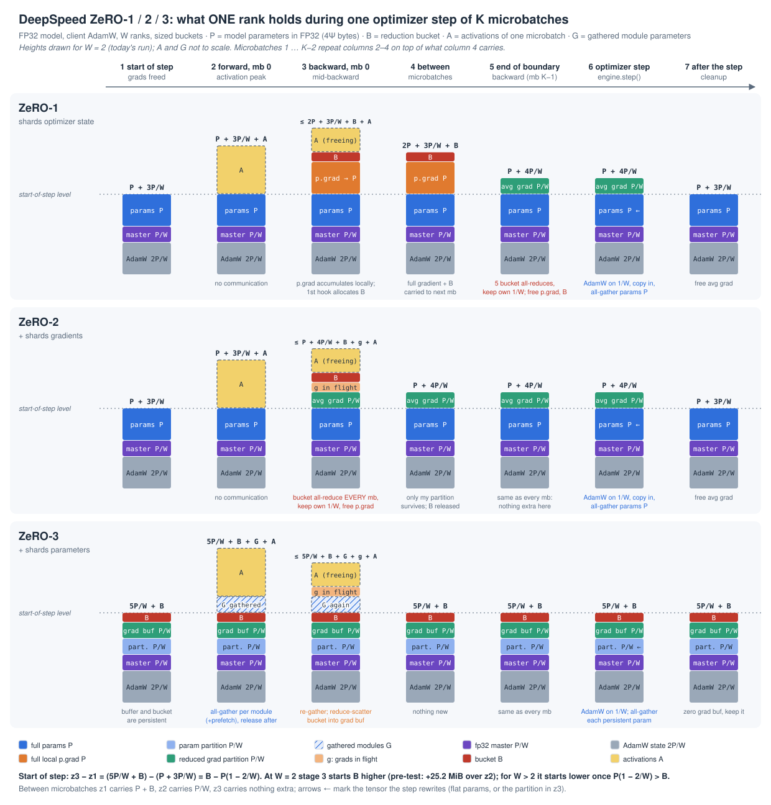

# Day 08: DeepSpeed ZeRO stages 0, 1, 2, 3 on the same model (dual-A100 guide)

> **Status (2026-11-09): complete.** The personal run `a100_core_20261108T090011Z` passed parity, count and memory. The three required observations are recorded in [notes.md](notes.md). Timing and slow-link results remain labelled pre-test.

## Required to close Day 08 (about 1 h on top of the run)

| # | Observation | Evidence from your run | Where in this guide |
| --- | --- | --- | --- |
| 1 | Which NCCL collective actually reduces the ZeRO-1/2 gradient buckets, and how often each stage reduces at K = 4 | `count` log, K = 4 table: the kernel kind for `z1` and `z2` (expected `AllReduce`, not `ReduceScatter`) and the per-step counts ([measured](../outputs/day08_downloads/a100_core_20261108T090011Z/session_a100_core_20261108T090011Z/count.log#L169): `z1` 6 AR, `z2` 21 AR) | §1.3, §1.5 (where the boundary sits), "How to read the count output" |
| 2 | Why ZeRO-3 starts each step with **more** memory than ZeRO-2 in this FP32 run, and which buffers account for the difference | `memory` log: the `start of step` row for `z2` and `z3`, and the `z3` census lines ([measured](../outputs/day08_downloads/a100_core_20261108T090011Z/session_a100_core_20261108T090011Z/memory.log#L284): 325.8 vs 351.0 MiB; param partition −P/2, `grad_partitions_flat_buffer` +P/2, `ipg_buckets` +25 MiB, persistent params +0.2) | §1.2, §1.4, "How to read the memory output" |
| 3 | One DeepSpeed gradient-accumulation pitfall, shown by a negative control | `parity` log: the `double_scale` or `fixed_gas` row, the check that caught it and the number ([measured](../outputs/day08_downloads/a100_core_20261108T090011Z/session_a100_core_20261108T090011Z/parity.log#L168): D, Adam step 5 vs 6) | §1.5, §1.7 |

**Day 08 is done when:**

- [x] Your run has finished the `parity`, `count` and `memory` stages, and `parity` printed `PARITY: ALL CHECKS PASSED` with both controls `DETECTED`. These three stages are the execution requirement. If the later `timing` or `slowlink` stage fails or is stopped, Day 08 can still close.
- [x] [`notes.md`](notes.md) §1–§4 are filled in: run record plus the three observations. Each one quotes the log file, the table row and the number, and gives a 3–6 sentence explanation.
- [x] Every number in §1–§4 is from your run (**[measured]**). A pre-test value may be quoted only for comparison, labelled **[pre-test]**.

**Optional follow-up (not required to close the day):**

- §1.8 predictions, and the full derived-expectations table.
- The **YOU WRITE** parts of `ds_setup.py`, written by you and diffed against the reference.
- Block 3, Stops 1–9: the full source walkthrough, and the per-stop notes in `notes.md` §B3.
- Timing (m = 8, m = 32, K = 4) and slow-link analysis, in `notes.md` §B8. The runner includes them by default. Pass `--core` for a fresh run that only needs the required stages.
- The default-bucket census, ZeRO-3 vs FSDP2, and the self-check questions.

The original full-scope goal and checklist follow, unchanged, for the optional work.

---

**Original goal (optional, full scope):** by tonight you can run Day 01's transformer under DeepSpeed at ZeRO stage 0, 1, 2 and 3, and say with measurements what each stage costs. You will show:

1. **Correctness.** Stages 0 and 1 are **bitwise identical** to DDP + the same AdamW. Stages 2 and 3 are close but not bitwise, for the same reason as Day 07's `sync`. Two DeepSpeed-specific accumulation bugs are caught by named checks.
2. **A memory table per stage, with every MiB named.** A tensor census says which DeepSpeed buffer owns each allocation. You can explain why, in FP32 on this model, stage 3 does **not** use less memory than stage 1 or 2. You can also explain why DeepSpeed's default bucket sizes add up to 1.9 GB here.
3. **What each stage sends.** You can find every collective in the trace and say what it is: stage 1/2's gradient "reduce-scatter" is an **all-reduce** kernel, stage 2 issues one full gradient all-reduce **per microbatch**, and stage 3 issues dozens of small gathers per step.
4. **Why a higher stage isn't faster.** More bytes, more collectives and more exposed time per step, measured on NVLink and on a slow link.

You write about 30 lines: the config for one stage and the accumulation contract with DeepSpeed's engine. Then you read DeepSpeed's code from `deepspeed.initialize` to the NCCL calls of each stage.

Days 06 and 07 left the numbers this day builds on:
- **Model size:** Ψ = 27,443,200 parameters, P = 104.69 MiB in FP32.
- **DDP:** 4P = 418.8 MiB of model state per rank at the start of a step (parameters, DDP buckets, AdamW state). Its K = 1, m = 8 backward peak was 1117.1 MiB in Day 07's run.
- **Day 06 (own ZeRO-1):** one flat buffer, one reduce-scatter + one all-gather per window: the same bytes as DDP's all-reduce.
- **Day 07 (FSDP2 per block):** 1.5P at the start of a step and a 905.0 MiB backward peak, but +14.6 ms per step at m = 8 from per-group overhead.
- **Day 07's open question:** does DeepSpeed's stage 3 gather per module like FSDP2, and does it prefetch by a byte budget instead of one group ahead? Today answers it from the source and the trace.

**Original full-scope checklist (optional since 2026-11-08; the required list is at the top):**

- [ ] §1.8 predictions written (memory per stage, collectives and bytes per step, bitwise groups, which check catches which control) before you look at Appendix A
- [ ] The **YOU WRITE** parts of `ds_setup.py` written by you and diffed against the reference
- [ ] `compare_ds.py --stage parity` prints `PARITY: ALL CHECKS PASSED`: every variant passes A–E, R, S; `z0` and `z1` are bitwise equal to DDP; both controls are `DETECTED` by their named check
- [ ] `--stage count`: collectives per optimizer step by NCCL kernel kind for every stage at K = 4 and K = 1, with the stage 1, 2 and 3 sequences read
- [ ] `--stage memory`: the memory table per stage (start of step, forward and backward peak, after the step) and the census for sized and default buckets
- [ ] `--stage timing` and `--stage slowlink`: ms per optimizer step for every stage at m = 8, m = 32 and K = 4 on NVLink, and at m = 8 on a slow link
- [ ] `day08/notes.md` filled with your measured numbers
- [ ] Block 3 per-stop source notes written in your own words
- [ ] You can answer without notes: *what does each ZeRO stage shard, what does DeepSpeed actually send for it, and why is a higher stage not faster?*

---

## Read this first: same host type, fresh rental, one new package

The software and rules are the same as Days 02–07: **2 × A100-SXM4-40GB, NV12, default NCCL settings**, torch 2.14.1+cu130, NCCL 2.30.7, `--condition shared`. The personal run had both GPUs on NUMA node 1.

New today: **DeepSpeed 0.19.9**. It is not in the image. Install it without building any CUDA extension. Today's code passes DeepSpeed a plain `torch.optim.AdamW`, so no DeepSpeed kernel is ever compiled.

The project directory arrives empty on a fresh rental. From your Windows project root:

```bash
ssh -p <port> root@<host> 'mkdir -p /workspace/AI-Infra-Learning/experiments'
scp -P <port> requirements.txt root@<host>:/workspace/AI-Infra-Learning/
scp -P <port> -r experiments/day01_single_gpu experiments/day02_data_parallel experiments/day03_ddp_hooks experiments/day04_grad_accum experiments/day07_fsdp2 experiments/day08_deepspeed root@<host>:/workspace/AI-Infra-Learning/experiments/
```

Then, on the instance:

```bash
cd /workspace/AI-Infra-Learning
ln -sfn /venv/main .venv        # fresh rental only
source .venv/bin/activate
DS_BUILD_OPS=0 python -m pip install deepspeed==0.19.9
export CUDA_VISIBLE_DEVICES=0,1 OMP_NUM_THREADS=1
unset NCCL_P2P_DISABLE NCCL_SHM_DISABLE NCCL_ALGO
nvidia-smi topo -m              # record it: timings compare only within one host
python -m torch.distributed.run --standalone --nproc_per_node 2 experiments/day02_data_parallel/hello_dist.py --device cuda
```

The Vast.ai SSH proxy refused connections intermittently during the pre-test ("kex_exchange_identification: Connection closed"). Retrying after 20–60 s worked. Start long stages with `nohup` (or use `run_server_once.sh` inside `tmux`), so a dropped SSH session does not kill them.

Today's code imports these files unchanged:
- Day 01: `train.py`
- Day 02: `ddp_manual.py`, `check_parity.py`, `launch_utils.py`, `find_symbols.py`, `gpu_probe.py`
- Day 03: `analyze_trace.py`
- Day 04: `compare_accum.py`, `count_collectives.py`
- Day 07: `train_fsdp.py` (`MemTimeline`), `analyze_fsdp_trace.py`

---

## Files

| File | What it is |
| --- | --- |
| `experiments/day08_deepspeed/ds_setup.py` | **The part you write.** `make_ds_config` (one config per stage, buckets sized for this model or DeepSpeed's defaults) and `ds_microbatch` (Day 04's accumulation contract through the engine). Given: evidence helpers (`safe_get_full_*`), shard and state reports, `tensor_census` |
| `experiments/day08_deepspeed/train_ds.py` | Day 04/07's loop with `--impl single / ddp / ds`, `--zero-stage`, `--buckets`, `--overlap`, two `--bug` controls, synchronized phase timing, the per-rank memory ledger, Day 07's block-boundary timeline, `--census`, `--memory-snapshot`, `--profile` |
| `experiments/day08_deepspeed/compare_ds.py` | Orchestrator: smoke → `parity` → `count` → `memory` → `timing` → `slowlink`. Plain `python` |
| `experiments/day08_deepspeed/find_symbols.py` | `file:line` of the Block 3 reading list in your DeepSpeed install |
| `experiments/day08_deepspeed/run_server_once.sh` | All stages once, logs, DeepSpeed source snapshot, output checks, checksummed archive |
| `day08/assets/zero_memory_phases.svg` | §1.2 figure: one rank's memory under ZeRO-1/2/3 at seven moments of one optimizer step, in units of P and W; drawn by `draw_zero_memory_phases.py` |

---

## Block 1: Design (30 min). Reason first, then compare with the measured run

### 1.1 One number, three optimizer classes

`deepspeed.initialize(model, optimizer, config)` returns an **engine**. The engine owns forward, `backward()` and `step()`. The config's `zero_optimization.stage` decides which optimizer class wraps your AdamW (`engine._configure_zero_optimizer`, Block 3 Stop 1):

| Stage | Optimizer class | Sharded per rank | Gradient reduction | Parameter communication |
| --- | --- | --- | --- | --- |
| 0 | none: your AdamW as is | nothing | all-reduce of the window's gradient, in the boundary backward's epilogue | none |
| 1 | `DeepSpeedZeroOptimizer(partition_grads=False)` | AdamW state + fp32 master copy | once per window, at the boundary, in 25 MiB buckets | all-gather of the updated parameters after the step |
| 2 | **the same class**, `partition_grads=True` | + gradients | **every microbatch**, from gradient hooks during backward, in buckets | same as stage 1 |
| 3 | `DeepSpeedZeroOptimizer_Stage3` + hooks on **every submodule** | + parameters | every microbatch, reduce-scatter in buckets | all-gather before each submodule's forward and backward; small "persistent" parameters stay full |

Stages 1 and 2 differ by **one boolean**. That boolean decides whether a rank may drop the gradient slices it does not own as soon as they are reduced (stage 2), or must keep the full gradient until the window ends (stage 1).

Three things DeepSpeed does that Day 07's FSDP2 did not:

1. **It broadcasts rank 0's parameters at initialization** (`engine._broadcast_model`). The harness still seeds the ranks differently, so check C proves it.
2. **It rewrites the optimizer you pass in.** Your AdamW's `param_groups[0]["params"]` is replaced by one flat fp32 partition (`stage_1_and_2.py:584`). That is why the optimizer can be built *before* wrapping, which is the opposite of FSDP2's rule. The LR scheduler built on the same optimizer keeps working because the group dictionaries are the same objects.
3. **It keeps an fp32 "master" copy of this rank's parameter partition**, even when the model is already FP32 (§1.2).

### 1.2 What each stage keeps per rank, in FP32

DeepSpeed is designed for mixed precision: BF16/FP16 parameters and gradients (2 + 2 bytes per parameter), plus an FP32 master copy and two FP32 Adam moments (4 + 4 + 4 bytes). That is the 16Ψ bytes of the ZeRO paper. The stages shard the 12Ψ of optimizer state (stage 1), then the gradients (stage 2), then the parameters (stage 3). In FP32 the model parameters are already 4 bytes, but DeepSpeed **still** makes the master copy. On this model that costs P/W = 52.3 MiB per rank.

Per rank at the **start of a step**, gradients freed, W = 2, sized buckets (B = 25 MiB):

| What | `ddp` | `z0` | `z1` | `z2` | `z3` | Day 07 FSDP2 |
| --- | --- | --- | --- | --- | --- | --- |
| model parameters | P | P | P (flat buffer; params are views of it) | P | P/2 (`ds_tensor`) + persistent ≈ 0.2 MiB | P/2 |
| fp32 master partition | — | — | P/2 | P/2 | P/2 | — |
| AdamW `exp_avg` + `exp_avg_sq` | 2P | 2P | P | P | P | P |
| persistent gradient buffer | P (DDP buckets) | — | — | — | P/2 (`grad_partitions_flat_buffer`) | — |
| persistent reduction bucket | — | — | — | — | B | — |
| **total** | **4P = 418.8** | **3P = 314.1** | **2.5P = 261.7** | **2.5P = 261.7** | **2.5P + B = 286.7** | **1.5P = 157.0** |

`memory_allocated()` adds a constant of about 64 MiB (cuBLAS workspaces, the causal mask, allocator rounding). Predict **differences between columns**. Note the last two columns: in FP32, DeepSpeed's stage 3 keeps four P/2-sized buffers plus a bucket, while FSDP2 keeps two.

During a step the stages differ again:

| | `z1` | `z2` | `z3` |
| --- | --- | --- | --- |
| between microbatches, K ≥ 2 | full `p.grad` (P) accumulates locally, plus the bucket buffer B that the first hook of each backward allocates and only the boundary reduction releases | this rank's averaged gradient partition (P/2); the bucket is released after each backward's reduction | nothing new: the partition buffer is persistent |
| forward | full parameters, always | full parameters, always | only the modules being computed (plus prefetch) |
| right before the optimizer | `averaged_gradients` (P/2) | `averaged_gradients` (P/2) | grad partition buffer (already counted) |

The same ledger for any W, at seven moments of one optimizer step of K ≥ 2 microbatches:



How to read the figure (schematic; heights drawn for W = 2, activations A and gathered modules G not to scale; drawn by `assets/draw_zero_memory_phases.py`):
- **One rank, one row per stage, one column per moment.** The dotted line is the stage's start-of-step level, so everything above it is what that moment adds. The text under each bar is what happens just before that moment, coloured by collective: red all-reduce, orange reduce-scatter, blue all-gather.
- **The bottom two blocks never change:** the fp32 master partition (P/W) and the AdamW moments (2P/W). Every stage ≥ 1 shards these, and they make the common 3P/W.
- **Columns 2–4 are microbatch 0.** Microbatches 1 … K−2 repeat them on top of what column 4 carries. That carried amount is the real difference between the stages:
  - stage 1 keeps the full `p.grad` (P) plus the bucket B until the boundary;
  - stage 2 keeps only its reduced partition (P/W);
  - stage 3 keeps nothing extra.
- **Column 5 is where stage 1 finally communicates.** Five bucket all-reduces, each rank keeps its 1/W slice, then `p.grad` and B are freed. Stage 2 has done this in every microbatch already. Stage 3's reduce-scatters have already filled its persistent gradient buffer.
- **Column 7 (cleanup):** stages 1 and 2 free `averaged_gradients` and return exactly to column 1. Stage 3 zeroes its gradient buffer but keeps it and the bucket, which is why its column 1 is higher at W = 2.

| Moment (per rank) | `z1` | `z2` | `z3` | At W = 2, sized buckets (MiB) [derived; bracketed source below] |
| --- | --- | --- | --- | --- |
| start of step = after the step | P + 3P/W | P + 3P/W | 5P/W + B | 261.7 / 261.7 / 286.7 [measured: 261.8 / 261.8 / 287.0 named in the census] |
| forward of a microbatch adds | A | A | A + G | A ≈ 570–630 at m = 8 for every stage |
| between microbatches, on top of the start | P + B | P/W | 0 | 129.7 / 52.3 / 0 [pre-test: 135.5 / 56.4 / 0.2] |
| end of boundary backward and the step, on top of the start | P/W | P/W | 0 | 52.3 / 52.3 / 0 [measured: 52.6 for `z1` at K = 1] |

Two formulas fall out of the table:
- **At the start of a step**, z3 − z1 = (5P/W + B) − (P + 3P/W) = **B − P(1 − 2/W)**. At W = 2 the bracket is zero, so stage 3 starts exactly one bucket higher: +25.2 MiB over `z2` in the measured run, which is Observation 2. From W = 3 on, stage 3 starts lower once P(1 − 2/W) > B; here that holds for any W ≥ 3. That is [derived, not tested]: this host has two GPUs.
- **Between microbatches**, stage 1's extra P + B does not shrink with W at all, stage 2's P/W does, and stage 3 adds nothing. That is why stage 1's K = 4 peak was the highest of the three (Appendix A.3).

So stage 3 only wins when, at the moment that matters, the full parameters and gradients the other stages hold outweigh what stage 3 adds (P/2 gradient buffer + B + gathered modules). At the start of a step that never happens on this 27M model in FP32. At the peak it depends on *when* the peak falls: at K = 1, m = 8 it falls at the start of backward, before stage 1/2 hold any gradient, and stage 3 is higher; with K = 4 or m = 32 the pre-test found stage 3 lowest (Appendix A.3). With BF16 parameters and gradients, or a model whose parameters dwarf its activations, stage 3 wins everywhere.

### 1.3 What each stage sends: kernels and bytes

Read DeepSpeed's names with care. `zero_optimization.reduce_scatter: true` is the default, and so is `use_multi_rank_bucket_allreduce: true`. With both, stage 1/2's `average_tensor` (Block 3, Stop 4) divides the bucket by W, **all-reduces** it, and each rank keeps the slice it owns. The NCCL kernel is an `AllReduce`. At W = 2 it sends P per reduction, not the P/2 of a true reduce-scatter.

Bytes sent per rank per optimizer step, ring collectives at W = 2 (an all-reduce of X sends X; a reduce-scatter or all-gather of X sends X/2):

| Variant | Collectives per step (K microbatches) | K = 1 | K = 4 |
| --- | --- | --- | --- |
| `ddp` | 4 bucket all-reduces at the window's last backward | P | P |
| `z0` | 1 all-reduce of all gradients (DeepSpeed's fallback bucket is 5e8 elements) | P | P |
| `z1` | 5 bucket all-reduces at the boundary + 1 scalar all-reduce (gradient norm) + 1 all-gather of updated params | 1.5P | 1.5P |
| `z2` | 5 bucket all-reduces **per microbatch** + 1 scalar + 1 all-gather | 1.5P | 4.5P |
| `z3` | per microbatch: coalesced all-gathers in forward and again in backward, 5 bucketed reduce-scatters; per step: 1 scalar + **one all-gather per persistent parameter** (51 here) | ≈ 1.5P | ≈ 6P |

Two consequences:
- **Stage 1 here moves 1.5× DDP's bytes,** while Day 06's hand-written ZeRO-1 moved exactly P. The difference is DeepSpeed's all-reduce-then-keep-a-slice default, chosen for many-GPU jobs with small buckets. `use_multi_rank_bucket_allreduce: false` switches to one `reduce` per destination rank. That is [not tested] today.
- **Stage 2's bytes grow with K.** It cannot hold the full gradient across microbatches; that is the whole point of stage 2. So it reduces each microbatch, like Day 06's `rs_every` and Day 07's `sync`, but as a full all-reduce each time.

### 1.4 The defaults trap

DeepSpeed's defaults suit billion-parameter models:

| Knob | Default | On this model |
| --- | --- | --- |
| `reduce_bucket_size` | 5e8 elements | one bucket buffer = **1907 MiB** of FP32, 18× the whole model. With `contiguous_gradients: true` (default) the gradient hooks allocate it in **every** backward (stage 1/2), or keep it for good (stage 3). `overlap_comm` allocates two |
| `allgather_bucket_size` | 5e8 | harmless: the whole model fits one all-gather |
| `stage3_prefetch_bucket_size` | 5e7 | prefetch the whole model ahead |
| `stage3_max_reuse_distance` | 1e9 elements | never release a parameter that will be used again within 1e9 elements, i.e. never release anything |

`make_ds_config(..., buckets="sized")` sets the buckets to 25 MiB (DDP's `bucket_cap_mb`) and stage 3's prefetch and reuse distance to one block. `buckets="default"` leaves all of them alone. The memory stage runs both. Before you run, predict which stage's **start-of-step** memory the default bucket changes, and which stages only see it as a backward **peak**.

### 1.5 The accumulation contract

DeepSpeed's canonical loop is:

```python
for batch in microbatches:
    loss = engine(batch)
    engine.backward(loss)   # divides loss by gradient_accumulation_steps (scale_wrt_gas=True)
    engine.step()           # acts only when (micro_steps + 1) % gradient_accumulation_steps == 0
```

Day 04's contract has its own loss weights (rows_j / rows_in_window) and a short final window. Both defaults break it:

| DeepSpeed default | What goes wrong with Day 04's loop | Fix in `ds_microbatch` | Control |
| --- | --- | --- | --- |
| `engine.backward(loss)` divides by `gradient_accumulation_steps` | the gradient is divided by K twice: 4× too small at K = 4 | `engine.backward(loss * w, scale_wrt_gas=False)` | `double_scale` |
| the boundary comes from a micro-step counter | the short final window (2 microbatches) never reaches the boundary, so its update is silently skipped | `engine.set_gradient_accumulation_boundary(last)` before each forward, `engine.step()` once per window | `fixed_gas` |

Where the boundary sits differs by stage (`engine.allreduce_gradients`, Block 3, Stop 3):
- **Stages 0 and 1** communicate only in the boundary backward's epilogue. Before that, `p.grad` accumulates locally (Day 06's `zero1` row).
- **Stages 2 and 3** communicate in every backward, from hooks (Day 06's `rs_every` row). `engine.no_sync()` asserts for stages 2 and 3: "no_sync context manager is incompatible with gradient partitioning".

### 1.6 Numerics: what is bitwise

| Comparison | Prediction | Why |
| --- | --- | --- |
| `z0` vs `ddp` | **bitwise** | one reduction of the same local window sum, divide by 2 then sum (exact at W = 2), same AdamW over the same 30 tensors |
| `z1` vs `ddp` | **bitwise** | the same single reduction, then AdamW on one flat fp32 slice. AdamW is elementwise (Day 06 §1.3), so a flat slice gives the same numbers. Bucket boundaries do not change an elementwise sum |
| `z2`, `z3` vs `ddp` | close, **not** bitwise | one reduction per microbatch: Σⱼ fl(gⱼ⁰/2 + gⱼ¹/2) vs fl(Σⱼ gⱼ⁰/2 + Σⱼ gⱼ¹/2) (Day 06 `rs_every`, Day 07 `sync`) |
| `z3` loss at step 0 vs 1 process | maybe not bitwise | forward runs on gathered tensors in fresh storage. Whether that changes a kernel's summation order was not isolated in the pre-test |

### 1.7 Checks and the two controls

A–E are the checks of Days 02 and 04, against one process with one big batch per step (tiny model, windows `[4, 4, 4, 4, 4, 2]`). **R**: every parameter a rank holds in full is bitwise equal across ranks: all 30 for `ddp` and stages 0–2, only the persistent ones for stage 3. **S**: AdamW state, gathered from the shards with `safe_get_full_optimizer_state`, against the DDP run.

On the **tiny** model every tensor has fewer than 1e5 elements, so with DeepSpeed's default `stage3_param_persistence_threshold` stage 3 would partition nothing. The parity stage passes `--persist-threshold 1000`, so stage 3 partitions the weight matrices and keeps the 19 biases and norm vectors persistent.

| `--bug` (on `z2`) | What it does | Must be caught by |
| --- | --- | --- |
| `double_scale` | `engine.backward(loss * w)` with the default `scale_wrt_gas=True` | A |
| `fixed_gas` | DeepSpeed's canonical loop: `engine.step()` every microbatch, boundary from the config's GAS | D |

Questions before you run:
- Which control leaves B (parameters after one update) passing, and why? (Day 07's `sum_grads` hint applies.)
- Which control leaves A passing, and why can only D or E see it?
- Why can R not catch either control?

### 1.8 Predictions (optional; write yours before you read Appendix A)

Fill the middle column first. The derived expectations are below the table, and the run results are in Appendix A.

| Quantity | Your prediction | Check against |
| --- | --- | --- |
| After `deepspeed.initialize`, rank 0, MiB, `z0` / `z1` / `z3` | | memory table `after wrap` |
| Start of step, `ddp` − `z1` and `z1` − `z3` | | memory table `start of step` |
| Between microbatches at K = 4, `z1` vs `z2` vs `z3` | | timing table `between` |
| K = 1, m = 8 backward peak, ordered from lowest to highest | | memory table |
| Default buckets: which stage's start-of-step changes, and by how much | | memory table, `*_def` rows |
| AllReduce / ReduceScatter / AllGather per step, K = 4, every stage | | count table |
| Bytes sent per rank per step, K = 4, `z2` and `z3`, in units of P | | §1.3 + count table |
| Bitwise groups; which check catches each control | | parity log |
| ms per optimizer step at m = 8, K = 1: order `ddp`, `z0`–`z3` | | timing table |
| Does the gap between `z3` and `ddp` shrink at m = 32? | | timing table |

<details><summary>Derived expectations (open after writing yours)</summary>

| Quantity | Derived expectation |
| --- | --- |
| After wrap | `z0` P = 104.7 (nothing changes). `z1` 1.5P = 157.0: flat params + master partition. `z3` P/2 + P/2 + P/2 + B = 182.0: partition, master, grad partition buffer, bucket |
| Start of step | `ddp` − `z1` = 1.5P = 157.0. `z1` − `z3` = −B = −25: stage 3 is **higher** |
| Between microbatches | `z1` ≈ start + P + B (full grads + bucket). `z2` ≈ start + P/2 (partition only). `z3` ≈ start: nothing new persists |
| Backward peak, K = 1, m = 8 | the peak falls at the start of backward, before gradients exist. Stage 3's partition saving (P/2) is cancelled by its grad buffer and bucket. Expect `z1` ≈ `z2` < `z3` < `z0` < `ddp`. At K = 4 the order can change, because stage 1 then carries P of gradients through later microbatches |
| Default buckets | only `z3`'s start of step (+1907 − 25 MiB); `z1`/`z2` see it as a backward peak only |
| Collectives at K = 4 | `ddp` 4 AR. `z0` 1 AR. `z1` 6 AR + 1 AG. `z2` 4 × 5 + 1 = 21 AR + 1 AG. `z3` 4 × (fwd + bwd gathers) + 51 AG, 4 × 5 RS, 1 AR |
| Bytes at K = 4 | `z2` 4.5P, `z3` ≈ 6P |
| Bitwise | `z0`, `z1` bitwise; `z2`, `z3` not. `double_scale` → A (B passes: Adam is nearly scale-invariant), `fixed_gas` → D (A passes: windows 1–5 are correct) |
| Speed at m = 8 | `ddp` ≈ `z0` < `z1` < `z2` ≪ `z3` |
| m = 32 | the `z3` gap shrinks (more compute per gather to hide behind) but stays the largest: its per-module hooks and 51 per-parameter gathers do not grow with the batch, so they do not shrink either |
</details>

### 1.9 New rules (on top of Days 02–07)

1. **Read the kernel, not the config key.** `reduce_scatter: true` produced `AllReduce` kernels. The trace says what was sent.
2. **Size every bucket to the model, knowing what it trades.** A bucket is memory you pay for fewer collectives. A default sized for 10B parameters costs 1.9 GB on 27M; a tiny bucket costs launches.
3. **Own the accumulation contract.** Pass `scale_wrt_gas=False` when you weight the loss yourself, and set the boundary explicitly when windows vary.
4. **Read gradients between the boundary backward and `engine.step()`.** ZeRO frees them inside the step; reading later raises or returns stale data.
5. **A framework's mixed-precision design costs memory in FP32.** Stage ≥ 1 keeps an fp32 master partition even when the model is FP32.

---

## Block 2: Code (2 h, optional since 2026-11-08: the run uses the reference `ds_setup.py`)

### Stage 0 (15 min): the ledger by hand

From §1.2, in MiB:
- each stage's start-of-step memory, without the 64 MiB constant;
- `z1` and `z2` between microbatches at K = 4;
- the default-bucket buffer in MiB (5e8 × 4 bytes);
- the §1.3 collective counts and bytes for K = 1 and K = 4.

Then predict the `[rank r]` line of a medium `z3` run: elements kept (partition + persistent), fp32 master elements, state MiB, after-wrap MiB.

### Stage 1 (45 min): write the **YOU WRITE** parts of `ds_setup.py`

Copy `ds_setup.py` to a scratch name, delete the two bodies under `YOU WRITE`, and rewrite them:

1. **`make_ds_config`**: the batch keys (`train_micro_batch_size_per_gpu`, `gradient_accumulation_steps`, `train_batch_size`; DeepSpeed checks that the third is the product of the other two and W), `zero_optimization` per stage and bucket mode, `zero_allow_untested_optimizer`, no clipping, FP32. For `buckets="sized"` set the two bucket sizes to `BUCKET_NUMEL`, and for stage 3 the prefetch bucket, reuse distance and live-parameter cap from `BLOCK_NUMEL`. Leave everything else at the default.
2. **`ds_microbatch`**: `set_gradient_accumulation_boundary(last)` **before** the forward, forward through `engine(x)`, `engine.backward(loss * weight, scale_wrt_gas=False)`. Return the unweighted loss. Then implement the two bugs exactly as the table in §1.5 describes them.

Questions before moving on:
- Why must the boundary be set **before the forward**, not just before `engine.step()`? (Stage 0/1 reduce in `backward`'s epilogue, which reads `is_gradient_accumulation_boundary()`.)
- What does `engine.step()` do on a non-boundary microbatch? (`engine.step`, Stop 3: everything except `_take_model_step`.)
- Why is `zero_allow_untested_optimizer` needed? (`engine.py:2299`: ZeRO trusts only DeepSpeed's own optimizers by default.)
- `train_batch_size` describes a full window. Why does the short final window not violate it? (DeepSpeed only checks the config at init; the boundary override decides the rest.)

### Stage 2 (30 min): read the harness

In `train_ds.py` find:

- the wrap section. Day 01's optimizer (or its `--foreach` rebuild, made before wrapping) is passed to `deepspeed.initialize`, not deleted and rebuilt after wrapping as on Day 07. The scheduler stays with the harness.
- `ds_microbatch` called per microbatch with a `phase` context manager for the profiler ranges and the timeline. For `fixed_gas`, `engine.step()` runs inside the loop.
- `capture(s)`: the evidence read right after the last backward, before any `engine.step()`, excluded from the timer.
- the three timestamps. For DeepSpeed, [t1, t2] is `engine.step()`: AdamW on the partition, the fp32 → model copy, the parameter all-gather (stages 1/2) or the persistent-parameter gathers (stage 3), and `zero_grad`.
- `replicated_now()`: why it is re-evaluated at every check for stage 3. (Persistent parameters are empty until their first fetch.)

### Stage 3 (30 min): read the census and the evidence helpers

In `ds_setup.py`:
- `tensor_census` walks storages, not tensors. Why would counting `p.data` and `bit16_groups_flat` separately double-count stage 1/2's parameters? (The parameters are views of the flat buffer.)
- `full_grads` calls `safe_get_full_grad`. Read it (`tensor_fragment.py:208`): for stage 1/2 it places this rank's fragment in a zero buffer and all-reduces. Every rank must call it for every parameter in the same order. Why did the pre-test hang until the harness guarded it with `engine.is_gradient_accumulation_boundary()`? (Day 07 rule: a collective called by one rank only.)

### Pitfalls (symptom → cause)

| Symptom | Likely cause |
| --- | --- |
| 1.9 GB more memory than expected on a small model | default `reduce_bucket_size` (5e8 elements) with `contiguous_gradients` |
| stage 3 memory flat at ~2.2 GB between steps | the same bucket, kept for good by stage 3 (census: `zero.ipg_buckets`) |
| gradients 4× too small, loss still falls almost normally | `scale_wrt_gas=True` on top of your own weights (`double_scale`); Adam hides the scale |
| last optimizer step silently missing, Adam step count one short | boundary from the GAS counter with a variable window (`fixed_gas`) |
| `ValueError: Gradients are only available immediately after backward and before engine step` | reading gradients after `engine.step()`, or in a window that never reached the boundary |
| a run hangs at the end with GPUs at 100 % | one rank raised inside an evidence collective and the other waits in NCCL (guard before calling) |
| `AssertionError: no_sync context manager is incompatible with gradient partitioning` | `engine.no_sync()` with stage 2 or 3 |
| `max(): Expected reduction dim` in a replica check under stage 3 | comparing a parameter whose `p.data` is empty (not gathered) |
| stage 3 on a tiny model behaves like stage 2 | every tensor below `stage3_param_persistence_threshold`: nothing is partitioned |

---

## Block 3: Read the source (1 h, optional), from `deepspeed.initialize` to the NCCL calls

Required observations need only the parts of Stop 3 (where the boundary sits) and Stop 4 (`average_tensor` → `all_reduce`) that §1.3 and §1.5 already summarise. The rest is follow-up.

Run `python experiments/day08_deepspeed/find_symbols.py` first. The line numbers below are deepspeed 0.19.9's; your install prints its own. Paths are under `deepspeed/`.

### Stop 1: the engine (`__init__.py:433`, `runtime/engine.py:509`)

`initialize` builds a `DeepSpeedEngine`. In its constructor follow:
- `_configure_distributed_model` (`:2073`) → `_broadcast_model` (`:2037`): one broadcast per parameter from rank 0, skipped only for a model already partitioned by `zero.Init`.
- `_configure_optimizer` (`:2327`) → `_configure_zero_optimizer` (`:2632`). Find where `partition_grads=zero_stage == ZeroStageEnum.gradients` is passed to the stage 1/2 class, and where stage 3 builds `DeepSpeedZeroOptimizer_Stage3`.

*Q: why does stage 3 without `zero.Init` still go through `_broadcast_model` first?* *Q: what would `zero.Init` change for a 70B model that does not fit on one GPU?* (Parameters are partitioned as each module is constructed; the full model never exists on one rank.)

### Stop 2: the stage 1/2 constructor (`runtime/zero/stage_1_and_2.py:158`)

- The parameters of each group are flattened (`:505`–`:524`), and each model parameter becomes a view of the flat buffer (`_update_model_bit16_weights`, `:889`).
- This rank's slice is cloned into the fp32 master partition (`:560`), and the client optimizer's group is rewritten: `param_group['params'] = [self.single_partition_of_fp32_groups[i]]` (`:584`).
- Gradient hooks are created if `partition_gradients or overlap_comm or use_grad_accum_attribute or contiguous_gradients` (`:713`). So stage 1 has hooks too.

*Q: in stage 1 with `contiguous_gradients` on, what do the hooks do on a non-boundary microbatch?* (`process_gradients`, `:2284`: `setup_buckets` only, which allocates the bucket buffer; no reduction.) *Q: which census line is the master partition?*

### Stop 3: the accumulation contract in the engine (`runtime/engine.py`)

- `backward` (`:3381`): `loss / gradient_accumulation_steps() if scale_wrt_gas` (`:3412`), then `loss.backward()`, then `_backward_epilogue` (`:3152`) → `allreduce_gradients` (`:3072`).
- `allreduce_gradients`: stage ≥ 2 → `overlapping_partition_gradients_reduce_epilogue` **every** microbatch; otherwise only at the boundary, `reduce_gradients` (stage 1) or `buffered_allreduce_fallback` (`:3920`, stage 0).
- `is_gradient_accumulation_boundary` (`:3441`) and `set_gradient_accumulation_boundary` (`:3466`): the override wins over the counter.
- `step` (`:3566`) → `_take_model_step` (`:3504`): `optimizer.step()`, then `zero_grad`, then the engine's own LR scheduler if it has one (ours does not).
- `no_sync` (`:3218`): the assertion for stages 2 and 3.

*Q: the docstring mentions `managed_gradient_accumulation=false`. How would it replace `set_gradient_accumulation_boundary` for a variable window?* [not tested]

### Stop 4: stage 1/2 gradient reduction (`stage_1_and_2.py`)

`reduce_gradients` (`:958`, stage 1 at the boundary) or the hooks (stage 2) → `reduce_ready_partitions_and_remove_grads` (`:2293`) → `reduce_independent_p_g_buckets_and_remove_grads` (`:1414`): copy the gradient into the bucket buffer from `setup_buckets` (`:3256`); when the bucket is full → `reduce_ipg_grads` (`:2205`) → `average_tensor` (`:1590`).

Read `average_tensor` slowly. It divides the bucket by W, groups the slices by owner rank, and then:
- `use_multi_rank_bucket_allreduce` (default True) → `allreduce_and_scatter` (`:1545`) → **`dist.all_reduce`** of the bucket, each rank keeps its slice;
- otherwise → one `dist.reduce` per destination rank.

*Q: which NCCL kernel will the trace show for stage 2's gradients, and how many per microbatch with 25 MiB buckets?* *Q: why is the all-reduce choice good for many GPUs and small buckets, and bad for bytes at W = 2?*

### Stop 5: stage 1/2 step (`stage_1_and_2.py:3013`)

`step` → `_optimizer_step` (`:2967`) runs your AdamW on the fp32 partition, copies it into this rank's slice of the flat parameter buffer (`_update_model_bit16_weights`), then `all_gather_dp_groups` (`runtime/utils.py:1026`) → `all_gather_into_tensor`. Before the step, the global gradient norm is computed with one scalar `all_reduce` (`compute_grad_norm: true`, needed for clipping and logging).

*Q: which trace row is the scalar all-reduce, and why is its rank-0 duration 2–3 ms when its min-rank duration is 0.01 ms?* (It waits for the slower rank: Day 06's arrival skew.)

### Stop 6: stage 3 setup (`runtime/zero/parameter_offload.py`, `partition_parameters.py`)

- `DeepSpeedZeRoOffload` (`parameter_offload.py:136`): `mark_persistent_parameters` (`:317`) marks every parameter below `param_persistence_threshold` as persistent.
- `_register_deepspeed_module` (`:337`) recurses into **every child module** and registers forward pre/post hooks and backward hooks on each. This is the answer to Day 07's question: DeepSpeed gathers per **submodule** (each `Linear`, `LayerNorm`, `Embedding`, and `MultiheadAttention` for its own `in_proj`), not per wrapped block.
- `partition_parameters.py`: `_convert_to_deepspeed_param` (`:1270`) adds `ds_tensor`, `ds_status`, `ds_shape`; `partition` (`:1604`) → `_partition_param` (`:1778`) frees `p.data` to an empty tensor.

*Q: why does `nn.MultiheadAttention` work although it reads `out_proj.weight` without calling `out_proj`'s forward?* (Check which module's hook fetches it; then test your answer with `--profile`.)

### Stop 7: stage 3 fetch, prefetch and release (`partitioned_param_coordinator.py`)

`pre_sub_module_forward_function` (`parameter_offload.py:531`) → `fetch_sub_module` (`:310`) → `_fetch_sub_module_impl` (`:353`):
1. gather this module's own parameters if they are not available or in flight;
2. look ahead in the **recorded trace** of module execution (the first step records it) and prefetch upcoming parameters up to `prefetch_bucket_size` elements;
3. `__all_gather_params_` (`:582`) → `all_gather_coalesced` (`partition_parameters.py:1540`) on the all-gather stream.

`release_sub_module` (`:494`) → `__params_to_release` (`:634`): keep a parameter if it is reused within `max_reuse_distance` elements. This answers the second half of Day 07's question: DeepSpeed prefetches by an **element budget from a recorded trace**, where FSDP2 prefetches **one group ahead**.

*Q: with the default reuse distance (1e9), when is block 0's weight released after its forward?* (Never before its backward: it is reused within 1e9 elements.)

### Stop 8: stage 3 gradients and step (`runtime/zero/stage3.py`)

- `reduce_ready_partitions_and_remove_grads` (`:2160`) → `__add_grad_to_ipg_bucket` (`:1621`) → `__reduce_and_partition_ipg_grads` (`:1648`) → `__avg_scatter_grads` (`:1912`) → `reduce_scatter_coalesced` (`runtime/comm/coalesced_collectives.py:81`) → `dist.reduce_scatter_fn`: a real `ReduceScatter` kernel. Then `partition_grads` (`:2006`) writes into `grad_partitions_flat_buffer`.
- `step` (`:2873`) → `_post_step` (`:2835`) → `persistent_parameters[0].all_gather(persistent_parameters)` → `_all_gather` (`partition_parameters.py:1723`) → `_allgather_params_coalesced` (`:2022`). Read its loop: **one `all_gather_into_tensor` per parameter**.

*Q: how many persistent parameters does the medium model have, and how many all-gathers will the trace show in `## optimizer`?* (6 blocks × 8 biases/norm vectors + final norm (2) + head bias = 51.)

### Stop 9 (10 min): evidence and the knobs you did not use

- `safe_get_full_grad`, `safe_get_full_fp32_param`, `safe_get_full_optimizer_state` (`utils/tensor_fragment.py:208`, `:135`, `:170`).
- Read but [not tested]: `zero.Init`, `offload_optimizer` / `offload_param` (ZeRO-Offload / Infinity), `use_multi_rank_bucket_allreduce: false`, `zero_hpz_partition_size` (ZeRO++ hierarchical partitioning), `zero_quantized_weights` / `zero_quantized_gradients` (ZeRO++), `stage3_module_granularity_threshold` (leaf modules), BF16 (Day 9).

### Fill this in `notes.md` §B3 (optional)

| Item | Your answer (draft) |
| --- | --- |
| Entry | `deepspeed.initialize` → `DeepSpeedEngine`: broadcast, `_configure_zero_optimizer` picks the class by stage |
| Stage 1/2 state | flat parameter buffer (params are views) + fp32 master partition; client AdamW's `params` rewritten to the partition |
| Stage 1/2 gradients | hooks → bucket buffer → `average_tensor` → `all_reduce` of the bucket, keep own slice (multi-rank default); stage 1 only at the boundary, stage 2 every microbatch |
| Stage 1/2 step | AdamW on the partition → copy into the flat buffer → `all_gather_into_tensor` |
| Stage 3 parameters | hooks on every submodule; coordinator fetches + prefetches from a recorded trace by element budget; release by reuse distance |
| Stage 3 gradients | bucket → `reduce_scatter_coalesced` → grad partition buffer; persistent params all-gathered one by one after the step |
| Accumulation | `scale_wrt_gas` divides by GAS; boundary from the micro-step counter unless overridden |
| Mine vs framework | Day 06's flat ZeRO-1: RS + AG = P. DeepSpeed stage 1: bucket AR + AG = 1.5P at W = 2; FSDP2: per-module group, AG before use, RS after |

---

## Block 4: Run + summarize on the dual A100

Use plain `python` for the orchestrator: it launches `torchrun` itself and runs the smoke test first. Or run `bash experiments/day08_deepspeed/run_server_once.sh "a100_${RID}"` inside `tmux`: it does all of this, checks the outputs and writes an archive.

```bash
export CUDA_VISIBLE_DEVICES=0,1 OMP_NUM_THREADS=1
unset NCCL_P2P_DISABLE NCCL_SHM_DISABLE NCCL_ALGO
RID=$(date -u +%Y%m%dT%H%M%SZ)
mkdir -p outputs
nvidia-smi topo -m > "outputs/day08_topo_${RID}.txt"
python experiments/day08_deepspeed/compare_ds.py --stage parity   --condition shared --run-id "a100_${RID}"
python experiments/day08_deepspeed/compare_ds.py --stage count    --condition shared --run-id "a100_${RID}" --no-smoke
python experiments/day08_deepspeed/compare_ds.py --stage memory   --condition shared --run-id "a100_${RID}" --no-smoke
python experiments/day08_deepspeed/compare_ds.py --stage timing   --condition shared --run-id "a100_${RID}" --no-smoke --repeats 3
python experiments/day08_deepspeed/compare_ds.py --stage slowlink --condition shared --run-id "a100_${RID}" --no-smoke --repeats 2
```

Stage durations in the pre-test (from directory timestamps; about 21 min in total, plus a minute to install DeepSpeed):

| Stage | Runs | Duration |
| --- | --- | --- |
| parity | 8 (tiny) | about 2 min |
| count | 11 profiled | about 2.5 min |
| memory | 8 | about 1.5 min |
| timing | 19 × 3 repeats | 12 min 22 s |
| slowlink | 5 × 2 repeats + 2 profiled | 2 min 31 s |

`run_server_once.sh` checks 96 run directories, 26 traces and 8 memory snapshots in full mode. For the required stages alone, use `bash experiments/day08_deepspeed/run_server_once.sh "a100_${RID}" --core` with a fresh run ID. The core check expects 27 run directories, 22 traces and 8 snapshots. The runner writes `CORE_SUCCESS.txt` after verifying the required stages, before any optional timing.

Download the archive and verify its SHA-256 from Windows PowerShell with `experiments/day08_deepspeed/download_results.ps1 -Remote root@HOST -Port PORT -RunId RUN_ID`. The script extracts logs and results to `outputs/day08_downloads/RUN_ID/`. Use `-IncludeLaunchLog` if you redirected the runner to `outputs/day08_exports/day08_RUN_ID.log`.

### How to read the parity output

A/B/C are Day 02's checks and D/E are Day 04's, against one process with one big batch per step. Each block prints one line per rank: parameter elements kept, fp32 master elements, state MiB, after-wrap MiB and the first-step allocation. The BITWISE block compares each stage with DDP on the same AdamW; the `boundary` group (`z0`, `z1`) must be all `True`. Controls print lower-case `pass`/`fail` and a `DETECTED by check X` verdict.

### How to read the count output

- **Tables 1–2** (K = 4 and K = 1, m = 8): collectives per optimizer step by **NCCL kernel kind**, plus four time measures from Day 07: `comm` (rank 0's NCCL kernels, waiting included), `min-rank` (shorter of the two ranks per collective), `exposed` (no other kernel running) and `idle` (GPU span minus all GPU work).
- **The sequences** (`z1`, `z2`, `z2_ovl`, `z3`): one row per collective, with the CPU range that launched it (`## bwd 0`, `## optimizer`, or `bwd thread` for autograd's thread), its stream and its overlap with compute. DeepSpeed does not annotate its collectives with `record_function`, so the `launched inside` column shows the harness's phase ranges, or `?` on autograd's thread.
- Profiled runs are slower than real ones (Day 03). Rank them; do not quote them as benchmarks.

### How to read the memory output

There is one timeline per stage for microbatch 0 of the last warmup step, then the summary table, then the census. In the timelines, mark:
1. where `z3` gathers (`fwd_pre`) and where its working set shrinks again (`bwd_post`);
2. that `z1` and `z2` grow by the same +72 MiB of activations per block as DDP: they shard nothing that forward touches;
3. the `bwd_done` line: `z1`/`z2` are start + 52.6 MiB (`averaged_gradients` = P/2), `z3` is back at its start (the grad partition buffer is persistent).

The census lines are DeepSpeed's own attribute names, prefixed `zero.`. `(not found by the walk)` is the constant: about 64 MiB of cuBLAS workspaces and allocator rounding. For the full picture, drag `mem_<variant>_<rid>/memory_snapshot_rank0.pickle` into <https://pytorch.org/memory_viz>.

### How to read the timing tables (optional analysis)

- **ms / opt step**: K × (fwd+bwd, including every collective issued in backward) + `step` + scheduler, with synchronized phase boundaries; slowest rank per step, median over steps, [min–max] over repeats.
- **step** is `engine.step()` for DeepSpeed: AdamW on the partition, the fp32 → model copy, the parameter all-gather(s) and `zero_grad`. For DDP it is AdamW only.
- **between** is memory after microbatch 0 at K = 4; compare it with §1.2.
- Shared host: treat differences under about 4 ms at m = 8 cautiously (Day 07 §8.5).

### Write `day08/notes.md`

**Required:** fill [`notes.md`](notes.md) §1–§4: the run record and the three observations, each with log file, table row, number and explanation. Copy the K = 4 rows from the `count` log, the `start of step` row and the `z3` census from the `memory` log, and the control rows from the `parity` log.

**Optional:** the rest of `notes.md` (sections B2–B9) is the extended write-up. Add your §1.8 predictions and your own Block 3 notes if you do the follow-up, and keep measured results, interpretation and untested items separate.

---

## Today's core question, answered

**What does each ZeRO stage shard, what does DeepSpeed actually send for it, and why is a higher stage not faster?**

- **Stage 1** shards the AdamW state and an fp32 master copy of the parameters. Every rank still holds the full FP32 parameters and, during a window, the full gradient. DeepSpeed reduces once per window in buckets, as an **all-reduce** of each bucket from which each rank keeps its slice, then all-gathers the updated parameters. At W = 2 that is 1.5P per step, not the P of a true reduce-scatter.
- **Stage 2** also drops the gradient slices a rank does not own. It must therefore reduce **every microbatch**, from hooks during backward, and with DeepSpeed's default that is a full all-reduce each time: (K + 0.5)P per step.
- **Stage 3** also partitions the parameters. Every submodule all-gathers its weights before forward and again before backward, prefetching by an element budget from a recorded trace. Gradients are reduce-scattered in buckets. After the step, each small "persistent" parameter is all-gathered by its own collective. That is about 1.5P per microbatch plus dozens of small, latency-bound collectives per step.

**Memory.** In FP32 on a 27M-parameter model, stage 1 saves 1.5P against DDP at the start of a step. Stage 2 saves nothing more until K ≥ 2, where it keeps P/2 of gradient instead of P. Stage 3 saves the P/2 of parameter partition but adds a persistent P/2 gradient buffer and a persistent reduction bucket, so it starts every step **above** stages 1 and 2, and its K = 1, m = 8 peak is above theirs too. It only had the lowest peak once stage 1/2's gradients were alive at the peak (K = 4) or the peak moved (m = 32). Activations, which dominate at m = 8, are not touched by any stage. With DeepSpeed's defaults a single 1907 MiB bucket outweighs every saving.

**Time.** Each stage adds communication (bytes grow with K for stages 2 and 3) and fixed per-collective and per-hook work, while this model's compute per microbatch is small. In the pre-test at K = 1, m = 8, stages 1, 2 and 3 cost +6.4, +9.9 and +55.6 ms per step against DDP; at K = 4, +21.3, +37.3 and +191.7 ms. More compute per microbatch (m = 32) shrank stage 3's gap to +16.7 ms, and a slow link favoured stage 3's overlapped gathers over stage 1's exposed boundary all-reduces, but no stage beat DDP. Bucket size is a separate trade: DeepSpeed's 1907 MiB default made stages 1 and 2 *faster* (one all-reduce instead of five) and about 1.75 GiB fatter at the backward peak. A higher stage buys memory headroom, which you need only when model state, not activations, is what does not fit. It is never a speedup by itself.

---

## Self-check (answer aloud, < 2 min each)

<details><summary>1. What does each of DDP, ZeRO-1, ZeRO-2, ZeRO-3 keep on every rank (DeepSpeed, FP32)?</summary>

- **DDP / stage 0:** full parameters, full gradients, full AdamW state (DDP also its buckets).
- **Stage 1:** full parameters (one flat buffer), full gradients during the window, fp32 master partition, state partition.
- **Stage 2:** full parameters, gradient partition, master partition, state partition, a bucket buffer.
- **Stage 3:** parameter partition (+ small persistent parameters in full), master partition, gradient partition buffer, state partition, a bucket buffer, plus whatever modules are currently gathered.
</details>

<details><summary>2. Why are stages 1 and 2 one class, and what does the flag change?</summary>

`partition_grads`. Without it (stage 1) a rank keeps the full gradient until the window ends and reduces once, at the boundary. With it (stage 2) the gradient hooks reduce each bucket during backward in every microbatch and keep only the owned slice, so the full gradient never persists. Same optimizer, same step; only the gradient lifetime and the reduction frequency change.
</details>

<details><summary>3. Why did stage 1 send 1.5× DDP's bytes when Day 06's ZeRO-1 sent exactly 1×?</summary>

DeepSpeed's default `use_multi_rank_bucket_allreduce: true` all-reduces each gradient bucket and lets each rank keep its slice, instead of reduce-scattering. That sends P (an all-reduce) instead of P/2, and the parameter all-gather adds P/2. It trades bytes for fewer, larger collectives, which helps with many ranks and small buckets.
</details>

<details><summary>4. Why is stage 3 not smaller than stage 1 at the start of a step, and when is it?</summary>

It saves P/2 of parameters, but keeps a persistent P/2 gradient-partition buffer and a persistent reduction bucket, and in forward it holds the gathered modules plus prefetch. The fp32 master copy exists in both. At the start of a step, and at a peak that falls before any gradient exists (K = 1, m = 8), the saving is cancelled. When stage 1/2 carry gradients through the peak (K = 4: P or P/2 of them), stage 3 comes out lowest, by 19–100 MiB in the pre-test.
</details>

<details><summary>5. Which two accumulation bugs does DeepSpeed's default loop cause with Day 04's windows, and what catches them?</summary>

- `scale_wrt_gas=True` on top of your own row weights divides the gradient by K twice. Check A sees the 4× smaller gradient; B passes because Adam is nearly scale-invariant.
- A fixed GAS counter with a short final window never reaches the boundary, so the last update is skipped. A passes (the first window is right); D sees the Adam step count one short.
</details>

<details><summary>6. How does stage 3's gathering differ from FSDP2's?</summary>

FSDP2 gathers one group per `fully_shard` call, decided by you, and prefetches one group ahead. DeepSpeed hooks every submodule, records the module order in the first step, and prefetches upcoming parameters up to an element budget; it releases a parameter only if it is not reused within `max_reuse_distance` elements. Small parameters below a threshold are never partitioned, and are re-gathered one collective each after the step.
</details>

<details><summary>7. When would you choose stage 2 or 3 anyway?</summary>

When model state is what does not fit: with mixed precision the 12Ψ of optimizer state dominates, and at billions of parameters even 2Ψ of BF16 weights is too much for one GPU. Then sharding makes training possible at all, and a larger batch per GPU (made possible by the freed memory) can more than pay for the communication. On a 27M model at m = 8, neither condition holds.
</details>

**Next (Day 9):** mixed precision and activation checkpointing. DeepSpeed's master copy, today's 52 MiB overhead, becomes necessary there. Activation checkpointing attacks the memory none of today's stages touched.

---

## Appendix A: measured core run and optional timing pre-test

Sections A.1–A.3 use the personal run `a100_core_20261108T090011Z` on two A100-SXM4-40GB GPUs, NV12, NUMA node 1. The [downloaded results](../outputs/day08_downloads/a100_core_20261108T090011Z/) include logs, traces, snapshots and summaries. Timing-only results are explicitly labelled pre-test.

### A.1 Parity ([log](../outputs/day08_downloads/a100_core_20261108T090011Z/session_a100_core_20261108T090011Z/parity.log))

`PARITY: ALL CHECKS PASSED`. `z0` and `z1` were bitwise equal to DDP on all five saved quantities. `z2` passed every check with final parameters 3.643e-7 from DDP, the same distance as Day 07's FSDP2 `sync`. `z3` passed with 4.624e-7, and its step-0 loss differed from the 1-process reference by 4.768e-7 (all other variants: 0). `double_scale` failed A, E and S (gradient ratio 0.250) and passed B; `fixed_gas` failed D (Adam step 5 vs 6), E and S and passed A.

The first parity attempt (`pretest1`) found a harness bug, not a DeepSpeed one: `fixed_gas` calls `engine.step()` inside the loop, so reading gradients after the window raised `ValueError` on full windows and, in the short last window, raised on one rank inside a collective and hung the other. The harness now reads gradients right after the last backward and skips the read when the engine reports no boundary.

### A.2 Collectives per optimizer step ([log](../outputs/day08_downloads/a100_core_20261108T090011Z/session_a100_core_20261108T090011Z/count.log))

| K | `ddp` | `z0` | `z1` | `z2` | `z3` |
| --- | --- | --- | --- | --- | --- |
| 4 | 4 AR + 1 broadcast | 1 AR | 6 AR, 1 AG | **21 AR**, 1 AG | 1 AR, **20 RS, 155 AG** |
| 1 | 4 AR + 1 broadcast | 1 AR | 6 AR, 1 AG | 6 AR, 1 AG | 1 AR, 5 RS, **77 AG** |

Stage 3 at K = 1: 14 all-gathers in forward, 12 all-gathers and 5 reduce-scatters in backward, 1 scalar all-reduce and **51 all-gathers in `## optimizer`**, one per persistent parameter. Sum of min-rank kernel durations at K = 4: `ddp` 0.92, `z1` 1.30, `z2` 4.01, `z3` 10.38 ms.

### A.3 Memory per stage ([log](../outputs/day08_downloads/a100_core_20261108T090011Z/session_a100_core_20261108T090011Z/memory.log))

K = 1, m = 8, rank 0, MiB:

| | `ddp` | `z0` | `z1` | `z2` | `z3` | `z1_def` | `z2_def` | `z3_def` |
| --- | --- | --- | --- | --- | --- | --- | --- | --- |
| after wrap | 210.4 | 105.8 | 157.1 | 157.1 | 182.1 | 157.1 | 157.1 | 2065.1 |
| start of step | 484.9 | 380.2 | 326.1 | 325.8 | 351.0 | 325.8 | 325.8 | 2234.0 |
| forward peak | 1053.1 | 948.4 | 894.3 | 894.4 | 929.2 | 894.4 | 894.4 | 2860.7 |
| backward peak | 1117.1 | 1012.4 | 958.3 | 958.4 | 993.3 | 2730.4 | 2710.4 | 2924.8 |

Census at the start of a `z3` step: param partitions 52.3, fp32 master 52.3, AdamW state 104.7, `grad_partitions_flat_buffer` 52.3, `ipg_buckets` 25.0 (1907.3 with default buckets), persistent params 0.2, unnamed constant 64.1 MiB.

**[pre-test, optional timing stage]** Between microbatches at K = 4: `ddp` 595.1, `z0` 491.1, `z1` 461.6, `z2` 382.2, `z3` 351.2 MiB. K = 4 peaks: 1227, 1123, 1095, 1014, **995**. At m = 32, K = 1: 3014, 2909, 2855, 2855, **2747**. So stage 3's peak is the highest of the ZeRO stages at K = 1, m = 8, but the lowest at K = 4 and at m = 32.

### A.4 Timing [pre-test] ([NVLink log](../outputs/day08_downloads/pretest2/pretest_logs/timing_pretest2.log), [slow-link log](../outputs/day08_downloads/pretest2/pretest_logs/slowlink_pretest2.log))

Median ms per optimizer step, [min–max] over repeats:

| | `ddp` | `z0` | `z1` | `z2` | `z3` |
| --- | --- | --- | --- | --- | --- |
| K = 1, m = 8 | 37.11 [36.90–37.91] | 32.68 [31.40–34.73] | 43.51 [43.33–44.75] | 46.99 [46.82–47.20] | 92.73 [84.81–97.37] |
| K = 1, m = 32 | 94.44 | 94.54 | 96.81 | 96.57 | 111.14 |
| K = 4, m = 8 | 127.47 | 128.72 | 148.77 | 164.73 | **319.20** |
| slow link, K = 1, m = 8 | 72.40 | 81.84 | 112.29 | 111.00 | 114.67 |

Extras at K = 1, m = 8: `z2_ovl` 48.67 (no gain over `z2`), `z1_def` 41.61 [34.60–42.65], `z2_def` 40.64, `z3_def` 90.35. With DeepSpeed's 1907 MiB bucket, stages 1 and 2 were **faster** than with 25 MiB buckets: one all-reduce instead of five, paid for with about 1.75 GiB (1752–1772 MiB) of backward peak.

| Stage | One result to explain |
| --- | --- |
| Parity | `z1` is bitwise equal to DDP although AdamW ran on one flat fp32 slice |
| Count | `z2` issues 21 all-reduces per step at K = 4, `z1` 6 |
| Memory | `z3` starts each step 24.9 MiB above `z1` |
| Timing | `z3` takes 2.5× DDP at K = 4, but on the slow link it loses only 21.9 ms to `z1`'s 68.8 |
