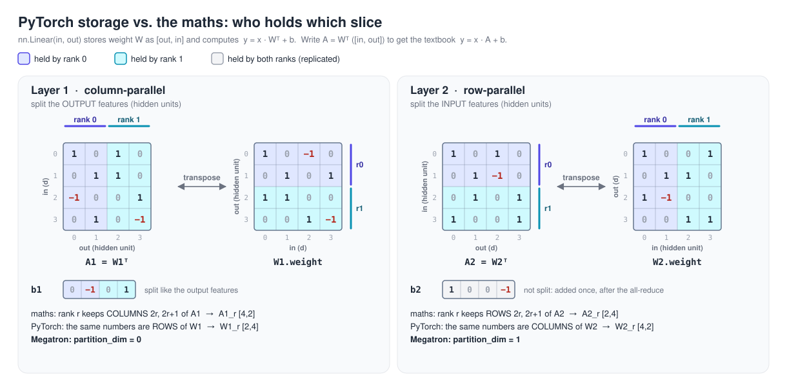
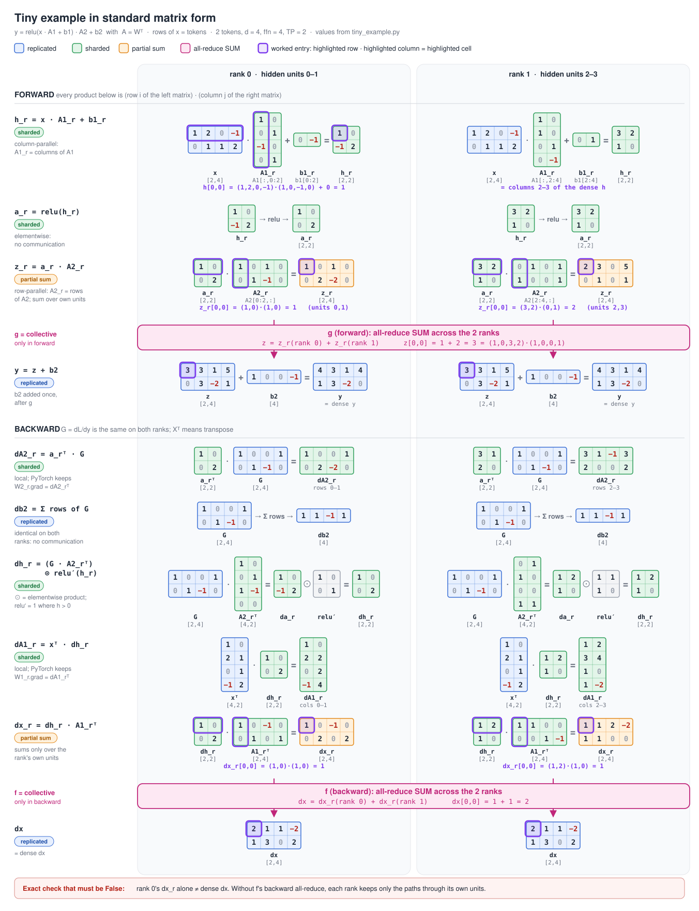
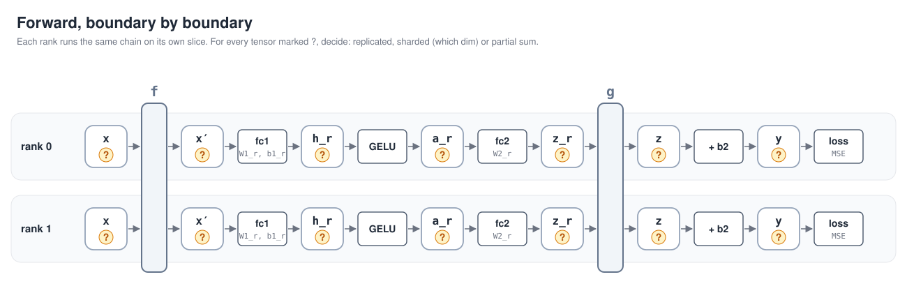
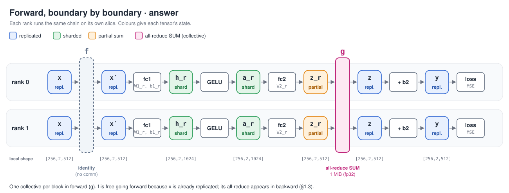

# Day 11: a tensor-parallel MLP with explicit autograd communication (dual-A100 guide)

> **Run status.** The manual reference run `manual_ref_20261113T062618Z` passed all three parity cases and all eight negative-control cases. The downloaded archive and its 37 manifest entries were verified. `my_tp.py` is written (all six functions, reviewed 2026-11-14) but not yet executed. The personal `--impl mine` GPU run is pending. [Manual results](#appendix-b-manual-reference-run) · [Pre-test results](#appendix-a-pre-test-results-pretest1-assistant-run-2026-11-13-pre-test) · [Experiment notes](notes.md)

## Required to close Day 11 (about 4 h including the run)

| # | You can explain | Evidence from your run | Where in this guide |
| --- | --- | --- | --- |
| 1 | **What each rank owns**: which slice of each `[out, in]` weight, and the shape of every activation and gradient on both ranks | `tiny_example` log; the `LOCAL SHAPES PER RANK` table in the parity log | §1.1 |
| 2 | **Where the two all-reduces are and why**: why the activation stays sharded between the layers, why `g` communicates only in forward and `f` only in backward | unit-test log (collectives per phase); `collectives forward/backward` lines | §1.2, §1.3 |
| 3 | **How to avoid scaling gradients by the TP size**, and which check catches each mistake | the four negative controls and their `ratio` column | §1.4, Block 2 Stage 4 |
| 4 | **Where the same pieces live in Megatron Core**, including what Megatron does differently (in-place reduce, the dx all-reduce fused into the linear backward and launched async) | Block 3 stops; optional `--megatron` stage | Block 3 |

**Completion record**

- [x] Record reasoning and observations for P1–P10 in notes §1 after the walkthrough.
- [x] Record the two-rank ownership drawing for the tiny example in notes §3.
- [ ] Write `my_tp.py` (Steps 1–3) and pass `--impl mine` unit and parity tests.
- [x] Run the reference with controls, download and verify the archive, and record the measured results in notes §2 and §4–§6.
- [x] Review Block 3 Stops 1–5 and record the mapping in notes §7.

**Optional (not needed to close the day):** the `--megatron` stage (Block 4), Block 3 Stops 6–7, the sequence-parallel drawing (§1.6), and the overlap question in Stop 3.

**Scope on purpose.** One MLP block (plus a two-block stack to show how errors propagate), TP = 2, one forward and one backward, no optimizer step, no timing. No attention, no sequence parallelism, no communication overlap of your own, no data parallelism. The point is the communication *pattern* and its correctness; performance comes on Day 13 inside Megatron.

---

## What is new today (and what you already have)

You have used every collective this needs: Day 02 built all-reduce from `send`/`recv`, Days 03–04 reduced gradients in hooks, Days 06–08 sharded optimizer state, gradients and parameters. All of those were **data parallel**: every rank runs the *whole* model on *different* data, and communication keeps the copies in sync.

New today:

- **Splitting one layer's math across ranks.** Each rank runs *part* of every matmul on the *same* data. Communication is now part of the forward pass itself: without it, the output is wrong, not just stale.
- **Three states a tensor can be in**: replicated (every rank has the full, identical tensor), sharded (each rank has a different slice), and **partial sum** (each rank has a full-shaped tensor, and the true value is the sum over ranks). A partial sum has the right shape and the wrong value, which makes it easy to miss.
- **Custom `torch.autograd.Function`s as communication operators.** You write `forward` and `backward` separately, so a collective can sit in one direction only. Day 03's hooks attached communication to gradients; today the communication *is* the gradient rule.
- **Gradient scaling in TP is not DDP's.** In DDP the ranks see different data, so gradients are *averaged*. In TP every rank computes the same loss, and the per-rank gradient pieces are different *terms of one sum*.

---

## Read this first: the host

The manual run and pre-test used Vast.ai container 60454650 with two A100-SXM4-80GB cards, an NV12 link, driver 580.178.04, torch 2.14.1+cu130 and NCCL 2.30.7. Day 11 also fits the 40 GB A100 template. Record the topology and versions for each rental. The optional Megatron stage uses a source checkout on `PYTHONPATH`.

The project directory is empty on a fresh rental. From your Windows project root:

```bash
ssh -p <port> root@<host> 'mkdir -p /workspace/AI-Infra-Learning/experiments'
scp -P <port> README.md requirements.txt root@<host>:/workspace/AI-Infra-Learning/
scp -P <port> -r day11 root@<host>:/workspace/AI-Infra-Learning/
scp -P <port> -r experiments/day11_tensor_parallel root@<host>:/workspace/AI-Infra-Learning/experiments/
```

Then, on the instance:

```bash
cd /workspace/AI-Infra-Learning
ln -sfn /venv/main .venv        # fresh rental only
source .venv/bin/activate
export CUDA_VISIBLE_DEVICES=0,1 OMP_NUM_THREADS=1
nvidia-smi topo -m              # expect NV12 between GPU0 and GPU1
python -c "import torch; print(torch.__version__, torch.cuda.device_count(), torch.cuda.can_device_access_peer(0, 1))"
```

Expected: `2.14.1+cu130 2 True`.

Optional, only for the Megatron stage (about 30 s):

```bash
git clone --depth 1 --branch core_v0.19.2 https://github.com/NVIDIA/Megatron-LM.git /workspace/Megatron-LM
```

---

## Files

All in `experiments/day11_tensor_parallel/`:

| File | What it is | Read it when |
| --- | --- | --- |
| `tiny_example.py` | Two "ranks" in one CPU process with integer matrices; prints what each rank owns, forward and backward | §1.1, before anything else |
| `tp_common.py` | Shapes, `make_problem` (one seed, CPU, float64 → cast), the dense MLP, the loss, `compare`, the collective counter | Stage 0 |
| `my_tp.py` | **Yours.** Shard functions, `CopyToTP` (f), `ReduceFromTP` (g), the two layers' `forward`, all **YOU WRITE** | Stages 1–3 |
| `tp_ref.py` | **Reference** for everything in `my_tp.py`, plus the shared `TPMLP` wrapper and `build_tp_model` | After yours passes, or when stuck |
| `baseline_1gpu.py` | The single-GPU MLP made of `nn.Linear`; saves inputs, parameters, y, dx and all gradients | Stage 3 |
| `check_tp_parity.py` | `--test unit` (shards, f, g) and `--test parity` (gather, compare, count collectives; `--controls`) | Stage 2 onward (read its docstring) |
| `tp_controls.py` | Four broken variants of the reference and the checks each must fail | Stage 4 |
| `megatron_impl.py` | Optional: the same MLP from Megatron Core's `ColumnParallelLinear` / `RowParallelLinear` | Block 3, Block 4 optional |
| `find_symbols.py` | `file:line` of the Block 3 reading list in your Megatron checkout (works on Windows too) | Block 3 |
| `run_server_once.sh`, `download_results.ps1` | Everything once, logged and archived; download and verify on Windows | Block 4 |

---

## Block 1: Design (45 min). Predict first, then open the answer

Write each prediction before you open the `<details>` block. The measured observations from the manual run are recorded in [notes §1](notes.md#1-predictions-and-checks).

Shapes used in the real check (Day 01's medium MLP): activations `[seq 256, batch 2, d 512]` (Megatron's `[s, b, h]` order), `ffn = 2048`, TP size P = 2, so each rank holds `ffn / P = 1024` hidden units. FP32 with TF32 off.

### 1.1 The tiny example: who owns what

One block, `y = W2 · relu(W1 · x + b1) + b2`, with 2 tokens, d = 4, ffn = 4 (2 hidden units per rank). ReLU only keeps the numbers integers; GELU behaves the same way. Run it (CPU, any machine with torch):

```bash
python experiments/day11_tensor_parallel/tiny_example.py
```

**PyTorch's layout first.** `nn.Linear(in, out).weight` is `[out_features, in_features]` and computes `y = x Wᵀ + b`. The names come from the textbook form `Y = X A` with `A = Wᵀ`, shape `[in, out]`:

| Name | Splits A's… | = splits PyTorch W's… | Each rank gets | Its output is |
| --- | --- | --- | --- | --- |
| column-parallel | columns (output features) | **rows, dim 0** | `W[r·out/P : (r+1)·out/P, :]` and the same slice of `b` | **sharded** along the last dim |
| row-parallel | rows (input features) | **columns, dim 1** | `W[:, r·in/P : (r+1)·in/P]`; `b` **not** split | **partial sum**, full shape |

So "column-parallel" cuts the PyTorch weight into *rows*. Megatron's code says the same thing as `partition_dim=0` for `ColumnParallelLinear` and `partition_dim=1` for `RowParallelLinear` (Block 3 Stop 2).

**P1.** In the tiny example, `W1` is `[4, 4]` and `W2` is `[4, 4]`. Which rows or columns of each does rank 1 hold, and what is the shape of `W1_r`, `W2_r`, `b1_r` on rank 1? In the real check (d = 512, ffn = 2048), what are the shapes of `W1_r`, `W2_r` and their gradients?

<details><summary>Answer P1</summary>

Rank 1 holds hidden units 2–3: rows 2–3 of `W1` (`W1_r` is `[2, 4]`), entries 2–3 of `b1` (`[2]`), and columns 2–3 of `W2` (`W2_r` is `[4, 2]`). `b2` is the full `[4]` on both ranks. In the real check `W1_r` and `dW1_r` are `[1024, 512]`, `W2_r` and `dW2_r` are `[512, 1024]`, `db1_r` is `[1024]` and `db2` is `[512]` on both ranks. The parity log prints this as `LOCAL SHAPES PER RANK`.
</details>

**Storage first.** The left grid in each card is the matrix as written in maths, `A = Wᵀ` with shape `[in, out]`. The right grid holds the same numbers as PyTorch stores them, `W.weight` with shape `[out, in]`. Colour shows which rank holds each entry. `tiny_example.py` prints the PyTorch layout, the right-hand grids.



**Then the computation, in standard matrix form.** Rows of `x` are tokens. Every product is read the textbook way: `(row i of the left matrix) · (column j of the right matrix)` gives entry `[i, j]`. One entry per product is highlighted in violet and worked out underneath. Colour gives each tensor's state, and the two pink bands are the only collectives. Rank `r` owns hidden units `2r, 2r+1`; the values are from the pre-test log.



PyTorch keeps the weight gradients in its own layout: `W1_r.grad = dA1_rᵀ` and `W2_r.grad = dA2_rᵀ`. These are the `dW1_r` and `dW2_r` that the script and the parity log print.

The script ends with exact integer checks, including one that **must be False**: rank 0's `dx_r` alone is not the dense `dx`.

### 1.2 Forward, boundary by boundary

For each arrow, decide: replicated, sharded (along which dimension), or partial sum.



**P2.** What state is each of `x'`, `h_r`, `a_r`, `z_r`, `z`, `y` in?

**P3.** Where must `b2` be added, and what goes wrong if each rank adds it inside its own matmul (`F.linear(a_r, W2_r, b2)`)? Which checks fail?

**P4.** How many collectives does one block issue in the forward pass, and how many bytes does each move in the real check?

<details><summary>Answers P2–P4</summary>



- `x'` replicated (f's forward is the identity). `h_r` and `a_r` **sharded** along the last (ffn) dimension. `z_r` **partial sum**, full shape `[256, 2, 512]`. `z` and `y` replicated.
- **Why the activation stays sharded.** GELU is elementwise: column j of `a` depends only on column j of `h`. The column-parallel layer produces exactly the ffn columns that the row-parallel layer's weight slice `W2[:, cols]` consumes. Rank r's `a_r` is the right input for rank r's `W2_r`, so nothing is exchanged between the two layers. This is why the pairing is *column then row*. An operation that mixes the ffn dimension (a LayerNorm over ffn, a softmax over ffn) would break it. A gated MLP (SwiGLU) works only if gate and up projections are sharded on the same units.
- **P3.** Add the bias once after `g` using `y = z + b2`. Adding it inside each rank's matmul counts it P times, shifting `y` by `(P−1)·b2`. In the manual one-block `bias_before_reduce` control, `y` failed with `rel = 8.98e-2`. The MSE gradient `dy = 2(y − t)/N` depends on `y`, so every gradient comparison failed. The two ranks still agreed with each other.
- **P4.** One all-reduce (in `g`), `[256, 2, 512]` FP32 = 1 MiB. The counter printed `collectives forward (1): all_reduce[256, 2, 512]`.
</details>

### 1.3 Backward, boundary by boundary

Autograd walks the same arrows in reverse. The loss is computed on every rank from the same `y`, so `dL/dy` starts **replicated**.

**P5.** What does `g`'s backward receive, and what must it return? Does it communicate?

**P6.** Which of `dW2_r`, `db2`, `dW1_r`, `db1_r` need any communication to be correct?

**P7.** What state is the gradient arriving at `f`'s backward in (`dx_r = dh_r · W1_r`), and what must `f` do?

<details><summary>Answers P5–P7</summary>

- **P5.** `dz`, replicated (= `dy`, since `y = z + b2`). The derivative of `Σ_r z_r` with respect to each `z_r` is 1, so each rank gets `dz_r = dz` unchanged. **No communication.** A forward all-reduce has an identity backward.
- **P6.** None. `dW2_r = dyᵀ a_r` uses only local tensors and is exactly the r-th column block of the dense `dW2`. `db2 = Σ dy` is identical on every rank because `dy` is. `dh_r = (dy W2_r) ⊙ gelu'(h_r)` is the r-th column block of the dense `dh`, so `dW1_r` and `db1_r` are the r-th row blocks of the dense ones. **Weight gradients in TP need no reduction across the TP group**: each rank owns a different slice, and the slice's gradient depends only on local data.
- **P7.** **Partial sum.** `x` reaches the loss through every hidden unit, and rank r only knows the paths through its own units. The true `dx = Σ_r dh_r W1_r`, so `f`'s backward is an **all-reduce SUM**. Its forward is the identity because `x` was already replicated. A forward copy has a sum as its backward. That is why one communication happens **only in backward**: replication costs nothing going forward, and its transpose is a sum.

`f` and `g` are conjugates (each one's backward is the other's forward). The manual one-block run recorded `forward (1)` and `backward (1)`, each a SUM all-reduce on `[256, 2, 512]`.
</details>

### 1.4 Not scaling gradients by the TP size

Four ways to get it wrong, each one a negative control in `tp_controls.py`:

| Mistake | Where it comes from | Effect on gradients |
| --- | --- | --- |
| `f` backward does nothing (`no_dx_allreduce`) | "forward was identity, so backward is too" | `dx` is rank r's partial; ranks disagree |
| `g` backward also all-reduces (`g_bwd_allreduce`) | "all-reduce in both directions" | `dz` summed over P identical copies: everything upstream of `g` × P |
| `f` backward averages (`avg_dx`) | the DDP habit (`ReduceOp.AVG`, or `/ world_size`) | `dx` × 1/P |
| `b2` inside the partial sum (`bias_before_reduce`) | treating the row-parallel bias like the column-parallel one | forward `y` off by `(P−1)·b2` |

The rule behind all of them: **every TP rank computes the same full loss on the same data and backpropagates 1.0**. There is no mean over ranks anywhere, and nothing divides by P. The sums in `f` add *different terms* of one derivative (unlike DDP, where ranks hold different samples of one estimate). Two more places in a real trainer where this matters (Block 3 Stop 6): parameters replicated across TP (`b2` here, LayerNorm weights in a transformer) get identical gradients on every rank and must **not** be all-reduced across TP. A global gradient norm must count them **once** while summing the squared norms of sharded parameters across ranks.

**P8.** With one block, which checks fail for `no_dx_allreduce`? Which fail with two stacked blocks, and why does the answer change?

**P9.** Predict the `ratio` (`⟨tp, ref⟩ / ⟨ref, ref⟩`) of each failing check for `g_bwd_allreduce` and `avg_dx`, for one block and for two.

<details><summary>Answers P8–P9</summary>

- **P8.** One block: only `dx` and `replicated` (the two ranks hold different `dx`). `y` and **all four weight gradients still pass**, because they do not depend on `dx`. That makes this bug easy to miss when you only check the weights of a single layer. With two blocks, block 1's partial `dx` is block 0's `dy`, so all four of block 0's gradients fail too. In a real model the first layer to notice is the one *below* the bug. Pre-test: `failed ['dx', 'replicated']` (1 block). With 2 blocks, the failures were `dx`, `replicated` and all four `blk0` gradients, with `dx` at ratio 0.248 (two partials compounded).
- **P9.** `g_bwd_allreduce`: ×2 for `dx`, `W1`, `b1`, `W2` with one block. `b2` passes because it sits outside `g`. With two blocks: ×2 in block 1 (except `b2`). Block 0's `dy` is ×2, so `blk0.b2` is ×2 and the rest of block 0 and `dx` are ×4. `avg_dx`: `dx` ×0.5 with one block. With two blocks, block 0 is ×0.5 and `dx` ×0.25. The pre-test printed exactly 2.0000, 4.0, 0.5 and 0.25. A ratio that is a clean power of P points to a scale bug. Anything else points to a missing or misplaced term.
</details>

### 1.5 Is "parity" bitwise? (P10)

**P10.** Will the TP output and gradients be bitwise equal to the single-GPU run in FP32? In FP64? Which tensor's error do you expect to be largest?

<details><summary>Answer P10</summary>

Not bitwise, in either precision. `y` sums 2048 products per element; TP computes two sums of 1024 and adds them, a different rounding order. Even the "local" weight gradients use matmuls of different shapes (`[1024, 512]` vs `[2048, 512]`), and cuBLAS may pick different kernels for them, so they are not guaranteed bitwise either. Pre-test FP32: every tensor within `rel ≤ 9.4e-7` (tolerance 1e-5), none bitwise, all ratios 1.0000. FP64: `rel ≤ 3.2e-15`, also not bitwise. The roughly 10⁹ shrink from FP32 to FP64 is what says the difference is rounding, not a missing term. The single-GPU baseline itself repeated bitwise, and a replay on rank 0 matched it bitwise. Which matmul kernels cuBLAS chose is **[not isolated]**.
</details>

### 1.6 Optional: what Day 13 adds on top (draw, do not build)

- **Sequence parallelism (SP).** Outside the TP region, `x` is replicated, so LayerNorm and dropout run the same work P times. SP shards those regions along the sequence. `f` becomes an **all-gather** along seq (forward) with reduce-scatter backward, and `g` becomes a **reduce-scatter** (forward) with all-gather backward. Same bytes as one all-reduce, less activation memory. Megatron: `_GatherFromSequenceParallelRegion`, `_ReduceScatterToSequenceParallelRegion` (`mappings.py:300`, `:355`). Draw the 4 boundaries for TP+SP in notes §8 if you have time.
- **Overlap.** Megatron launches the backward `dx` all-reduce asynchronously and computes `dW` while it runs (Block 3 Stop 3).

### 1.7 New rules (on top of Days 01–10)

1. **Label every tensor at every boundary**: replicated, sharded (dim), or partial sum. A partial sum has the right shape and the wrong value.
2. **Every forward collective has a conjugate in backward.** Identity ↔ all-reduce, all-gather ↔ reduce-scatter, split ↔ gather.
3. **TP gradients are never averaged across the TP group.** Same data, same loss, so the per-rank pieces are terms of one sum.
4. **Check the input gradient**, not just the weight gradients. A single-layer test cannot see a missing `dx` reduction through the weights.
5. **Report scale with a ratio.** `⟨tp, ref⟩ / ⟨ref, ref⟩` turns "it fails" into "it is exactly ×2".

---

## Block 2: Code (2 h)

Write `my_tp.py` in three steps and test each one before moving on. Every script exits with code **3** and prints `NOT IMPLEMENTED YET` / `INCOMPLETE (TODOs left)` while TODOs remain.

### Stage 0 (10 min): read the harness

In `tp_common.py`, read `make_problem` (why float64 on the CPU, then cast?), `dense_forward`, `loss_fn` (its docstring is rule 3), `compare` (the four numbers per tensor), and `CollectiveCounter` (why you must call `dist.all_reduce`, not a name imported earlier). In `check_tp_parity.py`, read the docstring and `run_variant`: how sharded gradients are gathered (`cat` along dim 0 for `W1`/`b1`, dim 1 for `W2`), and what `replicated` checks.

### Stage 1 (15 min): **YOU WRITE** `shard_column_parallel`, `shard_row_parallel`

Five TODOs (1a–1e). Then run Stage 2's command: the first two lines of the unit test check these.

### Stage 2 (30 min): **YOU WRITE** `CopyToTP` and `ReduceFromTP`

Four TODOs (2a–2d). Test with the unit tests (no baseline needed):

```bash
torchrun --standalone --nproc_per_node=2 experiments/day11_tensor_parallel/check_tp_parity.py --impl mine --test unit
```

Each rank puts the value `r + 1` in and sends the upstream gradient `10·(r + 1)`, so you can check every number by eye. Expected: `f` gives `x.grad = 30` on both ranks with `collectives fwd [] bwd ['all_reduce']`. `g` gives `y = 3` and `x.grad` = 10 on rank 0 and 20 on rank 1, with `fwd ['all_reduce'] bwd []`. The last line must be `UNIT TESTS: PASSED`. Without GPUs, the same test runs on CPU with `--device cpu` (gloo).

### Stage 3 (30 min): **YOU WRITE** the two `forward`s, then the parity check

TODOs 3a–3d. Then:

```bash
D11=experiments/day11_tensor_parallel
CUDA_VISIBLE_DEVICES=0 python $D11/baseline_1gpu.py --run-id try1                  # BASELINE: SAVED
torchrun --standalone --nproc_per_node=2 $D11/check_tp_parity.py --impl mine --test parity \
    --baseline outputs/day11_tp/tensors/baseline_float32_b1_try1.pt --run-id try1
```

Read the output in this order:

1. `dense replay on rank 0 bitwise equal to the saved baseline: True`. The baseline is reproducible, so any difference below comes from TP.
2. `LOCAL SHAPES PER RANK`. Compare with your P1 answer.
3. The check table. Every row should read `PASS` with `ratio 1.0000` and `rel` around 1e-7 to 1e-6.
4. `collectives forward (1) … backward (1)` and `all-reduce count fwd/bwd expected 1/1: PASS`.
5. `PARITY (mine, float32, 1 block(s)): PASSED`.

Then the two harder cases, which use the same commands with a different baseline:

```bash
CUDA_VISIBLE_DEVICES=0 python $D11/baseline_1gpu.py --run-id try1 --blocks 2
CUDA_VISIBLE_DEVICES=0 python $D11/baseline_1gpu.py --run-id try1 --dtype float64
torchrun --standalone --nproc_per_node=2 $D11/check_tp_parity.py --impl mine --baseline outputs/day11_tp/tensors/baseline_float32_b2_try1.pt --run-id try1
torchrun --standalone --nproc_per_node=2 $D11/check_tp_parity.py --impl mine --baseline outputs/day11_tp/tensors/baseline_float64_b1_try1.pt --run-id try1
```

### Stage 4 (20 min): the negative controls

Before running, write your P8/P9 predictions into the table in notes §5. Then:

```bash
torchrun --standalone --nproc_per_node=2 $D11/check_tp_parity.py --impl ref --controls \
    --baseline outputs/day11_tp/tensors/baseline_float32_b1_try1.pt --run-id try1
```

| Control | One-line change (in `tp_controls.py`) | Must fail (1 block) | Must fail (2 blocks) |
| --- | --- | --- | --- |
| `no_dx_allreduce` | `f` backward returns `grad_output` | `dx`, `replicated` | + all of block 0 |
| `g_bwd_allreduce` | `g` backward all-reduces | `dx`, `W1`, `b1`, `W2` (×2) | + `blk0.b2` (×2), block 0 and `dx` ×4, block 1 ×2 except `b2` |
| `avg_dx` | `f` backward divides by P | `dx` (×0.5) | `dx` (×0.25), block 0 (×0.5) |
| `bias_before_reduce` | `F.linear(a_r, W2_r, b2)` before `g` | everything (`y` first) | everything |

The script compares the failing set with this table and prints `DETECTED as predicted` or `NOT AS PREDICTED`. The **targeted** one is `no_dx_allreduce`. It is the exercise's main control: the forward and all weight gradients pass, and only `dx` and the cross-rank `replicated` check fail. Once you have written your own `CopyToTP`, try the same bug in yours (return `grad_output` unchanged) and confirm the same two checks fail.

### Pitfalls (symptom → cause)

| Symptom | Cause |
| --- | --- |
| Parity hangs, then times out after 180 s | One rank skipped a collective the other entered (a rank-dependent `if` around `dist.all_reduce`), or the ranks disagree on shapes |
| `y` right, `dx` ratio ≈ 1/P and ranks disagree | `f` backward missing its all-reduce |
| `dx`, `W1`, `b1`, `W2` exactly ×P | `g` backward also reduces |
| `dx` exactly ×1/P | AVG instead of SUM |
| `y` off by a constant per output column | `b2` added before the reduction |
| `W2` gradient check fails but the shape is right | `shard_row_parallel` took rows (dim 0) instead of columns |
| `RuntimeError: ... modified by an inplace operation` | All-reduce applied in place to a tensor autograd saved; clone first |
| The counter shows 0 collectives although the result is right | You imported `all_reduce` by name before the counter wrapped `dist.all_reduce` |
| Exit code 3 | A TODO still raises `NotImplementedError` |

---

## Block 3: Read Megatron Core (1 h; Stops 1–5 required, 6–7 optional)

**Pinned version: Megatron-LM `core_v0.19.2`, commit `4b4acac9a1d28ea6829c8d4f566d75698a21249d`** (2026-09-18, the latest release on 2026-11-13). In the pre-test it imported from a source checkout with torch 2.14.1+cu130, with no Transformer Engine or apex (warnings only), and its layers passed the Day 11 parity check. That makes it a tested candidate for the Day 13 pin. A full GPT run at this pin has **not** been tested. For a local copy on Windows, check out only `megatron/core`, because some test paths exceed Windows' path limit:

```bash
git clone --no-checkout --depth 1 --branch core_v0.19.2 https://github.com/NVIDIA/Megatron-LM.git
cd Megatron-LM && git restore --source=HEAD -- megatron/core
python ../experiments/day11_tensor_parallel/find_symbols.py .      # file:line table (no torch needed)
```

Line numbers below are for this pin.

### Stop 1 (10 min): f and g. `megatron/core/tensor_parallel/mappings.py`

- `_reduce` `:22`. Compare with your `_all_reduce_sum`: it bypasses when the group size is 1, and it all-reduces **in place** on `input_.contiguous()` (no clone; saves one activation-sized buffer).
- `_CopyToModelParallelRegion` `:201` = your `CopyToTP`. `_ReduceFromModelParallelRegion` `:221` = your `ReduceFromTP`. Both carry the group in the Function's arguments, as yours do.
- The public wrappers `copy_to_tensor_model_parallel_region` `:492` and `reduce_from_tensor_model_parallel_region` `:498`.
- `_ScatterToModelParallelRegion` `:240` and `_GatherFromModelParallelRegion` `:260` are the other conjugate pair: split / all-gather along the last dim.

*Q: which layer option uses the scatter/gather pair, and why is it not needed in an MLP built as column → row?*

### Stop 2 (10 min): who owns which slice. `megatron/core/tensor_parallel/layers.py`

- `_initialize_affine_weight_cpu` `:184`: builds the full master weight on every rank, `torch.split`s it along `partition_dim` and keeps `weight_list[rank::world_size]`. With `stride=1` that is chunk `rank`, i.e. your shard functions.
- `ColumnParallelLinear` `:869` allocates `[output_size_per_partition, input_size]` with `partition_dim=0` (`:1008`). `RowParallelLinear` `:1249` allocates `[output_size, input_size_per_partition]` with `partition_dim=1` (`:1371`).

*Q: what would `stride > 1` be for? Hint: a fused `[gate; up]` weight in a gated MLP, where each rank needs matching gate and up rows.*

### Stop 3 (15 min): where Megatron's f actually happens. `ColumnParallelLinear.forward` `:1100`, `LinearWithGradAccumulationAndAsyncCommunication` `:525`

- `:1066`: `self.allreduce_dgrad = world_size > 1 and not self.sequence_parallel and not self.disable_grad_reduce`.
- `:1139–1147`: `copy_to_tensor_model_parallel_region` is called **only when `allreduce_dgrad` is False**. With TP = 2, Megatron does **not** use the `f` Function at all.
- Instead, `LinearWithGradAccumulationAndAsyncCommunication.backward` (`:583`) computes `grad_input = grad_output.matmul(weight)` and immediately launches `torch.distributed.all_reduce(grad_input, ..., async_op=True)` (`:637–639`). Then it computes the weight gradient, and only then calls `handle.wait()` (`:749–750`). It is the same SUM all-reduce as your `f`, fused into the linear's backward so that the dW matmul overlaps the communication. The pre-test's Megatron stage shows it: `collectives backward (1): all_reduce[256, 2, 512] async`.
- The comment at `:640` explains `CUDA_DEVICE_MAX_CONNECTIONS=1`: with one hardware queue, the all-reduce is guaranteed to be *scheduled* before the dW kernel.

*Q (optional): with your separate `f`, the dx all-reduce runs after autograd finishes the whole linear's backward. What does the fused version gain, and why is the overlap free in terms of correctness? (dW does not depend on dx.)*

### Stop 4 (10 min): Megatron's g and the bias. `RowParallelLinear.forward` `:1430`

- `input_is_parallel=True`: no scatter (`:1442`). Your `a_r` is already sharded.
- `_forward_impl(..., bias=None, allreduce_dgrad=False)`: the matmul without bias and without a dx reduction. Why is no dx reduction needed here? (P5–P7: the input is sharded, so its gradient is sharded too.)
- `:1480`: `reduce_from_tensor_model_parallel_region` = your `g`. `:1482`: the bias is added after the reduction, once. With `skip_bias_add=True`, the bias is returned separately so a later kernel can fuse bias + dropout + residual.

### Stop 5 (5 min): the MLP that uses them. `megatron/core/transformer/mlp.py`

`MLP` `:155`: `linear_fc1` (`:222`) with `gather_output=False` (`:227`), the activation in `forward` (`:258`, possibly fused with the bias), and `linear_fc2` (`:242`) with `input_is_parallel=True` (`:250`). That is your `TPMLPBlock`: column → elementwise → row, with the activation left sharded.

### Stop 6 (optional, 5 min): counting replicated parameters once. `param_is_not_tensor_parallel_duplicate` (`layers.py:95`), used by `get_grad_norm_fp32` (`optimizer/clip_grads.py:55`, call at `:246`)

A parameter with `tensor_model_parallel=True` (a shard) counts on every rank. A replicated one (`b2`, LayerNorm) counts only on TP rank 0, and the squared norms are then all-reduced over the model-parallel group. *Q: by what factor would the global norm of the replicated parameters be wrong if every TP rank counted them?*

### Stop 7 (optional): sequence parallelism. `mappings.py` `_GatherFromSequenceParallelRegion` `:300`, `_ReduceScatterToSequenceParallelRegion` `:355`; the SP branch at `layers.py:566` (all-gather in forward)

Draw only (§1.6).

**For Day 13.** The groups these layers use come from `parallel_state.initialize_model_parallel` (`parallel_state.py:601`) and `get_tensor_model_parallel_group` (`:1704`). On Day 13 a TP all-reduce inside a pipeline stage will be exactly the `[s, b, h]` forward `g` and the async backward `dx` reduction you counted today. You will find them in the trace by those shapes.

---

## Block 4: Run + summarize (30–45 min)

### Commands

```bash
cd /workspace/AI-Infra-Learning && source .venv/bin/activate
export CUDA_VISIBLE_DEVICES=0,1 OMP_NUM_THREADS=1
D11=experiments/day11_tensor_parallel
RID=manual_$(date -u +%Y%m%dT%H%M%SZ)
bash $D11/run_server_once.sh "${RID}_mine" --impl mine        # ~40 s; your code
bash $D11/run_server_once.sh "${RID}_ref" --impl ref          # ~50 s; reference + 8 control runs
# optional, adds Megatron Core's layers on the fp32 baselines (~25 s):
# bash $D11/run_server_once.sh "${RID}_ref" --impl ref --megatron /workspace/Megatron-LM
```

Stages, in order (each logged to `outputs/day11_tp/session_<RID>/<stage>.log`): `environment` (versions, `nvidia-smi topo -m`, NVLink status, a project snapshot), `tiny_example`, `unit`, then for FP32 × 1 block, FP32 × 2 blocks and FP64 × 1 block: `baseline_*` (one GPU) and `parity_*` (two GPUs, with the controls for `ref` in FP32), then `verify_core`. The archive is `outputs/day11_exports/day11_<RID>.tar.gz` with a `SHA256SUMS` manifest. The baseline tensors (`outputs/day11_tp/tensors/`, about 100 MB) stay on the server. They are reproducible from the seed, and each baseline JSON records the SHA-256 of the input and parameter tensors (`problem_sha256`). **The runner never stops the instance.**

**Expected output checks:** `TINY EXAMPLE: PASSED`, `UNIT TESTS: PASSED`, three `PARITY (...): PASSED`, `CONTROLS: ALL DETECTED AS PREDICTED` twice (ref), and `OUTPUT CHECKS PASSED: ...`. The exit code is 0.

### Download to Windows, then stop the instance

```powershell
experiments/day11_tensor_parallel/download_results.ps1 -Remote root@<host> -Port <port> -RunId <RID>_mine
experiments/day11_tensor_parallel/download_results.ps1 -Remote root@<host> -Port <port> -RunId <RID>_ref
```

Each call checks the archive's SHA-256, extracts it to `outputs/day11_downloads/<RID>/`, and re-hashes every manifest entry. Before stopping the instance, check for `Manifest OK` on each run you downloaded and read its `exit_code` to confirm the experiment verdict.

### What to write in `notes.md`

§2 run record, §4 parity table (your `rel`, `bitwise`, `ratio`), §5 controls against your predictions, §6 collectives, §7 the Megatron mapping in your own words, §8 the three explanations (ownership, the two all-reduces, scaling). Label measured values **[measured]**, arithmetic **[derived]**, and causes the run does not separate **[not isolated]**, as on Day 10.

The reference results for this instance are recorded in [notes §2 and §4–§6](notes.md#2-run-record). Use a new run ID when you test `--impl mine`.

---

## Self-check (answer aloud, < 2 min each)

<details><summary>1. A colleague's TP=4 MLP matches the single-GPU weights' gradients exactly, but training diverges once two layers are stacked. What do you check first?</summary>

The input gradient of each TP block: a missing or averaged `f`-backward reduction leaves every weight gradient of the *last* layer correct and corrupts the layers below it (P8). Compare `dx` with a single-GPU run and look at the ratio.
</details>

<details><summary>2. Why is `f` an identity in forward but an all-reduce in backward?</summary>

Its input is already replicated, so forward needs nothing. Each rank's gradient with respect to that input covers only the paths through its own shard, and the true gradient is the sum of those paths. The backward of a copy is a sum.
</details>

<details><summary>3. Could you put the activation function after the all-reduce instead and save memory?</summary>

No. `gelu(Σ_r z_r) ≠ Σ_r gelu(z_r)`, and in any case the activation belongs between the two linears, where it is applied to `h`. `h` is sharded but complete per element, so the activation is exact there. The all-reduce has to come after the second linear, because only then are the per-rank values partial sums.
</details>

<details><summary>4. Per block and per direction, how many bytes does TP=2 all-reduce here, and how does that scale with ffn?</summary>

`s·b·d·4` = 256·2·512·4 = 1 MiB per block per direction, independent of ffn. The ffn-sized activation is never communicated, and that is the design's main saving. It does scale with tokens, so TP communication grows with batch × sequence. Data-parallel gradient communication scales with parameter count instead.
</details>

<details><summary>5. In DDP you average gradients over ranks. Why is averaging wrong in TP, and where would averaging be right in a DP × TP job?</summary>

TP ranks hold different terms of one gradient for the same data, so the terms must be summed. In a DP × TP job, each parameter's gradient is still averaged across the **data-parallel** group (different data), and only there.
</details>

**Next (Day 12):** GPipe and 1F1B over two pipeline stages.

---

## Appendix A: pre-test results (`pretest1`, assistant run, 2026-11-13) [pre-test]

The assistant ran `run_server_once.sh pretest1 --impl ref --megatron /workspace/Megatron-LM` on 2026-11-13 from 05:39:39 to 05:40:54 UTC (75 s including the Megatron stage). These are **pre-test** numbers for comparison, not your measurements.

**Host.** Vast.ai container 60454650 (hostname `7e92845066ae`), 2 × **A100-SXM4-80GB**, NV12, both GPUs on NUMA node 0, peer access both ways, driver 580.178.04. Python 3.12.15, torch 2.14.1+cu130, NCCL 2.30.7. Exit code 0, `OUTPUT CHECKS PASSED: tiny example, unit tests, parity fp32 x1, fp32 x2, fp64 x1, 8 control runs detected as predicted`. Megatron-LM `core_v0.19.2` (`4b4acac9`) from a source checkout.

Logs: [`outputs/day11_downloads/pretest1/session_pretest1/`](../outputs/day11_downloads/pretest1/session_pretest1/) ([environment](../outputs/day11_downloads/pretest1/session_pretest1/environment.log), [tiny example](../outputs/day11_downloads/pretest1/session_pretest1/tiny_example.log), [unit](../outputs/day11_downloads/pretest1/session_pretest1/unit.log), [parity fp32 ×1](../outputs/day11_downloads/pretest1/session_pretest1/parity_float32_b1.log), [fp32 ×2](../outputs/day11_downloads/pretest1/session_pretest1/parity_float32_b2.log), [fp64 ×1](../outputs/day11_downloads/pretest1/session_pretest1/parity_float64_b1.log), [Megatron ×1](../outputs/day11_downloads/pretest1/session_pretest1/megatron_float32_b1.log), [Megatron ×2](../outputs/day11_downloads/pretest1/session_pretest1/megatron_float32_b2.log)). The archive SHA-256 is `b120e81e10639c3fd5b473f61ccda06b8dfe717e61a0be2875b519e98733596b`, and all 42 manifest files were re-verified on Windows.

A second run, **`pretest1_mineplumbing`**, checked the `--impl mine` path end to end. The reference was copied over a *temporary* `my_tp.py` in a separate directory on the server (`/workspace/mineplumb`), and unit tests plus all three parity cases passed (37 files verified). The repository's `my_tp.py` is still the stub; run unmodified, it exits with code 3 at the unit tests (also checked).

### A.1 Parity, reference implementation (TP = 2 vs one GPU)

| Case | loss | worst `rel` (tensor) | bitwise | ratios | replicated | all-reduces fwd / bwd |
| --- | ---: | --- | --- | --- | --- | --- |
| FP32, 1 block | 1.443540931 | 8.06e-7 (`y`) | none | all 1.0000 | same | 1 / 1 |
| FP32, 2 blocks | 1.19227457 | 9.38e-7 (`dx`) | none | all 1.0000 | same | 2 / 2 |
| FP64, 1 block | 1.443540882 | 3.17e-15 (`dx`) | none | all 1.0000 | same | 1 / 1 |
| Megatron FP32, 1 block | 1.443540931 | 7.01e-7 (`y`) | none | all 1.0000 | same | 1 / 1 (bwd `async`) |
| Megatron FP32, 2 blocks | 1.19227457 | 9.45e-7 (`y`) | none | all 1.0000 | same | 2 / 2 (bwd `async`) |

FP32, 1 block, per tensor: `y` 2.74e-6 abs / 8.06e-7 rel; `dx` 2.62e-11 / 6.61e-7; `W1` 3.49e-10 / 6.87e-7; `b1` 2.33e-10 / 1.35e-7; `W2` 5.82e-10 / 2.98e-7; `b2` 4.66e-10 / 1.35e-7. The baselines repeated bitwise, and the rank-0 replay matched the saved baseline bitwise. Every all-reduce was `[256, 2, 512]` (1 MiB in FP32).

### A.2 Negative controls (FP32)

| Control | 1 block: failed (ratio) | 2 blocks: failed (ratio) |
| --- | --- | --- |
| `no_dx_allreduce` | `dx` (0.4976), `replicated` | `dx` (0.248), `replicated`, `blk0.W1` (0.497), `b1` (0.487), `W2` (0.500), `b2` (0.510) |
| `g_bwd_allreduce` | `dx`, `W1`, `b1`, `W2` (all 2.0000) | block 0 and `dx` 4.0, `blk0.b2` 2.0, `blk1.W1`, `b1`, `W2` 2.0 |
| `avg_dx` | `dx` (0.5000) | `dx` 0.25, all of block 0 0.5 |
| `bias_before_reduce` | everything; `y` rel 9.0e-2 (ratio 1.023) | everything; `y` ratio 1.089 |

All eight detected as predicted. The backward collective counts were 0 (`no_dx_allreduce`) and 2 per block (`g_bwd_allreduce`), and 1 per block otherwise.

### A.3 What the pre-test supports and what it does not

- **Supported [pre-test]:** the column → GELU → row MLP with `f`/`g` matches a dense `nn.Linear` MLP in forward output, input gradient and all weight and bias gradients, to FP32 rounding (≤ 9.5e-7 relative). In FP64 the gap falls to ≤ 3.2e-15. One all-reduce per block per direction. The four mistakes produce the predicted failures and exact scale factors. Megatron Core 0.19.2's layers produce the same pattern, with the backward all-reduce issued async.
- **Not isolated / not tested:** why even the local weight gradients are not bitwise (cuBLAS kernel selection for different shapes is the likely cause); timing or overlap (nothing was timed); BF16/FP16; TP > 2; Megatron beyond these two layers (no `parallel_state` beyond TP = 2, no GPT model, no training step).

## Appendix B: Manual reference run

`manual_ref_20261113T062618Z` ran on 2026-11-13 from 06:27:07 to 06:27:49 UTC (42 s for the runner). It used TP = 2 with `--impl ref` on two A100-SXM4-80GB GPUs with NV12 and bidirectional P2P. The runner exited with code 0, and the archive SHA-256 and all 37 manifest entries verified locally. [Run record and archive details](notes.md#2-run-record)

| Case | TP loss | Largest tensor-relative error | Threshold | All-reduces forward / backward |
| --- | ---: | --- | ---: | --- |
| FP32, 1 block | 1.443540931 | `8.06e-7` (`y`) | `1e-5` | 1 / 1 |
| FP32, 2 blocks | 1.192274570 | `9.38e-7` (`dx`) | `1e-5` | 2 / 2 |
| FP64, 1 block | 1.443540882 | `3.17e-15` (`dx`) | `1e-12` | 1 / 1 |

The replicated `y`, `dx` and `db2` were bitwise equal across TP ranks in all three cases. Both FP32 cases detected all four controls as predicted. In the two-block case, `avg_dx` gave a ratio of `0.5` for all block 0 parameter gradients and `0.25` for the model input gradient. [Run logs](../outputs/day11_downloads/manual_ref_20261113T062618Z/session_manual_ref_20261113T062618Z/) · [Negative-control details](notes.md#5-negative-controls)
